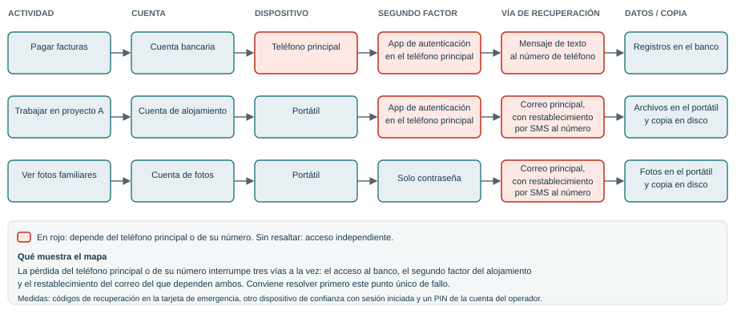

# Guía práctica de seguridad y recuperación

Revisión 0.27

## 1. Descripción y objetivos

> **Empieza por lo que más te importa. Imagina que lo pierdes y decide cómo protegerlo y recuperarlo. Cada medida exige algo de esfuerzo, así que elige un nivel que se ajuste a tus necesidades y que puedas mantener.**

**A quién va dirigida**
- Personas habituadas a usar varios dispositivos y cuentas en línea y a gestionar varios proyectos, también de trabajo.
- Quienes quieren mejorar la protección y disponibilidad de sus recursos digitales sin conocimientos especializados en seguridad.

**Por qué importa**
- Cada dispositivo o cuenta puede parecer seguro por separado, pero varios proyectos pueden depender del mismo portátil, número de teléfono o correo electrónico.
- Una pérdida puede desencadenar otras. Por ejemplo, si pierdes el correo que permite restablecer la contraseña del almacenamiento en la nube, quizá tengas que recurrir a una copia de seguridad para recuperar tus archivos.
- Al perder un teléfono, también puedes perder el acceso a la banca y a los códigos de inicio de sesión.
- La avería de un portátil puede parar varios proyectos a la vez.
- Un error, un fallo técnico o un ataque pueden originar un problema.

**Qué puedes hacer con esta guía**
- Identificar estas dependencias.
- Proteger lo que más te importa.
- Tener una forma de recuperar el acceso y los datos cuando algo falle.
- Mantener las medidas de protección en el tiempo.

**Cómo usarla**
- Cada medida añade un paso, incluso introducir un PIN o usar la huella dactilar. Busca un equilibrio que te resulte sostenible.
- Avanza nivel a nivel, a tu ritmo.
- Empieza por los capítulos 2 y 3, «Alcance, límites y advertencias» y «Conceptos básicos». Son breves y explican en qué se basan las acciones propuestas.

## 2. Alcance, límites y advertencias

**Qué abarca la guía**
- Tus dispositivos, cuentas, datos, hábitos y los riesgos de tu entorno, incluidos los relacionados con tu trabajo.
- Si diriges una empresa, la guía abarca los recursos digitales que gestionas a título personal.

**Qué queda fuera**
- El plan de seguridad de una empresa, sus sistemas compartidos, los datos de sus clientes y el acceso de su equipo. Estas cuestiones requieren una evaluación propia, más dedicación y apoyo profesional.
- Las actividades en zonas grises que puedan dar lugar a una investigación o un procedimiento judicial.
- La persecución dirigida, como el seguimiento persistente o los intentos reiterados de acceder específicamente a tus cuentas o dispositivos. Queda fuera del alcance de todos los niveles.

**Qué esperar**
- La guía ayuda a reducir el riesgo. Aun con estas medidas, pueden producirse incidentes e interrupciones.
- Los niveles proponen un orden práctico para aplicar las medidas. Cada entorno conserva sus propios riesgos.

**Cómo avanzar**
- Haz una cosa a la vez. Puedes introducir los cambios poco a poco.
- Sigue el orden propuesto cuando puedas. Las primeras acciones tienen mayor prioridad o preparan las siguientes. Completa los requisitos indicados antes de seguir con una acción que dependa de ellos.
- Si tienes dudas, detente o consulta con un profesional.

## 3. Conceptos básicos

La guía se basa en el Marco de Ciberseguridad del Instituto Nacional de Estándares y Tecnología (NIST) y sus orientaciones sobre planificación de contingencias (publicación especial 800-34), el modelado de amenazas de Open Worldwide Application Security Project (OWASP) y las orientaciones sobre copias de seguridad del National Cyber Security Centre (NCSC). Estos métodos ayudan a definir acciones pertinentes y comprobables. Puedes consultar las fuentes por su nombre.

Al leer cada concepto, piensa en un ejemplo de tu vida: ¿qué portátil, qué cuenta, qué archivos?

- **Inventario:** registro actualizado de dispositivos, cuentas, datos y sus relaciones. Por ejemplo, qué proyecto usa una máquina virtual (VM) y qué cuenta la controla.
- **Activo:** algo de valor, como un portátil, unos archivos o el acceso a la banca.
- **Modelo de amenazas:** descripción de lo que puede fallar y cómo. Por ejemplo, un ataque de phishing, un borrado accidental o la avería de un portátil.
- **Modelo de adversario:** descripción de los recursos, el acceso y las capacidades de un posible atacante. Por ejemplo, un estafador que dispone de una contraseña filtrada. Aquí se abordan ataques habituales.
- **Compromiso de seguridad:** pérdida de control o de confidencialidad. Por ejemplo, que alguien lea tu buzón o use una sesión robada.
- **Riesgo:** combinación de probabilidad y consecuencias, como la posibilidad de que roben los datos de una tarjeta y la pérdida económica que esto puede causar.
- **Dependencia:** algo que necesitas para usar o recuperar otro activo. Por ejemplo, sin acceso al correo puede ser imposible restablecer la contraseña de varios servicios.
- **Medida de protección:** medida que reduce un riesgo. Por ejemplo, el bloqueo de pantalla dificulta el acceso a un teléfono desatendido.
- **Riesgo residual:** lo que queda pendiente tras aplicar una medida. Por ejemplo, una copia de seguridad no revierte una filtración.
- **Recuperación:** devolver las cuentas, los dispositivos y los datos a un estado utilizable. Por ejemplo, iniciar sesión y abrir los archivos actuales en un portátil de sustitución.
- **Copia de seguridad:** copia que conservas para recuperar datos, como la versión de ayer de un documento. Su validez se comprueba al restaurarla y verificar el resultado.
- **Sincronización:** mantener varias copias actualizadas entre sí. Por ejemplo, un borrado puede propagarse de un dispositivo a otro. La sincronización por sí sola no garantiza que puedas recuperar versiones anteriores.

## 4. Niveles prácticos
Nunca compartas con un asistente de inteligencia artificial (IA) contraseñas, códigos de recuperación, claves ni exportaciones de un gestor de contraseñas. Contrasta sus instrucciones con las páginas oficiales del proveedor, ya que los menús y las funciones pueden cambiar.

### Nivel 0 — Empieza aquí: estafas y los primeros diez minutos

Esfuerzo previsto: una sesión breve, sin compras ni conocimientos técnicos.

Muchas pérdidas de cuentas o de dinero empiezan cuando alguien te convence de actuar. Completa este nivel primero. Trata la vía más habitual y los niveles siguientes parten de que sabes reconocerla.

#### 0.1 Detente y verifica antes de actuar

Una regla fija y unos contactos guardados te permiten verificar una solicitud urgente con calma.

- [ ] **0.1.1 — Decide en qué casos vas a detenerte y resume tu regla en una frase.** Por ejemplo: «Ante una petición urgente, me detengo y la compruebo por un canal que yo elija antes de actuar».
- [ ] **0.1.2 — Guarda las vías oficiales de contacto del banco, del emisor de la tarjeta y del operador móvil donde puedas consultarlas sin el teléfono.** Usa el número del reverso de la tarjeta o escribe tú mismo la dirección web oficial del proveedor.
- [ ] **0.1.3 — Aplica la regla de devolver la llamada.** Cuelga y contacta tú con la organización por un canal oficial que ya tengas guardado. Evita el número y el enlace que figuran en el mensaje.
- [ ] **0.1.4 — Acuerda una pregunta de verificación o una palabra clave con familiares o colegas cercanos.** Úsala si te piden dinero o acceso con urgencia.
- [ ] **0.1.5 — Activa las alertas de transacciones bancarias y de tarjeta.** Un SMS o una notificación por cada pago ayuda a detectar enseguida el uso de una tarjeta robada.

- **Por qué importa:** Los estafadores se valen de la urgencia, la autoridad y el secreto. Una regla acordada de antemano te ayuda a actuar aun cuando tengas prisa o miedo.
- **Herramientas y ejemplos:** Una llamada de quien dice ser del banco, de la policía o de soporte técnico. Un supuesto jefe o familiar que pide dinero urgente o tarjetas regalo. Una supuesta «cuenta segura» a la que te piden transferir fondos. Un aviso de entrega o multa con un enlace. Una petición de instalar software de acceso remoto o de leer en voz alta un código de un solo uso. Una organización legítima no te pedirá tu contraseña, un código de un solo uso ni una frase de recuperación.
- **Cómo puede ayudar la IA:** Pega un mensaje sospechoso después de quitar nombres, números y enlaces de personas reales. Pregunta qué partes intentan presionarte o qué solicitudes serían impropias de una organización legítima. Usa la respuesta como segunda opinión y verifica por el canal oficial guardado. Nunca pegues códigos, contraseñas ni números de tarjeta.
- **Resultado esperado:** Tienes una regla, una vía guardada para cada proveedor clave, una forma de verificar peticiones de familiares y alertas que te avisan rápidamente de cargos fraudulentos.
- **Cómo comprobarlo:** Aplica tu regla a un mensaje urgente real o imaginario. Encuentra la vía oficial guardada sin recurrir al mensaje. Tras tu próximo pago habitual, comprueba que recibes la alerta.
- **Riesgo de omitirlo:** Sigue abierta la vía más habitual para perder dinero o una cuenta, pues las medidas técnicas posteriores no te impiden entregar un código por tu cuenta.

#### 0.2 Qué hacer en los primeros diez minutos tras un error

Una lista breve de lo que conviene hacer justo después de abrir un enlace, hacer un pago o compartir un código.

- [ ] **0.2.1 — Esboza una lista para los primeros diez minutos.** Usa las situaciones de «Herramientas y ejemplos».
- [ ] **0.2.2 — Conserva la lista donde puedas consultarla sin el teléfono.** Guárdala en papel o en otro dispositivo para tenerla si el teléfono se pierde o se ve comprometido.
- [ ] **0.2.3 — Recorre la lista una vez con un ejemplo ficticio.** Evita hacer cambios en una cuenta real.

- **Por qué importa:** Tras pulsar un enlace, pagar o compartir un código, es fácil quedarse paralizado o seguir discutiendo con quien llamó. Los minutos cuentan especialmente si hay dinero en juego o si una cuenta permite recuperar el acceso a otras.
- **Herramientas y ejemplos:** Ajusta esta lista inicial a tu situación.
  - Termina la llamada o el chat. No intentes resolverlo con quien te contactó.
  - Si has enviado dinero o dado los datos de una tarjeta, llama al banco o al emisor desde el número que guardaste. Pide que detengan el pago o bloqueen la tarjeta.
  - Si has introducido una contraseña en una página sospechosa, cámbiala desde otro dispositivo de confianza con tu gestor de contraseñas y cierra las demás sesiones. Cambia la contraseña también en cada cuenta en que la hayas reutilizado.
  - Si has compartido un código o aprobado una solicitud, da por comprometida la cuenta y usa la vía oficial de recuperación.
  - Si has instalado software de acceso remoto, desconecta ese dispositivo de Internet y cambia las contraseñas importantes desde otro dispositivo.
  - Si tu número telefónico es el objetivo, contacta con el operador mediante la vía que guardaste.
  - Guarda capturas de pantalla y anota las horas. Informa al proveedor, al banco y, si corresponde, a las autoridades.
- **Cómo puede ayudar la IA:** Pídele a un asistente que convierta tus notas en una lista de una página o que proponga casos para ensayarla. Omite los identificadores y secretos de las cuentas reales.
- **Resultado esperado:** Tienes una lista que puedes seguir bajo presión y que encaja con el plan más detallado para pérdida de dispositivos del nivel 5.
- **Cómo comprobarlo:** Puedes consultar la lista en papel o desde otro dispositivo. Al repasarla, encuentras un primer paso concreto para cada situación.
- **Riesgo de omitirlo:** La demora y la improvisación pueden agravar un error que todavía tenía solución.

### Nivel 1 — Un punto de partida más seguro

Esfuerzo previsto: varias sesiones cortas; almacenamiento existente o una unidad/servicio de copia de seguridad; habilidades de configuración cotidiana.

#### 1.1 Haz un inventario breve y tenlo a mano

Haz una lista breve de lo imprescindible y lo que más usas para decidir qué proteger primero. Podrás completarla en la sección 2.1.

- [ ] **1.1.1 — Anota los dispositivos y proveedores imprescindibles y los de uso más frecuente.** El teléfono y la computadora que utiliza diariamente, su Internet y proveedores de teléfono, cualquier alojamiento.
- [ ] **1.1.2 — Anota los servicios imprescindibles y los de uso más frecuente, junto con la cuenta que usas para acceder.** Incluye la banca, el correo, los archivos en la nube y cualquier servicio que te costaría perder. Añade la dirección web o el enlace de administración.
- [ ] **1.1.3 — Anota los datos que no podrías recrear y dónde están.** Fotos, documentos, archivos de proyecto: qué dispositivo o servicio los contiene.
- [ ] **1.1.4 — Marca los elementos de mayor importancia.** Pregúntate qué podría leer, cambiar, borrar o gastar alguien que tomase el control de cada uno.
- [ ] **1.1.5 — Para cada elemento prioritario, anota qué dejaría de funcionar si lo perdieras.** Una frase corta es suficiente.
- [ ] **1.1.6 — Conserva una copia del inventario que puedas abrir sin tu dispositivo principal.** Una impresión o una copia en un segundo dispositivo; actualicelo después de cambios importantes.

- **Por qué importa:** No se puede proteger o recuperar lo que se ha olvidado. Las entradas marcadas también establecen el orden de todo lo demás en este nivel: que cuenta para proteger primero y qué datos para hacer una copia de seguridad primero.
- **Herramientas y ejemplos:** Una nota privada, hoja de cálculo o tabla; aproximadamente una página es el tamaño correcto. Si la lista crece más allá de eso, detenga y deje el resto para la sección 2.1. Un acceso bancario robado puede exponer dinero; el correo electrónico hackeado puede restablecer otras cuentas; las descargas reemplazables generalmente importan menos que las fotos familiares. Un entorno de servidor cambiante puede ser una línea: proveedor, cuenta, enlace de consola. Nunca ponga contraseñas, claves o códigos de recuperación en la lista.
- **Cómo puede ayudar la IA:** Pídale a un asistente una plantilla de tabla, o para categorías que la gente suele olvidar, luego llénela usted mismo. No puede saber lo que realmente usa. Comparta los nombres de servicio sólo si está cómodo con eso; nunca secretos.
- **Resultado esperado:** Una breve lista de lo que depende y cómo encontrarlo, con las entradas más importantes marcadas y una copia al alcance de la mano.
- **Cómo comprobarlo:** Elija una actividad ordinaria, como pagar una factura o abrir archivos de proyecto, y encuentre su dispositivo, servicio y ubicación de datos en la lista. Siga un enlace para confirmar que llega a la página correcta. Abra la copia sin su dispositivo principal.
- **Riesgo de omitirlo:** Puedes olvidar una cuenta bancaria, un proveedor o una ubicación de datos cuando necesites protegerlos o recuperarlos. También puedes dedicar tiempo a una tarea fácil mientras queda expuesto algo más importante.

#### 1.2 Protege tus dispositivos principales

Los dispositivos principales son los que usas a diario y en los que mantienes iniciada la sesión de tus cuentas, normalmente el teléfono y el ordenador principal. Ocúpate de uno cada vez.

- [ ] **1.2.1 — Configura un código de desbloqueo en cada dispositivo principal.** La biometría puede complementar el código, no reemplazarlo.
- [ ] **1.2.2 — Activa el bloqueo automático de pantalla.** Requerir el código después de un corto período de inactividad.
- [ ] **1.2.3 — Instala las actualizaciones pendientes.** Guarde su trabajo primero; utilice sólo la función de actualización del sistema.
- [ ] **1.2.4 — Reinicia el dispositivo cuando lo pidan las actualizaciones.** Cerrar una tapa de laptop no es un reinicio.
- [ ] **1.2.5 — Activa las actualizaciones automáticas cuando corresponda.** Deje que el sistema instale correcciones de rutina por sí solo, para que no tenga que recordar.
- [ ] **1.2.6 — Si alguien más usa su computadora, déle su propia cuenta de usuario.** No lo hagas si nadie lo hace.

- **Por qué importa:** Estos dispositivos mantienen sesiones abiertas a su correo electrónico, archivos y dinero. Un bloqueo mantiene a un buscador o transeúnte fuera; actualizaciones cierran las debilidades conocidas del software.
- **Herramientas y ejemplos:** Busque en la configuración del dispositivo “bloqueo de pantalla”, “opciones de inicio de sesión” y “actualización de software”. Nada que comprar. Los servidores remotos no tienen pantalla para bloquear y necesitan un enfoque diferente; ver sección 3.3.
- **Cómo puede ayudar la IA:** Pregunte dónde vive una configuración en su modelo exacto y la versión del sistema. Los nombres de menú que da pueden estar desactualizados, por lo que compare con la página de soporte del fabricante.
- **Resultado esperado:** Cada dispositivo principal se bloquea cuando no se presta atención y recibe actualizaciones con poco esfuerzo manual. Cualquier actualización atascada o reinicio pospuesto se escribe, no se descarta repetidamente.
- **Cómo comprobarlo:** Bloquear y desbloquear el dispositivo. Dejarlo inactivo y verlo bloquear. Después de reiniciar, abrir la pantalla de actualización y confirmar que nada está pendiente. Una semana o dos más tarde, confirmar una actualización automática realmente instalada.
- **Riesgo de omitirlo:** Cualquier persona que recoja un dispositivo sin vigilancia puede usar sus cuentas de inicio de sesión, y las debilidades conocidas permanecen abiertas a ataques comunes.

#### 1.3 Configura y usa un gestor de contraseñas básico

Un gestor de contraseñas da a cada cuenta su propia contraseña fuerte y la recuerda por usted. Aquí usted elige uno, protegerlo, y asegúrese de que siempre puede volver a entrar.

- [ ] **1.3.1 — Elige tu primer gestor con ayuda de la tabla.** Si no está seguro, tome el valor predeterminado para sus dispositivos; puede cambiar más tarde.
- [ ] **1.3.2 — Configúralo con una contraseña maestra o credenciales que no uses en ningún otro sitio.** Hazlo fuerte.
- [ ] **1.3.3 — Lee las instrucciones de recuperación antes de guardar contraseñas.** Aprenda ahora lo que el administrador puede y no puede restaurar si olvida la contraseña maestra.
- [ ] **1.3.4 — Activa la autenticación multifactor (MFA) para el gestor o su cuenta si está disponible.** Manténgase registrado en su dispositivo actual hasta que el nuevo inicio de sesión funcione.
- [ ] **1.3.5 — Durante la configuración, guarda los datos de recuperación fuera de la bóveda y del teléfono principal.** Una tarjeta de emergencia impresa en un sobre sellado, mantenido en algún lugar seguro en casa, funciona bien.
- [ ] **1.3.6 — Abre la bóveda desde otro dispositivo de confianza.** Haga esto antes de mover contraseñas críticas.
- [ ] **1.3.7 — Comprueba que puedes consultar los datos de recuperación sin tu dispositivo principal.** Abra la tarjeta de recuperación o las notas usando sólo un segundo dispositivo o papel.
- [ ] **1.3.8 — Guarda dos o tres credenciales de uso diario y úsalas para iniciar sesión desde el gestor.** Pruébalo con unas pocas cuentas reales para habituarte antes de trasladar las demás.

- **Por qué importa:** Las contraseñas únicas para cada cuenta sólo son prácticas cuando algo las recuerda para usted. El administrador se convierte en algo que no debe perder el acceso, por lo que su recuperación se prepara y se prueba antes de confiar en ella.
- **Herramientas y ejemplos:** Si tienes dudas, empieza por la opción más sencilla para los dispositivos que más usas.

  | Tus dispositivos | Opción inicial | Qué debes tener en cuenta |
  |---|---|---|
  | Principalmente dispositivos Apple | La función de contraseñas de Apple, protegida por tu cuenta de Apple | Todo dependerá de esa cuenta. Protégela siguiendo la sección 1.4 antes de trasladar contraseñas críticas. La opción es menos práctica en dispositivos de otras marcas |
  | Principalmente Android y Chrome | El Gestor de contraseñas de Google, protegido por tu cuenta de Google | Dependes de una sola cuenta. Comprueba que las contraseñas se sincronicen con los ordenadores que usas |
  | Principalmente Windows con un solo navegador | El gestor integrado en el navegador, con sesión iniciada en la cuenta del propio navegador | Averigua si las entradas son locales o se sincronizan. Protege esa cuenta y prepara su recuperación por separado |
  | Dispositivos variados o credenciales compartidas | Un gestor específico que sincronice en la nube y sea compatible con todos tus dispositivos | Protege su cuenta, entiende cómo recuperarla y, si es posible, prepara una exportación que puedas restaurar |
  | Quieres controlar el archivo de la bóveda y encargarte de su mantenimiento | Un archivo local cifrado, con sincronización opcional mediante almacenamiento en la nube | Protege la credencial de desbloqueo, guarda copias con versiones y resuelve los conflictos de sincronización. Es una opción avanzada y requiere copias aparte de la sincronización |

- **Cómo puede ayudar la IA:** Pídale a un asistente que explique las opciones o un término de recuperación desconocido en palabras simples, y que compare dos opciones con sus dispositivos.Decida desde la propia documentación del administrador. Nunca escriba una contraseña maestra, código de recuperación o exportación de almacén en un chat de IA.
- **Resultado esperado:** Las contraseñas tienen un hogar protegido que realmente usas, con una forma en que sobrevive la pérdida de tu dispositivo principal. El inventario sólo contiene el nombre del administrador y donde se mantiene su registro de recuperación.
- **Cómo comprobarlo:** Cree una entrada de prueba inofensiva, bloquee y desbloquee la bóveda, y encuentre la entrada en otro dispositivo de confianza sin el teléfono principal. Localice el registro de recuperación de forma independiente. No utilice códigos de una sola vez ni active un restablecimiento de cuenta como prueba.
- **Riesgo de omitirlo:** Las contraseñas reutilizadas y las notas dispersas son difíciles de manejar, por lo que una fuga puede abrir varias cuentas. Un administrador sin recuperación probada puede convertirse en un único punto de bloqueo.

#### 1.4 Protege tus cuentas principales

Las cuentas principales permiten restablecer o desbloquear otras. Entre ellas están el correo principal, la cuenta de tu operador móvil, el gestor de contraseñas y la cuenta de tu teléfono u ordenador, como Apple, Google o Microsoft. Protege una cuenta cada vez.

- [ ] **1.4.1 — Asigna una contraseña distinta a cada cuenta principal.** Genere y guárdelo con el gestor.
- [ ] **1.4.2 — Activa la MFA en cada cuenta principal que la admita.** Utilice una aplicación o clave de autenticación donde el proveedor ofrece una; para un mensajero, utilice la propia contraseña de verificación de dos pasos de la aplicación.
- [ ] **1.4.3 — Si el proveedor ofrece códigos de recuperación, guárdalos fuera del teléfono y de la propia cuenta al configurarla.** Imprime o manténgalos en un segundo dispositivo; no los dejes sólo en la cuenta.
- [ ] **1.4.4 — Comprueba que siguen funcionando las direcciones y números de teléfono de recuperación.** Quitar los que ya no controlas.
- [ ] **1.4.5 — Dibuja las cuatro cadenas de recuperación de la tabla y señala las dependencias circulares.** Una fila por cadena; marque cualquier fila donde la recuperación depende de algo que también desbloquea.
- [ ] **1.4.6 — Identifica para cada cadena una vía de recuperación que puedas usar sin tu teléfono principal.** La sección 4.1 lo prueba en vivo.

- **Por qué importa:** Quien controle estas cuentas puede restablecer contraseñas en otro lugar y leer las confirmaciones. Son el primer objetivo y lo primero que necesitas de vuelta. Una cadena es “libre de lazo” cuando puedes recuperar cada una sin necesitar algo que está bloqueado.
- **Herramientas y ejemplos:** Usa la página oficial de seguridad del proveedor, el generador del gestor y una aplicación de autenticación, una clave de acceso o una llave de seguridad, según lo admita el servicio. Las aplicaciones de mensajería que te identifican por el número de teléfono suelen ofrecer su propio ajuste de protección adicional. Por ejemplo, la verificación en dos pasos de WhatsApp pide un PIN o contraseña al volver a registrar el número. El PIN de Signal impide volver a registrarlo cuando también está activo el bloqueo de registro. Telegram ofrece una contraseña de verificación en dos pasos y admite claves de acceso. Consulta las opciones vigentes en la ayuda oficial de la aplicación, actívalas con la sesión actual abierta y guarda el código en tu gestor. Completa una fila por cadena de recuperación.

  | Cadena | Vía de recuperación habitual | Dependencia circular típica | Vía independiente que conviene preparar |
  |---|---|---|---|
  | Correo principal | Correo o teléfono de recuperación y códigos de recuperación | El correo A solo se recupera con el correo B y el B solo con el A | Códigos guardados en la tarjeta de emergencia y un segundo correo bajo tu control que sea independiente del primero |
  | Número de teléfono | Cuenta del operador, SIM o eSIM y PIN de la cuenta del operador | Las credenciales del operador solo se restablecen con un SMS a ese mismo número | PIN de la cuenta del operador y otra vía de identificación (véase el nivel 4) |
  | Gestor de contraseñas | Clave o tarjeta de recuperación y un segundo dispositivo con sesión iniciada | Los códigos de autenticación están solo en la bóveda o en el teléfono perdido | Tarjeta de emergencia guardada aparte del teléfono y un segundo dispositivo de confianza |
  | Cuenta del teléfono u ordenador (Apple, Google o Microsoft) | Dispositivo de confianza, clave o contacto de recuperación, número de teléfono | El único dispositivo de confianza es el teléfono perdido | Clave de recuperación guardada y un segundo dispositivo de confianza |

  Ejemplo: Alex recupera su correo mediante un SMS a su número. Para recuperar la cuenta del operador necesita acceder a ese mismo correo. Los códigos de autenticación del gestor están en el teléfono. Si pierde el teléfono, queda bloqueado en cada cadena. Alex guarda un código de recuperación del correo en la tarjeta de emergencia, configura un PIN para la cuenta del operador y deja el gestor abierto en otro dispositivo de confianza. Ahora tiene una vía independiente del teléfono para cada cadena.
- **Cómo puede ayudar la IA:** Pegue sólo los encabezados de la tabla y sus propias notas de palabras simples (por ejemplo, “mi correo electrónico se recupera por texto a mi teléfono”) y pregunte dónde se puede ocultar un bucle. Pregunte qué significa la opción de recuperación de un proveedor. Abra la página de seguridad del proveedor escribiendo la dirección oficial usted mismo, no a través de un enlace de un asistente o un mensaje. Nunca comparta códigos.
- **Resultado esperado:** Cada cuenta principal tiene una contraseña guardada única, un factor de inicio de sesión adicional y una ruta de recuperación que puede utilizar. Una tabla completa no muestra ningún bucle sin marcar. Las contraseñas y los códigos de recuperación permanecen en sus lugares protegidos; el inventario solo contiene referencias a dónde.
- **Cómo comprobarlo:** Sin cerrar tu sesión actual, inicia otra en una ventana privada del navegador con la contraseña y el factor que guardaste. Para una aplicación de mensajería registrada en el teléfono, usa su comprobación de seguridad, como el recordatorio de PIN o contraseña. Evita volver a registrar el número como prueba. Si el proveedor ofrece un mensaje de prueba de recuperación, envíalo y comprueba que llega a un destino que controlas y puedes abrir sin el teléfono principal. Para cada fila de la tabla, identifica una vía independiente del teléfono principal o marca la carencia.
- **Riesgo de omitirlo:** Una contraseña reutilizada puede entregar la cuenta que restablece todos los demás. Una ruta de recuperación anticuada o circular puede mantenerte fuera de tu propia cuenta.

#### 1.5 Crea y prueba una primera copia de seguridad

Una primera copia de seguridad debe ser simple. Elija una cosa para proteger y demostrar que usted puede recuperarlo.

- [ ] **1.5.1 — Copia los archivos más importantes a una unidad externa o a un servicio de copias de seguridad.** Comience con los datos marcados más importantes en la sección 1.1.
- [ ] **1.5.2 — Desconecta la unidad o mantén la copia fuera del alcance de la cuenta de uso diario.** Desconecta la unidad cuando termine la copia, o usa una cuenta de copias de seguridad que la cuenta de uso diario no pueda eliminar.
- [ ] **1.5.3 — Restaura un archivo en una carpeta nueva sin usar el original.** Utilice la función de restauración o copia de la copia de seguridad, nunca la ubicación del archivo original.
- [ ] **1.5.4 — Comprueba el contenido del archivo restaurado.** Abra el archivo restaurado y confirme que lee y se ve como se esperaba.
- [ ] **1.5.5 — Comprueba su fecha o versión.** Asegúrese de que es la versión que pretendía restaurar, no una copia antigua o parcial.
- [ ] **1.5.6 — Anota el resultado de la restauración de prueba en la ficha de cobertura de las copias de seguridad.** Una línea: fecha, lo que restauró, resultado, próxima acción; sin secretos.
- [ ] **1.5.7 — Programa un evento recurrente en el calendario para actualizar las copias.** Mensual es un punto de partida razonable.

- **Por qué importa:** Un dispositivo puede fallar, perderse o tener archivos borrados o dañados, y la sincronización puede propagar ese daño a cada copia. Una copia de seguridad separada es el camino de regreso, y sólo una restauración muestra que funciona.
- **Herramientas y ejemplos:** El inicio más simple es una unidad externa y una copia simple; un servicio de copia de seguridad que mantiene las versiones es una buena alternativa. Descargue archivos solo en la nube antes de copiar para no hacer copias de seguridad de los marcadores de posición vacíos. Restaurar en una nueva carpeta, nunca sobre un archivo de trabajo. Mantener la copia separada: una unidad que se mantiene conectada o una carpeta sincronizada, se puede borrar o cifrar junto con el original por un error, ransomware o alguien que se haga cargo de su cuenta. Los niveles posteriores se basan en esta regla en lugar de repetirla: la sección 6.4 la verifica con una toma de cuenta, y la sección 9.2 añade una copia fuera del sitio. Refrescar mensualmente y después de cambios importantes; antes si un mes de trabajo perdido es inaceptable. Si el almacén de inventario o contraseñas vive en la nube, también mantenga una exportación del inventario que puede abrir de forma independiente; para la bóveda, vea la exportación cifrada de su administrador y lo que se necesita para abrirlo.
- **Cómo puede ayudar la IA:** Pídale a un asistente instrucciones paso a paso para su unidad o herramienta de copia de seguridad, o una plantilla de nota simple. Un asistente no puede confirmar que su copia de seguridad funciona; sólo su prueba de restauración puede.
- **Resultado esperado:** Una copia de seguridad conocida, con una nota de lo que cubre, donde está, su fecha, cómo se mantiene separado, y una pieza de evidencia de que una restauración funciona.
- **Cómo comprobarlo:** El archivo restaurado se abre desde su nueva carpeta y tiene el contenido y la versión esperados. La copia de seguridad no es accesible para la eliminación de uso diario; verificar por mirar, no por eliminar nada. La prueba se observa en la hoja de cobertura de copia de seguridad.
- **Riesgo de omitirlo:** La pérdida del dispositivo, la corrupción o una eliminación que se propaga a través de la sincronización puede no dejar ninguna copia utilizable. Una copia de seguridad no probada puede fallar cuando sea necesario o mantener una versión inesperadamente antigua.

### Nivel 2 — Un entorno cotidiano ordenado y mejor protegido

Esfuerzo previsto: varias sesiones; la mayoría de las configuraciones existentes; hardware de reemplazo posible; ayuda con cifrado si es necesario.

#### 2.1 Amplía el inventario con otras herramientas y métodos

La lista de Nivel 1 vino de la memoria. Ahora utilice la evidencia para encontrar lo que la memoria falló.

- [ ] **2.1.1 — Comprueba que la lista incluye los servicios importantes que usas.** Caminar a través de una semana normal.
- [ ] **2.1.2 — Consulta tres fuentes para localizar cuentas olvidadas.** Su buzón de correo, su lista de contraseña guardada (sólo nombres de sitio), y sus estados de cuenta de su tarjeta o banco.
- [ ] **2.1.3 — Para cada entrada importante, añade cómo recuperarías el acceso y dónde se guardan las credenciales.** Referencias únicamente, como “códigos de recuperación: sobre de emergencia”.
- [ ] **2.1.4 — Marca las entradas que dependen del mismo teléfono, correo electrónico o número.** El ejemplo de mapa de dependencia en el apéndice muestra cómo.
- [ ] **2.1.5 — Pasa la lista a una herramienta más estructurada si ya resulta difícil de mantener en una nota.** Opcional.

- **Por qué importa:** Las cuentas olvidadas mantienen contraseñas antiguas y detalles de recuperación antiguos, y nadie las observa. Grabar el camino de regreso convierte la lista en algo que puedes usar durante una recuperación.
- **Herramientas y ejemplos:** Busque en su buzón mensajes de bienvenida, recibos, “confirmar su correo electrónico”, avisos de reestablecimiento de contraseña y renovaciones de suscripción. Mire la lista de aplicaciones en su teléfono. Una hoja de cálculo o tabla de Grist con columnas para el propósito, enlace, prioridad, ruta de recuperación y referencia secreto-almacenamiento es suficiente.
- **Cómo puede ayudar la IA:** Dos avisos, usando nombres y estructura solamente.
  - *Encuéntralos:* “Quiero encontrar cuentas en línea que pueda haber olvidado. Dame 15 consultas de búsqueda para mi bandeja de entrada de correo electrónico (mensajes de bienvenida, recibos, ‘confirma tu correo electrónico’, ‘tu cuenta ha sido creada’, avisos de restablecimiento de contraseña, renovaciones de suscripción). Añade lo mismo para la lista de aplicaciones de mi teléfono y mis estados de cuenta de mi banco y mi tarjeta
  - *Ordenarlos:* “Abajo está una lista simple de nombres de servicio solamente, sin contraseñas o nombres de usuario. Sortifiquelos en: dinero, identidad y gobierno, correo electrónico y teléfono, archivos y fotos en la nube, trabajo y proyectos, sociales, compras, y probablemente sin usar. Por cada uno importante, diga lo que podría restablecer en otro lugar y si debo cerrarlo o protegerlo. Verificaré todo en el servicio real.”

  Una exportación de contraseña guardada contiene las propias contraseñas; copiar sólo la columna de nombre del sitio, nunca el archivo.
- **Resultado esperado:** Una lista más completa que coincida con lo que realmente utilizas, con una ruta de recuperación marcada para cada entrada importante y cuentas no utilizadas marcadas para cerrar.
- **Cómo comprobarlo:** Elija tres elementos de una declaración de pago reciente o la pantalla de inicio de su teléfono y encontrar cada uno en la lista. Para una entrada importante, siga la referencia de recuperación registrada al lugar real.
- **Riesgo de omitirlo:** Las viejas cuentas permanecen expuestas sin su conocimiento, y en una emergencia usted sabe que existe una cuenta pero no cómo recuperarla.

#### 2.2 Retira los sistemas obsoletos, sin soporte o en desuso

Retire o restrinja lo que ya no consigue correcciones de seguridad, y elimine el software que no utiliza.

- [ ] **2.2.1 — Identifica el software y los dispositivos que ya no reciben soporte.** Compare las versiones con la información de soporte oficial del proveedor, no solo la edad.
- [ ] **2.2.2 — Conserva los datos que necesites antes de retirar equipos que han perdido el soporte.** Exportar o copiarlo primero, por lo que retirar el dispositivo no puede destruir la única copia.
- [ ] **2.2.3 — Verifica una vía alternativa de acceso a las cuentas sensibles antes de retirar el equipo.** Acceso de correo electrónico, proveedor, administrador y autenticador.
- [ ] **2.2.4 — Deja de usar software y dispositivos sin soporte para acceder a cuentas o datos sensibles.** Mueva el trabajo de banca, correo electrónico y administración a un dispositivo o sistema que todavía recibe actualizaciones de seguridad.
- [ ] **2.2.5 — Fija fechas de sustitución o actualización.** Una compra no debe bloquear los pasos de protección no relacionados.
- [ ] **2.2.6 — Elimina las aplicaciones que no uses.** Primero compruebe si uno tiene los datos necesarios o es su único lector.
- [ ] **2.2.7 — Elimina las extensiones del navegador que no uses.** Compruebe cada perfil del navegador.

- **Por qué importa:** Un sistema que funciona pero que ya no recibe correcciones permanece abierto a ataques conocidos. Cada aplicación o extensión no utilizada es una cosa más para actualizar y confiar sin ningún beneficio.
- **Herramientas y ejemplos:** Páginas de ciclo de vida útil del proveedor, la lista de aplicaciones instaladas y los ajustes de extensión de cada navegador. Exportar datos en formatos compatibles y abrirlos en el dispositivo de reemplazo. No borres el contenido del equipo antiguo hasta que se confirme la preservación y el acceso.
- **Cómo puede ayudar la IA:** Pregunte si una versión específica sigue siendo compatible y qué hace una aplicación o extensión desconocida, y luego confirme en el sitio del proveedor. Las fechas de soporte de un asistente pueden estar desactualizadas.
- **Resultado esperado:** Estado de soporte conocido para dispositivos y software importantes, trabajo sensible se trasladó a los soportados, equipo antiguo marcado restringido o retirado, un plan fechado para cada excepción restante, y menos componentes innecesarios.
- **Cómo comprobarlo:** Abra una muestra de los datos conservados en un dispositivo soportado. Inicie sesión en cuentas críticas sin el equipo de retiro. Los elementos retirados se han ido y su trabajo normal todavía funciona. Cada excepción tiene una restricción y una próxima fecha.
- **Riesgo de omitirlo:** Los viejos sistemas mantienen debilidades sin arreglar. La jubilación abrupta puede destruir la única copia legible de datos o el único factor de inicio de sesión de trabajo. Una excepción sin fecha se convierte en permanente.

#### 2.3 Protege el resto de tus cuentas importantes

Trabajar en la lista en orden de impacto, una cuenta a la vez.

- [ ] **2.3.1 — Sustituye las contraseñas débiles o reutilizadas de las cuentas de la lista.** Deje que el gestor genere una nueva contraseña única para cada uno, una cuenta a la vez.
- [ ] **2.3.2 — Activa la MFA disponible en esas cuentas.** Prefiere una aplicación de autenticación, una clave de acceso o una llave de seguridad en vez de los SMS donde el servicio ofrece una opción.
- [ ] **2.3.3 — Añade una clave de acceso (passkey) en las cuentas importantes que la admitan.** Mantenga la contraseña y el MFA trabajando junto a ella.
- [ ] **2.3.4 — Al configurar cada cuenta, guarda la información de recuperación en otro lugar.** Mantenga los códigos y las claves de recuperación en algún lugar al que pueda acceder sin iniciar sesión en esa cuenta.
- [ ] **2.3.5 — Activa las alertas de seguridad de la cuenta.** Envíales a algún lugar donde leas.

- **Por qué importa:** El nivel 1 protegía las cuentas que desbloqueaban otras. La banca, los pagos, los archivos en la nube, los dominios y el alojamiento ahora reciben el mismo tratamiento, por lo que una contraseña filtrada sigue siendo un problema.
- **Herramientas y ejemplos:** Los ajustes oficiales de seguridad de cada servicio, además del generador del gestor y el informe de reutilización si tiene uno. Mantenga la sesión de trabajo abierta hasta que se verifique el nuevo inicio de sesión, y actualice la entrada de bóveda derecha durante cada cambio. La bóveda puede contener códigos de recuperación ordinarios, pero su propia recuperación no puede depender solo de sí misma.
- **Cómo puede ayudar la IA:** Pídale a un asistente que ayude a ordenar cuentas por impacto o explique una configuración de seguridad desconocida. No debe ver contraseñas o códigos.
- **Resultado esperado:** Los servicios importantes tienen contraseñas guardadas distintas, un factor de inicio de sesión adicional donde se ofrece, información de recuperación que puede llegar desde fuera de la cuenta, y alertas que llegan a donde se busca.
- **Cómo comprobarlo:** Para cada cuenta, inicie un nuevo inicio de sesión con la contraseña y el factor guardados mientras mantiene la sesión original. Encuentre su información de recuperación sin entrar en la cuenta. Confirme que una notificación de prueba inofensiva llega donde el servicio ofrece una; note las características no soportadas como huecos.
- **Riesgo de omitirlo:** Una contraseña reutilizada puede exponer varios servicios. La falta de información de recuperación o alertas silenciosas puede dejar desprevenido un allanamiento o incapaz de recuperar el acceso.

#### 2.4 Refuerza la protección de tus dispositivos

Compruebe que la protección contra malware funciona y que el disco de un dispositivo perdido o robado no se puede leer.

- [ ] **2.4.1 — Confirme que la protección contra malware funciona.** Compruebe el estado de seguridad del sistema y que está actualizado.
- [ ] **2.4.2 — Compruebe el estado de cifrado de disco en dispositivos importantes.** Busque en la configuración de seguridad del sistema; note cualquier unidad que no esté cifrada.
- [ ] **2.4.3 — Habilitar el cifrado de disco donde falta.** En primer lugar, decidir dónde se conservará la clave de recuperación.
- [ ] **2.4.4 — Guarde la clave de recuperación de cifrado durante la configuración.** No sólo en el disco cifrado o un teléfono que se podría perder con él.
- [ ] **2.4.5 — Recuperar esa llave de otro dispositivo de confianza.** Abra la llave de un segundo dispositivo para demostrar que puede obtener cuando éste es inutilizable.

- **Por qué importa:** Un bloqueo de pantalla no protege un disco retirado de un ordenador robado; cifrado lo hace. Protección de malware que se ha detenido silenciosamente no protege nada.
- **Herramientas y ejemplos:** Seguridad de Windows y cifrado de dispositivos o BitLocker; macOS FileVault; la disponibilidad difiere según la edición y el hardware. Evite agregar escáneres competidores sin entender cómo interactúan. El inventario solo contiene el lugar donde se guarda la clave de recuperación y qué dispositivo coincide, nunca la clave.
- **Cómo puede ayudar la IA:** Pregunte cómo comprobar el estado de cifrado en su sistema exacto y para qué es la clave de recuperación. Nunca pegue la clave de recuperación en un chat.
- **Resultado esperado:** La protección informa de un estado saludable y actual. Los dispositivos importantes están cifrados y cada clave de recuperación se almacena en privado donde se puede recuperar.
- **Cómo comprobarlo:** El sistema informa de cifrado habilitado y completo. Recuperar el registro de claves correspondiente de otro dispositivo de confianza. Ejecutar un escaneo normal cuando esté disponible. No bloquear deliberadamente la unidad o eliminar las claves como una prueba.
- **Riesgo de omitirlo:** Los datos de un dispositivo perdido o robado pueden ser legibles a pesar de la pantalla de inicio de sesión. Cifrado sin una clave de recuperación accesible puede convertir un fallo del dispositivo en pérdida de datos permanente.

#### 2.5 Oculta la información confidencial en la pantalla de bloqueo

Esta es una configuración de 15 minutos que funciona antes de cualquier pérdida. Hágalo una vez por teléfono, luego compruebe los dispositivos conectados.

- [ ] **2.5.1 — Identifique aplicaciones cuyas notificaciones pueden revelar códigos, mensajes privados o detalles financieros.** Mensajes de texto, correo electrónico, mensajería, banca, seguridad de la cuenta.
- [ ] **2.5.2 — Oculta las vistas previas de mensajes de esas aplicaciones en la pantalla de bloqueo.** Si el contenido no se puede ocultar de forma fiable, elimine las notificaciones de esa aplicación de la pantalla de bloqueo.
- [ ] **2.5.3 — Limita las acciones sensibles que se pueden realizar desde las notificaciones sin desbloquear, si la opción está disponible.** Responder, por ejemplo.
- [ ] **2.5.4 — Revise las previsualizaciones de notificaciones en dispositivos emparejados o vinculados que utilice.** Un reloj o un equipo conectado tiene su propia configuración.
- [ ] **2.5.5 — Pruebe la configuración mientras el teléfono permanece bloqueado.** Bloquea el teléfono, envíate un mensaje ficticio, y lee lo que se muestra en la pantalla bloqueada.

- **Por qué importa:** Un bloqueo de pantalla fuerte no ayuda si un código de inicio de sesión o enlace de reinicio recién llegado es legible en la pantalla bloqueada de un teléfono que alguien más está sosteniendo.
- **Herramientas y ejemplos:** En el iPhone: Configuración → Notificaciones → Mostrar vistas previas, además de la propia configuración de notificación de cada aplicación; elija Cuando desbloquear o Nunca. En Android: buscar Notificaciones para contenido de pantalla bloqueada o notificaciones sensibles; algunos dispositivos ofrecen controles por aplicación. Los nombres y la disponibilidad varían. Mantenga activadas las alertas útiles cuando sea posible.
- **Cómo puede ayudar la IA:** Pregunte dónde están estos ajustes en su modelo de teléfono exacto y la versión del sistema, y luego confirme en el dispositivo.
- **Resultado esperado:** Usted nota una alerta sin su código, enlace, mensaje, o cantidad que se muestra a alguien que tiene el teléfono bloqueado. El costo es un desbloqueo adicional para leerlo. Los nombres de las aplicaciones todavía pueden ser visibles; ocultar el texto no oculta todo.
- **Cómo comprobarlo:** Envía mensajes ficticios a las aplicaciones elegidas. Mira la pantalla de bloqueo sin desbloquearla con tu cara ni tu huella. Intenta ampliar la notificación y responder. Desbloquea después y confirma que las alertas siguen llegando. Repite la prueba en los dispositivos conectados. Evita provocar alertas bancarias reales para probarlo.
- **Riesgo de omitirlo:** Los códigos y mensajes privados se pueden leer, y algunas acciones tomadas, sin desbloquear el teléfono.

### Nivel 3 — Actividades separadas y copias de seguridad fiables

Esfuerzo previsto: varias sesiones; posible suscripción de copia de seguridad o almacenamiento adicional; habilidades de configuración diaria, con ayuda para servidores si es necesario.

#### 3.1 Usa navegadores y perfiles distintos para diferentes tareas

Mantenga diferentes tipos de actividad en diferentes perfiles de navegador, por lo que un error no llega a todo.

- [ ] **3.1.1 — Decide qué tareas necesitan un perfil propio o un navegador distinto.** Grupos típicos: dinero e identidad (banca, pagos, gobierno), navegación diaria, cada proyecto o identidad de trabajo, y navegación no confiable.
- [ ] **3.1.2 — Cree un perfil o navegador separado para cuentas de dinero y de identidad.** Inicie sesión en esas cuentas sólo allí.
- [ ] **3.1.3 — Mantenga las extensiones de ese perfil al mínimo.** La extensión del gestor de contraseñas, si usas uno, suele ser suficiente.
- [ ] **3.1.4 — Crear un perfil separado para cada proyecto o identidad de trabajo.** Un perfil por cliente, proyecto o empleador mantiene separados sus logins y extensiones.
- [ ] **3.1.5 — Usa otro perfil o navegador para visitar sitios de menor confianza.** Enlaces, descargas y sitios desconocidos que solo está probando.
- [ ] **3.1.6 — Revise las contraseñas guardadas, el autocompletar y la configuración de sincronización para cada perfil.** Mantenga sólo lo que necesita ese perfil.

- **Por qué importa:** Un navegador almacena sesiones de inicio de sesión. Si una sesión o una extensión es robada o mal utilizada, todo abierto en el mismo perfil es expuesto, a veces sin necesidad de su contraseña o MFA. Separar tareas limita lo que cualquier error puede alcanzar.
- **Herramientas y ejemplos:** Los perfiles están integrados en cada navegador principal; un segundo navegador o una cuenta de usuario del sistema operativo se separa más fuertemente que un solo perfil. Una máquina virtual se separa más fuertemente, con más esfuerzo. Los perfiles reducen la contaminación cruzada; no detienen el malware en el propio equipo. Nombre o color de cada perfil para que pueda ver de un vistazo dónde está. El nivel 6 añade una revisión de las sesiones activas.
- **Cómo puede ayudar la IA:** Pida los pasos para crear y cambiar perfiles en su navegador específico, o para agrupar sus cuentas en tareas. Confirme los nombres de menú en la página de ayuda del navegador.
- **Resultado esperado:** Las cuentas de dinero e identidad viven en un perfil mínimo, los proyectos se mantienen separados, la navegación arriesgada ocurre en otros lugares, y usted sabe por el nombre del perfil en el que se encuentra.
- **Cómo comprobarlo:** Abra cada perfil y confirme que se inicia sólo a sus propias cuentas y sólo tiene las extensiones que usted enumeró. Confirme que el perfil de dinero no tiene extensiones innecesarias.
- **Riesgo de omitirlo:** Una extensión maliciosa, una sesión robada o un clic descuidado pueden llegar a su banca, sus proyectos y sus cuentas privadas juntos.

#### 3.2 Separa las contraseñas personales y de proyectos en bóvedas

*Sólo si administra más de un proyecto o comparte cualquier cuenta con otras personas.*

Dale a cada proyecto su propio contenedor en tu gestor de contraseñas.

- [ ] **3.2.1 — Decidir qué proyectos necesitan su propia bóveda.** Prueba: ¿quién podría necesitar acceso, y qué le darías?
- [ ] **3.2.2 — Cree bóvedas o colecciones separadas para uso personal y para cada proyecto.** Nombre cada bóveda después del proyecto, por lo que está claro lo que una entrega incluiría.
- [ ] **3.2.3 — Mueva las credenciales de cada proyecto a su propia bóveda.** Mueva o vuelva a guardar las entradas de un proyecto a la vez, y luego elimine las copias antiguas.
- [ ] **3.2.4 — Agregue una línea a su inventario diciendo qué bóveda tiene qué proyecto.** Sólo referencias.
- [ ] **3.2.5 — Compruebe que una bóveda del proyecto puede ser entregada o compartida sin exponer elementos personales.** Mirando, no compartiendo.

- **Por qué importa:** Una gran bóveda significa que cualquier persona con la que compartas, o cualquier error, llega a todo. Los contenedores separados te permiten dar a un colaborador, o más tarde un sucesor, un proyecto sin tu vida privada.
- **Herramientas y ejemplos:** La mayoría de los administradores soportan varias bóvedas, carpetas con su propio uso compartido o colecciones.Utilice un administrador con contenedores separados: mantiene un secreto maestro y un registro de recuperación.Utilice cuentas de administrador separadas sólo cuando una persona diferente debe tener o heredar acceso, el proyecto pertenece a un cliente, o el proyecto puede ser vendido o entregado; que cuesta un segundo secreto maestro y un segundo registro de recuperación, y está cubierto por el nivel 7. Un administrador emitido por su empleador pertenece a su empleador y está fuera de esta guía.
- **Cómo puede ayudar la IA:** Pídale a un asistente que le sugiera nombres de bóvedas y cuáles de sus proyectos merecen sus propios, de una lista de nombres de proyectos. No comparta credenciales.
- **Resultado esperado:** Las credenciales personales y de proyecto se encuentran en contenedores separados, y el contenedor de cada proyecto podría ser entregado por sí solo.
- **Cómo comprobarlo:** Abra cada contenedor y confirme que sólo tiene los elementos de su proyecto. Confirme que la configuración de compartir coincide con quién debe tener acceso.
- **Riesgo de omitirlo:** Un inicio de sesión de proyecto compartido o comprometido puede exponer cuentas personales, y un traspaso significa ordenar sus credenciales con prisa.

#### 3.3 Protege el acceso a servidores y máquinas virtuales

*Sólo si utiliza servidores remotos o máquinas virtuales.*

Controle quién y qué puede iniciar sesión en sus servidores, de modo que se pueda conceder, verificar y eliminar el acceso sin buscar llaves. Los pasos que se aplican dependen de cuántas máquinas ejecute.

- [ ] **3.3.1 — Identifique la consola del proveedor y la cuenta que la administra.** Observe qué proveedor y qué login gestiona cada servidor o máquina virtual.
- [ ] **3.3.2 — Proteja el inicio de sesión del proveedor con MFA donde se ofrece.** Utilice una aplicación o clave de autenticador; la cuenta del proveedor puede controlar cada máquina bajo ella.
- [ ] **3.3.3 — Verifica el acceso administrativo independiente antes de cambiar los ajustes de inicio de sesión de cualquier servidor.** Una segunda sesión de trabajo y la consola de recuperación del proveedor.
- [ ] **3.3.4 — Si administras pocos servidores de forma manual, asigna a cada persona y dispositivo su propia clave o cuenta.** No compartas uno.
- [ ] **3.3.5 — Si administras pocos servidores de forma manual, retira las claves y cuentas que ya no hagan falta.** Borrar las teclas antiguas y los logins de personas, dispositivos y herramientas que ya no necesitan acceso.
- [ ] **3.3.6 — Si tienes muchas máquinas o cambian a menudo, da acceso por grupos o roles, sin configurarlo servidor por servidor.** Utilice el sistema de identidad del proveedor.
- [ ] **3.3.7 — Si tienes muchas máquinas o cambian a menudo, prioriza credenciales de corta duración frente a claves permanentes en las máquinas.** Por ejemplo, los certificados o las herramientas de sesión del proveedor.
- [ ] **3.3.8 — Si tienes muchas máquinas o cambian a menudo, registra a qué entorno da acceso cada grupo o rol.** Sólo referencias.
- [ ] **3.3.9 — Si tienes muchas máquinas o cambian a menudo, comprueba con una cuenta de prueba que retirarla del grupo le quita el acceso.** Utilice una cuenta de prueba inofensiva para ver el trabajo de eliminación antes de confiar en ella.

- **Por qué importa:** Un servidor es contactado a través de una cuenta de proveedor y un inicio de sesión remoto. O bien puede ser tomado, y o bien puede bloquearlo si se cambia de forma descuidada. Con un puñado de máquinas, las teclas per-servidor son manejables; con muchas, las llaves se multiplican, nadie sabe quién sostiene cuál, y quitar a alguien significa visitar cada máquina.
- **Herramientas y ejemplos:** Para el acceso remoto se suele usar Secure Shell (SSH) o el Protocolo de Escritorio Remoto (RDP). Si gestionas el acceso de forma manual, asigna una clave o cuenta por persona y dispositivo, protege las claves privadas y anota quién tiene acceso. Si gestionas el acceso mediante reglas, asigna a cada persona un grupo o rol en el sistema de identidades del proveedor o en el inicio de sesión único. Concede acceso por pertenencia, usa certificados de corta duración o herramientas de sesión en lugar de claves permanentes y retira a cada persona del grupo cuando ya no necesite el acceso. Programa las actualizaciones y reinicios según la carga de trabajo y las copias de seguridad del servidor. Basta con guardar en el inventario una referencia al método de acceso. Consulta al administrador responsable si no está claro cómo acceder o recuperar el acceso.
- **Cómo puede ayudar la IA:** Un asistente puede explicar un método de acceso o revisar un cambio planeado en términos generales. Nunca pegue claves privadas o contraseñas, y no ejecute órdenes que no entienda en un servidor en vivo.
- **Resultado esperado:** Para cada entorno usted sabe quién o qué puede llegar a él y cómo se elimina ese acceso, y usted ha visto una segunda manera en el trabajo.
- **Cómo comprobarlo:** Inicie sesión a través de la ruta prevista y confirme que se abre la consola de recuperación del proveedor. No cambie la configuración de firewall o autenticación simplemente para probarlos.
- **Riesgo de omitirlo:** Un inicio de sesión débil del servidor expone lo que el servidor tiene, un cambio equivocado puede cortar su propio acceso, y los antiguos colaboradores pueden mantener el acceso que olvidó.

#### 3.4 Automatiza las copias de seguridad y comprueba su cobertura

Haz que las copias de seguridad corran sin ti, y comprueba que cubran lo que importa.

- [ ] **3.4.1 — Compruebe sus copias de seguridad contra los cinco grupos de abajo.** Para cada uno, nombre la copia de seguridad y cómo se restauraría.
- [ ] **3.4.2 — Note lo que no está cubierto.** Dele a cada espacio una razón, una prioridad y una próxima acción.
- [ ] **3.4.3 — Automatice copias de seguridad para los datos cubiertos.** Utilice la herramienta de copia de seguridad del sistema o la copia de seguridad programada del proveedor, no una copia manual.
- [ ] **3.4.4 — Configura una alerta para los fallos de copia y programa también una comprobación manual.** Elija el correo electrónico o un mensaje que realmente leer, y poner un recordatorio recurrente como copia de seguridad.
- [ ] **3.4.5 — Usa una prueba inofensiva admitida por la herramienta para confirmar que recibes la alerta.** Utilice la función de prueba de notificación de la herramienta; no rompa una copia de seguridad real para comprobar.

- **Por qué importa:** Un tarea de copia de seguridad saludable todavía puede faltar los datos que más necesita, y las copias manuales se rancio. La automatización mantiene las copias actualizadas; las alertas le dicen cuando se detiene.
- **Herramientas y ejemplos:** Utilice esta breve comprobación de cobertura; cada línea debe terminar en una copia de seguridad que puede nombrar o un vacío señalado.
  1. Documentos y archivos de proyectos, incluidos los archivos de solo la nube.
  2. Fotos y otros medios irremplazables.
  3. Correo electrónico, contactos y calendarios.
  4. Exportación del almacén de contraseñas, registros de recuperación y claves de cifrado.
  5. Servidores de proyectos y bases de datos, en su caso.

  Un buzón de cloud puede necesitar su propia exportación; una base de datos en vivo puede necesitar su método de copia de seguridad soportado; las instantáneas del proveedor necesitan una comprobación de restauración utilizable, no sólo una comprobación de existencia. Use las propias herramientas de copia de seguridad del sistema o la función de copia de seguridad documentada de un proveedor, y una función de notificación de prueba en lugar de romper una copia de seguridad real.
- **Cómo puede ayudar la IA:** Pídale a un asistente que explique las opciones de herramientas de copia de seguridad para su sistema, o que convierta los cinco grupos en una tabla que pueda rellenar. No puede ver lo que contienen sus copias de seguridad.
- **Resultado esperado:** Cada uno de los cinco grupos está cubierto, pendiente de verificación o marcado como carencia. Las tareas de copia programadas se ejecutan en el horario previsto y alguien recibe aviso si fallan.
- **Cómo comprobarlo:** Trace dos o tres conjuntos de datos reales a un método de copia de seguridad y restauración. Vea una ejecución programada y confirme que un cambio reciente es recuperable. La alerta inofensiva llega, o la comprobación manual tiene una fecha.
- **Riesgo de omitirlo:** Las brechas parecen protección completa, las copias pasan desapercibidas y los fallos permanecen en silencio hasta el día en que necesitas una restauración.

#### 3.5 Conserva versiones antiguas y prueba a restaurar una

Mantenga la historia suficiente como para volver a pasar por un error que nota tarde, y demostrar que funciona.

- [ ] **3.5.1 — Establecer la retención utilizando la regla de inicio a continuación.** Configure el número de días o versiones que mantiene la copia de seguridad, siguiendo la regla en Herramientas y ejemplos.
- [ ] **3.5.2 — Verifique los límites de retención reales del proveedor.** El plan por el que pagas, no la página de marketing.
- [ ] **3.5.3 — Localiza las opciones de restauración de la papelera y del historial de versiones.** Buscar donde los elementos borrados y versiones de archivos anteriores se pueden recuperar, y por cuánto tiempo.
- [ ] **3.5.4 — Restaurar una versión de archivo anterior a una ubicación separada.** Deja el archivo de trabajo intacto.
- [ ] **3.5.5 — Anote el resultado.** Versión elegida, origen, resultado, tiempo tomado, próxima acción.

- **Por qué importa:** La supresión o corrupción se nota a menudo tarde. Si cada versión conservada ya contiene el daño, la copia de seguridad no puede ayudar.
- **Herramientas y ejemplos:** Regla de inicio, no es un estándar: mantenga al menos 30 días de versiones, y 90 cuando su plan y almacenamiento lo permitan. Si no puede, note el período más corto como un espacio conocido. El nivel 9 reemplaza esta regla con objetivos basados en su propia situación. Los límites de la papelera y el historial de versiones pueden diferir de la retención de copias de seguridad.
- **Cómo puede ayudar la IA:** Pregunte qué significa una configuración de retención, o si necesita ayuda para comparar los límites del plan que ha copiado de la página del proveedor.
- **Resultado esperado:** La retención que sigue la regla de partida, los límites confirmados escritos junto a ella, y la evidencia de que una versión más antigua realmente se puede recuperar.
- **Cómo comprobarlo:** Abra el archivo antiguo recuperado desde su ubicación separada y confirme el contenido anterior esperado. Compare la versión más antigua disponible con la regla. No elimine archivos en vivo para probar esto.
- **Riesgo de omitirlo:** Una prueba exitosa de archivos recientes puede ocultar el historial roto, y para el tiempo que se encuentra el daño, cada copia restante puede contenerlo.

### Nivel 4 — Protección ante la pérdida del teléfono o el ordenador

Esfuerzo previsto: unas cuantas sesiones; otro dispositivo de confianza y, posiblemente, un autenticador de repuesto; instrucciones de operador móvil y proveedor.

#### 4.1 Accede a tus cuentas sin el dispositivo principal

Haga esto mientras el dispositivo principal todavía funciona. Déjelo sin usar durante cada prueba; no lo borre ni lo apague. Use la tabla de cadenas de recuperación de la sección 1.4: cada fila debe ser ahora demostrable.

- [ ] **4.1.1 — Inicia sesión en tu correo desde otro dispositivo de confianza sin usar el teléfono principal para la MFA.** Utilice un factor de repuesto o código de recuperación; deje el teléfono principal apagado o sin usar.
- [ ] **4.1.2 — Inicia sesión en el almacén de contraseñas en las mismas condiciones.** La misma prueba para el gestor de contraseñas: otro dispositivo, sin teléfono principal.
- [ ] **4.1.3 — Abra sus notas de recuperación sin el teléfono principal.** Abra las notas de un segundo dispositivo o papel para confirmar que no dependen del teléfono.
- [ ] **4.1.4 — Prueba la recuperación o transferencia de la aplicación de autenticación en una cuenta de bajo riesgo.** Mantenga el factor existente funcionando hasta que el nuevo tenga éxito.

- **Por qué importa:** Un segundo dispositivo puede mostrar la página de inicio de sesión y luego pedir un código o aprobación en el teléfono que falta. Esta sección encuentra que la dependencia antes de una pérdida lo hace.
- **Herramientas y ejemplos:** Una segunda computadora, tableta o teléfono de repuesto protegido; un autenticador de repuesto, una llave de seguridad física o una ruta de recuperación apoyada por el proveedor. Nunca utilice una computadora pública para el almacén. Las aplicaciones de autenticación difieren: algunas se sincronizan a través de una cuenta, otras necesitan una transferencia manual o una reinscripción de cada servicio, y una transferencia que necesita el teléfono antiguo no ayuda después de que el teléfono se pierde. Trate los secretos de configuración exportados y transferir imágenes como credenciales, no como capturas de pantalla para notas ordinarias.
- **Cómo puede ayudar la IA:** Pregunta cómo maneja tu aplicación autenticadora un teléfono perdido y qué significa un término como “reinscripción”. No compartas imágenes o códigos de transferencia.
- **Resultado esperado:** Una ruta conocida para el correo electrónico, la bóveda, y sus notas de recuperación con el teléfono habitual fuera de la imagen, una manera probada de recuperar los códigos de inicio de sesión, y su tabla de cadenas actualizada con lo que ahora está probado.
- **Cómo comprobarlo:** Complete cada inicio de sesión y abra las notas sin que el teléfono principal dé su aprobación, códigos o acceso. Haga un nuevo inicio de sesión en la cuenta de bajo riesgo con el factor recuperado o transferido. Cualquier fila que todavía necesite el teléfono principal se marca como un hueco.
- **Riesgo de omitirlo:** Usted puede saber cada contraseña y todavía estar bloqueado, con las instrucciones de recuperación detrás de la misma cerradura.

#### 4.2 Configura la localización y el bloqueo de un dispositivo perdido

Enciende los servicios que localizan y bloquean un dispositivo perdido, y comprueba que puedas contactar con ellos.

- [ ] **4.2.1 — Activa las funciones de ubicación del dispositivo cuando estén disponibles.** Enciende la configuración de encontrar mi dispositivo de la plataforma en cada teléfono, tableta y computadora.
- [ ] **4.2.2 — Activar funciones de bloqueo remoto cuando estén disponibles.** Comprueba que puedes bloquear un dispositivo perdido de forma remota, sin borrarlo.
- [ ] **4.2.3 — Llegar a esos servicios desde otro dispositivo con un factor de inicio de sesión alternativo.** No emita un comando de borrado.

- **Por qué importa:** Localizar o bloquear un dispositivo perdido sólo funciona si la función se encendió de antemano y se puede llegar a él sin el dispositivo en sí.
- **Herramientas y ejemplos:** El servicio de búsqueda de dispositivos integrado en su teléfono o plataforma informática. Algunos ofrecen un acceso limitado de dispositivos perdidos que no necesita el código de verificación habitual. Guarde la dirección oficial ahora en lugar de confiar en un enlace que llega en un mensaje después de una pérdida.
- **Cómo puede ayudar la IA:** Pregunte qué puede y no puede hacer el servicio de búsqueda de su plataforma cuando un dispositivo está desconectado. Siga la página de dispositivos perdidos del proveedor para los pasos reales.
- **Resultado esperado:** Puede llegar al servicio, ver el dispositivo correcto y saber qué acciones soporta. Un dispositivo sin conexión puede no aceptar un comando de inmediato.
- **Cómo comprobarlo:** Inicie sesión a través de la ruta documentada en otro dispositivo de confianza e identifique el dispositivo correcto. Mire sólo el estado: no borrar, y no hay bloqueo que pueda cerrarle.
- **Riesgo de omitirlo:** Usted puede descubrir durante la pérdida que el servicio nunca fue habilitado, o sólo se puede contactar con el dispositivo que falta.

#### 4.3 Protege tu número con el operador móvil

*Sólo si su número de teléfono recibe el inicio de sesión o códigos bancarios. Eso es cierto para la mayoría de los lectores.*

Un PIN de cuenta de operador es un secreto que le das al personal o a la aplicación del operador para probar que eres dueño de la cuenta antes de que cambien nada, como emitir una SIM de reemplazo o mover tu número. No es la autenticación multifactor (MFA), que protege el inicio de sesión en una cuenta en línea con un segundo factor como un código de aplicación o una clave, y no es el PIN de SIM o el código de desbloqueo del dispositivo.

- [ ] **4.3.1 — Configura un PIN para la cuenta del operador móvil si está disponible.** El SIM PIN no impide que el operador móvil emita una SIM de reemplazo.
- [ ] **4.3.2 — Activa el bloqueo de portabilidad del número si está disponible.** Pídale al operador móvil que bloquee el movimiento de su número a otro operador móvil sin cheques adicionales.
- [ ] **4.3.3 — Averigua qué identificación exige el operador para darte una SIM de sustitución.** Pregunte qué identificación o detalles requieren, y mantenga la respuesta donde se puede leer sin el teléfono.
- [ ] **4.3.4 — Averigua cómo se puede desactivar el bloqueo de portabilidad.** Pregunte cómo se quita el bloqueo y cuánto tiempo lleva.
- [ ] **4.3.5 — Averigua cuánto tarda normalmente el operador en proporcionar una SIM de sustitución.** Pregunte cuánto tiempo normalmente toma volver a recibir servicio en una nueva SIM.

- **Por qué importa:** Alguien puede tratar de mover su número persuadiendo al operador móvil, sin tocar nunca su SIM. El mismo conocimiento del proceso del operador móvil es lo que obtiene su propio número de vuelta rápidamente.
- **Herramientas y ejemplos:** Los operadores pueden ofrecer un PIN de la cuenta, bloqueo de portabilidad o verificación adicional; los nombres y protecciones difieren según el proveedor y el país. Un bloqueo de transferencia puede no cubrir todo tipo de reemplazo de SIM, así que pregunte sobre ambos. Mantenga las respuestas donde puede leerlos sin el teléfono.
- **Cómo puede ayudar la IA:** Pida a un asistente que redacte las preguntas para su operador móvil. Las respuestas del operador móvil, no del asistente, son lo que graba.
- **Resultado esperado:** La cuenta de operador móvil está protegida con los controles que ofrece, y usted tiene una vía escrita y viable para recuperar su número, incluyendo sus límites.
- **Cómo comprobarlo:** Los controles se muestran como activados en un canal oficial del operador. Encuentre las instrucciones de reemplazo y retirada del bloqueo sin su teléfono. No inicie una transferencia real o reemplazo de SIM como una prueba.
- **Riesgo de omitirlo:** Su número, y los códigos que se le envían, pueden ser trasladados a través del operador móvil. Su propia recuperación puede retrasarse si la identificación requerida no está a mano.

#### 4.4 Activa un PIN de la SIM (opcional)

*Opcional. Completa primero la sección 4.3. Para prevenir el fraude por duplicado de SIM, es más importante proteger la cuenta del operador. Al configurar un PIN de la SIM puedes bloquearla por error.*

El PIN de la SIM (módulo de identidad del abonado) es distinto del código de desbloqueo del dispositivo y del PIN de la cuenta del operador de la sección 4.3. Prepara la recuperación de la SIM antes de activarlo.

- [ ] **4.4.1 — Obtén del operador el PIN actual de la SIM.** Evita adivinarlo.
- [ ] **4.4.2 — Pide al operador el código de desbloqueo personal (PUK).** Sirve para desbloquear la SIM después de introducir demasiadas veces un PIN incorrecto. Consíguelo antes de necesitarlo.
- [ ] **4.4.3 — Guarda los datos de recuperación de la SIM fuera del teléfono antes de activar el PIN.** Conserva el PIN y el PUK en una tarjeta o en un sobre cerrado.
- [ ] **4.4.4 — Activa un PIN de la SIM distinto del código de desbloqueo del dispositivo, si está disponible.** Esto incluye las SIM integradas (eSIM).
- [ ] **4.4.5 — Reinicia el teléfono para probar el PIN de la SIM que ya conoces.** Si introduces varios códigos incorrectos puedes bloquearla.

- **Por qué importa:** Sin un PIN de la SIM, una SIM física movida a otro teléfono puede recibir sus llamadas y códigos de mensaje de texto. El código de desbloqueo del dispositivo no lo impide.
- **Herramientas y ejemplos:** La página oficial de la cuenta del operador móvil, la documentación SIM original o el canal de soporte. Un registro de papel sellado es un lugar sencillo para el PUK. Los menús y la disponibilidad varían.
- **Cómo puede ayudar la IA:** Pídale a un asistente que explique la diferencia entre un PIN de la SIM, un PUK y un PIN de cuenta del operador. Nunca pida un PIN “predeterminado” para intentar: los predeterminados varían, y los intentos incorrectos bloquean la SIM.
- **Resultado esperado:** La SIM pide su PIN después de un reinicio o cuando se mueve a otro teléfono, y su información de recuperación está disponible sin el teléfono. Espere un código adicional después de cada reinicio.
- **Cómo comprobarlo:** Confirme que el registro almacenado pertenece a la línea correcta. Reinicie en un momento conveniente e introduzca sólo el PIN conocido. Nunca adivine un PIN o PUK.
- **Riesgo de omitirlo:** Una SIM física sin protección se puede utilizar en otro dispositivo. Habilitar un PIN sin la información de recuperación puede cortar su propio servicio telefónico.

#### 4.5 Usa un número separado para los códigos de inicio de sesión (opcional)

*Sólo si puede ejecutar una segunda línea telefónica (una segunda SIM o un eSIM) y está dispuesto a mantenerla protegida. Muchos lectores no necesitarán esto.*

Un segundo número que sólo sus bancos y cuentas clave saben es más difícil para los estafadores de apuntar.

- [ ] **4.5.1 — Decidir si un segundo número vale la pena.** Ayuda más si su número principal es ampliamente conocido y sus cuentas todavía envían códigos por mensaje de texto.
- [ ] **4.5.2 — Contrata el número a tu nombre con un operador móvil.** Evite los números virtuales libres o temporales: los bancos a menudo los rechazan y son más fáciles de perder.
- [ ] **4.5.3 — Proteja esa cuenta del operador como la primera.** Añada su PIN de cuenta del operador y bloqueo de transferencia de número, como en la sección 4.3.
- [ ] **4.5.4 — Mantén la línea activa.** Añade un evento de calendario recurrente para lo que el operador móvil requiera, porque los números inactivos pueden ser reciclados.
- [ ] **4.5.5 — Cambia al nuevo número el inicio de sesión o la recuperación de una cuenta importante por vez.** Mantenga el número viejo hasta que el nuevo esté confirmado funcionando.
- [ ] **4.5.6 — Mantenga el nuevo número en privado.** No se lo dé a los contactos, ni lo publique, ni lo use para tiendas y formularios.
- [ ] **4.5.7 — Actualiza tu tabla de cadenas de recuperación.** Añade el nuevo número como la ruta de recuperación para cualquier cadena que hayas movido a él.
- [ ] **4.5.8 — Añadir el nuevo número al inventario.** Tenga en cuenta la línea, el operador móvil, y donde se guardan sus datos de recuperación.

- **Por qué importa:** Los estafadores y estafadores de intercambio de SIM comienzan desde los números que pueden encontrar. Un número que sólo sus bancos y cuentas clave saben que es más difícil de apuntar, y evita que el spam y las llamadas lleguen a la línea que recibe sus códigos.
- **Herramientas y ejemplos:** Un teléfono dual-SIM, o un SIM físico más un eSIM. La segunda línea cuesta un plan o una recarga, añade una segunda cuenta del operador y una segunda cadena de recuperación, y se puede perder si falla. Cuando un servicio admite una aplicación autenticadora, clave de acceso o clave de seguridad, usando eso en lugar de códigos de mensaje de texto elimina la dependencia de cualquier número; mantenga el número separado para los servicios que no ofrecen nada más. Algunos proveedores no aceptarán códigos por texto a una segunda línea, así que compruebe antes de mover una cuenta.
- **Cómo puede ayudar la IA:** Pídale a un asistente que compare los planes y el soporte eSIM para su modelo de teléfono en términos generales, o que redacte preguntas para el operador móvil. Confirme la disponibilidad y los precios con el propio operador móvil. No comparta sus números.
- **Resultado esperado:** Un número recibe sus códigos de inicio de sesión y es conocido por pocos, protegido tan cuidadosamente como su línea principal, y registrado en sus cadenas de recuperación.
- **Cómo comprobarlo:** Activa un código inofensivo desde una cuenta movida y confirma que llega a la nueva línea. Confirma el PIN de cuenta de transporte y muestra el bloqueo de transferencia como está habilitado en un canal oficial del operador. No inicies una transferencia real o reemplazo de SIM como prueba.
- **Riesgo de omitirlo:** Nada se rompe: esto es un extra opcional. Los lectores que lo omiten mantienen las 4.3 protecciones y, cuando es posible, reducen su dependencia de los códigos de mensaje de texto.

#### 4.6 Prevé la pérdida de todo lo que llevas en una sola bolsa

Asegúrese de que una pérdida no lleve sus dispositivos y su camino de vuelta juntos.

- [ ] **4.6.1 — Piensa en lo que sueles llevar juntos.** Teléfono, laptop, llave de seguridad, billetera, llaves, tarjeta de recuperación o notas.
- [ ] **4.6.2 — Mantener las cosas que se recuperan en diferentes lugares.** Por ejemplo, la tarjeta de emergencia, la llave de seguridad de repuesto, o la unidad de copias de seguridad permanecer en casa, no en la bolsa.
- [ ] **4.6.3 — Asegúrese de que al menos un dispositivo de confianza o ruta de recuperación permanezca fuera de la bolsa.** Por ejemplo, un segundo dispositivo de inicio de sesión en casa, o una llave de repuesto guardada en otro lugar.
- [ ] **4.6.4 — Comprueba que cada dispositivo que lleves tiene bloqueo local y las funciones de localización y bloqueo remoto activadas.** Confirme que el bloqueo de la pantalla y encontrar-mi-dispositivo están encendidos para el teléfono, laptop y la tableta que usted lleva.
- [ ] **4.6.5 — Ensaya el escenario sobre el papel.** El teléfono y el portátil se han ido: ¿a qué se puede llegar todavía, y qué está atascado?

- **Por qué importa:** Muchos planes suponen silenciosamente que sólo se pierde una cosa. En la vida real una bolsa, un coche, o un robo toma el teléfono, el portátil, y la unidad de copias de seguridad juntos.
- **Herramientas y ejemplos:** Un segundo dispositivo de confianza en casa, una llave de seguridad de repuesto guardada en otro lugar, una unidad de copias de seguridad que no está en la misma bolsa o habitación que el portátil, y una tarjeta de emergencia protegida. Un ordenador familiar compartido añade exposición: sus sesiones guardadas y los datos del navegador están disponibles para quien utiliza la misma cuenta.
- **Cómo puede ayudar la IA:** Pídale a un asistente que desafíe su paso de papel con preguntas “y si esto también falta”. Mantenga fuera los identificadores y secretos reales.
- **Resultado esperado:** Ninguna bolsa, habitación o coche tiene tanto sus dispositivos y todo lo necesario para recuperarlos.
- **Cómo comprobarlo:** En el papel, quitar cada artículo llevado a su vez y encontrar una ruta para recuperar el correo electrónico, la bóveda, y sus archivos. Verificar las copias caseras son accesibles sin los dispositivos perdidos. No eliminar o desactivar nada de verdad.
- **Riesgo de omitirlo:** Un robo o accidente puede eliminar los dispositivos y la ruta de recuperación a la vez.

### Nivel 5 — Preparación y práctica ante la pérdida simultánea de todo

Esfuerzo previsto: varias sesiones y un ensayo seguro; almacenamiento en papel o cifrado de copias; un calendario.

#### 5.1 Prepárate para perder documentos de identidad y el acceso a la identidad digital nacional

*Sólo si usted tiene documentos de identidad o utiliza un teléfono basado en e-ID, banco-ID, o la aplicación digital-carpeta. Las reglas difieren por país; tenga en cuenta la ruta de su propio país.*

Saber cómo reemplazar cada documento y cómo restaurar cualquier ID basado en el teléfono.

- [ ] **5.1.1 — Piensa en tus documentos de identidad clave y quién los emitió cada uno.** Pasaporte, identificación nacional, licencia de conducir, documentos de residencia o de impuestos, tarjetas de seguro.
- [ ] **5.1.2 — Encuentre la ruta de reemplazo de cada emisor.** Dónde aplicar, qué se requiere, cuánto tiempo toma.
- [ ] **5.1.3 — Mantenga copias protegidas donde pueda llegar a ellas sin su teléfono.** Cifrado o en papel; no en una galería de fotos o chat ordinario.
- [ ] **5.1.4 — Si usas una aplicación de identificación electrónica o bancaria en el teléfono, averigua cómo restaurarla o volver a activarla sin el teléfono antiguo.** Busque en las páginas de ayuda del emisor los pasos y cualquier requisito en persona.
- [ ] **5.1.5 — Añada el contacto de cada emisor para reportar pérdidas a su plan de acción.** Añadir el número o el sitio web para usar si un documento o e-ID se pierde o se roba.

- **Por qué importa:** Una aplicación de pasaporte o e-ID perdida puede bloquear la banca, viajes, servicios oficiales e incluso la recuperación de cuentas.
- **Herramientas y ejemplos:** Los sitios web del emisor, la página de ayuda del operador o del banco para su aplicación y el almacenamiento cifrado que configuraste en Nivel 2. Las copias de los documentos son en sí mismas sensibles; nunca los ponen en un chat de IA. Espera retrasos, pasos en persona y honorarios, y anótalos.
- **Cómo puede ayudar la IA:** Pregúntele a un asistente qué preguntas hacer a cada emisor, o cómo estructurar la lista. No suba los escaneos de documentos o números, y confirme cada procedimiento con el emisor.
- **Resultado esperado:** Para cada documento y aplicación: quién lo emitió, cómo reportar pérdidas, qué necesidades de reemplazo y dónde está tu copia protegida.
- **Cómo comprobarlo:** Localice el contacto de reporte de pérdidas para cada artículo desde otro dispositivo. Para la aplicación basada en el teléfono, busque las instrucciones propias del emisor para un nuevo teléfono sin iniciar una reedición real.
- **Riesgo de omitirlo:** Un documento perdido o e-ID puede paralizar la banca, los servicios oficiales y los viajes, y cada solución comienza desde cero mientras usted está bajo estrés.

#### 5.2 Prepara un plan ante la pérdida de un dispositivo

Decidir de antemano lo que haría si un teléfono o computadora se pierde, por lo que no está improvisando.

- [ ] **5.2.1 — Guarda los contactos de emergencia donde puedas consultarlos sin el teléfono.** Incluye a dos personas de confianza, al operador móvil, al servicio antifraude del banco y, si corresponde, a los servicios de Internet o del edificio.
- [ ] **5.2.2 — Esboza una lista de acciones para el caso de que pierdas un dispositivo.** Accede desde un dispositivo de confianza, localiza y bloquea el dispositivo perdido, protege las cuentas y sesiones, contacta con el operador y, si corresponde, denuncia el robo.
- [ ] **5.2.3 — Incluye una decisión explícita antes de cualquier borrado.** Valora si podrás recuperar todo, si hay que conservar pruebas y qué consecuencias indica el proveedor.

- **Por qué importa:** Bajo estrés no recordarás los números o el orden correcto, y el teléfono que los sostiene es lo que falta.
- **Herramientas y ejemplos:** Una tarjeta privada impresa o una nota accesible de forma independiente con números oficiales, la dirección del servicio de búsqueda y las referencias a las instrucciones de recuperación. Use la plantilla de lista de acciones cortas en el apéndice. Añada una sucursal separada para sospechar de robo o adquisición de cuentas.
- **Cómo puede ayudar la IA:** Pídale a un asistente que convierta sus notas en una lista de verificación de una página o que desafíe el plan con preguntas de “qué pasa si” . Mantenga los números de teléfono, identificadores de cuenta y secretos fuera del chat.
- **Resultado esperado:** Una lista que puede seguir sin buscar ni recordar, construida en las rutas que probó en las secciones 4.1–4.4. Los secretos permanecen en su tienda protegida.
- **Cómo comprobarlo:** Desde otro dispositivo o en la copia en papel, encuentra cada contacto y página oficial. Recorre el plan sin ejecutar acciones destructivas. Evita borrar dispositivos durante un ensayo.
- **Riesgo de omitirlo:** Los retrasos, las decisiones improvisadas y la dependencia del teléfono perdido prolongan la pérdida de acceso y dejan cuentas expuestas utilizables.

#### 5.3 Ensaya cómo retomar el trabajo

Pruebe toda la ruta una vez en otro dispositivo de confianza, utilizando los inicios de sesión que ya demostró en la sección 4.1.

- [ ] **5.3.1 — Restaurar archivos esenciales en otro dispositivo de confianza.** A una ubicación separada.
- [ ] **5.3.2 — Completar una pequeña tarea real con ellos.** Por ejemplo, abra un documento de proyecto recuperado y envíelo desde el servicio relacionado.
- [ ] **5.3.3 — Note el resultado.** Lo que funcionó, cuánto tiempo tomó, qué arreglar.

- **Por qué importa:** Archivos y cuentas pueden cada aspecto recuperable en papel mientras que el proceso combinado falla en un dispositivo de reemplazo.
- **Herramientas y ejemplos:** Elija una pequeña tarea que haga regularmente. Utilice las notas de copia de seguridad y recuperación que ya ha preparado. No sobrescriba archivos en vivo ni importe sobre un almacén de trabajo.
- **Cómo puede ayudar la IA:** Pídale a un asistente que ayude a planificar los pasos del ensayo de antemano o que ordene sus notas después.
- **Resultado esperado:** Evidencia de que su ruta restaura los datos utilizables y el acceso juntos, y un plan actualizado con lo que realmente sucedió.
- **Cómo comprobarlo:** Terminar la tarea elegida sin el teléfono principal o el ordenador, a continuación, inspeccionar el contenido restaurado y la versión. Mantenga la copia de seguridad de origen intacta. Tenga en cuenta el éxito, éxito parcial, fracaso, o no probado honestamente, y repetir después de la fijación de un bloqueador.
- **Riesgo de omitirlo:** La primera prueba real de su recuperación ocurre durante una pérdida real.

#### 5.4 Mantén la preparación con una revisión trimestral

Una cita recurrente evita que todo lo de arriba se vuelva rancio en silencio.

- [ ] **5.4.1 — Añade una revisión trimestral de 15 minutos a tu calendario como evento recurrente.** Elige una fecha cada tres meses y haz que el evento se repita.
- [ ] **5.4.2 — Guarde la lista de verificación de seis elementos que aparece a continuación junto a ese evento.** Adjuntar los seis elementos al evento del calendario para que aparezcan cada vez.
- [ ] **5.4.3 — Haz la primera revisión y registralo.** Ejecute la lista una vez ahora, y note la fecha y cualquier cosa que haya arreglado.

- **Por qué importa:** Todo en esta guía decae: los códigos de recuperación se vuelven rancios, las copias de seguridad de deriva, los contactos y los dispositivos cambian. Un evento recurrente es más fácil de guardar que muchos recordatorios.
- **Herramientas y ejemplos:** Los mismos seis artículos cada vez:
  1. Los códigos de recuperación y la tarjeta de emergencia todavía están presentes y actuales.
  2. Una muestra de restauración funciona.
  3. Los contactos y los detalles del operador móvil siguen siendo correctos.
  4. La lista de dispositivos y cuentas coincide con la realidad.
  5. Se han examinado todas las excepciones de “deslizamiento hasta más tarde”.
  6. Las actualizaciones y reinicios no están atascados.

  Una vez al año, también repetir el ensayo en la sección 5.3.
- **Cómo puede ayudar la IA:** Pídale a un asistente que convierta los seis elementos en una lista de verificación imprimible o que sugiera una prueba rápida para cada uno. Nunca pegue códigos reales o listas de cuentas.
- **Resultado esperado:** Un evento recurrente que dispara, una lista de verificación que puede terminar en unos 15 minutos, y una nota corta cada vez.
- **Cómo comprobarlo:** El evento del calendario se repite cada tres meses y se adjunta la lista de verificación. La primera revisión se registra con la fecha, el resultado y la siguiente acción.
- **Riesgo de omitirlo:** La configuración funciona el día que la terminas y deja de trabajar después.

### Nivel 6 — Preparación ante el compromiso de una cuenta

Esfuerzo previsto: varias sesiones; generalmente servicios existentes, posiblemente almacenamiento de respaldo adicional; confianza con ajustes de inicio de sesión y recuperación.

#### 6.1 Refuerza el inicio de sesión en cuentas críticas

Reemplazar o respaldar contraseñas en sus cuentas más críticas con métodos de inicio de sesión que son más difíciles de phish.

- [ ] **6.1.1 — Asegure la cuenta del proveedor que guardará sus claves de acceso.** Su administrador, teléfono o cuenta de computadora.
- [ ] **6.1.2 — Verifique la recuperación de esa cuenta del proveedor sin su dispositivo principal.** Pruebe la ruta de recuperación con otro dispositivo de confianza, no sólo el que utiliza diariamente.
- [ ] **6.1.3 — Registrar claves de acceso en las cuentas críticas que las apoyan.** Correo electrónico, administrador, cuenta de teléfono o computadora, banca.
- [ ] **6.1.4 — Registrar un segundo autenticador cuando esté disponible.** Una segunda aplicación, clave o dispositivo.

- **Por qué importa:** Una contraseña se puede escribir en una página falsa; una clave de acceso sólo funciona en el sitio real. Pero una clave de acceso es sólo tan seguro y tan recuperable como la cuenta que lo almacena.
- **Herramientas y ejemplos:** Una clave de acceso es una credencial de inicio de sesión vinculada al sitio que reemplaza la contraseña; vive con su cuenta de administrador, teléfono o computadora. Utilice el soporte de clave de acceso en su cuenta de administrador o plataforma, y la página de seguridad de cada servicio. Mantenga el inicio de sesión existente funcionando hasta que se pruebe la clave de acceso.
- **Cómo puede ayudar la IA:** Pídale a un asistente que le explique qué es una clave de acceso, o cuál de sus servicios listados es probable que soporte uno; confirme en la página de cada servicio. Nunca comparta códigos o material de recuperación.
- **Resultado esperado:** Las cuentas críticas aceptan un inicio de sesión resistente al phishing, y la cuenta que contiene las claves de acceso puede ser recuperada.
- **Cómo comprobarlo:** Inicia sesión con la clave de acceso en un dispositivo de confianza, luego confirma que el segundo autenticador funciona. Localiza la información de recuperación de la cuenta del proveedor sin el dispositivo principal.
- **Riesgo de omitirlo:** Una página falsa convincente todavía puede recoger su contraseña y códigos.

#### 6.2 Revisa las opciones alternativas de acceso y recuperación

Las vías alternativas más débiles, como los códigos por SMS, pueden reducir la protección de un inicio de sesión más fuerte. Sustitúyelas solo cuando tengas una alternativa probada.

- [ ] **6.2.1 — Prueba una vía de recuperación independiente antes de modificar cualquier opción alternativa.** Confirme que una ruta de respaldo funciona antes de quitar la que tiene ahora.
- [ ] **6.2.2 — Sustituye un método alternativo más débil solo cuando hayas probado otro.** Mantenga el único canal que tiene, incluyendo el acceso de mensaje de texto, donde un servicio no ofrece nada más.
- [ ] **6.2.3 — Vuelve a comprobar la configuración de recuperación de la cuenta después de cada cambio.** Abra la página de seguridad de la cuenta y confirme que la vía alternativa anterior ya no figura y que la nueva ruta está listada.
- [ ] **6.2.4 — Guardar los nuevos códigos de recuperación fuera de la cuenta.** Almacenar los nuevos códigos fuera de la cuenta y eliminar los antiguos.

- **Por qué importa:** Un atacante que no puede vencer a su clave de acceso intentará la copia de seguridad. Pero la eliminación de una copia de seguridad que todavía necesita puede bloquearlo.
- **Herramientas y ejemplos:** La página de seguridad de la cuenta y la tabla de cadenas de recuperación de la sección 1.4. Haga una cuenta a la vez y mantenga una sesión de trabajo abierta.
- **Cómo puede ayudar la IA:** Pídale a un asistente que le explique qué significa una opción de recuperación dada, o que revise su plan en términos generales. Nunca pegue códigos reales.
- **Resultado esperado:** Cada cuenta crítica tiene una vía alternativa sólida que has verificado y puedes usar.
- **Cómo comprobarlo:** Después del cambio, ejecute una recuperación controlada en una cuenta de bajo riesgo y confirme que funcionen los códigos guardados. No elimine su última ruta de trabajo para probar.
- **Riesgo de omitirlo:** Alguien podría entrar por la vía alternativa más débil aunque hayas reforzado el inicio de sesión.

#### 6.3 Revisa si hay accesos no deseados a tus cuentas

Busque cosas que un intruso, o una vieja herramienta, haya dejado atrás.

- [ ] **6.3.1 — Revise las reglas y los filtros del buzón.** Busque reglas que oculten, avancen o eliminen mensajes.
- [ ] **6.3.2 — Revisión de reenvío de correo electrónico.** Compruebe si el correo está siendo copiado a una dirección que no conoce.
- [ ] **6.3.3 — Revise las contraseñas específicas de la aplicación.** Eliminar cualquiera que no use; pueden pasar por alto el segundo factor.
- [ ] **6.3.4 — Revise los dispositivos de confianza y las sesiones activas.** Apaga dispositivos y sesiones que no reconoces.
- [ ] **6.3.5 — Revise las aplicaciones conectadas.** Eliminar aplicaciones y servicios que ya no utilices o que no recuerdes permitir.
- [ ] **6.3.6 — Revisa los detalles de la recuperación de cuentas.** Asegúrese de que el correo electrónico de recuperación y el número de teléfono siguen siendo suyos.
- [ ] **6.3.7 — Retire cualquier cosa que no reconozca o necesite.** Quita cada artículo que encuentres, uno a la vez, manteniendo la sesión que estás usando.

- **Por qué importa:** Las sesiones de inicio de sesión robadas pueden evitar contraseñas y MFA, y una regla de reenvío silencioso puede filtrar correo durante meses. Una revisión encuentra lo que un cambio de contraseña no eliminaría.
- **Herramientas y ejemplos:** La página de seguridad o privacidad de cada cuenta, empezando por el correo electrónico y la cuenta de teléfono o computadora. La sección 3.1 limita lo que una sesión robada puede alcanzar.
- **Cómo puede ayudar la IA:** Pregunte a un asistente qué hace una configuración dada, o para una lista de lugares a buscar en un servicio específico. Confirme en la propia página del servicio.
- **Resultado esperado:** Sólo el acceso que usted reconoce permanece, en sus cuentas críticas.
- **Cómo comprobarlo:** Revisite cada página y confirme que los elementos eliminados han desaparecido y que sus propios dispositivos todavía inician sesión. No elimine la sesión que está utilizando.
- **Riesgo de omitirlo:** El acceso de un intruso puede sobrevivir a un cambio de contraseña.

#### 6.4 Aísla una copia de seguridad de las credenciales de uso diario

Asegúrese de que un atacante que se haga cargo de su cuenta diaria también no puede eliminar sus copias de seguridad.

- [ ] **6.4.1 — Compruebe que cada tarea de copia de seguridad de la sección 3.4 se mantiene separado, como en 1.5.2.** No montada o sincronizada continuamente, o protegida por retención la cuenta diaria no puede anular.
- [ ] **6.4.2 — Verifique lo que su cuenta diaria puede borrar en la copia de seguridad.** Mirando los permisos, no borrando nada.
- [ ] **6.4.3 — Compruebe si la cuenta diaria podría hacerse cargo de la administración del respaldo.** Por ejemplo, a través del mismo almacén de contraseñas, un restablecimiento de contraseña enviado al mismo buzón, o el mismo inicio de sesión único (SSO).
- [ ] **6.4.4 — Compruebe si la cuenta diaria podría acortar o evitar la retención.** Vea quién puede cambiar la configuración de retención, historial de versiones o protección de eliminación.
- [ ] **6.4.5 — Para una copia offline, compruebe lo que sobrevive mientras la siguiente copia de seguridad se ejecuta.** Mientras que la unidad está conectada está expuesta; mantenga una segunda copia, como una unidad rotada, que se mantiene desconectada durante ese tiempo.

- **Por qué importa:** La sección 1.5 explica por qué una copia se mantiene separada; esta sección comprueba que se mantiene contra un atacante deliberado. El ransomware y la adquisición de cuentas a menudo van después de las copias de seguridad primero. Una copia de seguridad que el atacante puede llegar directamente, o a través de una ruta de administración los controles diarios de la cuenta, no es una ruta de recuperación.
- **Herramientas y ejemplos:** Una unidad desconectada, un servicio de copia de seguridad con credenciales separadas, o almacenamiento con retención resistente a la eliminación. Compruebe dónde se guardan las credenciales de administración de la copia de seguridad y cómo se restablecen: si el reinicio va al buzón diario o el inicio de sesión vive en la bóveda diaria, una toma de una llega a la otra. Dos unidades utilizadas a su vez dejan una copia sin conexión mientras la otra está escrita.
- **Cómo puede ayudar la IA:** Pídale a un asistente que explique términos como “inmutable” o “append-only”, o que revise su configuración en términos generales. No puede ver sus permisos.
- **Resultado esperado:** Sabes exactamente cómo una cuenta diaria comprometida podría y no podría tocar tus copias de seguridad.
- **Cómo comprobarlo:** Desde la cuenta diaria, mire los permisos de la copia de seguridad y confirme que los cambios de eliminación, administración y retención están bloqueados o recuperables. Confirme que al menos una copia utilizable permanece fuera de alcance durante cada ejecución de la copia de seguridad. Nunca pruebe intentando un cambio destructivo o un restablecimiento real de contraseña.
- **Riesgo de omitirlo:** Una toma de posesión puede eliminar tanto los datos como sus copias de seguridad.

#### 6.5 Prepara y ensaya planes ante cuentas comprometidas y pérdida de datos

Decidir de antemano lo que haría, y luego probarlo con alguien en quien confíe.

- [ ] **6.5.1 — Esboza un plan para el caso de que alguien tome control de una cuenta.** Incluye el acceso desde un dispositivo de confianza, la recuperación a través del proveedor, el cambio de contraseñas, la revocación de sesiones y tokens, la búsqueda de accesos que aún sigan activos y el posible secuestro del número de teléfono.
- [ ] **6.5.2 — Esboza un plan ante la pérdida de datos.** Detén los cambios y la sincronización, guarda pruebas cuando proceda, revisa el historial y la papelera, restaura en otra ubicación, verifica el resultado y ten en cuenta la posibilidad de que haya malware.
- [ ] **6.5.3 — Repasa con una persona de confianza el plan ante una cuenta comprometida.** Léelo en voz alta y pregúntale cuál sería su primer paso.
- [ ] **6.5.4 — Repasa con esa persona el plan ante la pérdida de datos.** Haz el mismo ejercicio y apunta lo que no le quede claro.
- [ ] **6.5.5 — Restaura un archivo de prueba desde la copia aislada en una ubicación aparte.** Abre allí el archivo restaurado.
- [ ] **6.5.6 — Anota el resultado y qué debes corregir.** Apunta qué funcionó, qué falló y qué debes arreglar antes del próximo ensayo.

- **Por qué importa:** Bajo el estrés, el orden de las acciones importa y la primera reacción es a menudo la incorrecta. Una segunda persona encuentra vacíos que no se pueden ver.
- **Herramientas y ejemplos:** La plantilla de la lista de acciones en el apéndice y su plan de dispositivos perdidos de la sección 5.2. En un incidente real, las instrucciones de seguridad, dinero y proveedor pueden cambiar el pedido.
- **Cómo puede ayudar la IA:** Pídale a un asistente que desafíe un plan con los casos “y si”. Mantenga fuera los identificadores y secretos de la cuenta.
- **Resultado esperado:** Dos planes cortos que alguien más ha leído, y una restauración de la copia de seguridad aislada que funcionó.
- **Cómo comprobarlo:** La persona de confianza puede decir lo que haría primero. La muestra restaurada se abre correctamente. Nada fue borrado o sobrescrito de verdad.
- **Riesgo de omitirlo:** El primer ensayo de estas acciones es el incidente real.

### Nivel 7 — Adaptación a funciones distintas y accesos compartidos

Esfuerzo previsto: varias sesiones; ajustes moderados habilidades o asistencia.

#### 7.1 Separa identidades, privilegios de administración y cuentas del gestor cuando esté justificado

Dividir las cosas sólo donde el beneficio vale la pena el trabajo de recuperación extra.

- [ ] **7.1.1 — Diga qué riesgo específico reduce cada separación propuesta.** Por cada separación que consideres, di de qué te protege.
- [ ] **7.1.2 — Diga qué trabajo extra de recuperación y mantenimiento agrega.** Note los pasos adicionales de cuentas, secretos y recuperación que agregaría.
- [ ] **7.1.3 — Crea las separaciones que están justificadas.** Siga adelante sólo donde el beneficio es mayor que el esfuerzo añadido.
- [ ] **7.1.4 — Cree una cuenta separada de gestor de contraseñas para un proyecto solo cuando se aplique la prueba.** Una persona diferente posee o hereda acceso, el proyecto pertenece a un cliente, o puede ser vendido o entregado.
- [ ] **7.1.5 — Ponga a un lado una tarjeta de recuperación adicional y el secreto maestro para esa cuenta.** Una segunda cuenta de gestor necesita la suya propia.
- [ ] **7.1.6 — Configure una cuenta de administrador separada cuando sea compatible.** Una cuenta separada utilizada sólo para instalar y cambiar el sistema.
- [ ] **7.1.7 — Protege sus credenciales.** Guarde su contraseña en el administrador y mantenga una ruta de recuperación para ella.
- [ ] **7.1.8 — Verifique la recuperación del administrador antes de confiar en ella.** Comprueba que puedes recuperar el acceso del administrador sin bloquearte.
- [ ] **7.1.9 — Utilice una cuenta estándar para el trabajo diario cuando sea compatible.** Haga correo electrónico, navegación y documentos sin derechos de administrador.

- **Por qué importa:** Una cuenta diaria que puede instalar software y cambiar la configuración convierte el malware o un error en un compromiso completo. La separación limita lo que cada cuenta puede hacer, pero cada cuenta adicional es una cosa más que recuperar.
- **Herramientas y ejemplos:** Las cuentas estándar y de administrador de su computadora; la sección 3.2 cubre bóvedas separadas dentro de un administrador.
- **Cómo puede ayudar la IA:** Pídale a un asistente que sopese una separación contra su costo de recuperación en términos generales, o que explique cómo funcionan las cuentas de administrador en su sistema.
- **Resultado esperado:** Cada separación tiene una razón y una ruta de recuperación probada, y nada se divide sólo por la rapidez.
- **Cómo comprobarlo:** Inicie sesión como administrador y como usuario estándar, y confirme el trabajo diario sin derechos de administrador. Confirme la ruta de recuperación del administrador sin bloquearse.
- **Riesgo de omitirlo:** Un acceso diario comprometido tiene control total, o un traspaso expone cuentas privadas.

#### 7.2 Amplía las copias de seguridad a nuevas ubicaciones de datos

Lleve dispositivos y servicios recién añadidos a sus copias de seguridad.

- [ ] **7.2.1 — Añada las ubicaciones de datos recién encontradas a su cobertura de respaldo.** Agregue cada nuevo dispositivo, servicio o carpeta que contenga datos a la lista de cobertura de copias de seguridad.
- [ ] **7.2.2 — Prueba una restauración representativa de cada adición.** Restaurar un archivo de cada nueva fuente a una carpeta separada y abrirlo.

- **Por qué importa:** Cada nuevo dispositivo y servicio es un lugar que los datos pueden vivir sin protección.
- **Herramientas y ejemplos:** El control de cobertura de cinco grupos en la sección 3.4 y la hoja de tarea de copia de seguridad-cobertura.
- **Cómo puede ayudar la IA:** Pídale a un asistente que le ayude a enumerar las ubicaciones de datos típicas en los tipos de dispositivos.
- **Resultado esperado:** La tabla de cobertura muestra las nuevas ubicaciones y una restauración que funcionó de cada una.
- **Cómo comprobarlo:** Restaurar un archivo de cada nueva ubicación a una carpeta separada y abrirlo.
- **Riesgo de omitirlo:** Las brechas aparecen cuando se añaden los dispositivos, sin nada que mostrar para ellos.

#### 7.3 Acuerda reglas para el acceso compartido

*Sólo si compartes cuentas, dispositivos o datos con otras personas.*

Haga explícito el acceso compartido para que pueda ser revisado y terminado.

- [ ] **7.3.1 — Note quién posee cada cuenta compartida.** Acéptalo con la gente involucrada.
- [ ] **7.3.2 — Acordamos lo que cada persona puede hacer.** Por ejemplo, ver sólo, editar o administrar; una persona por rol.
- [ ] **7.3.3 — Acordamos cómo termina el acceso cuando alguien se va.** Decidir quién elimina el acceso, y qué sucede con los datos compartidos y credenciales.
- [ ] **7.3.4 — Establezca una fecha de revisión.** Escoge una fecha para comprobar quién todavía tiene acceso y si todavía lo necesita.

- **Por qué importa:** Compartir sin hablar significa que nadie sabe quién puede entrar todavía, y la eliminación después de una pelea es un caos.
- **Herramientas y ejemplos:** Una breve nota compartida, y el intercambio de bóvedas se encuentra en la sección 3.2.
- **Cómo puede ayudar la IA:** Pídale a un asistente que redacte un breve acuerdo de intercambio amistoso que luego edite.
- **Resultado esperado:** Cada artículo compartido tiene un propietario, permisos, un paso de salida y una fecha de revisión.
- **Cómo comprobarlo:** Elija una cuenta compartida y pase por quitar a una persona; confirme que los pasos son posibles sin la ayuda de la persona.
- **Riesgo de omitirlo:** La gente mantiene el acceso que deberían haber perdido.

#### 7.4 Limita el acceso de las herramientas y automatizaciones

*Sólo si utiliza asistentes de IA, scripts u otra automatización que pueda llegar a sus cuentas, servidores o datos.*

Dar a una herramienta su propio acceso estrecho y extraíble en lugar de sus propias llaves.

- [ ] **7.4.1 — Mantenga una breve nota de qué herramientas pueden llegar a qué, bajo qué login.** Una línea por herramienta es suficiente.
- [ ] **7.4.2 — Dale a cada herramienta su propia identidad en lugar de tu inicio de sesión personal o clave.** Cree una cuenta, rol o clave separada solo para esa herramienta.
- [ ] **7.4.3 — Limitar esa identidad a lo que la tarea necesita.** Empieza solo lectura.
- [ ] **7.4.4 — Proporciona las credenciales mediante un intermediario.** Usa una integración del gestor de contraseñas, un agente SSH, secretos que se proporcionen en tiempo de ejecución o credenciales de corta duración. Evita pegarlas en archivos o conversaciones.
- [ ] **7.4.5 — Requerir su aprobación para eliminar datos, cambiar la producción y gastar dinero.** Haz que la herramienta te pida primero algo destructivo, vivo o costoso.
- [ ] **7.4.6 — Compruebe que las credenciales de la herramienta no pueden eliminar o alterar sus copias de seguridad aisladas.** Mire los permisos para confirmar que no puede llegar al almacenamiento de copia de seguridad.
- [ ] **7.4.7 — Enciende los registros de acceso donde esté soportado, y léelos.** Lea los registros de vez en cuando para ver lo que la herramienta realmente hizo.
- [ ] **7.4.8 — Prueba a eliminar el acceso de la herramienta sin afectar a la tuya.** Revocar el acceso de la herramienta sobre una base de prueba y confirmar que su propio todavía funciona.
- [ ] **7.4.9 — Establezca una fecha de revisión para el acceso de cada herramienta.** Ponga un recordatorio recurrente para preguntar si cada herramienta todavía necesita su acceso.

- **Por qué importa:** Un agente que lee contenido no confiable puede ser dirigido por él, y una clave pegada en una transcripción o archivo es copiada en algún lugar que usted no puede controlar. Una identidad estrecha, separada y revocable limita el daño.
- **Herramientas y ejemplos:** Cuentas de servicio o roles separados, una herramienta de administración de contraseñas o secretos con acceso a la línea de comandos, certificados o tokens de corta duración, y las indicaciones de aprobación de su herramienta.
- **Cómo puede ayudar la IA:** Pida a un asistente que le explique cómo configurar una identidad limitada en su plataforma en términos generales. Nunca pegue la credencial en sí.
- **Resultado esperado:** Cada herramienta tiene una identidad con nombre, derechos mínimos, un registro, y una manera probada de cortarlo.
- **Cómo comprobarlo:** Revoca el acceso de la herramienta en una prueba y comprueba que conservas tu propio acceso y que las copias siguen intactas. Confirma que no aparecen credenciales en chats, instrucciones ni archivos del proyecto.
- **Riesgo de omitirlo:** Una herramienta filtrada o manipulada puede llegar a todo lo que puedas.

### Nivel 8 — Protección frente a riesgos del hogar y del entorno de confianza

Esfuerzo previsto: unas cuantas sesiones; acceso a su router y conversaciones con familiares y amigos; posible compra de router.

#### 8.1 Protege el router y la red Wi-Fi de casa

*Sólo si controlas tu router de casa u oficina.*

El router se sienta frente a cada dispositivo que tienes, así que uno débil los debilita a todos.

- [ ] **8.1.1 — Actualiza el firmware del router.** Instale la última versión desde el sitio del fabricante o la página de actualización del router.
- [ ] **8.1.2 — Cambie las credenciales de administrador de routers por defecto o débiles.** Reemplaza la contraseña de fábrica con una única larga almacenada en el administrador.
- [ ] **8.1.3 — Activar cifrado Wi-Fi compatible.** Utilice Wi-Fi Protegido Access 3 (WPA3) donde los dispositivos lo soportan, de lo contrario Wi-Fi Protegido Access 2 (WPA2).
- [ ] **8.1.4 — Desactivar la administración remota no utilizada.** Desactive la gestión de Internet a menos que realmente lo necesite.
- [ ] **8.1.5 — Desactivar la configuración Wi-Fi protegida no utilizada (WPS).** WPS hace que la unión Wi-Fi sea fácil, pero es un punto débil conocido, así que apágalo si no lo usas.
- [ ] **8.1.6 — Desactivar el Plug y Play Universal no utilizado (UPnP).** UPnP permite a los dispositivos abrir puertos por su cuenta; apágalos si nada lo necesita.

- **Por qué importa:** El firmware antiguo, las contraseñas predeterminadas y las páginas de gestión expuestas son la forma en que se toman los routers.
- **Herramientas y ejemplos:** La página de administración del router, alcanzada desde el interior de su red, y la página de soporte del fabricante para firmware. Tenga en cuenta la ruta de recuperación del router antes de cambiar las credenciales.
- **Cómo puede ayudar la IA:** Pida pasos generales para su modelo de router, luego verifique en la página del fabricante. Nunca comparta la contraseña de administrador.
- **Resultado esperado:** Firmware actual, credenciales de administrador y Wi-Fi fuertes, y menos características expuestas.
- **Cómo comprobarlo:** Confirme la versión de firmware, vuelva a conectar sus dispositivos con la nueva configuración de Wi-Fi y confirme que la página de administración no es accesible desde el exterior.
- **Riesgo de omitirlo:** Un router comprometido puede redirigir o ver todo lo que hay detrás de él.

#### 8.2 Separa los dispositivos de invitados y los del hogar conectado

*Sólo si tienes invitados, dispositivos inteligentes para el hogar u otros aparatos de confianza en tu red.*

Mantenga los dispositivos que no controla lejos de los que hace.

- [ ] **8.2.1 — Ponga los huéspedes y los dispositivos de hogar inteligente en una red separada.** Utilice la red de invitados del router o una red separada para ellos.
- [ ] **8.2.2 — Probar que un dispositivo invitado no puede alcanzar un recurso local protegido.** Desde un dispositivo invitado, intente abrir un archivo compartido o una impresora en su red principal.
- [ ] **8.2.3 — Note las excepciones necesarias, como la impresión o la fundición.** Permitir sólo lo que se necesita, por ejemplo una impresora, y escribirlo.

- **Por qué importa:** Un dispositivo inteligente barato con una seguridad débil puede convertirse en el camino a su portátil o servidor de archivos.
- **Herramientas y ejemplos:** Configuración de la red invitada del router, o una red de área local virtual separada (VLAN) si ofrece una. Elija un recurso protegido, como un archivo compartido, como objetivo de prueba.
- **Cómo puede ayudar la IA:** Pídale a un asistente que explique la función de la red de invitados en los propios términos de su router.
- **Resultado esperado:** Los dispositivos no confiables comparten Internet, pero no sus archivos.
- **Cómo comprobarlo:** Desde un dispositivo invitado, intente llegar al recurso protegido y confirme que falla, luego confirme que las excepciones que necesita todavía funcionan.
- **Riesgo de omitirlo:** Un dispositivo débil puede exponer el resto.

#### 8.3 Reduce la exposición a través de familiares, amistades y colegas

*Solo si las personas cercanas a ti comparten tu red, cuentas o dispositivos.*

Los ataques a menudo llegan a través de alguien en quien confías: el teléfono de un niño en tu Wi-Fi, la cuenta hackeada de un familiar que te envía mensajes, una carpeta compartida. No puedes asegurar los dispositivos de otras personas, pero puedes limitar lo que un problema de su lado puede alcanzar.

- [ ] **8.3.1 — Averigua quién está conectado contigo.** Personas cuyos dispositivos, cuentas o elementos compartidos tocan los suyos: Wi-Fi compartido, grupos familiares compartidos, carpetas o álbumes compartidos, chats grupales, logins compartidos.
- [ ] **8.3.2 — Mueva sus dispositivos a la red de invitados donde no necesitan sus archivos.** Los huéspedes y los dispositivos de los familiares pueden compartir Internet sin ver sus archivos.
- [ ] **8.3.3 — Revise lo que comparte con ellos y elimine lo que no es necesario.** Compartir ubicación, álbumes, calendarios, carpetas, derechos de administrador de planes familiares.
- [ ] **8.3.4 — Cerrar sesión de sus cuentas en dispositivos que no controla.** La tableta de un niño, la computadora de un pariente.
- [ ] **8.3.5 — Dile a la gente cercana a ti lo que nunca pedirás por mensaje.** Dinero, códigos, acceso remoto, contraseñas.
- [ ] **8.3.6 — Ofrézcase a ayudarlos con lo básico, si están de acuerdo.** Bloqueo de pantalla, actualizaciones, contraseñas únicas.
- [ ] **8.3.7 — Dibuja cómo desconectarías un dispositivo compartido o una cuenta compartida si está comprometida.** Decidir a quién llamarías y qué apagarías primero.

- **Por qué importa:** El dispositivo más débil o cuenta entre las personas a las que está conectado es a menudo la forma más fácil de entrar. La cuenta de un amigo hackeado puede pedir dinero o códigos, y un dispositivo familiar comprometido en su red puede ver lo que comparte.
- **Herramientas y ejemplos:** La red de invitados del router desde la sección 8.2, la configuración de compartir familia y ubicación, la configuración de álbum compartido y carpeta compartida, y las reglas de Nivel 0 para solicitudes urgentes. Haga esto con el acuerdo de las personas: sus dispositivos y privacidad son suyos.
- **Cómo puede ayudar la IA:** Pídale a un asistente que redacte un mensaje breve y amistoso explicando los aspectos básicos a un pariente, o una lista de ajustes para mirar en una función de compartir familia.
- **Resultado esperado:** Tú sabes quién está conectado a ti, lo que pueden alcanzar, y cómo cortarías el enlace; las personas cercanas a ti saben lo que nunca pedirás por mensaje.
- **Cómo comprobarlo:** Elige una persona conectada y di lo que un compromiso de su cuenta o dispositivo podría ver o cambiar de tu lado. Confirma que la respuesta es sólo lo que querías.
- **Riesgo de omitirlo:** Un contacto descuidado o comprometido puede llegar a sus cuentas, archivos y dinero a través de una ruta que nunca protegió.

### Nivel 9 — Preparación ante una interrupción prolongada

Esfuerzo previsto: varias sesiones más un ejercicio de recuperación; almacenamiento ex situ, llaves de hardware, y posibles costos de conectividad; habilidades moderadas o asistencia.

#### 9.1 Define objetivos de recuperación

Decide cuánta pérdida y espera puedes tolerar por las pocas actividades que más importan, por lo que las copias de seguridad y los planes se ajustan a tus necesidades reales.

El objetivo de punto de recuperación (RPO) mide cuántos datos recientes puedes permitirte perder, como un día de cambios. El objetivo de tiempo de recuperación (RTO) indica cuánto puedes esperar para volver a operar, como cuatro horas para recuperar el acceso a la banca.

- [ ] **9.1.1 — Ordena tus actividades importantes según su prioridad de recuperación.** Pon la banca, el trabajo y las fotos en el orden en que los recuperarías.
- [ ] **9.1.2 — Fija un RPO para cada actividad importante.** Para las pocas actividades prioritarias, ¿cuánto trabajo reciente podrías perder?
- [ ] **9.1.3 — Fija un RTO para cada actividad importante.** Para esas mismas actividades, ¿cuánto podrías esperar a reanudarlas?
- [ ] **9.1.4 — Decide cuándo empieza a medirse el tiempo de recuperación.** Por ejemplo, desde que detectas el problema.
- [ ] **9.1.5 — Anota por separado el retraso de detección.** Estima cuánto tiempo podrías tardar en detectar el problema. Mide ese intervalo por separado.
- [ ] **9.1.6 — Ajusta la frecuencia de las copias a los objetivos.** Haz copias más a menudo para las actividades en las que toleras pocas pérdidas.
- [ ] **9.1.7 — Ajusta el tiempo de conservación al plazo de detección.** Conserva versiones el tiempo suficiente para cubrir lo que podrías tardar en detectar el daño.

- **Por qué importa:** Sin objetivos, “lo suficientemente bueno” es una suposición. Con ellos, se puede ver qué copias de seguridad son demasiado infrecuentes y cuáles recuperaciones son demasiado lentas.
- **Herramientas y ejemplos:** Una tabla simple de actividad, pérdida tolerable y tiempo de meta. Establecer un objetivo no muestra que sea alcanzable; la sección 9.6 lo mide.
- **Cómo puede ayudar la IA:** Pídale a un asistente que explique RPO y RTO con ejemplos de sus propias actividades, o que le haga preguntas que le ayuden a clasificarlas.
- **Resultado esperado:** Un objetivo para cada actividad importante, y configuraciones de respaldo que coincidan con ella.
- **Cómo comprobarlo:** Para una actividad, compare su frecuencia de copia de seguridad con su RPO y su tiempo de restauración con su RTO.
- **Riesgo de omitirlo:** Descubriste que tu apoyo era demasiado viejo sólo cuando lo necesitabas.

#### 9.2 Crea una copia de seguridad aislada en otra ubicación

Una copia en otro lugar, que un solo evento o una sola cuenta no puede borrar.

- [ ] **9.2.1 — Elija una ubicación fuera del sitio con diferentes riesgos de fallo.** Otro edificio, ciudad, o proveedor.
- [ ] **9.2.2 — Elija almacenamiento desconectado o inmutable.** La separación comprobada en la sección 6.4, aplicada a la copia ex situ: protegida contra alteración o supresión durante la retención.
- [ ] **9.2.3 — Planifique cómo lo alcanzará o lo transportará.** Decida cómo llegará a ella o traerla de vuelta, por ejemplo en coche o una descarga.
- [ ] **9.2.4 — Crear la copia de recuperación fuera del sitio.** Ejecute la primera copia de seguridad completa a la ubicación elegida.
- [ ] **9.2.5 — Almacenar sus llaves de recuperación en algún lugar recuperable independientemente.** Por ejemplo, un registro sellado sin conexión.
- [ ] **9.2.6 — Mantenga las credenciales de administración de la copia de seguridad aislada separada de su bóveda diaria.** No confíe sólo en la bóveda que un atacante podría tomar el control para gestionar la copia de seguridad.

- **Por qué importa:** Fuego, robo, un proveedor que cierra su cuenta, o ransomware puede borrar todo en un solo lugar. La copia fuera del sitio es el que sobrevive.
- **Herramientas y ejemplos:** Una unidad mantenida en otra ubicación de confianza, o un servicio de copia de seguridad con bloqueo de objetos. Cifrar y mantener la llave separada. Compruebe la ruta de restauración antes de depender de ella.
- **Cómo puede ayudar la IA:** Pídale a un asistente que compare las opciones de almacenamiento en términos generales. Nunca comparta las claves.
- **Resultado esperado:** Una copia reciente fuera del sitio que su cuenta diaria no puede borrar, con sus llaves almacenadas de forma segura.
- **Cómo comprobarlo:** Restaurar una muestra de ella a una ubicación separada (véase 9.6). Confirme dónde están las teclas sin abrir la copia cifrada.
- **Riesgo de omitirlo:** Un evento puede tomar sus datos y sus copias de seguridad juntos.

#### 9.3 Añade llaves de seguridad físicas (opcional)

*Opcional. Los métodos de inicio de sesión fuertes del nivel 6 ya protegen la mayoría de las cuentas; una clave de hardware añade la mayoría para sus dos o tres cuentas más críticas, como el correo electrónico primario, el gestor de contraseñas y cualquier cuenta de intercambio de criptograma.*

Una llave física que prueba que eres tú y que no puedes ser despistado.

- [ ] **9.3.1 — Obtenga dos llaves de seguridad de hardware compatibles.** Compra dos de una fuente de confianza; la segunda es la de repuesto.
- [ ] **9.3.2 — Registrar la clave principal en cada cuenta crítica que la apoya.** Una clave puede contener una clave de acceso o ser un segundo factor.
- [ ] **9.3.3 — Registrar la llave de repuesto en las mismas cuentas.** Añadir la segunda clave a cada cuenta donde se registra la primera.
- [ ] **9.3.4 — Pruebe la clave principal en cada cuenta.** Inicia sesión en cada cuenta con la clave principal.
- [ ] **9.3.5 — Prueba la llave de repuesto en cada cuenta.** Inicia sesión en cada cuenta con la llave de repuesto.
- [ ] **9.3.6 — Guardar códigos de recuperación de cuentas durante la configuración.** Imprime o guarda los códigos aparte de las llaves.
- [ ] **9.3.7 — Guarde la llave de repuesto aparte de la llave primaria.** Mantenga el repuesto en un lugar diferente, no en la misma bolsa o cajón.
- [ ] **9.3.8 — Tenga en cuenta en qué cuentas se registra cada clave.** Sólo referencias.
- [ ] **9.3.9 — Dibuja una lista corta de lo que harías si una llave se pierde o falla.** Incluya a quién contactaría y qué cuentas arreglaría primero.
- [ ] **9.3.10 — Añade un cheque de llave de repuesto a tu revisión trimestral.** Compruebe una vez por cuarto que el resto todavía se registra en.

- **Por qué importa:** Una clave derrota las páginas falsas de inicio de sesión. Pero una sola clave es un único punto de fallo, por lo que el repuesto, los códigos de recuperación, y la lista de cuentas registradas importan tanto como la clave.
- **Herramientas y ejemplos:** Si una clave se pierde o falla: inicia sesión con los códigos de repuesto o de recuperación, elimina la clave perdida de cada cuenta, cierra otras sesiones y luego registra un reemplazo. Si ambos se han ido, usa los códigos de recuperación guardados o una copia de seguridad que guardaste, o la recuperación más lenta del proveedor; una clave robada por sí sola no es suficiente sin tu contraseña y generalmente su PIN. No restablezcas una clave mientras sea la única. Las teclas de acceso almacenadas sólo en una clave no se pueden copiar, así que registra ambas claves en cada cuenta.
- **Cómo puede ayudar la IA:** Pregunte a un asistente qué claves funcionan con sus cuentas, o para ayudar a estructurar su lista de claves perdidas. No comparta códigos.
- **Resultado esperado:** Dos teclas de trabajo almacenadas aparte, una lista de dónde se registra cada uno, y un plan corto para una llave perdida o fallida.
- **Cómo comprobarlo:** Inicia sesión con cada clave de cada cuenta. Encuentra la lista y los códigos de recuperación sin las claves.
- **Riesgo de omitirlo:** Nada se rompe: esto es opcional. Los lectores que lo omiten confían en los métodos de Nivel 6 y los códigos de recuperación.

#### 9.4 Prevé una conexión alternativa y un dispositivo de sustitución

Ser capaz de trabajar cuando su Internet o dispositivo principal se ha ido.

- [ ] **9.4.1 — Organizar una conexión alternativa.** Un punto de acceso telefónico, un segundo proveedor, o una ubicación de confianza.
- [ ] **9.4.2 — Prueba el acceso que necesitas a través de esa conexión.** Inicia sesión en una cuenta a través de la conexión alternativa.
- [ ] **9.4.3 — Prueba el acceso de respaldo a través de él.** Abra una muestra de respaldo sobre la misma conexión.
- [ ] **9.4.4 — Organizar el acceso a un dispositivo de reemplazo.** Saber de qué ordenador o qué dispositivo de repuesto se puede utilizar, y cómo llegar a él.

- **Por qué importa:** Muchas recuperaciones necesitan el Internet y una computadora de trabajo, y eso es lo que una interrupción elimina.
- **Herramientas y ejemplos:** Un plan de teléfono con capacidad para hotspot, la conexión de un amigo o una biblioteca, un portátil de repuesto o un dispositivo prestado. No inicie sesión en sus cuentas en un ordenador público no confiable.
- **Cómo puede ayudar la IA:** Pida a un asistente que enumere lo que necesitaría para restaurar el trabajo en un dispositivo de reemplazo desnudo.
- **Resultado esperado:** Usted sabe cómo ponerse en línea y en un dispositivo si sus habituales no están disponibles.
- **Cómo comprobarlo:** A través de la conexión alternativa, inicie sesión en una cuenta y abra una muestra de respaldo. Confirme que el dispositivo de reemplazo puede ser alcanzado.
- **Riesgo de omitirlo:** Su plan de recuperación asume las mismas cosas que han fallado.

#### 9.5 Prepara la salida de un proveedor

Ser capaz de dejar un proveedor sin perder sus datos o acceso.

- [ ] **9.5.1 — Note los pasos de salida para cada proveedor crítico.** Exportaciones utilizables, qué sucede si la cuenta decae o el servicio se apaga, migración y eventual eliminación.
- [ ] **9.5.2 — Pruebe una exportación utilizable mientras el acceso del proveedor todavía funciona.** Descarga una exportación y ábrela en otro dispositivo antes de que lo necesites.

- **Por qué importa:** Los proveedores cambian los términos, cierran o bloquean las cuentas. El tiempo para aprender a salir es antes de que lo necesite.
- **Herramientas y ejemplos:** La herramienta de exportación o descarga del proveedor, y su página de ayuda en el cierre. Prefiere los formatos abiertos; abra la exportación en otro dispositivo.
- **Cómo puede ayudar la IA:** Pregunte a un asistente qué buscar en una exportación, o para comparar formatos en términos generales.
- **Resultado esperado:** Para cada proveedor crítico, se ha abierto una ruta de salida conocida y una exportación.
- **Cómo comprobarlo:** Abra los datos exportados en un programa independiente en un dispositivo separado.
- **Riesgo de omitirlo:** El primer intento de exportación ocurre después de que se pierde el acceso.

#### 9.6 Ensaya y mide la recuperación

Prueba todo el plan de interrupción y compáralo con tus objetivos.

- [ ] **9.6.1 — Restaurar una muestra de la copia fuera del sitio a una ubicación separada.** Utilice la copia fuera del sitio para restaurar un archivo a una nueva carpeta y abrirlo.
- [ ] **9.6.2 — Ensaye una actividad importante sin su dispositivo o cuenta principal.** Haga una pequeña tarea real usando sólo el dispositivo de conexión y reemplazo alternativo.
- [ ] **9.6.3 — Mida la pérdida de datos real contra su RPO.** Compara la edad de los datos restaurados con la pérdida que dijiste que podías tolerar.
- [ ] **9.6.4 — Mida el tiempo de recuperación contra su RTO.** Compara cuánto tiempo tardaste con el tiempo que dijiste que podrías esperar.
- [ ] **9.6.5 — Note las lagunas restantes.** Anote lo que todavía no alcanza sus objetivos, con un propietario y una fecha para cada uno.

- **Por qué importa:** Los objetivos son sólo deseos hasta que un ensayo muestra lo que es alcanzable.
- **Herramientas y ejemplos:** Elija una pequeña actividad real, utilice el dispositivo alternativo de conexión y reemplazo de 9.4, y cronóelo. No sobrescriba datos en vivo.
- **Cómo puede ayudar la IA:** Pídale a un asistente que ayude a planificar el ensayo o resuma sus notas después.
- **Resultado esperado:** Medir números junto a sus objetivos, y una lista de lagunas con las siguientes acciones.
- **Cómo comprobarlo:** La actividad ensayada se completó sin el dispositivo principal, y cada hueco tiene un propietario y una fecha.
- **Riesgo de omitirlo:** Aprenderás los números reales durante una verdadera interrupción.

### Nivel 10 — Preparación para cuando no puedas intervenir

Esfuerzo previsto: planificación conjunta y un ensayo; posiblemente una característica de acceso de emergencia; una persona de confianza dispuesta y límites claros.

#### 10.1 Acuerda el papel de una persona de confianza

Asegúrese de que alguien esté dispuesto y claro acerca de lo que se le está pidiendo que haga.

- [ ] **10.1.1 — Pida a una persona de confianza que asuma el papel.** Pregúnteles directamente y asegúrese de que están cómodos con él.
- [ ] **10.1.2 — Capturar su acuerdo en una breve nota compartida.** Así que ambos recuerdan lo que se acordó.
- [ ] **10.1.3 — Acordamos lo que pueden hacer.** Por ejemplo, llegue al inventario, pague una factura o póngase en contacto con un proveedor.
- [ ] **10.1.4 — Acordamos lo que no deben hacer.** Por ejemplo, sin transferencias y sin borrar nada.
- [ ] **10.1.5 — Acordamos cómo se puede terminar el acceso.** Decida cómo usted o ellos pueden terminar el arreglo, y cómo se elimina el acceso.
- [ ] **10.1.6 — Acordar los límites de privacidad.** Di lo que no deberían leer o compartir, por ejemplo, tus mensajes personales.

- **Por qué importa:** Un papel que nadie aceptó fallar cuando es necesario, y límites poco claros dañan la confianza.
- **Herramientas y ejemplos:** Una breve nota escrita que ambos guarden. Piensen en la enfermedad, los viajes y la muerte por separado; el lado legal varía según el país.
- **Cómo puede ayudar la IA:** Pídale a un asistente que redacte puntos de conversación para la conversación. Mantenga los nombres y detalles fuera.
- **Resultado esperado:** Una persona nombrada que conoce el papel, los límites y cómo renunciar.
- **Cómo comprobarlo:** Pídale a la persona que le diga con sus propias palabras lo que haría y no haría.
- **Riesgo de omitirlo:** En una crisis, una persona puede no actuar, o puede actuar más allá de lo que usted quería.

#### 10.2 Prepara instrucciones de recuperación sin información secreta

Note dónde está todo y en qué orden, sin los secretos mismos.

- [ ] **10.2.1 — Prepare instrucciones para listar proveedores, identificadores de cuentas, métodos de recuperación, referencias de almacenamiento secreto, contactos y prioridades.** No incluyas secretos.

- **Por qué importa:** La persona de confianza necesita un mapa, no sus contraseñas.
- **Herramientas y ejemplos:** Constrúyelo a partir de tu inventario, cadenas de recuperación y contactos de emergencia. Póngalo donde la persona pueda alcanzarlo sin ti.
- **Cómo puede ayudar la IA:** Pídale a un asistente que estructure las instrucciones. No comparta secretos ni identificadores reales.
- **Resultado esperado:** Un documento que alguien más puede seguir paso a paso.
- **Cómo comprobarlo:** Léelo como si fueras esa persona; nada en él debería abrir una cuenta por sí mismo.
- **Riesgo de omitirlo:** La persona tiene voluntad, pero no hay ruta.

#### 10.3 Configura el acceso de emergencia

Elija cómo la persona de confianza realmente entraría.

- [ ] **10.3.1 — Elija un mecanismo de acceso de emergencia que se ajuste al papel acordado.** Una función de gestión de contraseñas o un registro sellado protegido.
- [ ] **10.3.2 — Compruebe si la función admite el acceso de emergencia inmediato o solo el legado digital.** El legado digital libera acceso después de una larga inactividad o en el momento de la muerte; el acceso de emergencia funciona mientras usted está vivo pero inalcanzable.
- [ ] **10.3.3 — Configurar la revocación cuando esté soportado.** Asegúrese de que puede cancelar su acceso en cualquier momento.
- [ ] **10.3.4 — Configure un retraso o caducidad cuando sea apropiado y soportado.** Utilice un período de espera o una fecha de caducidad cuando la función lo ofrezca.

- **Por qué importa:** El mecanismo correcto equilibra entrar cuando no puedes, y no entrar cuando puedes decir que no.
- **Herramientas y ejemplos:** Características de acceso de emergencia del gestor con un período de espera, o un sobre sellado en poder de la persona o un profesional. Diferentes características se adaptan a diferentes roles.
- **Cómo puede ayudar la IA:** Pida a un asistente que compare los mecanismos en términos generales. Confirme cada característica en la documentación del propio proveedor.
- **Resultado esperado:** Un mecanismo cuyo desencadenante, retraso y revocación entiendes.
- **Cómo comprobarlo:** Lea la descripción del proveedor de cuándo se concede el acceso, y confirme que puede revocarlo.
- **Riesgo de omitirlo:** El plan depende de un traspaso informal que puede no funcionar.

#### 10.4 Ensaya el plan y mantenlo al día

Prueba el acuerdo una vez con la persona de confianza, y luego corrige lo que muestra el ensayo.

- [ ] **10.4.1 — Que la persona de confianza complete una recuperación permitida, de bajo riesgo y no destructiva sin entrenamiento en vivo.** Escoge una tarea inofensiva y déjales hacerlo solos, usando solo tus instrucciones escritas.
- [ ] **10.4.2 — Actualiza las instrucciones de lo que mostró el ensayo.** Corregir lo que no estaba claro o faltaba.
- [ ] **10.4.3 — Establecer las fechas de revisión.** Elija fechas para ver el arreglo y las instrucciones de nuevo.
- [ ] **10.4.4 — Note lo que debe desencadenar una revisión.** Un nuevo dispositivo o cuenta, una mudanza, un cambio de trabajo, un aviso de incumplimiento, un cambio de proveedor.

- **Por qué importa:** El primer intento siempre encuentra lagunas. Las circunstancias cambian, y las instrucciones van rancio.
- **Herramientas y ejemplos:** Elija una acción como llegar al inventario o una cuenta inofensiva. Añada la revisión a su revisión trimestral o calendario anual.
- **Cómo puede ayudar la IA:** Pídale a un asistente que ayude a enumerar los desencadenantes de la revisión o ordene las instrucciones después.
- **Resultado esperado:** Una persona que ha hecho un paso solo, y las instrucciones se corrigieron de él.
- **Cómo comprobarlo:** El ensayo tuvo éxito sin ti, y los cambios están en las instrucciones.
- **Riesgo de omitirlo:** El arreglo existe en el papel hasta el día en que falla.

### Nivel 11 — Preparación para delegar el mantenimiento

Esfuerzo previsto: revisión pagada y apoyo potencialmente recurrente; incorporación y ejercicios periódicos; selección y supervisión de proveedores.

#### 11.1 Solicita una revisión independiente

Haga que alguien independiente mire sus riesgos y su recuperación, y entienda cómo se les paga.

- [ ] **11.1.1 — Obtenga una revisión de riesgo personal y recuperación.** Haga que alguien independiente evalúe sus riesgos y su configuración de recuperación.
- [ ] **11.1.2 — Pregunte acerca de las comisiones de productos e intereses de rehabilitación.** Averigüe si ganan dinero de lo que recomiendan.
- [ ] **11.1.3 — Decidir si las decisiones importantes necesitan un revisor separado.** Para decisiones importantes, considere una segunda opinión independiente.

- **Por qué importa:** Una revisión de alguien independiente encuentra lo que no puedes. Alguien que también te vende la solución tiene un conflicto de intereses.
- **Herramientas y ejemplos:** Un profesional de la seguridad independiente; pregunte cómo se les paga.
- **Cómo puede ayudar la IA:** Pida a un asistente que redacte preguntas para un proveedor. No puede reemplazar la revisión.
- **Resultado esperado:** Una visión escrita de sus riesgos y recuperación de alguien cuyos intereses usted entiende.
- **Cómo comprobarlo:** Usted puede indicar cómo se paga al revisor y lo que tienen que ganar.
- **Riesgo de omitirlo:** Delegas en la confianza solo.

#### 11.2 Acuerda el alcance y las condiciones del soporte

Ponga por escrito lo que el proveedor hará, lo que pueden acceder, y lo que se queda el suyo.

- [ ] **11.2.1 — Acordar el alcance de apoyo escrito.** Deletree exactamente lo que el proveedor hace y no hace.
- [ ] **11.2.2 — Acordar términos de confidencialidad.** Coincide en cómo sus datos y detalles son protegidos y compartidos.
- [ ] **11.2.3 — Acordar responsabilidades y condiciones de responsabilidad.** Coincide con quién es responsable de qué, y qué pasa si algo sale mal.
- [ ] **11.2.4 — Acordamos contactos de emergencia.** Acordamos a quién llamar y cómo, a cualquier hora, en caso de emergencia.
- [ ] **11.2.5 — Limitar el acceso del proveedor a lo que el alcance requiere.** Dé sólo el acceso que las tareas acordadas necesitan, con un login separado para el proveedor.
- [ ] **11.2.6 — Verifique que conserve la propiedad de las cuentas y rutas de recuperación.** Confirme que usted, no el proveedor, mantiene las cuentas y el camino de regreso.

- **Por qué importa:** La delegación sin alcance es acceso abierto. Usted debe permanecer como el propietario de las cuentas y el camino de regreso.
- **Herramientas y ejemplos:** Un acuerdo escrito; considere el asesoramiento legal para los términos. Dé al proveedor identidades separadas, nunca su propio inicio de sesión.
- **Cómo puede ayudar la IA:** Pídale a un asistente que enumere las preguntas que debe hacerle a un proveedor. Mantenga fuera los términos y los identificadores.
- **Resultado esperado:** Un alcance claro, acceso limitado y rutas de recuperación todavía en sus manos.
- **Cómo comprobarlo:** Confirme que puede eliminar el proveedor sin perder ninguna cuenta.
- **Riesgo de omitirlo:** Una dependencia que no puedes deshacer.

#### 11.3 Decide qué supervisar y con qué límites

Decida qué puede observar el proveedor y qué acciones necesitan su aprobación primero.

*Sólo si el proveedor propone monitoreo del dispositivo.*

- [ ] **11.3.1 — Decidir si la detección y respuesta del punto final es apropiada.** Software que observa un dispositivo para detectar amenazas y puede responder.
- [ ] **11.3.2 — Acordar qué datos de vigilancia se recopilan.** Pregunte qué registra el software, por ejemplo archivos, ubicaciones y actividad.
- [ ] **11.3.3 — Coincido en cuánto tiempo se mantiene.** Pregunte cuánto tiempo se almacenan los datos y cuándo se eliminan.
- [ ] **11.3.4 — Estoy de acuerdo con quién puede verlo.** Pregunte qué personas y empresas pueden verlo.
- [ ] **11.3.5 — Acorde dónde las acciones de respuesta disruptivas necesitan su permiso.** Por ejemplo, bloquear un dispositivo o bloquear una cuenta necesita su aprobación primero.

- **Por qué importa:** El monitoreo puede detectar problemas temprano, y recopila datos íntimos y puede bloquear su dispositivo.
- **Herramientas y ejemplos:** La política de datos del proveedor, y su propia lista de las acciones que desea aprobar primero.
- **Cómo puede ayudar la IA:** Pídale a un asistente que explique los términos de la política del proveedor.
- **Resultado esperado:** Sabes lo que se recoge, se guarda y quién puede actuar.
- **Cómo comprobarlo:** El acuerdo establece cada uno de los cinco puntos.
- **Riesgo de omitirlo:** Los datos que no esperabas se recopilan, y las acciones ocurren sin ti.

#### 11.4 Configura la supervisión, los informes y las pruebas de restauración

Obtenga evidencia regular de que las copias de seguridad, alertas y restauraciones aún funcionan.

- [ ] **11.4.1 — Organizar respaldo y monitoreo de alerta.** Asegúrese de que a alguien se le diga cuándo falla una copia de seguridad o si se dispara una alerta, y que se le incluya a usted.
- [ ] **11.4.2 — Active los registros de acceso al proveedor donde esté soportado.** Encienda registros que muestren lo que el proveedor hizo en sus cuentas.
- [ ] **11.4.3 — Verifique que los informes del proveedor le lleguen.** Abra un informe reciente y confirme que lo recibe y lo entiende.
- [ ] **11.4.4 — Organizar pruebas periódicas de restauración.** Coinciden con qué frecuencia restauran una muestra y le muestran el resultado.

- **Por qué importa:** La delegación es tan buena como la evidencia de que el trabajo está hecho.
- **Herramientas y ejemplos:** Los informes que usted puede leer sin la ayuda del proveedor, y restaurar las pruebas que usted puede presenciar.
- **Cómo puede ayudar la IA:** Pídale a un asistente que resuma un informe con palabras simples. Mantenga fuera los identificadores.
- **Resultado esperado:** Evidencia regular de que las copias de seguridad, alertas y restaura el trabajo, que se puede verificar.
- **Cómo comprobarlo:** Abra el último informe y un resultado de restauración usted mismo.
- **Riesgo de omitirlo:** Sólo se aprende sobre los fracasos en el tiempo de recuperación.

#### 11.5 Ensaya con el proveedor

Pasea por un incidente, una recuperación y la entrega de la persona de confianza con el proveedor.

- [ ] **11.5.1 — Ensayar una respuesta de incidente con el proveedor.** Caminar a través de un incidente de fingir y ver quién hace qué.
- [ ] **11.5.2 — Ensaye la recuperación con el proveedor.** Pasee por la restauración de datos y acceso con el proveedor.
- [ ] **11.5.3 — Ensayar el acuerdo de persona de confianza con el proveedor.** Compruebe que el proveedor conoce el papel de su persona de confianza.

- **Por qué importa:** Cada partido debe conocer los papeles de los demás antes de un evento real.
- **Herramientas y ejemplos:** Un recorrido de mesa, no una prueba destructiva.
- **Cómo puede ayudar la IA:** Pídale a un asistente que prepare escenarios o que ordene las notas después.
- **Resultado esperado:** Cada lado sabe quién hace qué, y las brechas se notan.
- **Cómo comprobarlo:** Cada ensayo termina con una breve nota de lo que hay que arreglar.
- **Riesgo de omitirlo:** Los papeles se descubren durante el incidente.

#### 11.6 Planifica el mantenimiento y la salida del proveedor

Acorde el horario de mantenimiento y una salida limpia, con sus datos y sin acceso sobrante.

- [ ] **11.6.1 — Acordar un horario de mantenimiento.** Acordar lo que se hace y con qué frecuencia, por ejemplo, actualiza y restaura las pruebas.
- [ ] **11.6.2 — Acordamos cómo se revoca el acceso.** Coincidir en cómo y con qué rapidez se elimina su acceso.
- [ ] **11.6.3 — Coincidir en cómo se devuelven los datos.** Coincide en cómo sus datos vuelven a usted, y en qué formato.
- [ ] **11.6.4 — Acuerda cómo se confirmará el borrado de los datos.** Pida una confirmación por escrito de que sus datos han sido eliminados.
- [ ] **11.6.5 — Tenga en cuenta el plan de salida del proveedor.** Tenga una breve nota de cómo terminaría el arreglo.
- [ ] **11.6.6 — Pruebe a eliminar el acceso del proveedor sin perturbar sus rutas de recuperación.** Prueba en una cuenta de bajo riesgo primero, luego confirma que tus propias rutas siguen funcionando.

- **Por qué importa:** Usted debe ser capaz de terminar la relación limpiamente, con sus datos y sin el acceso sobrante.
- **Herramientas y ejemplos:** Una cláusula de salida escrita y una eliminación de acceso probada en una cuenta de bajo riesgo.
- **Cómo puede ayudar la IA:** Pida a un asistente que indique qué verificar al final de un contrato.
- **Resultado esperado:** Puedes irte sin perder datos o sin dejar acceso.
- **Cómo comprobarlo:** Después de una eliminación de prueba, sus propias rutas de recuperación todavía funcionan.
- **Riesgo de omitirlo:** Terminar el servicio deja el acceso abierto o los datos varados.

### Módulo A — Activos digitales: monederos, frases de recuperación y frases de contraseña (opcional)

Para los lectores que tienen criptomonedas u otros activos controlados por una frase de recuperación. Aquí no hay proveedor para restablecer una clave perdida, y quien vea la frase puede tomar los activos. Haga Niveles 0-3 primero.

Esfuerzo previsto: unas cuantas sesiones cuidadosas; una monedero de hardware o material de respaldo sin conexión duradero puede ser necesario.

#### A.1 Haz una lista de tus monederos sin anotar información secreta

Una lista de lo que tienes y cómo se recupera cada billetera, sin ningún secreto en ella.

- [ ] **A.1.1 — Reúne las monederos y cuentas que tienes.** Tipo (intercambio o custodia, software, hardware), activos o redes, y qué dispositivo o servicio lo tiene.
- [ ] **A.1.2 — Marcar qué entradas son de custodia y cuáles son auto-mantenidos.** Las cuentas custodiales siguen las secciones de cuentas de Niveles 1-3 y Nivel 6; las cuentas de custodia automática siguen este módulo.
- [ ] **A.1.3 — Note cómo se recupera cada monedero de auto-mantenido.** Longitud de la frase de recuperación, si se utiliza una frase de contraseña (sí o no), y una referencia a dónde se guarda la copia de seguridad.
- [ ] **A.1.4 — Marque cuánto está en juego en cada uno.** Un orden de magnitud difícil es suficiente.

- **Por qué importa:** No puede proteger lo que no ha enumerado, y la protección adecuada depende del tipo y la cantidad.
- **Herramientas y ejemplos:** Añádalos como filas en el inventario existente. Note referencias como “semilla: placa metálica, segura en casa” y nunca las palabras mismas.
- **Cómo puede ayudar la IA:** Pida a un asistente que explique términos desconocidos o que sugiera columnas. Nunca escriba ninguna palabra semilla, frase de contraseña, lista de direcciones atada a usted, o clave en un chat.
- **Resultado esperado:** Una lista que le dice lo que existe, cómo se recupera, y dónde se guarda la copia de seguridad, sin contener un secreto.
- **Cómo comprobarlo:** Para una monedero, siga la referencia a la ubicación real de la copia de seguridad. Ninguna entrada contiene una palabra semilla, frase de contraseña o clave.
- **Riesgo de omitirlo:** Es posible que no sepas lo que tienes, qué monederos carecen de respaldo, o qué cuentas de cambio tienen activos.

#### A.2 Separa los fondos según su exposición

Mantenga la cantidad expuesta en el uso diario a lo que podría perder.

- [ ] **A.2.1 — Decida cuánto está dispuesto a guardar en una monedero utilizada para las transacciones cotidianas.** Elija una cantidad que usted podría perder sin daño grave.
- [ ] **A.2.2 — Mantener cantidades mayores en una monedero que se usa raramente.** Preferiblemente una monedero de hardware.
- [ ] **A.2.3 — Al mover activos entre monederos, envíe primero una pequeña cantidad de prueba.** Envía primero una pequeña prueba, y confirma que llega antes de enviar el resto.

- **Por qué importa:** La monedero que conecta a sitios web y aplicaciones es la más expuesta. Mantener sólo una cantidad modesta allí limita lo que un error o un sitio malicioso puede tomar.
- **Herramientas y ejemplos:** Piense en una monedero de gastos y una monedero de ahorros. Una monedero de hardware utilizado sólo para firmar, y una monedero de software para pequeñas cantidades, es un arreglo común.
- **Cómo puede ayudar la IA:** Pida explicaciones claras de términos como el almacenamiento “caliente” y “frío”. No le pregunte dónde invertir o qué comprar.
- **Resultado esperado:** Cada día el uso de riesgos sólo una cantidad que usted ha decidido que puede perder.
- **Cómo comprobarlo:** Cada billetera está etiquetada como gasto o a largo plazo en su lista, y las cantidades coinciden con su intención.
- **Riesgo de omitirlo:** Un enlace malicioso o una aplicación puede vaciar todo lo que tengas.

#### A.3 Haz copias de la frase de recuperación y de la frase de contraseña

Guarda la frase de recuperación y la frase de contraseña de forma duradera y en lugares distintos. Comprueba que las copias funcionan.

- [ ] **A.3.1 — Escribe la frase de recuperación en un soporte duradero durante la configuración.** No la guardes en un dispositivo. Usa papel o, si te preocupan el fuego y el agua, metal.
- [ ] **A.3.2 — Mantén la frase de recuperación fuera de fotos, notas en la nube, correo, gestores de contraseñas y chats.** Pueden robarla de cualquier lugar donde se guarde o se escriba.
- [ ] **A.3.3 — Si usas una frase de contraseña, guárdala aparte de la frase de recuperación.** Así tendrás una barrera adicional si alguien encuentra esta última.
- [ ] **A.3.4 — Conserva una segunda copia de la frase de recuperación en otro lugar.** Usa otro edificio o un lugar de confianza para que un mismo incendio o robo no afecte a ambas copias.
- [ ] **A.3.5 — Verifica la copia con la función de comprobación del monedero o usa un dispositivo de reserva con una cantidad pequeña.** Nunca escribas la frase en un sitio web ni en un ordenador que no controles.
- [ ] **A.3.6 — Anota en el inventario solo dónde está cada copia y cuándo la verificaste.** Omite las palabras de la frase.

- **Por qué importa:** La frase inicial es el activo. Si se pierde, nadie puede recuperar los fondos; si se ve, cualquiera puede tomarlos. Ambos riesgos tienen que ser manejados juntos.
- **Herramientas y ejemplos:** Una copia de seguridad escrita o estampada almacenada en un lugar seguro u otro lugar seguro, y una segunda copia en un edificio separado o lugar de confianza. Una frase de contraseña guardada por separado significa que un ladrón que encuentra la frase de recuperación todavía no puede abrir los fondos, pero usted debe ser capaz de recuperar la frase de contraseña también: olvidar que es tan final como perder la frase de recuperación. Algunas monederos de hardware incluyen un cheque de recuperación que confirma la copia de seguridad sin mover fondos.
- **Cómo puede ayudar la IA:** Pida a un asistente que explique la diferencia entre una frase de recuperación y una frase de contraseña o que revise su plan en términos generales. Nunca debe ver las palabras, y no puede confirmar que su copia de seguridad es correcta.
- **Resultado esperado:** Sus activos sobreviven a la pérdida del dispositivo y la pérdida de una ubicación de respaldo, sin un solo lugar o persona que pueda ver todo.
- **Cómo comprobarlo:** Ejecuta la comprobación de recuperación del monedero, o restaura en un dispositivo de reserva con una pequeña cantidad, y confirma que aparece el mismo monedero. Localiza ambas copias de la frase de recuperación y el lugar donde guardas la frase de contraseña. Evita borrar, restablecer o usar como entorno de prueba un monedero que contenga tus activos principales.
- **Riesgo de omitirlo:** Un fallo del dispositivo o un incendio puede borrar los activos, y una foto o copia de la nube puede entregarlos a un ladrón.

#### A.4 Verifica el método antes de confiar en él

Tome el software sólo de fuentes oficiales y nunca escriba una frase de recuperación en una página.

- [ ] **A.4.1 — Obtén el software y el firmware del monedero solo de su sitio oficial.** Escribe tú la dirección o usa un marcador que hayas creado. Evita los anuncios de búsqueda y los enlaces recibidos por mensaje.
- [ ] **A.4.2 — Verifica las direcciones de recepción en la pantalla del propio monedero físico.** Compara la dirección que vas a usar con la que muestra el dispositivo.
- [ ] **A.4.3 — Recuerda que el soporte oficial nunca solicita la frase de recuperación ni la frase de contraseña.** Si alguien te la pide, se trata de un intento de estafa, por muy oficial que parezca.
- [ ] **A.4.4 — Nunca introduzcas la frase de recuperación en un sitio web, una ventana emergente o un formulario de «verificación».** Las páginas y aplicaciones legítimas no la necesitan. Si la introduces, alguien puede tomar tus activos.

- **Por qué importa:** Aplicaciones falsas de monedero, soporte falso, páginas de “validación de monederos” y direcciones similares son comunes. Una sola entrada de la frase de semilla termina la protección.
- **Herramientas y ejemplos:** Marcar los sitios oficiales después de comprobarlos. Tratar mensajes no solicitados, mensajes directos de "apoyo", y premios o ofertas de caída de aire como estafas (ver Nivel 0).
- **Cómo puede ayudar la IA:** Pídale a un asistente que explique cómo funciona una estafa. No confíe en ella para juzgar si un sitio, aplicación o enlace en particular es genuino.
- **Resultado esperado:** El software proviene de fuentes que usted revisó, y usted reconoce las formas comunes de ser pedido para su frase.
- **Cómo comprobarlo:** Puede indicar la fuente oficial de cada billetera que utilice y encontrarla sin un anuncio de motor de búsqueda o un mensaje.
- **Riesgo de omitirlo:** Una falsificación convincente puede transferir todo a la vez, y la transacción no puede ser revertida.

#### A.5 Protege las cuentas en plataformas de intercambio y custodia

Tratar las cuentas de cambio como cuentas críticas, con límites de retiro.

- [ ] **A.5.1 — Dar a cada cuenta una contraseña única y un factor de inicio de sesión adicional.** Una llave de seguridad física donde se apoya.
- [ ] **A.5.2 — Activar una lista de permisos de retirada de dirección o un retraso en el retiro cuando se ofrezca.** Permitir retiros sólo para direcciones que usted pre-aprobado, o con un período de espera.
- [ ] **A.5.3 — Guarde sus códigos de recuperación fuera de la cuenta durante la configuración.** Almacenar los códigos fuera de línea, aparte de la cuenta, y no en una foto.
- [ ] **A.5.4 — Confirme que el correo electrónico y el teléfono detrás de la cuenta están protegidos por el Nivel 1.** Compruebe que el correo electrónico y el teléfono detrás de la cuenta están protegidos como en el Nivel 1.

- **Por qué importa:** Estas cuentas se recuperan como las ordinarias, pero el daño de una adquisición es inmediato y generalmente final.
- **Herramientas y ejemplos:** Siga las secciones 1.3, 1.4 y 2.3 para cada cuenta. Las opciones del proveedor difieren; compruebe lo que cada oferta.
- **Cómo puede ayudar la IA:** Pida a un asistente que enumere las preguntas que debe hacer o los ajustes que debe buscar. Confirme cada configuración en el sitio oficial del proveedor.
- **Resultado esperado:** Una toma del correo electrónico o contraseña por sí sola no puede retirar fondos.
- **Cómo comprobarlo:** Inicie un nuevo inicio de sesión con las credenciales guardadas y el factor mientras se mantiene iniciado. Confirme la lista de permisos o muestra de retraso como está habilitado.
- **Riesgo de omitirlo:** Una contraseña reutilizada o un swap SIM puede vaciar la cuenta en minutos.

#### A.6 Planifica el acceso para otras personas

Decidir quién podría llegar a los activos si no puede, sin darles los activos ahora.

- [ ] **A.6.1 — Decida si alguien más debe ser capaz de llegar a estos activos si usted no puede.** Decida quién, si alguien, y cuánto quiere que sea capaz de hacer.
- [ ] **A.6.2 — En caso afirmativo, prepare instrucciones que expliquen dónde están las cosas, sin contener los secretos.** Describa lo que existe y dónde, para que una persona de confianza pueda encontrarlo.
- [ ] **A.6.3 — Si divides el secreto entre las personas, usa un esquema de umbral que soporte la monedero, no una simple división de las palabras.** Utilice la propia característica de soporte de la monedero, por ejemplo dos de tres acciones.
- [ ] **A.6.4 — Pregunte a un profesional sobre el lado legal donde las cantidades lo justifican.** Pregunte acerca de testamentos, herencias e impuestos cuando las cantidades lo justifiquen.

- **Por qué importa:** Los activos que sólo usted puede recuperar se pierden con usted. Al mismo tiempo, dar a alguien la frase de semilla ahora les da los activos ahora.
- **Herramientas y ejemplos:** Opciones: un registro sellado mantenido por una persona de confianza o un profesional, o dividir el secreto. Una división simple, como la mitad de las palabras a cada amigo, es débil: cada amigo aprende la mitad de la frase, lo que hace que adivinar el resto sea mucho más fácil, y perder la mitad pierde todo. Mejor es un esquema de umbral como el compartir secreto de Shamir (el estándar SLIP-39, ofrecido por algunas monederos de hardware): por ejemplo, dos de tres acciones recuperan la monedero y una sola acción no revela nada. Otro arreglo simple mantiene la frase de recuperación con una persona y la frase de contraseña con otra o en casa. Utilice la característica de soporte propio de la monedero, no un esquema casero, y probar la recuperación con una pequeña cantidad. Cada opción negocia el riesgo de pérdida contra el riesgo de mal uso; esta guía no elige para usted.
- **Cómo puede ayudar la IA:** Pídale a un asistente que ayude a estructurar las instrucciones o las preguntas de lista para un abogado. No debe ver la frase inicial, la frase de contraseña o las ubicaciones clave.
- **Resultado esperado:** Una decisión que usted ha tomado a propósito, y donde usted eligió compartir, instrucciones que alguien podría seguir.
- **Cómo comprobarlo:** Lea las instrucciones como si usted fuera la otra persona. Ellos deben explicar lo que existe y dónde, y nada en ellos debe abrir los activos por su cuenta.
- **Riesgo de omitirlo:** Los bienes pueden ser inalcanzables para su familia, o accesibles por la persona equivocada, porque nada se decidió.

### Módulo B — Agentes de IA, habilidades y conexiones (opcional)

Para los lectores que utilizan agentes de IA que pueden actuar, no solo responden: ejecutar comandos, editar archivos, navegar, enviar mensajes o conectarse a sus cuentas. Un agente sigue instrucciones en lo que lee, por lo que una página web, correo electrónico, documento o complemento de un proveedor en el que no confía puede dirigirlo. Haga primero Niveles 0-3. La sección 7.4 da a cada herramienta su propia identidad y credenciales limitadas y extraíbles; este módulo añade lo que es específico para los agentes y sus complementos.

Aparecen aquí tres tipos de complementos:
- **Habilidad (skill):** un conjunto de instrucciones empaquetadas, a veces con scripts, que un agente carga para una tarea.
- **Servidor del Protocolo de Contexto de Modelo (MCP):** un conector que le da a un agente nuevas herramientas y datos, como acceso a su calendario o una base de datos.
- **Complemento (plugin):** un complemento que extiende la aplicación del agente.

Ten claro qué protege cada medida. Un entorno aislado, un contenedor o una cuenta de usuario separada con sus propios permisos de carpetas limita lo que el agente puede alcanzar en tu equipo. Lo que salga del equipo depende de los permisos y del servicio. El proveedor del agente y cada conector alojado reciben lo que el agente envía y lo que el acceso concedido les permita leer. Comparte datos reales solo con proveedores de confianza. Para probar a otros proveedores usa datos ficticios. Si haces este módulo justo después del nivel 3, completa los pasos 7.4.1–7.4.5 para cada agente antes de darle acceso.

Esfuerzo previsto: unas cuantas sesiones; sin compras; comodidad con la configuración de su agente. Una caja de arena puede ser una cuenta de usuario separada en su computadora, un contenedor o una máquina virtual.

#### B.1 Identifica a qué pueden acceder tus agentes

Una lista corta de sus agentes, sus complementos, y lo que cada uno puede leer y hacer.

- [ ] **B.1.1 — Observe cada agente de IA que utiliza y dónde se ejecuta.** Por ejemplo, una aplicación de chat, una aplicación de escritorio, una herramienta de línea de comandos o una extensión del navegador.
- [ ] **B.1.2 — Observe cada habilidad, servidor MCP, plugin o conector añadido a él, y quién lo proporciona.** Incluye aquellos que vinieron incorporados o fueron agregados por un equipo.
- [ ] **B.1.3 — Marque cuál de ellos puede actuar, no sólo leer.** Actuar significa escribir, enviar, eliminar, pagar o ejecutar comandos.
- [ ] **B.1.4 — Marque cuál de ellos lee contenido desde fuera, como páginas web, correo electrónico o documentos compartidos.** Ese contenido puede llevar instrucciones escritas por extraños.

- **Por qué importa:** La combinación arriesgada es un agente que lee contenido externo, puede ver sus datos privados, y puede actuar o enviar datos. No puede limitar esa combinación hasta que pueda verlo.
- **Herramientas y ejemplos:** Las páginas de configuración del agente para conectores, extensiones, habilidades y permisos. Una línea por agente y por complemento es suficiente: nombre, proveedor, lectura, actúa, contenido externo (sí o no). La nota de la herramienta de la sección 7.4.1 puede contenerlo.
- **Cómo puede ayudar la IA:** Pídale al agente que enumere sus propias herramientas y conectores instalados y luego compare con su página de configuración: el agente puede no informar de todo. Nunca le pida que muestre tokens o claves.
- **Resultado esperado:** Una lista donde cada agente y complemento tiene un proveedor y una marca para leer contenido externo y para actuar.
- **Cómo comprobarlo:** Abra la configuración de cada agente y confirme que no falta nada instalado en su lista.
- **Riesgo de omitirlo:** Un complemento que olvidaste mantiene su acceso, y no puedes juzgar lo que una instrucción inyectada podría alcanzar.

#### B.2 Pon límites a lo que puede hacer el agente

Haz que las acciones arriesgadas pregunten primero, y mantén al agente dentro del espacio que elijas.

- [ ] **B.2.1 — Mantén la confirmación previa para acciones que modifiquen, envíen, borren o gasten.** Desactiva las opciones de permiso permanente y aprobación automática para esas acciones aunque la confirmación lleve tiempo.
- [ ] **B.2.2 — Ejecuta en un entorno aislado los agentes que pueden ejecutar código o comandos.** Usa el modo aislado del propio agente, otra cuenta de usuario, un contenedor o una máquina virtual.
- [ ] **B.2.3 — Limita el acceso del agente a las carpetas que necesita.** Dale acceso a la carpeta del proyecto. Mantén fuera de su alcance el resto de la carpeta personal, el gestor de contraseñas, las claves y las unidades de copias de seguridad.
- [ ] **B.2.4 — Quita las credenciales activas de las carpetas que el agente puede leer.** Saca las claves y los tokens de los archivos del proyecto y proporciónalos a través de un intermediario, como en 7.4.4.
- [ ] **B.2.5 — Activa un registro de las acciones del agente.** Procura que guarde la acción, el destino, la hora y el resultado. Antes de guardar transcripciones completas, comprueba dónde se almacenan, quién puede verlas y cuánto tiempo se conservan.
- [ ] **B.2.6 — Averigua cómo detener el agente y cancelar sus tareas programadas o en segundo plano.** Prueba una vez a detener una tarea inofensiva.

- **Por qué importa:** Un agente que es dirigido, o simplemente incorrecto, actúa con los permisos que le dio. Solicitudes de aprobación, una caja de arena, y una carpeta estrecha limitan lo que un paso malo puede hacer, y el registro muestra lo que pasó.
- **Herramientas y ejemplos:** Configuración de permisos o aprobación, sandbox o modos “restrictos”, listas de permisos de comandos y configuración de espacio de trabajo o carpeta en su agente. Una cuenta de usuario separada en su equipo es una caja de arena simple cuando no se ofrece nada más, siempre que sus permisos de carpeta lo detengan leyendo sus propias carpetas. Un agente con acceso a una unidad de copia de seguridad puede dañar su camino de vuelta, así que mantenerlo fuera (ver 6.4). Una transcripción completa puede mantener la entrada sensible y salida de la herramienta, así que mantenga los secretos fuera de ella y mantenga el contenido privado sólo mientras lo necesite.
- **Cómo puede ayudar la IA:** Pídale al agente que explique sus propios modos de permiso y lo que cada uno permite, y luego confírmelos en la documentación oficial del proveedor.
- **Resultado esperado:** Las acciones arriesgadas preguntan primero, el agente trabaja dentro de un espacio limitado sin secretos en vivo, sus acciones se registran, y sabes cómo detenerlo.
- **Cómo comprobarlo:** Cree una carpeta de prueba fuera del espacio permitido del agente con un archivo inventado en él. Pida al agente que lea ese archivo y confirme que está bloqueado o pregunte primero. Si prueba una escritura, utilice un archivo desechable que creó para la prueba. Confirme que el registro muestra el intento.
- **Riesgo de omitirlo:** Una instrucción mal interpretada puede eliminar archivos, enviar datos o gastar dinero con sus derechos completos.

#### B.3 Evalúa las habilidades, los servidores MCP y los complementos antes de añadirlos

Revise un complemento antes de obtener acceso, especialmente de un proveedor que no conoce.

- [ ] **B.3.1 — Compruebe quién publica el complemento.** Prefiere el propio conector oficial del servicio o un editor bien conocido; mira el repositorio, su historia, y cuán ampliamente se utiliza.
- [ ] **B.3.2 — Lea qué acceso pide antes de instalar.** Alcances, tokens, acceso a archivos y redes, y si puede actuar o sólo leer.
- [ ] **B.3.3 — Lea sus instrucciones y descripciones de herramientas para cualquier cosa inesperada.** Las habilidades y las descripciones de las herramientas son textos que el agente obedece; busque peticiones para enviar datos, leer archivos no relacionados o ignorar su configuración.
- [ ] **B.3.4 — Pruébalo primero en la caja de arena con datos inventados o una cuenta de prueba.** Observa lo que lee, escribe y envía; dale datos reales sólo una vez que confíes en el proveedor.
- [ ] **B.3.5 — Conéctalo con sus propias credenciales limitadas.** Solo lectura siempre que sea posible, como en 7.4.2–7.4.3; nunca la contraseña de su cuenta principal o un token de acceso completo.
- [ ] **B.3.6 — Instale una versión fija donde pueda, y revise sus permisos después de cada actualización.** Cuando las versiones no se puedan arreglar, compruebe los permisos y los cambios después de las actualizaciones; no retrase las actualizaciones de seguridad.
- [ ] **B.3.7 — Añádalo a su lista de B.1 con una fecha de revisión.** Eliminar complementos que ya no utilice.

- **Por qué importa:** Un complemento se ejecuta con el acceso del agente, y una actualización puede cambiar lo que hace después de comprobarlo. Una persona maliciosa o descuidada puede leer sus archivos, filtrar datos, o informar en silencio al agente.
- **Herramientas y ejemplos:** La página o repositorio oficial del complemento, sus permisos listados y la configuración de complemento o conector del agente. Un complemento que pide mucho más acceso de lo que necesita su trabajo es un signo de advertencia. Los complementos locales que ejecutan código en su computadora merecen la misma precaución que cualquier programa descargado.
- **Cómo puede ayudar la IA:** Pegue una descripción o instrucciones públicas de un complemento, no sus credenciales, y pregunte qué acceso implica y qué parece inusual. Trate la respuesta como una segunda opinión; usted decide.
- **Resultado esperado:** Cada complemento tiene un editor conocido, acceso que se ajusta a su trabajo, sus propias credenciales limitadas, una versión fija o revisada, y una fecha de revisión.
- **Cómo comprobarlo:** Para un complemento, confirme desde la propia página de seguridad del servicio que su credencial sólo tiene el acceso esperado, y que la versión instalada es la que revisó.
- **Riesgo de omitirlo:** Un único complemento de confianza puede ver todo lo que el agente ve y actuar en consecuencia.

#### B.4 Trata como no confiable lo que lee el agente

Mantenga las instrucciones ocultas en páginas, correos electrónicos, documentos y resultados de herramientas de convertirse en acciones.

- [ ] **B.4.1 — Cuando un agente lea contenido externo, usa una sesión sin herramientas para actuar o enviar información.** Por ejemplo, un modo de solo lectura o un agente separado sin acceso al envío de correo, los pagos o la modificación de archivos.
- [ ] **B.4.2 — Exige tu aprobación antes de que el agente envíe algo al exterior.** Incluye correos, mensajes, solicitudes web, publicaciones, cargas de archivos y cambios en documentos o tickets compartidos, especialmente si la sesión también puede leer datos privados.
- [ ] **B.4.3 — Haz una prueba inofensiva de inyección de instrucciones.** Dale una página o un documento de prueba con una instrucción oculta e inofensiva, como añadir «piña» a su respuesta. Observa si la sigue, la señala o pide confirmación.
- [ ] **B.4.4 — Revisa el registro después de las primeras sesiones en que el agente lea contenido externo.** Busca acciones o mensajes que tú no hayas solicitado.

- **Por qué importa:** Esto se llama inyección rápida: el texto escrito para el agente oculta el contenido que lee. Los agentes no pueden decir de manera fiable sus instrucciones de un extraño, por lo que la protección es limitar lo que un agente dirigido puede hacer.
- **Herramientas y ejemplos:** Los modos de solo lectura o “pedir” del agente, los ajustes de aprobación por herramienta y los perfiles o proyectos separados. Open Worldwide Application Security Project (OWASP) enumera la inyección rápida primero entre los riesgos para las aplicaciones de IA, y su guía de prevención recomienda permisos mínimos, aprobación humana para las acciones consiguientes y monitoreo. Una conexión de solo lectura todavía pasa lo que lee al proveedor del agente. Utilice únicamente contenido inventado en la prueba, nunca datos reales.
- **Cómo puede ayudar la IA:** Pida al agente que explique cuál de sus herramientas puede enviar datos y cómo requerir la aprobación para cada uno, y luego confirme en su configuración.
- **Resultado esperado:** Leer contenido exterior y actuar o enviar están separados o cerrados por su aprobación, y usted ha visto cómo su agente reacciona a una instrucción inyectada.
- **Cómo comprobarlo:** Tenga en cuenta el resultado de la palabra inyectada como una respuesta de un modelo: muestra cómo reaccionó el agente una vez, no que está protegido. Por separado, pruebe lo que el host impone. En una sesión de sólo lectura, solicite una acción denegada y confirme que está bloqueada. En una sesión de aprobación cerrada, confirme que el prompt muestra el destino y el alcance, lo niega y confirme que no se envió ni cambió nada.
- **Riesgo de omitirlo:** Una página web o correo electrónico puede hacer que el agente filtre sus datos o actúe en su nombre.

#### B.5 Prepara una respuesta si un agente o complemento se comporta de forma inesperada

Un plan corto para detenerlo, cortar su acceso, y comprobar los daños.

- [ ] **B.5.1 — Esboza los primeros pasos si un agente hace algo inesperado.** Detenlo, desconecta el complemento, revoca sus credenciales, lee el registro y comprueba qué cambió.
- [ ] **B.5.2 — Guarda la dirección de la página donde puedes revocar el acceso del agente en cada servicio conectado.** Tenlas a mano desde otro dispositivo.
- [ ] **B.5.3 — Incluye los agentes y complementos en tu revisión trimestral.** Comprueba la lista de B.1, los complementos que ya no usas y las fechas de revisión.

- **Por qué importa:** Cuando un agente hace algo inesperado, los minutos importan, como en la sección 0.2. Saber dónde cortar el acceso evita buscar bajo presión.
- **Herramientas y ejemplos:** Las páginas de revocación de sus cuentas (aplicaciones conectadas, tokens, sesiones), los controles de parada y desconexión propios del agente y sus copias de seguridad para restaurar archivos cambiados. Siga las secciones 0.2 y 6.5 si el dinero, las cuentas o los datos se ven afectados.
- **Cómo puede ayudar la IA:** Pídale a un asistente que convierta sus notas en una lista de verificación de una página. No utilice el agente afectado para investigarse a sí mismo.
- **Resultado esperado:** Un plan corto, páginas de revocación al alcance de la mano, y un cheque recurrente en la revisión trimestral.
- **Cómo comprobarlo:** Para un complemento, encuentre su página de revocación desde otro dispositivo sin usar el agente. No revoque nada que todavía necesite.
- **Riesgo de omitirlo:** Un agente comprometido sigue trabajando mientras buscas el interruptor de apagado.

### Hábitos cotidianos

- Verifica las solicitudes inesperadas por otro canal que ya conozcas.
- Antes de actuar ante una solicitud urgente de dinero, códigos o acceso, haz una pausa.
- Rechaza las solicitudes de inicio de sesión que tú no hayas iniciado.
- Bloquea los dispositivos cuando queden desatendidos.
- Instala las actualizaciones cuando el sistema te avise.
- Completa los reinicios que hagan falta.
- Usa el gestor de contraseñas para las cuentas nuevas.
- Conserva la nueva información de recuperación cuando cambies la configuración.
- Actualiza el inventario al añadir dispositivos, cuentas o ubicaciones de copias.
- Revisa enseguida las alertas de seguridad y de copias de seguridad.
- Haz las comprobaciones manuales programadas.
- Usa el perfil del navegador que corresponde a la tarea.
- Lee qué va a hacer un agente de IA antes de aprobarlo.
- Haz la revisión trimestral cuando te lo recuerde el calendario.

## Apéndice — ejemplos de fichas de trabajo
Conserva las fichas completadas en privado y guarda una copia de recuperación que puedas abrir sin tu dispositivo o cuenta principal. Indica dónde se guardan los secretos de forma descriptiva. Evita escribir contraseñas, códigos o claves reales. Las primeras filas de cada tabla son ejemplos ficticios.

### Inventario y prioridades
| Dispositivo, cuenta o datos | Proveedor o ubicación | Prioridad | Dependencia para recuperar | Referencia al lugar donde se guarda el secreto | Estado, carencia y siguiente paso |
|---|---|---|---|---|---|
| Correo principal | Proveedor de correo, enlace a la cuenta | Alta | Código de recuperación en la tarjeta de emergencia y número de teléfono | Gestor, entrada «Correo» | MFA activada y código de recuperación guardado |
| Fotos familiares | Carpeta del portátil y disco externo | Alta | Disco guardado en casa | Ninguna | Restauración probada en marzo |
| Cuenta de alojamiento | Consola del proveedor | Media | Correo y aplicación de autenticación | Gestor, bóveda «Alojamiento» | Falta verificar el acceso del segundo administrador |
| | | | | | |
| | | | | | |

Ordena los elementos por impacto y dependencias. Usa esas prioridades para decidir qué proteger, qué incluir en las copias y qué restauraciones probar primero.

### Cobertura de las copias de seguridad
| Datos y ubicación | Copia y aislamiento | Frecuencia y conservación | Prueba de restauración | Omisión o dependencia |
|---|---|---|---|---|
| Carpeta de documentos | Disco externo, desconectado después de cada copia | Mensual, se conservan las tres últimas copias | 2026-03-12 · Documento de muestra restaurado en una carpeta nueva · Abierto y versión confirmada · Próxima prueba tras la actualización de abril | Primero se descargan los archivos que solo están en la nube |
| Fotos | Fotos en la nube y copia en disco | Mensual, un año de versiones | Sin probar | La copia en disco aún no incluye las fotos del teléfono |
| Correo | Solo en el buzón del proveedor | Ninguna | Sin probar | Falta una exportación independiente |
| | | | | |
| | | | | |

### Mapa de dependencias
Para cada actividad crítica, sigue la cadena cuenta → dispositivo → factor de autenticación → vía de recuperación → datos o copia de seguridad. Pregúntate si perder el correo, el número de teléfono, el gestor de contraseñas, el proveedor de claves de acceso, el administrador de las copias o una persona de confianza impediría la recuperación. Anota una vía independiente.

### Contactos de emergencia
| Función | Contacto principal | Contacto alternativo | Ubicación accesible de forma independiente | Última verificación |
|---|---|---|---|---|
| Persona de confianza | Nombre y número | Segunda persona | Tarjeta en casa | Marzo |
| Operador móvil | Número oficial de atención | Web del operador | Tarjeta en casa | Marzo |
| Atención a fraudes del banco | Número en la tarjeta | Web del banco | Tarjeta en casa | Marzo |
| | | | | |
| | | | | |

Usa datos de contacto oficiales que ya conozcas.

### Plantilla de lista breve de acciones
| Situación que activa el plan | Primera acción | Pasos siguientes y dependencias | A quién llamar | Cómo verificar la recuperación |
|---|---|---|---|---|
| Dispositivo perdido o robado | Usa otro dispositivo de confianza y evalúa el riesgo inmediato para tus cuentas y tu dinero | Sigue los pasos de bloqueo y recuperación del proveedor, protege las cuentas y sesiones y contacta con el operador | Operador y persona de confianza | Puedes iniciar sesión en el correo desde otro dispositivo |
| Cuenta comprometida | Usa un dispositivo de confianza y el canal oficial de recuperación del proveedor | Revoca las sesiones cuando sea posible, corrige los ajustes y comprueba las cuentas relacionadas | Soporte del proveedor | Vuelves a controlar los datos de recuperación |
| Archivos perdidos o dañados | Detén los cambios y la sincronización que puedan propagar el daño | Revisa las versiones y la papelera, restaura en una ubicación nueva y verifica el resultado | | El archivo restaurado se abre correctamente |
| | | | | |
| | | | | |

Estos ejemplos sirven para preparar tu plan. En un incidente real, el orden puede cambiar en función de tu seguridad, las posibles pérdidas económicas y las instrucciones del proveedor. Durante un ensayo, evita borrar dispositivos o claves y sobrescribir datos que todavía funcionan.
