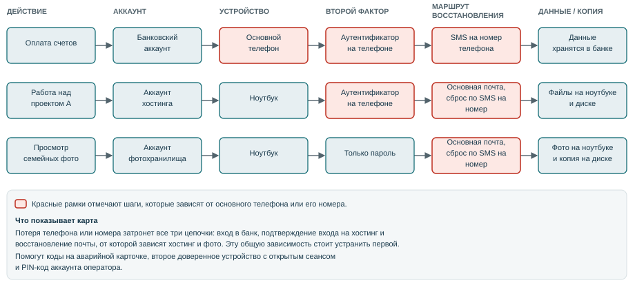

# Практическое руководство по безопасности и восстановлению

Ревизия 0.27

## 1. Описание и цели

> **Начните с того, что для вас важно. Представьте, что вы потеряли доступ к этим данным, аккаунтам или устройствам, и решите, как их защитить и восстановить. Защита требует усилий. Выберите уровень, меры которого вам по силам поддерживать.**

**Для кого это**
- Те, кто уверенно пользуется несколькими устройствами, онлайн-аккаунтами и сервисами для личных и рабочих проектов.
- Те, кто хочет лучше защитить свои данные и сохранить к ним доступ без специальных знаний по безопасности.

**Почему это важно**
- Устройства и аккаунты могут выглядеть безопасными по отдельности, но несколько проектов могут зависеть от одного ноутбука, номера телефона или почтового аккаунта.
- Потеря доступа к почте может запустить цепочку проблем. Если без неё нельзя сбросить пароль от облачного хранилища, нужные файлы придётся восстанавливать из резервной копии.
- Потеря телефона может означать и потерю доступа к банку, и потерю кодов для входа.
- Сбой ноутбука может остановить несколько проектов сразу, без всякой атаки.
- Неприятности могут начаться с ошибки, технического сбоя или атаки.

**Что помогает сделать это руководство**
- Увидеть эти связи.
- Защитить то, что важно.
- Заранее подготовиться к восстановлению, если что-то пойдёт не так.
- Поддерживать защиту постоянно, а не от случая к случаю.

**Как им пользоваться**
- Каждая мера защиты требует небольших усилий, даже если вы просто вводите персональный идентификационный номер (PIN) или прикладываете палец к датчику. Выберите удобный для вас баланс.
- Проходите уровни в удобном для вас темпе.
- Сначала прочитайте главы 2 и 3. В них кратко описаны границы руководства и принципы, на которых основаны практические шаги.

## 2. Границы применения и ограничения

**Что охватывает руководство**
- Руководство касается устройств, аккаунтов и данных, которыми вы пользуетесь сами, в том числе для работы. Оно учитывает ваши привычки и риски.
- Это касается и руководителей компаний. В фокусе остаётся то, чем вы пользуетесь лично.

**Что оно не охватывает**
- План безопасности для бизнеса, его общих систем, клиентских данных или доступа команды. Для них нужна отдельная оценка, больше усилий и профессиональная поддержка.
- Занятия в серой зоне, которые могут привести к расследованию или уголовному преследованию.
- Целенаправленное преследование, когда кто-то постоянно следит за вами или пытается взломать именно ваши аккаунты или устройства. Эти ситуации выходят за рамки всех уровней.

**Чего ожидать**
- Руководство помогает снизить риск, но сбои и перерывы в работе всё равно возможны.
- Уровни задают порядок практических шагов. Они не служат оценкой защищённости.

**Как проходить**
- Делайте одно действие за раз. Не нужно менять всё сразу.
- По возможности идите по порядку. Первые пункты обычно важнее или готовят к следующим. Если для шага есть предварительное условие, сначала выполните его.
- Если сомневаетесь, сделайте паузу или обратитесь к специалисту.

## 3. Кратко об основных понятиях
Руководство опирается на материалы Национального института стандартов и технологий США (NIST). Среди них рамочная модель кибербезопасности (NIST Cybersecurity Framework) и руководство по планированию восстановления (Special Publication 800-34). Мы также используем материалы по моделированию угроз проекта Open Worldwide Application Security Project (OWASP) и рекомендации по резервному копированию Национального центра кибербезопасности Великобритании (NCSC). Эти источники помогают сформулировать конкретные меры и понять, как проверить их на практике.

Запоминать термины не нужно. Читая определения, подставляйте свои примеры. Какой ноутбук, какой аккаунт или какие файлы вы имеете в виду?

- **Перечень (инвентаризация):** актуальный список устройств, аккаунтов, данных и связей между ними. Например, в нём видно, какой проект использует виртуальную машину (VM) и из какого аккаунта ею управляют.
- **Актив:** что-то ценное; например, ноутбук, файлы или доступ к банку.
- **Модель угроз:** что может пойти не так и как; например, фишинг, случайное удаление или сбой ноутбука.
- **Модель нарушителя:** представление о том, какой доступ и какие возможности есть у атакующего. Пример — мошенник, узнавший ваш пароль из утечки. В этом руководстве речь о распространённых атаках.
- **Компрометация:** потеря контроля или конфиденциальности; например, кто-то читает вашу почту или использует украденный сеанс входа.
- **Риск:** вероятность и последствия вместе; например, вероятность кражи данных карты и вызванная ею финансовая потеря.
- **Зависимость:** то, что нужно для использования или восстановления другого актива; например, потеря доступа к почте может заблокировать сброс паролей во многих сервисах.
- **Мера защиты:** действие, снижающее риск. Например, блокировка экрана мешает постороннему воспользоваться оставленным без присмотра телефоном.
- **Остаточный риск:** то, что остаётся нерешённым после мер предосторожности; например, резервные копии не отменяют утечку.
- **Восстановление:** возвращение к работе с нужными аккаунтами, устройствами и данными. Например, вы входите в аккаунт на запасном ноутбуке и открываете актуальные файлы.
- **Резервная копия:** копия, сохранённая на случай восстановления. Пример — вчерашняя версия документа. Чтобы проверить копию, восстановите из неё данные и убедитесь, что они открываются.
- **Синхронизация:** перенос изменений между копиями. Например, файл, удалённый на одном устройстве, может исчезнуть и на другом. Сама по себе синхронизация не гарантирует, что прежнюю версию можно вернуть.

## 4. Практические уровни
Никогда не передавайте ассистенту на основе искусственного интеллекта (ИИ) пароли, коды восстановления, ключи или экспорт хранилища паролей. Сверяйте его инструкции с официальной справкой сервиса. Меню и функции могут меняться.

### Уровень 0 — Начните здесь: мошенничество и первые десять минут

Что понадобится: немного времени. Покупки и технические навыки не нужны.

Люди часто теряют деньги или доступ к аккаунтам, когда мошенник убеждает их что-то сделать. Начните с этого уровня. На следующих уровнях пригодится умение распознавать такие ситуации.

#### 0.1 Остановитесь и проверьте, прежде чем действовать

Заранее сформулируйте правило и сохраните несколько официальных контактов. Это поможет спокойно проверить срочную просьбу.

- [ ] **0.1.1 — Сформулируйте своё правило на случай срочной просьбы одним предложением.** Например, если меня торопят, я сначала остановлюсь и сам свяжусь с человеком или организацией по знакомому каналу.
- [ ] **0.1.2 — Сохраните официальные контакты банка, эмитента карты и оператора связи.** Возьмите номер с карты или вручную введите адрес официального сайта. Храните контакты там, где найдёте их без телефона.
- [ ] **0.1.3 — Освойте правило обратного звонка.** Завершите разговор и сами свяжитесь с организацией по сохранённым контактам. Номер и ссылки из сообщения для этого не подходят.
- [ ] **0.1.4 — Договоритесь с семьёй или близкими коллегами о контрольном вопросе или кодовом слове.** Используйте его, чтобы проверить срочную просьбу о деньгах или доступе.
- [ ] **0.1.5 — Включите уведомления об операциях в банке и по картам.** Сообщения (SMS) или уведомления в приложении помогут быстро заметить чужой платёж.

- **Зачем:** Мошенники торопят, ссылаются на авторитет и просят никому не говорить. Заранее принятое правило помогает действовать, даже когда вы спешите или напуганы.
- **Инструменты и примеры:** Типичные схемы: звонящий представляется сотрудником банка, полиции или техподдержки; «руководитель» или родственник просит срочно денег или подарочные карты; история про «безопасный счёт»; уведомление о доставке или штрафе со ссылкой; просьба установить программу удалённого доступа; просьба продиктовать одноразовый код. Настоящая организация не попросит ваш пароль, одноразовый код или фразу восстановления.
- **Помощь ИИ:** Удалите из подозрительного сообщения имена, номера и ссылки. Попросите ассистента указать, где вас пытаются торопить и о чём настоящая организация не стала бы просить. Всё равно перепроверьте сообщение по сохранённым контактам. Не передавайте коды, пароли или номера карт.
- **Хороший результат:** У вас есть правило, официальные контакты важных для вас организаций, способ проверить просьбу близких и уведомления о платежах.
- **Проверка:** Возьмите недавнее срочное сообщение или придумайте пример и примените своё правило. Найдите сохранённые официальные контакты, не пользуясь сообщением. После следующего обычного платежа картой убедитесь, что пришло уведомление.
- **Если пропустить:** Самый распространённый способ потерять деньги или аккаунт остаётся открытым, и никакая техническая защита позже не помешает вам самому выдать код.

#### 0.2 Подготовьтесь к первым десяти минутам после ошибки

Короткий список действий на случай, если вы перешли по подозрительной ссылке, отправили деньги или передали код.

- [ ] **0.2.1 — Набросайте короткий список «первые десять минут».** Используйте ситуации из раздела «Инструменты и примеры».
- [ ] **0.2.2 — Держите список там, где его можно прочитать без телефона.** На бумаге или на другом устройстве, чтобы потерянный или взломанный телефон не унёс и его.
- [ ] **0.2.3 — Прочитайте его один раз на вымышленном примере.** Ничего не меняйте в реальном аккаунте.

- **Зачем:** После ошибки легко растеряться или продолжить спорить с мошенником. Быстрее всего нужно действовать, если под угрозой деньги или аккаунт, через который можно сбросить другие пароли.
- **Инструменты и примеры:** Возьмите этот список за основу и адаптируйте к своей ситуации.
  - Прервите звонок или переписку. Не пытайтесь исправить ситуацию вместе с собеседником.
  - Если вы отправили деньги или сообщили данные карты, позвоните в банк или эмитенту карты по сохранённому номеру и попросите остановить платёж или заблокировать карту.
  - Если вы ввели пароль на подозрительной странице, смените его с другого доверенного устройства, используя менеджер паролей. Завершите остальные сеансы. Смените пароль и в других аккаунтах, где он повторялся.
  - Если вы передали код или подтвердили чужой запрос, действуйте так, как если бы аккаунт уже захватили. Воспользуйтесь официальным способом восстановления доступа.
  - Установили программу удалённого доступа: отключите устройство от интернета, затем смените важные пароли с другого устройства.
  - Если под угрозой ваш номер телефона, свяжитесь с оператором по сохранённым контактам.
  - Сохраните скриншоты и зафиксируйте время событий. Сообщите о случившемся провайдеру, банку и, если уместно, в компетентные органы.
- **Помощь ИИ:** Попросите ассистента превратить ваши заметки в одностраничный чек-лист или проверить его вопросами «что если». Не оставляйте реальные идентификаторы аккаунтов и секреты.
- **Хороший результат:** У вас есть список, которым можно воспользоваться в стрессовой ситуации. Он согласуется с более подробным планом на случай потери устройства на уровне 5.
- **Проверка:** Список доступен с другого устройства или на бумаге. Проход по нему называет одно конкретное первое действие для каждой ситуации.
- **Если пропустить:** Задержка и импровизация превращают поправимую ошибку в потерю.

### Уровень 1 — Более безопасная отправная точка

Что понадобится: несколько коротких подходов, доступное хранилище, диск или сервис для резервных копий и умение менять обычные настройки.

#### 1.1 Составьте короткий перечень и держите его под рукой

Намеренно короткий список того, что критично или используется чаще всего, чтобы понимать, что защищать в первую очередь. Раздел 2.1 дополнит его позже; не пытайтесь охватить всё сразу.

- [ ] **1.1.1 — Перечислите важные устройства и сервисы, которыми часто пользуетесь.** Включите основной телефон и компьютер, интернет-провайдера, оператора связи и хостинг, если он у вас есть.
- [ ] **1.1.2 — Запишите критичные и самые используемые сервисы и аккаунт, через который вы в них входите.** Банк, почта, облачные файлы и всё, без чего вам было бы трудно. Добавьте сайт или ссылку на управление.
- [ ] **1.1.3 — Запишите данные, которые вы не смогли бы воссоздать, и где они находятся.** Фото, документы, файлы проектов: какое устройство или сервис их хранит.
- [ ] **1.1.4 — Отметьте, что важнее всего.** Подумайте, что человек с доступом к этому устройству, аккаунту или файлам сможет прочитать, изменить, удалить или потратить.
- [ ] **1.1.5 — Отметьте, что остановилось бы при потере каждой отмеченной записи.** Достаточно короткой фразы.
- [ ] **1.1.6 — Держите копию, которую можно открыть без основного устройства.** Распечатка или копия на втором устройстве; обновляйте её после важных изменений.

- **Зачем:** Нельзя защитить или восстановить то, что вы забыли. Отмеченные записи также задают порядок всего остального на этом уровне: какой аккаунт защищать первым и какие данные копировать первыми.
- **Инструменты и примеры:** Подойдёт личная заметка или таблица примерно на одну страницу. Если список становится длиннее, отложите остальное до раздела 2.1. Доступ к банку открывает доступ к деньгам, а захват почты позволяет сбрасывать пароли в других сервисах. Файл, который легко скачать повторно, обычно менее важен, чем семейные фото. Если серверы часто меняются, достаточно указать провайдера, аккаунт и ссылку на консоль. Пароли, ключи и коды восстановления в перечень не вносите.
- **Помощь ИИ:** Попросите ассистента предложить шаблон таблицы или категории, которые люди часто забывают, а заполните её сами. Он не может знать, чем вы действительно пользуетесь. Делитесь названиями сервисов, только если вам так комфортно; никогда — секретами.
- **Хороший результат:** Короткий список того, от чего вы зависите и как это найти, с отмеченными важнейшими записями и копией под рукой.
- **Проверка:** Возьмите обычное занятие, например оплату счёта или открытие файлов проекта, и найдите в списке его устройство, сервис и место хранения данных. Перейдите по одной ссылке, чтобы убедиться, что она ведёт на нужную страницу. Откройте копию без основного устройства.
- **Если пропустить:** Вы можете забыть банковский аккаунт, провайдера или место хранения данных при защите или восстановлении, либо потратить усилия на удобные задачи, пока что-то более важное остаётся незащищённым.

#### 1.2 Защитите основные устройства

Основные устройства — те, которыми вы пользуетесь ежедневно и на которых выполнен вход в ваши аккаунты: обычно телефон и основной компьютер. Делайте по одному устройству за раз.

- [ ] **1.2.1 — Установите код разблокировки на каждом основном устройстве.** Биометрия может дополнять код, но не заменять его.
- [ ] **1.2.2 — Включите автоматическую блокировку экрана.** Требуйте код после короткого периода бездействия.
- [ ] **1.2.3 — Установите доступные обновления.** Сначала сохраните работу. Пользуйтесь штатной функцией обновления системы.
- [ ] **1.2.4 — Перезагрузите устройство, если этого требуют обновления.** Закрытие крышки ноутбука не заменяет перезагрузку.
- [ ] **1.2.5 — Включите автоматические обновления там, где это уместно.** Позвольте системе самой устанавливать обычные исправления, чтобы вам не приходилось помнить о них.
- [ ] **1.2.6 — Если компьютером пользуется кто-то ещё, дайте им отдельную учётную запись.** Пропустите, если таких нет.

- **Зачем:** С этих устройств обычно уже открыт доступ к почте, файлам и банковским сервисам. Блокировка мешает посторонним им воспользоваться. Обновления устраняют известные уязвимости.
- **Инструменты и примеры:** Поищите в настройках устройства «блокировка экрана», «параметры входа» и «обновление системы». Покупать ничего не нужно. У удалённых серверов нет экрана для блокировки, им нужен другой подход; см. раздел 3.3.
- **Помощь ИИ:** Спросите, где находится настройка на вашей точной модели и версии системы. Названия меню, которые он предложит, могут устареть, поэтому сверьтесь со страницей поддержки производителя.
- **Хороший результат:** Каждое основное устройство блокируется, если им не пользуются, и обновляется почти без вашего участия. Если обновление не завершилось или требуется перезагрузка, отметьте это и вернитесь к задаче.
- **Проверка:** Заблокируйте и разблокируйте устройство. Оставьте его бездействовать и посмотрите, как оно блокируется. После перезагрузки откройте экран обновлений и убедитесь, что ничего не ожидает. Через неделю-две проверьте, что автоматическое обновление действительно установилось.
- **Если пропустить:** Любой, кто поднимет оставленное устройство, сможет пользоваться вашими открытыми аккаунтами, а известные слабости останутся доступны распространённым атакам.

#### 1.3 Настройте и используйте базовый менеджер паролей

Менеджер паролей даёт каждому аккаунту собственный надёжный пароль и запоминает его за вас. Здесь вы выбираете менеджер, защищаете его и убеждаетесь, что всегда сможете вернуться в него.

- [ ] **1.3.1 — Выберите стартовый менеджер по таблице ниже.** Если сомневаетесь, возьмите вариант по умолчанию для ваших устройств; позже можно поменять.
- [ ] **1.3.2 — Настройте менеджер с уникальным мастер-паролем или отдельным способом входа.** Выберите надёжный вариант, который больше нигде не используете.
- [ ] **1.3.3 — Прочитайте инструкции по восстановлению, прежде чем что-то сохранять в нём.** Узнайте сейчас, что менеджер может и не может восстановить, если вы забудете мастер-пароль.
- [ ] **1.3.4 — Включите многофакторную аутентификацию (MFA) для менеджера или его аккаунта, где она поддерживается.** Оставайтесь в системе на текущем устройстве, пока новый вход не заработает.
- [ ] **1.3.5 — Сохраните информацию для восстановления менеджера вне хранилища и вне основного телефона во время настройки.** Хорошо подходит распечатанная аварийная карточка в запечатанном конверте, хранящаяся в надёжном месте дома.
- [ ] **1.3.6 — Откройте хранилище с другого доверенного устройства.** Сделайте это, прежде чем переносить туда важные пароли.
- [ ] **1.3.7 — Убедитесь, что можете добраться до информации для восстановления без основного устройства.** Откройте аварийную карточку или заметки, используя только второе устройство или бумагу.
- [ ] **1.3.8 — Начните пользоваться: сохраните два-три повседневных входа и войдите с ними через менеджер.** Используйте менеджер для нескольких реальных аккаунтов, чтобы он стал привычкой, прежде чем переносить остальное.

- **Зачем:** Уникальные пароли для каждого аккаунта практичны только тогда, когда что-то запоминает их за вас. Тогда менеджер становится тем, к чему нельзя потерять доступ, поэтому его восстановление готовят и проверяют до того, как вы на него полагаетесь.
- **Инструменты и примеры:** Если сомневаетесь, начните с простого варианта для устройств, которыми пользуетесь чаще всего.

  | Ваши устройства | Скучный вариант по умолчанию | На что обратить внимание |
  |---|---|---|
  | В основном устройства Apple | Встроенный менеджер паролей Apple, защищённый вашим аккаунтом Apple | Теперь всё зависит от этого аккаунта; полностью защитите его в 1.4, прежде чем переносить туда важные пароли. Менее удобно на устройствах не от Apple |
  | В основном Android и Chrome | Менеджер паролей Google, защищённый вашим аккаунтом Google | Та же зависимость от одного аккаунта; проверьте, синхронизируется ли он с компьютерами, которые вы используете |
  | В основном Windows с одним браузером | Встроенный менеджер этого браузера, с входом в аккаунт браузера | Проверьте, хранятся ли записи локально или синхронизируются, и отдельно защитите и восстанавливайте этот аккаунт |
  | Смешанные устройства или вы делитесь входами с другими | Отдельный облачный менеджер с синхронизацией, поддерживающий все ваши устройства | Защитите его аккаунт, разберитесь в восстановлении и спланируйте экспорт, который можно восстановить, если он поддерживается |
  | Вы хотите контролировать файл хранилища и будете его обслуживать | Локальный зашифрованный файл хранилища, при желании синхронизируемый через облако | Защитите секрет разблокировки, храните версионные резервные копии, разбирайтесь с конфликтами синхронизации; одна лишь синхронизация с облаком — не резервная копия. Для начинающих лучше выбрать другой вариант |

- **Помощь ИИ:** Попросите ассистента объяснить варианты или незнакомый термин восстановления простыми словами и сравнить два варианта с учётом ваших устройств. Решение принимайте по документации самого менеджера. Никогда не вводите в чат с ИИ мастер-пароль, код восстановления или экспорт хранилища.
- **Хороший результат:** Пароли хранятся в одном защищённом месте, которым вы регулярно пользуетесь. Вы сможете войти в менеджер, даже если потеряете основное устройство. В перечне указано только название менеджера и место хранения сведений для восстановления.
- **Проверка:** Создайте тестовую запись без секретов, заблокируйте и снова откройте хранилище. Найдите запись на другом доверенном устройстве без помощи основного телефона. Убедитесь, что сведения для восстановления доступны отдельно от хранилища. Не расходуйте одноразовые коды и не запускайте сброс аккаунта ради проверки.
- **Если пропустить:** Повторно используемые пароли и разбросанные заметки остаются трудными в управлении, поэтому одна утечка может открыть несколько аккаунтов. Менеджер без проверенного восстановления может стать единственной точкой блокировки.

#### 1.4 Защитите основные аккаунты

Начните с аккаунтов, через которые можно восстановить доступ к другим сервисам. Это основная почта, аккаунт оператора связи, менеджер паролей и аккаунт Apple, Google или Microsoft, связанный с вашим устройством. Выполняйте шаги по одному аккаунту за раз.

- [ ] **1.4.1 — Дайте каждому основному аккаунту уникальный пароль.** Сгенерируйте и сохраните его в менеджере.
- [ ] **1.4.2 — Включите многофакторную аутентификацию (MFA) для основных аккаунтов, которые её поддерживают.** Используйте приложение-аутентификатор или ключ, если сервис их поддерживает. В мессенджере включите предусмотренную приложением дополнительную проверку.
- [ ] **1.4.3 — Если провайдер предлагает коды восстановления, сохраните их вне телефона и вне самого аккаунта во время настройки.** Распечатайте их или держите на втором устройстве; не оставляйте их только в аккаунте.
- [ ] **1.4.4 — Убедитесь, что резервные адреса и номера телефонов ещё работают.** Удалите те, которые вы больше не контролируете.
- [ ] **1.4.5 — Набросайте четыре цепочки восстановления из таблицы ниже и отметьте любой цикл.** По одной строке на цепочку; отметьте строку, где восстановление зависит от того, что эта же цепочка разблокирует.
- [ ] **1.4.6 — Для каждой цепочки найдите способ восстановления без основного телефона.** В разделе 4.1 вы проверите, работает ли он.

- **Зачем:** Получив доступ к этим аккаунтам, злоумышленник может сбрасывать пароли в других сервисах и читать подтверждения. Поэтому их защищают и возвращают в первую очередь. Убедитесь, что для восстановления одного доступа не требуется другой, уже заблокированный.
- **Инструменты и примеры:** Используйте официальную страницу безопасности провайдера, генератор менеджера и поддерживаемое приложение-аутентификатор, ключ доступа или аппаратный ключ. Мессенджеры, которые входят по номеру телефона, работают иначе: их дополнительный фактор — обычно не приложение-аутентификатор и не файл ключа, а собственная настройка приложения, и детали различаются. Например, двухэтапная проверка WhatsApp запрашивает PIN-код или пароль при повторной регистрации номера; PIN-код Signal блокирует повторную регистрацию, только если также включена блокировка регистрации (Registration Lock); Telegram предлагает пароль двухэтапной проверки и поддерживает ключи доступа для входа. Проверьте текущие параметры входа и восстановления приложения на его официальных страницах помощи, включите настройку, пока текущий сеанс остаётся открытым, и сохраните код в менеджере. Заполните по одной строке на цепочку; столбцы показывают, на что смотреть.

  | Цепочка | Обычные способы восстановления | Типичная замкнутая цепочка | Как подготовить независимый способ |
  |---|---|---|---|
  | Основная почта | Резервный адрес или номер телефона, коды восстановления | Почта A восстанавливается только через почту B, а та — только через A | Сохранённые коды восстановления на аварийной карточке; вторая почта, которую вы контролируете и которая не зависит от первой |
  | Номер телефона | Аккаунт у оператора, SIM- или eSIM-карта, PIN-код аккаунта оператора | Доступ к аккаунту оператора восстанавливается только по SMS на этот же номер | PIN-код аккаунта оператора и способ подтвердить личность (см. уровень 4) |
  | Менеджер паролей | Ключ восстановления или аварийная карточка, второе устройство с выполненным входом | Коды аутентификатора хранятся только в хранилище или только на потерянном телефоне | Аварийная карточка, хранящаяся отдельно от телефона; второе доверенное устройство |
  | Аккаунт телефона или компьютера (Apple, Google, Microsoft) | Доверенное устройство, ключ восстановления или контакт, номер телефона | Единственное доверенное устройство — потерянный телефон | Сохранённый ключ восстановления; второе доверенное устройство |

  Пример. Почта Алекса восстанавливается по SMS на его номер. Вход в аккаунт оператора — по письму на тот же адрес. Коды аутентификатора менеджера — на телефоне. Если телефон потерян, каждая цепочка ждёт другую, и восстановить ничего нельзя. Алекс добавляет сохранённый код восстановления почты на аварийную карточку, PIN-код аккаунта оператора и второе устройство, где уже выполнен вход в менеджер. Теперь у каждой цепочки есть маршрут, не затрагивающий потерянный телефон.
- **Помощь ИИ:** Вставляйте только заголовки таблицы и свои заметки простыми словами (например, «моя почта восстанавливается по SMS на мой телефон») и спросите, где может скрываться цикл. Спросите, что означает вариант восстановления у провайдера. Открывайте страницу безопасности провайдера, набрав официальный адрес самостоятельно, а не по ссылке от ассистента или из сообщения. Никогда не делитесь кодами.
- **Хороший результат:** Для каждого основного аккаунта сохранены уникальный пароль, дополнительный фактор входа и рабочий способ восстановления. Все обнаруженные замкнутые цепочки отмечены в таблице. Пароли и коды восстановления хранятся в защищённых местах. В перечне указано только, где их искать.
- **Проверка:** Оставьте текущий сеанс открытым и войдите заново в приватном окне браузера, используя сохранённый пароль и дополнительный фактор. Для мессенджера с регистрацией по номеру телефона воспользуйтесь безопасной проверкой самого приложения, например предложением повторно ввести PIN-код или пароль. Не регистрируйте номер заново ради проверки. Если сервис позволяет, отправьте тестовое сообщение для восстановления и убедитесь, что получите его без основного телефона. Для каждой строки таблицы укажите рабочий способ без основного телефона или отметьте, что его пока нет.
- **Если пропустить:** Повторно использованный пароль может отдать аккаунт, который сбрасывает все остальные. Устаревший или замкнутый способ восстановления может не пустить вас в собственный аккаунт.

#### 1.5 Сделайте и проверьте первую резервную копию

Начните с простой копии наиболее важных данных. Сразу проверьте, что из неё можно восстановить файл.

- [ ] **1.5.1 — Скопируйте самые важные файлы на внешний диск или в сервис резервного копирования.** Начните с данных, отмеченных как самые важные в разделе 1.1.
- [ ] **1.5.2 — Защитите резервную копию от удаления из повседневной учётной записи.** После копирования отключите диск или настройте права в сервисе резервного копирования так, чтобы из повседневной учётной записи нельзя было удалить копию.
- [ ] **1.5.3 — Восстановите один файл в новую папку, не используя оригинал.** Используйте функцию восстановления или копирования резервной копии, а не исходное расположение файла.
- [ ] **1.5.4 — Проверьте содержимое восстановленного файла.** Откройте восстановленный файл и убедитесь, что он читается и выглядит как ожидалось.
- [ ] **1.5.5 — Проверьте его дату или версию.** Убедитесь, что это та версия, которую вы хотели восстановить, а не старая или неполная копия.
- [ ] **1.5.6 — Отметьте результат проверки в таблице охвата резервного копирования.** Укажите дату, что восстановили, результат и следующий шаг. Секреты не записывайте.
- [ ] **1.5.7 — Добавьте обновление резервной копии в календарь как повторяющееся событие.** Разумная отправная точка — раз в месяц.

- **Зачем:** Устройство можно потерять, файлы могут повредиться или исчезнуть, а синхронизация может разнести изменения по всем устройствам. Отдельная резервная копия поможет вернуть данные. Убедиться в этом можно пробным восстановлением.
- **Инструменты и примеры:** Начните с обычной копии на внешний диск или сервиса резервного копирования с историей версий. Сначала скачайте файлы, которые есть только в облаке, чтобы в копию попали сами файлы. Восстанавливайте в новую папку, не перезаписывая рабочие файлы. Постоянно подключённый диск или синхронизируемая папка могут пострадать вместе с оригиналом из-за ошибки, программы-вымогателя или захвата аккаунта. В разделе 6.4 вы проверите изоляцию при захвате аккаунта, а в разделе 9.2 создадите копию в другом месте. Обновляйте копию раз в месяц и после важных изменений. Если потеря месяца работы неприемлема, делайте копии чаще. Если перечень или хранилище паролей находятся в облаке, держите отдельно доступную копию перечня. Узнайте, поддерживает ли менеджер зашифрованный экспорт и как его открыть. Не оставляйте незашифрованный экспорт паролей. Данные для восстановления доступа к аккаунту не заменяют копию записей хранилища. На уровне 3 вы настроите автоматическое копирование и хранение прежних версий.
- **Помощь ИИ:** Попросите ассистента дать пошаговые инструкции для вашего диска или инструмента резервного копирования или простой шаблон заметки. Ассистент не может подтвердить, что ваша копия работает; это может только проверка восстановления.
- **Хороший результат:** Вы знаете, какие данные входят в копию, где она находится, когда сделана и как защищена. У вас есть результат пробного восстановления.
- **Проверка:** Восстановленный файл открывается в новой папке, а содержимое и версия совпадают с ожидаемыми. Убедитесь по настройкам, что повседневная учётная запись не позволяет удалить копию. Запишите результат в таблицу охвата резервного копирования.
- **Если пропустить:** Потеря устройства, повреждение или удаление, распространяющееся через синхронизацию, могут не оставить пригодной копии. Непроверенная копия может отказать, когда понадобится, или содержать неожиданно старую версию.

### Уровень 2 — Порядок в настройках и защита на каждый день

Что понадобится: несколько подходов. Обычно достаточно имеющихся настроек. Возможно, придётся заменить оборудование или обратиться за помощью с шифрованием.

#### 2.1 Дополните перечень, сверившись с другими источниками

На уровне 1 вы составили перечень по памяти. Теперь проверьте, что могли упустить. Отведите на это 30 минут и проверьте три источника, затем остановитесь.

- [ ] **2.1.1 — Проверьте, что в вашем списке есть важные сервисы, которыми вы действительно пользуетесь.** Пройдитесь по обычной неделе.
- [ ] **2.1.2 — Поищите забытые аккаунты в трёх источниках.** Ваша почта, список сохранённых паролей (только названия сайтов) и выписки по карте или банку.
- [ ] **2.1.3 — Отметьте, как восстановить доступ к каждому важному ресурсу.** Укажите, где хранятся данные для восстановления, например «коды на аварийной карточке». Не копируйте сами секреты.
- [ ] **2.1.4 — Отметьте записи, которые зависят от одного и того же телефона, почты или номера.** Пример карты зависимостей в приложении показывает, как это сделать.
- [ ] **2.1.5 — Перенесите список в более структурированный инструмент, если он перерос заметку.** Необязательно.

- **Зачем:** Забытые аккаунты хранят старые пароли и старые данные восстановления, и никто за ними не следит. Запись пути назад превращает список в то, чем можно пользоваться при восстановлении.
- **Инструменты и примеры:** Поищите в почте приветственные письма, чеки, «подтвердите email», уведомления о сбросе пароля и продления подписки. Посмотрите список приложений на телефоне. Достаточно электронной таблицы или таблицы Grist со столбцами «назначение», «ссылка», «приоритет», «способ восстановления» и «ссылка на хранение секрета».
- **Помощь ИИ:** Два запроса, только с названиями и структурой.
  - *Найти их:* «Я хочу найти онлайн-аккаунты, о которых мог забыть. Дай мне 15 поисковых запросов для почты (приветственные письма, чеки, «подтвердите email», «ваш аккаунт создан», уведомления о сбросе пароля, продления подписки). Добавь такие же для списка приложений на телефоне и для выписок по банку и картам. Я выполню их сам».
  - *Разобрать их:* «Ниже простой список только названий сервисов, без паролей и логинов. Разложи их по категориям: деньги, личность и госуслуги, почта и телефон, облачные файлы и фото, работа и проекты, соцсети, покупки и, вероятно, неиспользуемые. Для каждого важного скажи, что он может сбросить в другом месте и стоит ли его закрыть или защитить. Я всё проверю на самом сервисе».

  Экспорт сохранённых паролей содержит сами пароли; копируйте только столбец с названиями сайтов, никогда — сам файл.
- **Хороший результат:** Более полный список, который соответствует тому, чем вы действительно пользуетесь, с отмеченным маршрутом восстановления для каждой важной записи и неиспользуемыми аккаунтами, отмеченными для закрытия.
- **Проверка:** Возьмите три пункта из недавней выписки по платежам или с главного экрана телефона и найдите каждый в списке. Для одной важной записи проследуйте по записанной ссылке восстановления до реального места.
- **Если пропустить:** Старые аккаунты остаются открытыми без вашего ведома, а в чрезвычайной ситуации вы знаете, что аккаунт существует, но не знаете, как вернуть его.

#### 2.2 Избавьтесь от устаревших, неподдерживаемых и неиспользуемых систем

Если устройство или программа больше не получает обновления безопасности, откажитесь от использования или ограничьте его. Удалите приложения, которыми не пользуетесь.

- [ ] **2.2.1 — Определите неподдерживаемое программное обеспечение и устройства.** Сравнивайте версии с официальной информацией производителя о поддержке, а не только с возрастом.
- [ ] **2.2.2 — Сохраните нужные данные, прежде чем выводить неподдерживаемое оборудование из эксплуатации.** Сначала экспортируйте или скопируйте их, чтобы вывод устройства не уничтожил единственную копию.
- [ ] **2.2.3 — Проверьте альтернативный доступ к чувствительным аккаунтам до вывода устройства из эксплуатации.** Доступ к почте, провайдеру, администратору и аутентификатору.
- [ ] **2.2.4 — Перенесите работу с важными аккаунтами на поддерживаемые устройства и программы.** Это касается банка, почты и административного доступа.
- [ ] **2.2.5 — Назначьте даты замены или обновления.** Покупка не должна блокировать несвязанные шаги защиты.
- [ ] **2.2.6 — Удалите неиспользуемые приложения.** Сначала проверьте, не хранит ли какое-то из них нужные данные и не является ли единственным их читателем.
- [ ] **2.2.7 — Удалите неиспользуемые расширения браузера.** Проверьте каждый профиль браузера.

- **Зачем:** Система, которая работает, но больше не получает исправлений, остаётся открытой для известных атак. Каждое неиспользуемое приложение или расширение — ещё одна вещь, которую нужно обновлять и которой нужно доверять без пользы.
- **Инструменты и примеры:** Страницы жизненного цикла поддержки производителей, список установленных приложений и настройки расширений каждого браузера. Экспортируйте данные в поддерживаемых форматах и откройте их на заменяющем устройстве. Не стирайте старое оборудование, пока сохранность и доступ не подтверждены.
- **Помощь ИИ:** Спросите, поддерживается ли ещё конкретная версия и что делает незнакомое приложение или расширение, затем подтвердите на сайте производителя. Даты поддержки у ассистента могут устареть.
- **Хороший результат:** Известный статус поддержки важных устройств и программ, чувствительная работа перенесена на поддерживаемые, старое оборудование помечено как ограниченное или выведенное, у каждого оставшегося исключения есть датированный план, и меньше ненужных компонентов.
- **Проверка:** Откройте образец сохранённых данных на поддерживаемом устройстве. Войдите в критичные аккаунты без выводимого оборудования. Удалённые элементы исчезли, а обычная работа продолжается. У каждого исключения есть ограничение и следующая дата.
- **Если пропустить:** Старые системы сохраняют неисправленные слабости. Резкий вывод может уничтожить единственную читаемую копию данных или единственный работающий фактор входа. Исключение без даты становится постоянным.

#### 2.3 Защитите остальные важные аккаунты

Начните с аккаунтов, потеря которых имела бы самые серьёзные последствия. Работайте с ними по одному.

- [ ] **2.3.1 — Замените слабые или повторно используемые пароли в перечисленных аккаунтах.** Позвольте менеджеру сгенерировать новый уникальный пароль для каждого, по одному аккаунту за раз.
- [ ] **2.3.2 — Включите поддерживаемую MFA в этих аккаунтах.** Предпочитайте приложение, ключ доступа или аппаратный ключ, а не SMS, где сервис даёт выбор.
- [ ] **2.3.3 — Добавьте ключ доступа (passkey), если важный аккаунт его поддерживает.** Сохраните рабочий пароль и многофакторную аутентификацию.
- [ ] **2.3.4 — Сохраняйте информацию для восстановления вне каждого защищаемого аккаунта во время настройки.** Держите коды и ключи восстановления там, куда можно добраться, не входя в этот аккаунт.
- [ ] **2.3.5 — Включите уведомления о событиях безопасности в аккаунте.** Выберите канал, который регулярно проверяете.

- **Зачем:** Уровень 1 защитил аккаунты, которые разблокируют другие. Теперь банк, платежи, облачные файлы, домены и хостинг получают такую же обработку, чтобы один утёкший пароль оставался одной проблемой.
- **Инструменты и примеры:** Официальные настройки безопасности каждого сервиса, а также генератор менеджера и отчёт о повторном использовании, если он есть. Держите рабочий сеанс открытым, пока новый вход не проверен, и обновляйте нужную запись хранилища при каждом изменении. Хранилище может содержать обычные коды восстановления, но его собственное восстановление не может зависеть только от него самого.
- **Помощь ИИ:** Попросите ассистента помочь упорядочить аккаунты по влиянию или объяснить незнакомую настройку безопасности. Он не должен видеть пароли или коды.
- **Хороший результат:** У важных сервисов есть отдельные сохранённые пароли, дополнительный фактор входа там, где он предлагается, информация для восстановления, доступная извне аккаунта, и оповещения, приходящие туда, где вы смотрите.
- **Проверка:** Для каждого аккаунта начните новый вход с сохранённым паролем и фактором, сохраняя исходный сеанс. Найдите его информацию для восстановления, не входя в аккаунт. Убедитесь, что безобидное тестовое уведомление приходит, если сервис это предлагает; отметьте неподдерживаемые функции как пробелы.
- **Если пропустить:** Один повторно использованный пароль может открыть несколько сервисов. Отсутствие информации для восстановления или молчащие оповещения могут оставить вас в неведении о взломе или без возможности вернуть доступ.

#### 2.4 Усильте защиту устройств

Проверьте, что защита от вредоносных программ работает и что диск потерянного или украденного устройства нельзя прочитать.

- [ ] **2.4.1 — Убедитесь, что защита от вредоносных программ работает.** В настройках безопасности системы проверьте, что защита включена и обновлена.
- [ ] **2.4.2 — Проверьте статус шифрования диска на важных устройствах.** Посмотрите в настройках безопасности системы; отметьте диск, который не зашифрован.
- [ ] **2.4.3 — Включите шифрование диска там, где его нет.** Сначала решите, где будет храниться ключ восстановления.
- [ ] **2.4.4 — Сохраните ключ восстановления шифрования во время настройки.** Не только на зашифрованном диске или на телефоне, который может потеряться вместе с ним.
- [ ] **2.4.5 — Найдите сохранённый ключ восстановления с другого доверенного устройства.** Убедитесь, что сможете получить ключ при отказе зашифрованного устройства.

- **Зачем:** Блокировка экрана не защищает диск, извлечённый из украденного компьютера; это делает шифрование. Защита от вредоносных программ, которая молча остановилась, не защищает ничего.
- **Инструменты и примеры:** Безопасность Windows и шифрование устройства или BitLocker; FileVault в macOS; доступность зависит от редакции и оборудования. Не добавляйте конкурирующие сканеры, не понимая, как они взаимодействуют. В перечне хранится только место хранения ключа восстановления и устройство, к которому он подходит, но никогда сам ключ.
- **Помощь ИИ:** Спросите, как проверить статус шифрования в вашей системе и для чего нужен ключ восстановления. Никогда не вставляйте ключ восстановления в чат.
- **Хороший результат:** Защита от вредоносных программ включена и обновлена. Важные устройства зашифрованы, а ключи хранятся в защищённом месте, доступном при восстановлении.
- **Проверка:** Система сообщает, что шифрование включено и завершено. Получите соответствующую запись ключа с другого доверенного устройства. Запустите обычную проверку, если она доступна. Не блокируйте диск и не удаляйте ключи намеренно ради проверки.
- **Если пропустить:** Данные на потерянном или украденном устройстве могут читаться, несмотря на экран входа. Шифрование без доступного ключа восстановления может превратить сбой устройства в безвозвратную потерю данных.

#### 2.5 Скройте конфиденциальные данные на экране блокировки

Эта настройка занимает около 15 минут и пригодится, если телефон потеряется. Начните с телефона, затем проверьте связанные устройства.

- [ ] **2.5.1 — Определите приложения, уведомления которых могут раскрывать коды, личные сообщения или финансовые данные.** SMS, почта, мессенджеры, банк, безопасность аккаунта.
- [ ] **2.5.2 — Скройте предпросмотр сообщений на экране блокировки для этих приложений.** Если содержимое нельзя надёжно скрыть, уберите уведомления этого приложения с экрана блокировки.
- [ ] **2.5.3 — Ограничьте чувствительные действия с уведомлениями, доступные без разблокировки, где это поддерживается.** Например, ответ.
- [ ] **2.5.4 — Проверьте предпросмотр уведомлений на сопряжённых или связанных устройствах, которыми пользуетесь.** У часов или связанного компьютера свои настройки.
- [ ] **2.5.5 — Проверьте настройки, пока телефон остаётся заблокированным.** Заблокируйте телефон, отправьте себе тестовое сообщение и прочитайте, что видно на экране блокировки.

- **Зачем:** Сильная блокировка экрана не поможет, если новый код входа или ссылка для сброса читаются на заблокированном экране телефона, который держит кто-то другой.
- **Инструменты и примеры:** На iPhone: Настройки → Уведомления → Показывать предпросмотр, плюс собственные настройки уведомлений каждого приложения; выберите «При разблокировке» или «Никогда». На Android: найдите в настройках уведомлений содержимое на экране блокировки или чувствительные уведомления; некоторые устройства предлагают управление для каждого приложения. Названия и доступность различаются. По возможности сохраняйте полезные оповещения включёнными.
- **Помощь ИИ:** Спросите, где эти настройки на вашей точной модели телефона и версии системы, затем подтвердите на устройстве.
- **Хороший результат:** Вы замечаете оповещение, но его код, ссылка, сообщение или сумма не видны тому, кто держит заблокированный телефон. Цена — одна дополнительная разблокировка, чтобы прочитать. Названия приложений могут оставаться видны; скрытие текста скрывает не всё.
- **Проверка:** Отправьте в выбранные приложения тестовые сообщения без личных данных. Посмотрите на экран блокировки так, чтобы телефон не распознал лицо или отпечаток. Попробуйте раскрыть уведомление и ответить. Затем разблокируйте телефон и убедитесь, что уведомления по-прежнему приходят. Повторите проверку на связанных устройствах. Не проводите реальные банковские операции ради теста.
- **Если пропустить:** Коды и личные сообщения можно прочитать, а некоторые действия выполнить, не разблокируя телефон.

### Уровень 3 — Раздельные профили и надёжные резервные копии

Что понадобится: несколько подходов и умение менять обычные настройки. Возможно, потребуется сервис резервного копирования, дополнительное хранилище или помощь с серверами.

#### 3.1 Используйте отдельные браузеры и профили для разных задач

Разведите разные задачи по профилям браузера. Тогда ошибка в одном профиле с меньшей вероятностью затронет остальные.

- [ ] **3.1.1 — Решите, какие задачи получат собственный профиль или браузер.** Типичные группы: деньги и личность (банк, платежи, госуслуги), повседневный просмотр, каждая проектная или рабочая роль, недоверенный просмотр.
- [ ] **3.1.2 — Создайте отдельный профиль или браузер для финансовых сервисов и сервисов с подтверждением личности.** Входите в эти аккаунты только там.
- [ ] **3.1.3 — Оставьте в этом профиле минимум расширений.** Обычно достаточно расширения менеджера паролей, если вы им пользуетесь.
- [ ] **3.1.4 — Создайте отдельный профиль для каждой проектной или рабочей роли.** Один профиль на клиента, проект или работодателя держит их входы и расширения отдельно.
- [ ] **3.1.5 — Используйте отдельный профиль или браузер для незнакомых сайтов и файлов.** Открывайте там ссылки, сайты и загрузки, которым пока не доверяете.
- [ ] **3.1.6 — Проверьте сохранённые пароли, автозаполнение и настройки синхронизации для каждого профиля.** Оставьте только то, что нужно этому профилю.

- **Зачем:** Браузер хранит сеансы входа. Если один сеанс или одно расширение украдено или использовано неправильно, всё открытое в том же профиле оказывается под угрозой, иногда без вашего пароля или MFA. Разделение задач ограничивает то, до чего может добраться одна ошибка.
- **Инструменты и примеры:** Профили встроены в каждый популярный браузер; второй браузер или учётная запись операционной системы разделяют сильнее, чем один профиль. Виртуальная машина разделяет ещё сильнее, но требует больше усилий. Профили уменьшают перекрёстное заражение; они не останавливают вредоносные программы на самом компьютере. Назовите или раскрасьте каждый профиль, чтобы сразу видеть, где вы. Уровень 6 добавляет проверку активных сеансов.
- **Помощь ИИ:** Попросите показать, как создавать и переключать профили в вашем браузере, или сгруппировать ваши аккаунты по задачам. Подтвердите названия меню на странице помощи самого браузера.
- **Хороший результат:** Аккаунты денег и личности живут в минимальном профиле, проекты остаются отдельно, рискованный просмотр происходит в другом месте, и по названию профиля вы понимаете, где находитесь.
- **Проверка:** Откройте каждый профиль и убедитесь, что он входит только в свои аккаунты и содержит только перечисленные вами расширения. Убедитесь, что в профиле денег нет лишних расширений.
- **Если пропустить:** Одно вредоносное расширение, украденный сеанс или неосторожный клик могут добраться до банка, проектов и личных аккаунтов одновременно.

#### 3.2 Разделите личные и проектные пароли по хранилищам

*Только если вы ведёте больше одного проекта или делитесь какими-либо аккаунтами с другими людьми.*

Выделите каждому такому проекту отдельное хранилище в менеджере паролей.

- [ ] **3.2.1 — Решите, каким проектам нужно собственное хранилище.** Проверка: кому может понадобиться доступ и что вы передали бы?
- [ ] **3.2.2 — Создайте отдельные хранилища или коллекции для личного использования и для каждого такого проекта.** Назовите каждое хранилище по проекту, чтобы было ясно, что войдёт в передачу.
- [ ] **3.2.3 — Перенесите учётные данные каждого проекта в его хранилище.** Переносите или заново сохраняйте записи по одному проекту за раз, затем удалите старые копии.
- [ ] **3.2.4 — Добавьте в перечень строку о том, какое хранилище содержит какой проект.** Только ссылки.
- [ ] **3.2.5 — Убедитесь, что доступ к хранилищу проекта можно передать без раскрытия личных записей.** Изучите настройки, не предоставляя доступ на самом деле.

- **Зачем:** Одно большое хранилище означает, что любой, с кем вы делитесь, или любая ошибка добирается до всего. Отдельные контейнеры позволяют отдать коллеге или позже преемнику один проект без вашей личной жизни.
- **Инструменты и примеры:** Большинство менеджеров поддерживают несколько хранилищ, папки с собственным доступом или коллекции. Используйте один менеджер с отдельными контейнерами: вы сохраняете один мастер-секрет и одну запись восстановления. Отдельные аккаунты менеджера используйте, только когда другой человек должен держать доступ или наследовать его, проект принадлежит клиенту или может быть продан или передан; это стоит второго мастер-секрета и второй записи восстановления и рассматривается на уровне 7. Менеджер, выданный работодателем, принадлежит работодателю и выходит за рамки этого руководства.
- **Помощь ИИ:** Попросите ассистента предложить названия хранилищ и определить, какие из ваших проектов заслуживают собственного, по простому списку названий проектов. Не делитесь учётными данными.
- **Хороший результат:** Личные и проектные учётные данные лежат в отдельных контейнерах, и контейнер каждого проекта можно передать отдельно.
- **Проверка:** Откройте каждое хранилище проекта и убедитесь, что там только его записи. Сверьте настройки общего доступа со списком тех, кому он нужен.
- **Если пропустить:** Общий или скомпрометированный проектный вход может раскрыть личные аккаунты, а передача означает спешную сортировку учётных данных.

#### 3.3 Защитите доступ к серверам и виртуальным машинам

*Только если вы используете удалённые серверы или виртуальные машины.*

Контролируйте, кто и что может входить на ваши серверы, чтобы доступ можно было выдать, проверить и отозвать, не разыскивая ключи. Какие шаги применимы, зависит от количества машин.

- [ ] **3.3.1 — Найдите консоль управления и аккаунт администратора у провайдера.** Отметьте провайдера и аккаунт для каждого сервера или виртуальной машины.
- [ ] **3.3.2 — Защитите аккаунт у провайдера многофакторной аутентификацией, если она доступна.** Воспользуйтесь приложением-аутентификатором или ключом. Из этого аккаунта можно управлять всеми связанными с ним машинами.
- [ ] **3.3.3 — Проверьте независимый административный доступ, прежде чем менять схему входа любого сервера.** Второй рабочий сеанс и консоль восстановления провайдера.
- [ ] **3.3.4 — Если вы управляете несколькими серверами вручную, выдайте каждому человеку и устройству отдельный ключ или учётную запись.** Не используйте один ключ или аккаунт на всех.
- [ ] **3.3.5 — На серверах с ручной настройкой удалите ненужные ключи и учётные записи.** Уберите доступ людей, устройств и инструментов, которым он больше не нужен.
- [ ] **3.3.6 — Много машин или они меняются: выдавайте доступ через группы или роли, а не на каждый сервер.** Используйте систему идентификации провайдера.
- [ ] **3.3.7 — Много машин или они меняются: предпочитайте краткоживущие учётные данные долгоживущим ключам, оставленным на машинах.** Например, сертификаты или сеансовые инструменты провайдера.
- [ ] **3.3.8 — Если машин много или их состав меняется, отметьте, к какой среде даёт доступ каждая группа или роль.** Оставьте только ссылки или указатели на записи.
- [ ] **3.3.9 — Если машин много или их состав меняется, проверьте отзыв доступа через группу.** Удалите из группы тестовую учётную запись и проверьте, что доступ пропал. Рабочие аккаунты не трогайте.

- **Зачем:** К серверу попадают через аккаунт провайдера и удалённый вход. Любой из них можно захватить, и любой может заблокировать вас, если его неосторожно изменить. С несколькими машинами ключи на каждый сервер управляемы; когда их много, ключи размножаются, никто не знает, у кого какой, а удаление человека означает обход каждой машины.
- **Инструменты и примеры:** Для удалённого входа обычно используют Secure Shell (SSH) или Remote Desktop Protocol (RDP). При ручном управлении выдавайте отдельный ключ или аккаунт каждому человеку и устройству, защищайте закрытые ключи и отмечайте, у кого есть доступ. При управлении через группы или роли права определяются членством в группе или назначенной ролью. Используйте учётные записи провайдера или единый вход, а вместо постоянных ключей — краткосрочные сертификаты или сеансовые средства. При уходе человека его права можно отозвать одним исключением из группы. Планируйте обновления и перезапуски с учётом нагрузки и резервного копирования. В перечне достаточно ссылки на доступ. Если неясно, как войти или восстановить доступ, спросите ответственного администратора.
- **Помощь ИИ:** Ассистент может объяснить метод доступа или в общих чертах проверить планируемое изменение. Никогда не вставляйте закрытые ключи или пароли и не выполняйте команды, которых не понимаете, на живом сервере.
- **Хороший результат:** Для каждого окружения вы знаете, кто или что может до него добраться и как этот доступ отзывается, и вы видели, что второй путь входа работает.
- **Проверка:** Войдите выбранным способом и убедитесь, что консоль восстановления провайдера открывается. Не меняйте настройки межсетевого экрана или аутентификации ради проверки.
- **Если пропустить:** Слабый вход на сервер раскрывает всё, что сервер хранит; ошибочное изменение может отрезать ваш собственный доступ, а бывшие коллеги могут сохранить доступ, о котором вы забыли.

#### 3.4 Настройте автоматическое копирование и проверьте, какие данные оно охватывает

Настройте резервное копирование без вашего участия и убедитесь, что оно охватывает важные данные.

- [ ] **3.4.1 — Проверьте резервные копии по пяти группам ниже.** Для каждой назовите резервную копию и то, как она будет восстановлена.
- [ ] **3.4.2 — Отметьте данные, для которых копии пока нет.** Для каждого пробела укажите причину, приоритет и следующий шаг.
- [ ] **3.4.3 — Автоматизируйте резервное копирование охваченных данных.** Используйте инструмент резервного копирования системы или запланированное резервное копирование провайдера, а не ручное копирование.
- [ ] **3.4.4 — Настройте оповещение о сбое резервного копирования и запланированную ручную проверку как запасной вариант.** Выберите почту или сообщение, которые действительно читаете, и поставьте повторяющееся напоминание как резерв.
- [ ] **3.4.5 — Проверьте, что уведомление до вас доходит.** Воспользуйтесь штатной функцией отправки тестового уведомления, если она есть. Не вызывайте сбой специально.

- **Зачем:** Исправное задание резервного копирования всё равно может пропускать самые нужные данные, а ручные копии устаревают. Автоматизация поддерживает копии актуальными; оповещения сообщают, когда она останавливается.
- **Инструменты и примеры:** Используйте эту короткую проверку охвата; каждая строка должна заканчиваться именованной резервной копией или отмеченным пробелом.
  1. Документы и файлы проектов, включая файлы только в облаке.
  2. Фотографии и другие незаменимые медиа.
  3. Почта, контакты и календари.
  4. Экспорт хранилища паролей, записи восстановления и ключи шифрования.
  5. Проектные серверы и базы данных, если они есть.

  Облачному почтовому ящику может понадобиться собственный экспорт; живой базе данных может понадобиться поддерживаемый метод резервного копирования; снимкам провайдера нужна проверка пригодного восстановления, а не только проверка существования. Используйте собственные инструменты резервного копирования системы или документированную функцию резервного копирования провайдера и тестовое уведомление вместо поломки настоящей копии. Рабочий лист охвата резервного копирования в приложении — более подробная форма.
- **Помощь ИИ:** Попросите ассистента объяснить варианты инструментов резервного копирования для вашей системы или превратить пять групп в таблицу, которую вы заполните. Он не может видеть, что содержат ваши резервные копии.
- **Хороший результат:** Каждая из пяти групп охвачена, непроверена или отмечена как пробел, а именованные задания резервного копирования выполняются по расписанию, и кто-то замечает сбои.
- **Проверка:** Проследите два-три реальных набора данных до именованной резервной копии и метода восстановления. Понаблюдайте за запланированным запуском и убедитесь, что недавнее изменение можно восстановить. Безобидное оповещение приходит, или у ручной проверки есть дата.
- **Если пропустить:** Пробелы выглядят как полная защита, копии устаревают незаметно, а сбои молчат до дня, когда понадобится восстановление.

#### 3.5 Храните старые версии и проверьте одну из них

Храните старые версии, чтобы можно было вернуться к состоянию до ошибки, замеченной с опозданием. Проверьте, что такую версию удаётся восстановить.

- [ ] **3.5.1 — Настройте срок хранения по правилу ниже.** Укажите, сколько дней или версий нужно хранить.
- [ ] **3.5.2 — Проверьте реальные ограничения на хранение у провайдера.** Смотрите условия своего тарифа.
- [ ] **3.5.3 — Найдите у провайдера возможности восстановления из корзины и истории версий.** Найдите, где и как долго можно восстановить удалённые элементы и более ранние версии файлов.
- [ ] **3.5.4 — Восстановите более старую версию файла в отдельное место.** Оставьте рабочий файл нетронутым.
- [ ] **3.5.5 — Запишите результат.** Выбранная версия, источник, результат, затраченное время, следующее действие.

- **Зачем:** Удаление или повреждение часто замечают поздно. Если каждая сохранённая версия уже содержит повреждение, резервная копия не поможет.
- **Инструменты и примеры:** Для начала храните достаточно версий, чтобы вернуться как минимум на 30 дней назад, а если позволяют тариф и объём хранилища — на 90 дней. Если срок короче, отметьте этот пробел. На уровне 9 вы зададите срок с учётом своих целей. Сроки хранения в корзине и истории версий могут отличаться от срока хранения резервных копий. Для проверки подойдёт файл с узнаваемым фрагментом текста или фотографией в прежней версии.
- **Помощь ИИ:** Спросите, что означает настройка срока хранения, или попросите помочь сравнить лимиты плана, которые вы скопировали со страницы провайдера.
- **Хороший результат:** Срок хранения, следующий отправному правилу, подтверждённые лимиты записаны рядом, и есть доказательство, что старую версию действительно можно восстановить.
- **Проверка:** Откройте восстановленный старый файл из отдельного места и убедитесь в ожидаемом более раннем содержимом. Сравните самую старую доступную версию с правилом. Не удаляйте рабочие файлы ради этой проверки.
- **Если пропустить:** Успешная проверка недавнего файла может скрыть сломанную историю, и к моменту обнаружения повреждения каждая оставшаяся копия может его содержать.

### Уровень 4 — Защита при потере телефона или компьютера

Что понадобится: несколько подходов, второе доверенное устройство, инструкции оператора и провайдера. Возможно, нужен запасной способ подтверждения входа.

#### 4.1 Проверьте доступ к аккаунтам без основного устройства

Проведите проверку, пока основное устройство работает. Во время проверки не пользуйтесь им, но не стирайте данные и не выходите из аккаунтов. Возьмите цепочки восстановления из раздела 1.4.

- [ ] **4.1.1 — Войдите в почту на другом доверенном устройстве, не используя основной телефон для MFA.** Используйте запасной фактор или код восстановления; оставьте основной телефон выключенным или неиспользуемым.
- [ ] **4.1.2 — Войдите в хранилище паролей при тех же условиях.** Та же проверка для менеджера паролей: другое устройство, без основного телефона.
- [ ] **4.1.3 — Откройте свои заметки о восстановлении без основного телефона.** Откройте заметки со второго устройства или с бумаги, чтобы убедиться, что они не зависят от телефона.
- [ ] **4.1.4 — Проверьте восстановление или перенос приложения-аутентификатора на одном аккаунте с низким риском.** Сохраняйте существующий фактор работающим, пока новый не заработает.

- **Зачем:** Второе устройство может показать страницу входа, а затем запросить код или подтверждение на пропавшем телефоне. Этот раздел находит такую зависимость раньше, чем потеря.
- **Инструменты и примеры:** Второй компьютер, планшет или защищённый запасной телефон; запасной аутентификатор, аппаратный ключ безопасности или поддерживаемый провайдером способ восстановления. Никогда не используйте общественный компьютер для хранилища. Приложения-аутентификаторы различаются: некоторые синхронизируются через аккаунт, другим нужен ручной перенос или повторная регистрация в каждом сервисе, а перенос, требующий старого телефона, не поможет после его потери. Относитесь к экспортированным секретам настройки и изображениям переноса как к учётным данным, а не как к скриншотам для обычных заметок.
- **Помощь ИИ:** Спросите, как ваше приложение-аутентификатор справляется с потерей телефона и что означает термин вроде «повторная регистрация». Не делитесь изображениями переноса или кодами.
- **Хороший результат:** Без основного телефона вы можете открыть почту, хранилище и заметки о восстановлении. Вы проверили восстановление кодов входа и отметили результаты в таблице цепочек.
- **Проверка:** Завершите каждый вход и откройте заметки без подтверждения, кодов или доступа с основного телефона. Выполните новый вход в аккаунт с низким риском с восстановленным или перенесённым фактором. Любая строка, которой всё ещё нужен основной телефон, отмечена как пробел.
- **Если пропустить:** Вы можете знать каждый пароль и всё равно остаться заблокированным, а инструкции по восстановлению будут за тем же замком.

#### 4.2 Настройте поиск и блокировку потерянного устройства

Включите сервисы, которые находят и блокируют потерянное устройство, и проверьте, что можете до них добраться.

- [ ] **4.2.1 — Включите функции определения местоположения устройства, где они доступны.** Включите настройку «найти устройство» платформы на каждом телефоне, планшете и компьютере.
- [ ] **4.2.2 — Включите функции удалённой блокировки, где они доступны.** Проверьте, что можете заблокировать потерянное устройство удалённо, не стирая его.
- [ ] **4.2.3 — Доберитесь до этих сервисов с другого устройства с альтернативным фактором входа.** Не отправляйте команду стирания.

- **Зачем:** Найти или заблокировать потерянное устройство можно, только если функция была включена заранее и вы можете добраться до неё без самого устройства.
- **Инструменты и примеры:** Встроенный сервис поиска устройств вашей платформы телефона или компьютера. Некоторые предлагают ограниченный вход для потерянного устройства, не требующий обычного кода подтверждения. Сохраните официальный адрес сейчас, а не полагайтесь на ссылку, которая придёт в сообщении после потери.
- **Помощь ИИ:** Спросите, что сервис поиска вашей платформы может и не может делать, когда устройство не в сети. Следуйте собственной странице провайдера о потерянном устройстве для фактических шагов.
- **Хороший результат:** Вы можете добраться до сервиса, видите нужное устройство и знаете, какие действия он поддерживает. Устройство не в сети может не принять команду сразу.
- **Проверка:** С другого доверенного устройства войдите выбранным способом и найдите нужное устройство. Проверьте только его статус. Не стирайте данные и не блокируйте его, если это может лишить вас доступа.
- **Если пропустить:** Вы можете обнаружить во время потери, что сервис никогда не включался или до него можно добраться только с пропавшего устройства.

#### 4.3 Защитите номер у оператора

*Только если на ваш номер телефона приходят коды входа или банковские коды. Это верно для большинства читателей.*

PIN-код аккаунта оператора помогает подтвердить, что номер принадлежит вам. Оператор может запросить его через сотрудника или приложение перед выдачей новой SIM-карты или переносом номера. Многофакторная аутентификация (MFA) защищает вход в онлайн-аккаунт с помощью второго фактора, например кода из приложения или ключа. PIN-код аккаунта оператора, PIN-код SIM-карты и код разблокировки устройства выполняют разные задачи.

- [ ] **4.3.1 — Добавьте PIN-код аккаунта оператора, где это доступно.** PIN-код SIM-карты не мешает оператору выдать замену SIM.
- [ ] **4.3.2 — Включите блокировку переноса номера, где это доступно.** Попросите оператора блокировать перенос номера к другому оператору без дополнительных проверок.
- [ ] **4.3.3 — Узнайте, как подтвердить личность для замены SIM-карты.** Спросите оператора, какие документы или данные нужны. Сохраните ответ так, чтобы прочитать его без телефона.
- [ ] **4.3.4 — Узнайте, как можно снять блокировку переноса.** Спросите, как снимается блокировка и сколько это занимает.
- [ ] **4.3.5 — Узнайте, сколько обычно занимает замена SIM-карты.** Спросите, через какое время связь заработает на новой карте.

- **Зачем:** Кто-то может попытаться перенести ваш номер, убедив оператора, даже не трогая вашу SIM-карту. То же знание процесса оператора помогает быстро вернуть собственный номер.
- **Инструменты и примеры:** Операторы могут предлагать пароль аккаунта, блокировку переноса (port-out lock) или дополнительную проверку; названия и защита различаются по провайдеру и стране. Блокировка переноса может не покрывать все виды замены SIM, поэтому спросите об обоих. Храните ответы там, где сможете прочитать их без телефона.
- **Помощь ИИ:** Попросите ассистента составить вопросы для оператора. Записывайте ответы оператора, а не ассистента.
- **Хороший результат:** Вы включили доступные меры защиты аккаунта оператора и отметили, как вернуть номер и какие ограничения при этом действуют.
- **Проверка:** По официальному каналу оператора убедитесь, что меры защиты включены. Найдите инструкции по замене SIM-карты и снятию блокировки переноса без основного телефона. Не запускайте перенос номера или замену SIM-карты ради проверки.
- **Если пропустить:** Мошенник может перенести ваш номер через оператора и получать коды, которые на него приходят. Если под рукой нет нужных документов или данных, возвращение номера займёт больше времени.

#### 4.4 Добавьте PIN-код SIM-карты (необязательно)

*Необязательно. Сначала выполните раздел 4.3. При мошеннической замене SIM-карты важнее защита аккаунта оператора. Настраивая PIN-код SIM-карты, можно случайно заблокировать свою карту.*

У модуля идентификации абонента (SIM) свой PIN-код. Он отличается от кода разблокировки устройства и PIN-кода аккаунта оператора из раздела 4.3. Прежде чем включать PIN-код SIM-карты, подготовьтесь к её разблокировке.

- [ ] **4.4.1 — Получите текущий PIN-код SIM у оператора.** Не угадывайте его.
- [ ] **4.4.2 — Получите у оператора персональный ключ разблокировки (PUK).** Он понадобится, если SIM-карта заблокируется после нескольких неверных попыток ввода PIN-кода.
- [ ] **4.4.3 — Сохраните данные для разблокировки SIM-карты вне телефона.** До включения PIN-кода положите запись с PIN-кодом и PUK в надёжное место, например в запечатанный конверт.
- [ ] **4.4.4 — Включите PIN-код SIM, отличный от кода устройства, где это поддерживается.** Это касается и встроенной SIM (eSIM).
- [ ] **4.4.5 — Перезагрузите телефон, чтобы проверить известный PIN-код SIM.** Повторные неверные коды могут заблокировать SIM.

- **Зачем:** Если вынуть физическую SIM-карту без PIN-кода и вставить её в другой телефон, на него будут приходить ваши звонки и коды из SMS. Код разблокировки старого телефона этому не мешает.
- **Инструменты и примеры:** Официальная страница аккаунта оператора, документация к исходной SIM или канал поддержки. Запечатанная бумажная запись — простое место для PUK. Меню и доступность различаются.
- **Помощь ИИ:** Попросите ассистента объяснить разницу между PIN-кодом SIM, PUK и PIN-кодом аккаунта оператора. Никогда не просите «стандартный» PIN, чтобы попробовать: стандарты различаются, а неверные попытки блокируют SIM.
- **Хороший результат:** После перезагрузки или переноса карты в другой телефон SIM-карта запрашивает свой PIN-код. Сведения для разблокировки доступны без телефона.
- **Проверка:** Убедитесь, что сохранённая запись относится к правильной линии. Перезагрузите в удобное время и введите только известный PIN. Никогда не угадывайте PIN или PUK.
- **Если пропустить:** Незащищённой физической SIM-картой можно воспользоваться в другом телефоне. Если включить PIN-код, не подготовив данные для разблокировки, можно самому остаться без связи.

#### 4.5 Используйте отдельный номер для кодов входа (необязательно)

*Только если можете держать вторую телефонную линию (вторую SIM или eSIM) и готовы её защищать. Многим читателям это не нужно.*

Второй номер, который знают только ваши банки и ключевые аккаунты, мошенникам труднее атаковать.

- [ ] **4.5.1 — Решите, стоит ли второй номер усилий.** Он помогает больше всего, если ваш основной номер широко известен, а аккаунты всё ещё присылают коды по SMS.
- [ ] **4.5.2 — Получите номер у настоящего оператора, на своё имя.** Избегайте бесплатных или временных виртуальных номеров: банки часто их не принимают, и их легче потерять.
- [ ] **4.5.3 — Защитите этот аккаунт оператора так же, как первый.** Добавьте его PIN-код аккаунта оператора и блокировку переноса номера, как в разделе 4.3.
- [ ] **4.5.4 — Держите линию активной.** Добавьте повторяющееся событие в календарь для всего, что требует оператор, потому что неактивные номера могут переиспользоваться.
- [ ] **4.5.5 — Переносите номер входа или восстановления одного важного аккаунта за раз.** Оставляйте старый номер, пока новый не подтверждён работающим.
- [ ] **4.5.6 — Держите новый номер в тайне.** Не давайте его контактам, не публикуйте и не используйте для магазинов и форм.
- [ ] **4.5.7 — Обновите таблицу цепочек восстановления.** Добавьте новый номер как способ восстановления для любой цепочки, которую на него перевели.
- [ ] **4.5.8 — Добавьте новый номер в перечень.** Отметьте линию, оператора и место хранения данных её восстановления.

- **Зачем:** Мошенники и похитители SIM начинают с номеров, которые могут найти. Номер, который знают только банки и ключевые аккаунты, труднее атаковать, и он не пускает спам и звонки на линию, которая получает ваши коды.
- **Инструменты и примеры:** Телефон с двумя SIM или физическая SIM плюс eSIM. Вторая линия стоит денег за план или пополнение, добавляет второй аккаунт оператора и вторую цепочку восстановления и может потеряться, если её не продлевать. Где сервис поддерживает приложение-аутентификатор, ключ доступа или аппаратный ключ, использование их вместо SMS убирает зависимость от любого номера; отдельный номер оставьте для сервисов, которые не предлагают ничего другого. Некоторые провайдеры не принимают коды по SMS на вторую линию, поэтому проверьте, прежде чем переносить аккаунт.
- **Помощь ИИ:** Попросите ассистента сравнить планы и поддержку eSIM для вашей модели телефона в общих чертах или составить вопросы для оператора. Уточните доступность и цены у самого оператора. Не делитесь своими номерами.
- **Хороший результат:** Один номер получает коды входа, его знают немногие, он защищён так же тщательно, как основная линия, и записан в цепочках восстановления.
- **Проверка:** Вызовите безобидный код из одного перенесённого аккаунта и убедитесь, что он приходит на новую линию. Убедитесь, что PIN-код аккаунта оператора и блокировка переноса показываются включёнными через официальный канал оператора. Не начинайте настоящий перенос или замену SIM ради проверки.
- **Если пропустить:** Ничего не ломается: это необязательное дополнение. Читатели, которые его пропускают, сохраняют защиту из 4.3 и, где возможно, уменьшают зависимость от SMS.

#### 4.6 Подготовьтесь к потере сумки со всеми устройствами

Распределите устройства и средства восстановления так, чтобы одна потеря не лишила вас всего сразу.

- [ ] **4.6.1 — Подумайте, что вы обычно носите вместе.** Телефон, ноутбук, ключ безопасности, кошелёк, ключи, аварийную карточку или заметки.
- [ ] **4.6.2 — Держите вещи, которые восстанавливают друг друга, в разных местах.** Например, аварийная карточка, запасной ключ безопасности или диск с резервной копией остаются дома, а не в сумке.
- [ ] **4.6.3 — Убедитесь, что хотя бы одно доверенное устройство или способ восстановления остаётся вне сумки.** Например, второе устройство с выполненным входом дома или запасной ключ, хранящийся в другом месте.
- [ ] **4.6.4 — Проверьте, что у каждого носимого устройства включены блокировка и поиск с блокировкой.** Убедитесь, что блокировка экрана и поиск устройства включены для телефона, ноутбука и планшета, которые вы носите.
- [ ] **4.6.5 — Разберите этот сценарий на бумаге.** Представьте, что телефон и ноутбук пропали. К чему у вас ещё есть доступ, а к чему уже нет?

- **Зачем:** Многие планы молча предполагают, что потеряно только одно. В реальной жизни сумка, машина или кража забирают телефон, ноутбук и диск с резервной копией вместе.
- **Инструменты и примеры:** Доверенное второе устройство дома, запасной ключ безопасности в другом месте, диск с резервной копией не в той же сумке или комнате, что ноутбук, и защищённая аварийная карточка. Общий семейный компьютер добавляет риск: его сохранённые сеансы и данные браузера доступны любому, кто пользуется тем же аккаунтом.
- **Помощь ИИ:** Попросите ассистента проверить ваш бумажный проход вопросами «что если и это тоже пропало». Не оставляйте реальные идентификаторы и секреты.
- **Хороший результат:** Ни одна сумка, комната или машина не содержат одновременно ваши устройства и всё необходимое для их восстановления.
- **Проверка:** По очереди представьте потерю каждой вещи, которую носите с собой. Проверьте по плану, как вернёте доступ к почте, хранилищу и файлам. Убедитесь, что домашние копии доступны без потерянных устройств. Не убирайте и не отключайте ничего по-настоящему.
- **Если пропустить:** Одна кража или авария может убрать устройства и способ восстановления одновременно.

### Уровень 5 — Готовность к одновременной потере устройств

Что понадобится: несколько подходов, безопасная репетиция, бумага или зашифрованное хранилище для копий и календарь.

#### 5.1 Подготовьтесь к потере удостоверений личности и электронного удостоверения (e-ID)

*Только если у вас есть документы, удостоверяющие личность, или вы пользуетесь приложением электронного удостоверения, банковской идентификации (bank-ID) или цифрового кошелька. Правила различаются по странам. Узнайте, какой порядок действует у вас.*

Знайте, как заменить каждый документ и как восстановить любое телефонное удостоверение.

- [ ] **5.1.1 — Вспомните ключевые документы, удостоверяющие личность, и кто выдал каждый.** Паспорт, национальное удостоверение, водительские права, документы о проживании или налогах, страховые карты.
- [ ] **5.1.2 — Узнайте порядок замены каждого документа.** Уточните у выдавшей его организации, куда обращаться, что понадобится и сколько времени займёт замена.
- [ ] **5.1.3 — Держите защищённые копии там, где их можно открыть без телефона.** Зашифрованные или на бумаге; не в обычной галерее фото и не в чате.
- [ ] **5.1.4 — Если вы используете телефонное e-ID или bank-ID, узнайте, как восстановить или перевыпустить его без старого телефона.** Посмотрите на страницах помощи эмитента шаги и требования личной явки.
- [ ] **5.1.5 — Добавьте контакт каждого эмитента для сообщения о потере в свой план действий.** Добавьте номер или сайт, который нужно использовать, если документ или e-ID потерян или украден.

- **Зачем:** Потерянный паспорт или приложение e-ID может заблокировать банк, поездки, государственные услуги и даже восстановление аккаунтов. Знание маршрута замены заранее экономит дни.
- **Инструменты и примеры:** Сайты эмитентов, страница помощи оператора или банка для их приложения и зашифрованное хранилище, которое вы настроили на уровне 2. Копии документов сами по себе чувствительны; никогда не кладите их в чат с ИИ. Ожидайте задержек, личной явки и сборов и запишите их.
- **Помощь ИИ:** Спросите ассистента, какие вопросы задать каждому эмитенту или как структурировать список. Не загружайте сканы документов или номера и подтверждайте каждую процедуру у эмитента.
- **Хороший результат:** Для каждого документа и приложения: кто его выдал, как сообщить о потере, что нужно для замены и где ваша защищённая копия.
- **Проверка:** Найдите контакт для сообщения о потере каждого пункта с другого устройства. Для телефонного приложения найдите собственные инструкции эмитента для нового телефона, не начиная настоящий перевыпуск.
- **Если пропустить:** Без документа или электронного удостоверения можно потерять доступ к банку и госуслугам или сорвать поездку. Придётся выяснять порядок восстановления уже в стрессовой ситуации.

#### 5.2 Продумайте план на случай потери устройства

Решите заранее, что будете делать, если телефон или компьютер потерян, чтобы не импровизировать.

- [ ] **5.2.1 — Сохраните экстренные контакты там, где их можно открыть без телефона.** Два доверенных человека, оператор, поддержка банка по мошенничеству и соответствующие контакты интернет-провайдера или здания.
- [ ] **5.2.2 — Набросайте короткий список того, что будете делать при потере устройства.** Доступ с доверенного устройства, поиск и блокировка, защита аккаунтов и сеансов, связь с оператором и сообщение о краже, где уместно.
- [ ] **5.2.3 — Добавьте точку решения перед любым стиранием.** Взвесьте полноту восстановления, доказательства и последствия у провайдера.

- **Зачем:** В стрессе вы не вспомните номера или правильный порядок, а телефон, в котором они записаны, — это то, что пропало.
- **Инструменты и примеры:** Личная распечатанная карточка или независимо доступная заметка с официальными номерами, адресом сервиса поиска и ссылками на инструкции по восстановлению. Используйте шаблон короткого списка действий в приложении. Добавьте отдельную ветку для подозрения на кражу или захват аккаунта. Срочная финансовая угроза может изменить порядок.
- **Помощь ИИ:** Попросите ассистента превратить заметки в одностраничный чек-лист или проверить план вопросами «что если». Не оставляйте в чате номера телефонов, идентификаторы аккаунтов и секреты.
- **Хороший результат:** План опирается на способы доступа, проверенные в разделах 4.1–4.4. Им можно воспользоваться без поисков и подсказок. Секреты остаются в защищённом месте.
- **Проверка:** С другого устройства или бумажной копии найдите каждый контакт и официальную страницу. Пройдите план, ничего не разрушая. Стирание никогда не является шагом репетиции.
- **Если пропустить:** Задержки, импровизированные решения и зависимость от пропавшего телефона продлевают потерю доступа и оставляют открытые аккаунты доступными.

#### 5.3 Отрепетируйте возвращение к работе

Один раз пройдите весь порядок восстановления на другом доверенном устройстве. Используйте способы входа, проверенные в разделе 4.1.

- [ ] **5.3.1 — Восстановите основные файлы на другом доверенном устройстве.** В отдельное место.
- [ ] **5.3.2 — Выполните с ними одну небольшую реальную задачу.** Например, откройте восстановленный документ проекта и отправьте его из связанного сервиса.
- [ ] **5.3.3 — Запишите результат.** Что сработало, сколько заняло, что исправить.

- **Зачем:** Файлы и аккаунты по отдельности могут выглядеть восстановимыми на бумаге, а совместный процесс на заменяющем устройстве — отказать.
- **Инструменты и примеры:** Выберите небольшую задачу, которую делаете регулярно. Используйте резервные копии и заметки о восстановлении, которые уже подготовили. Не перезаписывайте рабочие файлы и не импортируйте поверх рабочего хранилища.
- **Помощь ИИ:** Попросите ассистента помочь спланировать шаги репетиции заранее или привести заметки в порядок после.
- **Хороший результат:** Вы проверили, что выбранный способ возвращает доступ и нужные данные, и обновили план по результатам репетиции.
- **Проверка:** Завершите выбранную задачу без основного телефона или компьютера, затем проверьте восстановленное содержимое и версию. Оставьте исходную резервную копию нетронутой. Честно отметьте успех, частичный успех, неудачу или «не проверено» и повторите после устранения блокера.
- **Если пропустить:** Первая настоящая проверка вашего восстановления произойдёт во время реальной потери.

#### 5.4 Проверяйте настройки и план раз в квартал

Одна повторяющаяся встреча не даёт всему вышеперечисленному тихо устареть.

- [ ] **5.4.1 — Добавьте в календарь квартальную проверку на 15 минут как повторяющееся событие.** Выберите дату каждые три месяца и сделайте событие повторяющимся.
- [ ] **5.4.2 — Сохраните чек-лист из шести пунктов ниже рядом с этим событием.** Прикрепите шесть пунктов к событию календаря, чтобы они появлялись каждый раз.
- [ ] **5.4.3 — Проведите первую проверку и запишите её.** Пройдите список один раз сейчас и отметьте дату и всё, что исправили.

- **Зачем:** Всё в этом руководстве устаревает: коды восстановления теряют актуальность, резервные копии расходятся, контакты и устройства меняются. Одно повторяющееся событие легче поддерживать, чем множество напоминаний.
- **Инструменты и примеры:** Одни и те же шесть пунктов каждый раз:
  1. Коды восстановления и аварийная карточка на месте и актуальны.
  2. Одно образцовое восстановление работает.
  3. Контакты и данные оператора всё ещё верны.
  4. Список устройств и аккаунтов соответствует реальности.
  5. Все исключения «отложить на потом» просмотрены.
  6. Все необходимые обновления и перезагрузки завершены.

  Раз в год также повторяйте репетицию из раздела 5.3.
- **Помощь ИИ:** Попросите ассистента превратить шесть пунктов в печатный чек-лист или предложить одну быструю проверку для каждого. Никогда не вставляйте настоящие коды или списки аккаунтов.
- **Хороший результат:** Повторяющееся событие, которое срабатывает, чек-лист, который можно пройти примерно за 15 минут, и короткая заметка каждый раз.
- **Проверка:** Событие календаря повторяется каждые три месяца, и чек-лист прикреплён к нему. Первая проверка записана с датой, результатом и следующим действием.
- **Если пропустить:** Настройка работает в день завершения и тихо перестаёт работать после этого.

### Уровень 6 — Готовность к компрометации аккаунта

Что понадобится: несколько подходов и умение менять настройки входа и восстановления. Обычно достаточно имеющихся сервисов. Для резервных копий может понадобиться дополнительное хранилище.

#### 6.1 Усильте защиту входа в ключевые аккаунты

В самых важных аккаунтах замените или дополните пароль способами входа, лучше защищёнными от фишинга.

- [ ] **6.1.1 — Защитите аккаунт провайдера, который будет хранить ваши ключи доступа.** Ваш менеджер, телефон или аккаунт компьютера.
- [ ] **6.1.2 — Проверьте восстановление этого аккаунта провайдера без основного устройства.** Проверьте способ восстановления с другим доверенным устройством, а не только с тем, которым пользуетесь ежедневно.
- [ ] **6.1.3 — Зарегистрируйте ключи доступа на критичных аккаунтах, которые их поддерживают.** Почта, менеджер, аккаунт телефона или компьютера, банк.
- [ ] **6.1.4 — Зарегистрируйте второй аутентификатор, где это доступно.** Второе приложение, ключ или устройство.

- **Зачем:** Пароль можно ввести на поддельной странице; ключ доступа работает только на настоящем сайте. Но ключ доступа настолько же безопасен и восстановим, насколько безопасен и восстановим аккаунт, который его хранит.
- **Инструменты и примеры:** Ключ доступа — привязанные к сайту учётные данные для входа, заменяющие пароль; он живёт в вашем менеджере, телефоне или аккаунте компьютера. Используйте поддержку ключей доступа в менеджере или аккаунте платформы и страницу безопасности каждого сервиса. Оставляйте существующий вход работающим, пока ключ доступа не проверен.
- **Помощь ИИ:** Попросите ассистента объяснить, что такое ключ доступа, или какие из перечисленных вами сервисов, вероятно, его поддерживают; подтвердите на странице каждого сервиса. Никогда не делитесь кодами или материалами восстановления.
- **Хороший результат:** В ключевые аккаунты можно входить способом, устойчивым к фишингу. Доступ к аккаунту, в котором хранятся ключи доступа, можно восстановить.
- **Проверка:** Войдите с ключом доступа на доверенном устройстве, затем убедитесь, что второй аутентификатор работает. Найдите информацию для восстановления аккаунта провайдера без основного устройства.
- **Если пропустить:** Убедительная поддельная страница всё ещё может собрать ваш пароль и коды.

#### 6.2 Проверьте резервные способы входа и восстановления

Слабые резервные способы, например коды по SMS, сводят на нет более надёжный способ входа. Сокращайте их только там, где есть проверенная альтернатива.

- [ ] **6.2.1 — Проверьте независимый способ восстановления, прежде чем менять любой резервный способ.** Убедитесь, что он работает, прежде чем отключать текущий.
- [ ] **6.2.2 — Заменяйте более слабый резервный способ только там, где есть проверенная альтернатива.** Сохраняйте единственный канал, который у вас есть, включая доступ по SMS, если сервис не предлагает ничего другого.
- [ ] **6.2.3 — Перепроверьте настройки восстановления аккаунта после каждого изменения.** Откройте страницу безопасности аккаунта и убедитесь, что старый резервный способ исчез, а новый маршрут указан.
- [ ] **6.2.4 — Сохраните новые коды восстановления вне аккаунта.** Храните новые коды вне аккаунта и удалите старые.

- **Зачем:** Если злоумышленник не сможет обойти ключ доступа, он может попробовать резервный способ. Прежде чем убрать такой способ, убедитесь, что сами не потеряете доступ.
- **Инструменты и примеры:** Страница безопасности аккаунта и ваша таблица цепочек восстановления из раздела 1.4. Делайте по одному аккаунту за раз и держите рабочий сеанс открытым.
- **Помощь ИИ:** Попросите ассистента объяснить, что означает конкретный вариант восстановления, или проверить план в общих чертах. Никогда не вставляйте настоящие коды.
- **Хороший результат:** У каждого критичного аккаунта есть самый сильный из проверенных вами резервных способов и нет способа, которым вы не можете воспользоваться.
- **Проверка:** После изменения выполните контролируемое восстановление на аккаунте с низким риском и убедитесь, что сохранённые коды работают. Не удаляйте последний рабочий маршрут ради проверки.
- **Если пропустить:** Самый слабый резервный способ остаётся настоящей входной дверью.

#### 6.3 Проверьте аккаунты на нежелательный доступ

Ищите то, что мог оставить злоумышленник или старый инструмент.

- [ ] **6.3.1 — Проверьте правила и фильтры почтового ящика.** Ищите правила, которые скрывают, пересылают или удаляют сообщения.
- [ ] **6.3.2 — Проверьте пересылку почты.** Убедитесь, что почта не копируется на адрес, которого вы не знаете.
- [ ] **6.3.3 — Проверьте пароли для отдельных приложений.** Удалите все, которыми не пользуетесь; они могут обходить второй фактор.
- [ ] **6.3.4 — Проверьте доверенные устройства и активные сеансы.** Выйдите из устройств и сеансов, которые не узнаёте.
- [ ] **6.3.5 — Проверьте подключённые приложения.** Удалите приложения и сервисы, которыми больше не пользуетесь или не помните, что разрешали.
- [ ] **6.3.6 — Проверьте данные восстановления аккаунта.** Убедитесь, что резервная почта и номер телефона всё ещё ваши.
- [ ] **6.3.7 — Удалите всё, что не узнаёте или что не нужно.** Убирайте каждый найденный элемент по одному, сохраняя сеанс, которым пользуетесь.

- **Зачем:** Украденные сеансы входа могут обходить пароли и MFA, а тихое правило пересылки может месяцами сливать почту. Проверка находит то, что смена пароля не уберёт.
- **Инструменты и примеры:** Страница безопасности или конфиденциальности каждого аккаунта, начиная с почты и аккаунта телефона или компьютера. Раздел 3.1 ограничивает то, до чего может добраться один украденный сеанс.
- **Помощь ИИ:** Спросите ассистента, что делает конкретная настройка, или попросите чек-лист мест, которые нужно проверить в конкретном сервисе. Подтвердите на странице самого сервиса.
- **Хороший результат:** На критичных аккаунтах остаётся только доступ, который вы узнаёте.
- **Проверка:** Вернитесь на каждую страницу и убедитесь, что удалённые элементы исчезли, а ваши устройства всё ещё входят. Не удаляйте сеанс, которым пользуетесь.
- **Если пропустить:** Доступ злоумышленника может пережить смену пароля.

#### 6.4 Изолируйте резервную копию от повседневной учётной записи

Убедитесь, что злоумышленник, захвативший повседневный аккаунт, не сможет также удалить ваши резервные копии.

- [ ] **6.4.1 — Проверьте изоляцию каждого задания из раздела 3.4 по правилам пункта 1.5.2.** Копия должна быть отключена и не синхронизироваться постоянно, либо её срок хранения должен быть защищён от изменений из повседневной учётной записи.
- [ ] **6.4.2 — Выясните, что можно удалить из резервной копии через повседневную учётную запись.** Проверьте разрешения без пробных удалений.
- [ ] **6.4.3 — Проверьте, можно ли из повседневной учётной записи получить права администратора резервных копий.** Возможные пути включают общий менеджер паролей, сброс через тот же почтовый ящик или единую систему входа (single sign-on, SSO).
- [ ] **6.4.4 — Проверьте, можно ли из повседневной учётной записи сократить срок хранения или обойти ограничения.** Посмотрите, кто может менять срок хранения, историю версий и настройки защиты от удаления.
- [ ] **6.4.5 — Проверьте, какая копия останется защищённой при следующем копировании.** Подключённый диск уязвим. Например, можно чередовать два диска, оставляя второй отключённым, пока идёт запись на первый.

- **Зачем:** В разделе 1.5 копия хранится отдельно, а здесь вы проверяете, выдержит ли она намеренную атаку. Злоумышленник или программа-вымогатель могут нацелиться и на резервные копии. Копия не поможет, если её можно уничтожить напрямую или через права администратора, полученные из повседневной учётной записи.
- **Инструменты и примеры:** Отключённый диск, сервис резервного копирования с отдельными учётными данными или хранилище со сроком хранения, устойчивым к удалению. Проверьте, где хранятся административные учётные данные резервной копии и как они сбрасываются: если сброс идёт на повседневную почту или вход живёт в повседневном хранилище, захват одного добирается до другого. Два диска, используемые по очереди, оставляют одну копию офлайн, пока пишется другая.
- **Помощь ИИ:** Попросите ассистента объяснить термины вроде «неизменяемый» или «только для добавления» или проверить вашу конфигурацию в общих чертах. Он не видит ваши разрешения.
- **Хороший результат:** Вы точно знаете, как скомпрометированный повседневный аккаунт может и не может добраться до ваших резервных копий.
- **Проверка:** Из повседневной учётной записи просмотрите разрешения на удаление, администрирование и изменение срока хранения. Убедитесь, что опасные изменения заблокированы или их последствия можно устранить. При каждом копировании хотя бы одна пригодная копия должна оставаться вне досягаемости. Не меняйте данные и не запускайте настоящий сброс пароля ради проверки.
- **Если пропустить:** Один захват может убрать и данные, и их резервные копии.

#### 6.5 Продумайте и отрепетируйте планы на случай компрометации и потери данных

Заранее решите, что будете делать, и разберите план с человеком, которому доверяете.

- [ ] **6.5.1 — Набросайте план на случай компрометации аккаунта.** Доступ с доверенного устройства, восстановление у провайдера, смена паролей, отзыв сеансов и токенов, проверки закрепления и захват номера телефона.
- [ ] **6.5.2 — Набросайте план на случай потери данных.** Остановите изменения и синхронизацию, сохраните доказательства где уместно, проверьте историю и корзину, восстановите в отдельное место, проверьте и учтите вредоносные программы.
- [ ] **6.5.3 — Пройдите план на случай компрометации аккаунта с доверенным человеком.** Прочитайте его вслух и спросите, что они сделали бы первым.
- [ ] **6.5.4 — Разберите с доверенным человеком план на случай потери данных.** Повторите разбор для этого сценария и отметьте, что осталось неясным.
- [ ] **6.5.5 — Восстановите образец из изолированной резервной копии в отдельное место.** Используйте изолированную копию, чтобы восстановить один файл в новое место и открыть его.
- [ ] **6.5.6 — Запишите результаты и что исправить.** Отметьте, что сработало, что не сработало и что исправить до следующей репетиции.

- **Зачем:** В стрессе порядок действий важен, а первая реакция часто неверна. Второй человек находит пробелы, которых вы не видите.
- **Инструменты и примеры:** Шаблон списка действий в приложении и ваш план на случай потери устройства из раздела 5.2. В реальном инциденте безопасность, деньги и инструкции провайдера могут изменить порядок.
- **Помощь ИИ:** Попросите ассистента проверить план вопросами «что если». Не оставляйте идентификаторы аккаунтов и секреты.
- **Хороший результат:** Два коротких плана, прочитанных кем-то ещё, и удачное восстановление из изолированной резервной копии.
- **Проверка:** Доверенное лицо может сказать, что вы сделаете первым. Восстановленный образец открывается правильно. Ничего не было стёрто или перезаписано по-настоящему.
- **Если пропустить:** Первая репетиция этих действий — настоящий инцидент.

### Уровень 7 — Раздельные роли и управляемый общий доступ

Что понадобится: несколько подходов и опыт работы с настройками или помощь.

#### 7.1 Разделите учётные записи для разных ролей, права администратора и аккаунты менеджера паролей

Разделяйте доступ там, где польза оправдывает дополнительные усилия по восстановлению.

- [ ] **7.1.1 — Скажите, какой конкретный риск снижает каждое предлагаемое разделение.** Для каждого разделения, которое рассматриваете, скажите, от чего оно защищает.
- [ ] **7.1.2 — Скажите, какую дополнительную работу по восстановлению и обслуживанию оно добавляет.** Отметьте дополнительные аккаунты, секреты и шаги восстановления.
- [ ] **7.1.3 — Разделите доступ там, где это оправдано.** Выбирайте случаи, в которых польза перевешивает расходы времени на обслуживание и восстановление.
- [ ] **7.1.4 — Заведите отдельный аккаунт менеджера паролей для проекта, если выполняется хотя бы одно из условий.** Доступ есть у другого человека или перейдёт к нему, проект принадлежит клиенту либо его могут продать или передать.
- [ ] **7.1.5 — Подготовьте отдельную аварийную карточку и мастер-секрет для этого аккаунта.** Второму аккаунту менеджера нужны свои.
- [ ] **7.1.6 — Настройте отдельную учётную запись администратора, где это поддерживается.** Отдельный аккаунт только для установки и системных изменений.
- [ ] **7.1.7 — Защитите её учётные данные.** Храните её пароль в менеджере и держите для неё способ восстановления.
- [ ] **7.1.8 — Проверьте восстановление администратора, прежде чем полагаться на него.** Убедитесь, что можете вернуть административный доступ, не блокируя себя.
- [ ] **7.1.9 — Пользуйтесь обычной учётной записью для повседневной работы, если система это позволяет.** Читайте почту, работайте в браузере и с документами без прав администратора.

- **Зачем:** Если из повседневной учётной записи можно ставить программы и менять настройки, вредоносная программа или ошибка могут затронуть всю систему. Раздельные права ограничивают ущерб. При этом для каждого дополнительного аккаунта нужно продумать восстановление.
- **Инструменты и примеры:** Стандартная и административная учётные записи вашего компьютера; раздел 3.2 охватывает отдельные хранилища внутри одного менеджера.
- **Помощь ИИ:** Попросите ассистента взвесить разделение и его стоимость восстановления в общих чертах или объяснить, как работают учётные записи администратора в вашей системе.
- **Хороший результат:** У каждого разделения есть причина и проверенный способ восстановления, и ничего не разделено просто для порядка.
- **Проверка:** Войдите как администратор и как стандартный пользователь и убедитесь, что повседневные задачи работают без прав администратора. Подтвердите способ восстановления администратора, не блокируя себя.
- **Если пропустить:** Один скомпрометированный повседневный вход имеет полный контроль, или передача раскрывает личные аккаунты.

#### 7.2 Добавьте новые источники данных в резервное копирование

Включите новые устройства и сервисы в резервное копирование.

- [ ] **7.2.1 — Включите новые источники данных в план резервного копирования.** Добавьте каждое новое устройство, сервис или папку с данными.
- [ ] **7.2.2 — Проверьте восстановление из каждого нового источника.** Восстановите по одному файлу в отдельную папку и откройте его.

- **Зачем:** Каждое новое устройство и сервис — место, где данные могут жить без защиты.
- **Инструменты и примеры:** Проверка охвата по пяти группам из раздела 3.4 и рабочий лист охвата резервного копирования.
- **Помощь ИИ:** Попросите ассистента помочь перечислить типичные места данных на ваших типах устройств.
- **Хороший результат:** Таблица охвата показывает новые места и восстановление, которое сработало из каждого.
- **Проверка:** Восстановите один файл из каждого нового места в отдельную папку и откройте его.
- **Если пропустить:** По мере добавления устройств появляются пробелы, и ничего не показывает их.

#### 7.3 Договоритесь о правилах общего доступа

*Только если вы делитесь аккаунтами, устройствами или данными с другими людьми.*

Зафиксируйте правила общего доступа, чтобы их можно было пересмотреть, а доступ — отозвать.

- [ ] **7.3.1 — Отметьте, кто владеет каждым общим аккаунтом.** Договоритесь об этом с участниками.
- [ ] **7.3.2 — Договоритесь, что может делать каждый.** Например, только смотреть, редактировать или администрировать; один человек на роль.
- [ ] **7.3.3 — Договоритесь, как отозвать доступ, если участник уходит.** Решите, кто это сделает и что произойдёт с общими данными и учётными данными.
- [ ] **7.3.4 — Назначьте дату проверки.** Выберите дату, чтобы проверить, у кого ещё есть доступ и нужен ли он им.

- **Зачем:** Невысказанный общий доступ означает, что никто не знает, кто ещё может войти, а удаление после ссоры превращается в хаос.
- **Инструменты и примеры:** Короткая общая заметка и функции общего доступа к хранилищу из раздела 3.2.
- **Помощь ИИ:** Попросите ассистента составить короткое дружелюбное соглашение об общем доступе, которое вы затем отредактируете.
- **Хороший результат:** Понятно, кто владеет каждым общим ресурсом, у кого какие права, как отозвать доступ и когда его проверять.
- **Проверка:** Возьмите один общий аккаунт и пройдите удаление человека; убедитесь, что шаги возможны без его помощи.
- **Если пропустить:** Люди сохраняют доступ, который должны были потерять.

#### 7.4 Дайте инструментам и автоматизации ограниченный доступ

*Только если вы используете ИИ-ассистентов, скрипты или другую автоматизацию, которая может добраться до ваших аккаунтов, серверов или данных.*

Выдайте инструменту отдельный доступ с минимальными правами, которые можно отозвать.

- [ ] **7.4.1 — Отметьте, к чему и через какую учётную запись имеет доступ каждый инструмент.** Достаточно одной строки на инструмент.
- [ ] **7.4.2 — Выделите каждому инструменту отдельные учётные данные.** Создайте для него свой аккаунт, роль или ключ. Не используйте личный пароль или ключ.
- [ ] **7.4.3 — Оставьте инструменту только права, необходимые для задачи.** Начните с доступа только для чтения.
- [ ] **7.4.4 — Передавайте учётные данные через защищённый механизм.** Подойдут интеграция с менеджером паролей, агент Secure Shell (SSH), передача секрета при запуске или краткосрочные учётные данные. Не вставляйте секреты вручную.
- [ ] **7.4.5 — Требуйте подтверждения перед удалением данных, изменением рабочей среды или тратами.** Инструмент должен запрашивать ваше разрешение до любого такого действия.
- [ ] **7.4.6 — Проверьте, что учётные данные инструмента не могут удалить или изменить ваши изолированные резервные копии.** Посмотрите разрешения, чтобы убедиться, что он не доберётся до хранилища резервных копий.
- [ ] **7.4.7 — Включите журналы доступа, где это поддерживается, и читайте их.** Время от времени читайте журналы, чтобы видеть, что инструмент действительно делал.
- [ ] **7.4.8 — Проверьте отзыв доступа инструмента, не затрагивая свой.** Отзовите доступ инструмента на пробной основе и убедитесь, что ваш собственный всё ещё работает.
- [ ] **7.4.9 — Назначьте дату проверки доступа каждого инструмента.** Поставьте повторяющееся напоминание спрашивать, нужен ли каждому инструменту его доступ.

- **Зачем:** Посторонние инструкции в материалах, которые читает агент, могут повлиять на его действия. Ключ, вставленный в чат или файл, может попасть в журнал или к третьей стороне. Отдельный отзывный доступ с минимальными правами ограничивает ущерб.
- **Инструменты и примеры:** Отдельные сервисные аккаунты или роли, менеджер паролей или инструмент секретов с доступом из командной строки, краткоживущие сертификаты или токены и запросы подтверждения вашего инструмента.
- **Помощь ИИ:** Попросите ассистента объяснить, как выдать отдельный доступ с минимальными правами на вашей платформе в общих чертах. Никогда не вставляйте сами учётные данные.
- **Хороший результат:** У каждого инструмента есть отдельная учётная запись или роль, минимальные права, журнал и проверенный способ отключить его.
- **Проверка:** Отзовите доступ инструмента на пробной основе и убедитесь, что ваш собственный доступ и резервные копии не затронуты. Убедитесь, что учётные данные не появляются в чатах, запросах или файлах проекта.
- **Если пропустить:** Скомпрометированный инструмент может получить доступ ко всему, что доступно вам.

### Уровень 8 — Защита дома и при совместном доступе с близкими

Что понадобится: несколько подходов, доступ к роутеру и разговор с семьёй и друзьями. Возможно, потребуется заменить роутер.

#### 8.1 Защитите домашний роутер и Wi-Fi

*Только если вы контролируете домашний или офисный роутер.*

Через роутер подключаются все ваши домашние устройства. Уязвимый роутер создаёт риск для каждого из них.

- [ ] **8.1.1 — Обновите прошивку роутера.** Установите последнюю версию с сайта производителя или со страницы обновления роутера.
- [ ] **8.1.2 — Смените стандартные или слабые учётные данные администратора роутера.** Замените заводской пароль на длинный уникальный, сохранённый в менеджере.
- [ ] **8.1.3 — Включите совместимое шифрование Wi-Fi.** Используйте Wi-Fi Protected Access 3 (WPA3), где устройства поддерживают, иначе Wi-Fi Protected Access 2 (WPA2).
- [ ] **8.1.4 — Отключите неиспользуемое удалённое администрирование.** Выключите управление из интернета, если оно действительно не нужно.
- [ ] **8.1.5 — Отключите неиспользуемый Wi-Fi Protected Setup (WPS).** WPS упрощает подключение к Wi-Fi, но это известное слабое место, поэтому отключите, если не пользуетесь.
- [ ] **8.1.6 — Отключите неиспользуемый Universal Plug and Play (UPnP).** UPnP позволяет устройствам открывать порты самостоятельно; отключите, если ничего не требует.

- **Зачем:** Устаревшая прошивка, заводские пароли и доступная из интернета панель управления повышают риск захвата роутера.
- **Инструменты и примеры:** Страница администратора роутера, доступная из вашей сети, и страница поддержки производителя для прошивки. Отметьте способ восстановления роутера, прежде чем менять учётные данные.
- **Помощь ИИ:** Попросите общие шаги для вашей модели роутера, затем проверьте на странице производителя. Никогда не делитесь паролем администратора.
- **Хороший результат:** Актуальная прошивка, сильные учётные данные администратора и Wi-Fi, меньше открытых функций.
- **Проверка:** Подтвердите версию прошивки, переподключите устройства с новыми настройками Wi-Fi и убедитесь, что страница администратора недоступна извне.
- **Если пропустить:** Скомпрометированный роутер может перенаправлять или наблюдать всё, что за ним.

#### 8.2 Отделите гостевые устройства и устройства умного дома

*Только если у вас есть гости, устройства умного дома или другие недоверенные гаджеты в сети.*

Держите устройства, которые вы не контролируете, отдельно от тех, которые контролируете.

- [ ] **8.2.1 — Поместите гостей и устройства умного дома в отдельную сеть.** Используйте гостевую сеть роутера или отдельную сеть для них.
- [ ] **8.2.2 — Проверьте, что гостевое устройство не может добраться до защищённого локального ресурса.** С гостевого устройства попробуйте открыть общую папку или принтер в основной сети.
- [ ] **8.2.3 — Отметьте необходимые исключения, например печать или трансляцию.** Разрешите только необходимое, например один принтер, и запишите это.

- **Зачем:** Дешёвое умное устройство со слабой защитой может стать путём в ваш ноутбук или файловый сервер.
- **Инструменты и примеры:** Настройка гостевой сети роутера или отдельная виртуальная локальная сеть (VLAN), если она предлагается. Выберите один защищённый ресурс, например общую папку, как цель проверки.
- **Помощь ИИ:** Попросите ассистента объяснить функцию гостевой сети на языке вашего роутера.
- **Хороший результат:** Недоверенные устройства делят интернет, но не ваши файлы.
- **Проверка:** С гостевого устройства попробуйте добраться до защищённого ресурса и убедитесь, что не получается, затем убедитесь, что нужные исключения работают.
- **Если пропустить:** Одно слабое устройство может раскрыть остальные.

#### 8.3 Снизьте риски, связанные с общим доступом у семьи, друзей и коллег

*Только если близкие люди делят с вами сеть, аккаунты или устройства.*

Атаки часто приходят через человека, которому вы доверяете: телефон ребёнка в вашем Wi-Fi, взломанный аккаунт родственника, который пишет вам, общая папка. Вы не можете защитить чужие устройства, но можете ограничить, до чего может добраться проблема на их стороне.

- [ ] **8.3.1 — Выясните, с кем у вас есть общий доступ и к чему именно.** Это может быть сеть Wi-Fi, семейная группа, общая папка или устройство.
- [ ] **8.3.2 — Переведите их устройства в гостевую сеть, где им не нужны ваши файлы.** Гости и устройства родственников могут делить интернет, не видя ваших файлов.
- [ ] **8.3.3 — Проверьте, чем вы делитесь с ними, и уберите ненужное.** Геолокация, альбомы, календари, папки, права администратора семейного плана.
- [ ] **8.3.4 — Выйдите из своих аккаунтов на устройствах, которые не контролируете.** Планшет ребёнка, компьютер родственника.
- [ ] **8.3.5 — Скажите близким, чего вы никогда не попросите сообщением.** Деньги, коды, удалённый доступ, пароли.
- [ ] **8.3.6 — Предложите помочь им с основами, если они согласны.** Блокировка экрана, обновления, уникальные пароли.
- [ ] **8.3.7 — Набросайте, как вы отключите общее устройство или аккаунт, если он скомпрометирован.** Решите, кому позвоните и что выключите первым.

- **Зачем:** Самое слабое устройство или аккаунт среди связанных с вами людей часто оказывается самым лёгким путём внутрь. Взломанный аккаунт друга может попросить у вас деньги или коды, а скомпрометированное семейное устройство в вашей сети видит то, чем вы делитесь.
- **Инструменты и примеры:** Гостевая сеть роутера из раздела 8.2, настройки семейного доступа и геолокации, настройки общих альбомов и папок и правила уровня 0 для срочных просьб. Делайте это с согласия людей: их устройства и приватность принадлежат им.
- **Помощь ИИ:** Попросите ассистента составить короткое дружелюбное сообщение с основами для родственника или список настроек, которые стоит посмотреть в семейном доступе. Не оставляйте имена и детали.
- **Хороший результат:** Вы знаете, кто связан с вами, до чего они могут добраться и как вы разорвёте связь; близкие знают, чего вы никогда не попросите сообщением.
- **Проверка:** Выберите одного связанного человека и скажите, что компрометация его аккаунта или устройства может увидеть или изменить на вашей стороне. Убедитесь, что ответ — только то, что вы задумали.
- **Если пропустить:** Один неосторожный или скомпрометированный контакт может добраться до ваших аккаунтов, файлов и денег через маршрут, который вы не защищали.

### Уровень 9 — Готовность к длительному сбою

Что понадобится: несколько подходов и репетиция восстановления. Возможны расходы на хранилище в другом месте, аппаратные ключи и связь. Понадобится опыт работы с настройками или помощь.

#### 9.1 Задайте цели восстановления

Для нескольких самых важных задач определите, сколько данных допустимо потерять и сколько времени можно ждать восстановления. Под эти цели настройте резервное копирование и планы действий.

Целевая точка восстановления (Recovery Point Objective, RPO) показывает, сколько недавних данных допустимо потерять, например правки за день. Целевое время восстановления (Recovery Time Objective, RTO) показывает, как быстро нужно вернуться к работе, например в течение четырёх часов.

- [ ] **9.1.1 — Расставьте важные задачи в порядке восстановления.** Решите, что вернуть первым: доступ к банку, рабочим данным или фотографиям.
- [ ] **9.1.2 — Задайте RPO для каждого важного занятия.** Только для нескольких самых важных: сколько недавней работы вы можете позволить себе потерять?
- [ ] **9.1.3 — Задайте RTO для каждого важного занятия.** Для тех же нескольких: сколько вы можете ждать, чтобы снова работать?
- [ ] **9.1.4 — Решите, когда начинается отсчёт восстановления.** Например, когда вы заметили, а не когда это произошло.
- [ ] **9.1.5 — Отдельно оцените время до обнаружения сбоя.** Подумайте, как долго проблема может оставаться незамеченной. Это время считайте отдельно от восстановления.
- [ ] **9.1.6 — Настройте частоту резервного копирования под цели.** Копируйте чаще для занятий с малой допустимой потерей.
- [ ] **9.1.7 — Настройте срок хранения с учётом времени до обнаружения сбоя.** Храните прежние версии достаточно долго, чтобы успеть заметить проблему и вернуться к нужной версии.

- **Зачем:** Без целей «достаточно хорошо» — догадка. С ними видно, какие копии слишком редки и какие восстановления слишком медленны.
- **Инструменты и примеры:** Простая таблица: занятие, допустимая потеря, целевое время. Установка цели не показывает, что она достижима; раздел 9.6 измеряет это.
- **Помощь ИИ:** Попросите ассистента объяснить RPO и RTO на примерах ваших занятий или задать вам вопросы, помогающие их ранжировать.
- **Хороший результат:** Цель для каждого важного занятия и настройки резервного копирования, которые ей соответствуют.
- **Проверка:** Для одного занятия сравните частоту резервного копирования с его RPO, а время восстановления — с RTO.
- **Если пропустить:** Вы узнаете, что копия слишком стара, только когда она понадобится.

#### 9.2 Создайте изолированную резервную копию в другом месте

Храните копию отдельно от основной. Тогда один сбой или захваченный аккаунт с меньшей вероятностью уничтожит обе.

- [ ] **9.2.1 — Выберите место, где копии не грозят те же сбои.** Например, другое здание, другой город или другой провайдер.
- [ ] **9.2.2 — Выберите отключаемое или неизменяемое хранилище.** Примените правила изоляции из раздела 6.4 к копии в другом месте. Защитите её от перезаписи и удаления в течение срока хранения.
- [ ] **9.2.3 — Продумайте, как получить копию оттуда.** Например, решите, как забрать диск или скачать данные.
- [ ] **9.2.4 — Сделайте первую полную копию в выбранном месте.** Запустите резервное копирование.
- [ ] **9.2.5 — Храните ключи восстановления так, чтобы получить их независимо от самой копии.** Например, сохраните запись на бумаге в запечатанном конверте.
- [ ] **9.2.6 — Держите административные учётные данные изолированной копии отдельно от повседневного хранилища.** Не полагайтесь только на хранилище, которое злоумышленник может захватить, чтобы управлять копией.

- **Зачем:** Пожар, кража, закрытие аккаунта или программа-вымогатель могут уничтожить всё, что хранится в одном месте. Копия в другом месте помогает пережить такой сбой.
- **Инструменты и примеры:** Диск в другом доверенном месте или сервис резервного копирования с блокировкой объектов (object lock). Зашифруйте её и держите ключ отдельно. Проверьте способ восстановления, прежде чем полагаться на неё.
- **Помощь ИИ:** Попросите ассистента сравнить варианты хранения в общих чертах. Никогда не делитесь ключами.
- **Хороший результат:** У вас есть свежая копия в другом месте. Повседневная учётная запись не позволяет её удалить, а ключи доступны из защищённого места.
- **Проверка:** Восстановите образец из неё в отдельное место (см. 9.6). Убедитесь, где ключи, не открывая зашифрованную копию.
- **Если пропустить:** Одно событие может забрать данные и резервные копии вместе.

#### 9.3 Добавьте аппаратные ключи безопасности (необязательно)

*Необязательно. Способы входа из уровня 6 уже защищают большинство аккаунтов. Аппаратный ключ особенно полезен для двух-трёх самых важных, например для основной почты, менеджера паролей и криптобиржи.*

Физический ключ, который доказывает, что это вы, и который нельзя обмануть фишингом.

- [ ] **9.3.1 — Приобретите два совместимых аппаратных ключа безопасности.** Купите два у доверенного источника; второй — запасной.
- [ ] **9.3.2 — Зарегистрируйте основной ключ в каждом критичном аккаунте, который его поддерживает.** Аппаратный ключ может хранить ключ доступа или служить вторым фактором.
- [ ] **9.3.3 — Зарегистрируйте запасной ключ в тех же аккаунтах.** Добавьте второй ключ в каждый аккаунт, где зарегистрирован первый.
- [ ] **9.3.4 — Проверьте основной ключ в каждом аккаунте.** Войдите в каждый аккаунт с основным ключом.
- [ ] **9.3.5 — Проверьте запасной ключ в каждом аккаунте.** Войдите в каждый аккаунт с запасным ключом.
- [ ] **9.3.6 — Сохраните коды восстановления аккаунтов во время настройки.** Распечатайте или храните коды отдельно от ключей.
- [ ] **9.3.7 — Храните запасной ключ отдельно от основного.** Держите запасной в другом месте, не в той же сумке или ящике.
- [ ] **9.3.8 — Отметьте, в каких аккаунтах зарегистрирован каждый ключ.** Только ссылки.
- [ ] **9.3.9 — Набросайте короткий список того, что будете делать при потере или отказе ключа.** Укажите, к кому обратитесь и какие аккаунты исправите первыми.
- [ ] **9.3.10 — Включите проверку запасного ключа в квартальную проверку.** Раз в квартал убедитесь, что с его помощью по-прежнему можно войти.

- **Зачем:** Ключ побеждает поддельные страницы входа. Но один ключ — единственная точка отказа, поэтому запасной ключ, коды восстановления и список зарегистрированных аккаунтов важны не меньше самого ключа.
- **Инструменты и примеры:** Если один ключ потерян или сломался: войдите с запасным или кодами восстановления, удалите потерянный ключ из каждого аккаунта, выйдите из других сеансов, затем зарегистрируйте замену. Если оба пропали, используйте сохранённые коды восстановления или оставленный резервный способ, либо более медленное восстановление провайдера; украденного ключа одного недостаточно без вашего пароля и обычно его PIN. Не сбрасывайте ключ, пока он у вас единственный. Ключи доступа, хранящиеся только на ключе, нельзя скопировать, поэтому регистрируйте оба ключа в каждом аккаунте.
- **Помощь ИИ:** Спросите ассистента, какие ключи работают с вашими аккаунтами, или попросите помочь структурировать список потерянных ключей. Не делитесь кодами.
- **Хороший результат:** Два работающих ключа, хранящихся отдельно, список того, где какой зарегистрирован, и короткий план на случай потери или отказа ключа.
- **Проверка:** Войдите каждым ключом в каждый аккаунт. Найдите список и коды восстановления без ключей.
- **Если пропустить:** Ничего не ломается: это необязательно. Пропустившие полагаются на методы уровня 6 и коды восстановления.

#### 9.4 Подготовьте запасное устройство и альтернативное подключение

Умейте работать, когда интернет или основное устройство пропало.

- [ ] **9.4.1 — Организуйте альтернативное подключение.** Точка доступа на телефоне, второй провайдер или доверенное место.
- [ ] **9.4.2 — Проверьте нужный доступ через это подключение.** Войдите в один аккаунт через альтернативное подключение.
- [ ] **9.4.3 — Проверьте доступ к резервной копии через него.** Откройте образец резервной копии через то же подключение.
- [ ] **9.4.4 — Договоритесь, каким устройством сможете воспользоваться взамен основного.** Заранее выясните, как получить доступ к запасному или чужому компьютеру.

- **Зачем:** Многие восстановления требуют интернета и работающего компьютера, а именно их сбой и убирает.
- **Инструменты и примеры:** Тариф с точкой доступа, подключение друга или библиотеки, запасной ноутбук или одолженное устройство. Не входите в свои аккаунты на недоверенном общественном компьютере.
- **Помощь ИИ:** Попросите ассистента перечислить, что понадобится, чтобы восстановить работу на чистом заменяющем устройстве.
- **Хороший результат:** Вы знаете, как выйти в интернет и получить устройство, если обычные недоступны.
- **Проверка:** Через альтернативное подключение войдите в один аккаунт и откройте образец резервной копии. Убедитесь, что до запасного устройства можно добраться.
- **Если пропустить:** План восстановления предполагает именно то, что отказало.

#### 9.5 Подготовьтесь к смене провайдера

Заранее разберитесь, как уйти от провайдера и сохранить данные и доступ.

- [ ] **9.5.1 — Отметьте, как уйти от каждого важного провайдера.** Учтите доступные форматы экспорта, прекращение действия аккаунта или закрытие сервиса, перенос и последующее удаление данных.
- [ ] **9.5.2 — Проверьте экспорт данных, пока у вас есть доступ к сервису.** Скачайте один экспорт и откройте его на другом устройстве.

- **Зачем:** Провайдеры меняют условия, закрываются или блокируют аккаунты. Учиться уходить нужно до того, как это понадобится.
- **Инструменты и примеры:** Инструмент экспорта или скачивания провайдера и его страница помощи о закрытии. Предпочитайте открытые форматы; открывайте экспорт на другом устройстве.
- **Помощь ИИ:** Спросите ассистента, на что смотреть в экспорте, или попросите сравнить форматы в общих чертах.
- **Хороший результат:** Вы знаете, как уйти от каждого важного провайдера, и проверили, что экспортированные данные открываются.
- **Проверка:** Откройте экспортированные данные в независимой программе на отдельном устройстве.
- **Если пропустить:** Первая попытка экспорта произойдёт после потери доступа.

#### 9.6 Проведите репетицию восстановления и сравните результат с целями

Проверьте весь план на случай сбоя и сравните его с целями.

- [ ] **9.6.1 — Восстановите пробный файл из копии, которая хранится в другом месте.** Восстановите файл в новую папку и откройте его.
- [ ] **9.6.2 — Отрепетируйте одно важное занятие без основного устройства или аккаунта.** Выполните небольшую реальную задачу, используя только альтернативное подключение и заменяющее устройство.
- [ ] **9.6.3 — Измерьте фактическую потерю данных относительно RPO.** Сравните возраст восстановленных данных с потерей, которую вы признали допустимой.
- [ ] **9.6.4 — Сравните фактическое время восстановления с RTO.** Проверьте, уложились ли вы в допустимое время.
- [ ] **9.6.5 — Отметьте, где не удалось достичь целей.** Для каждого пробела укажите, кто займётся исправлением и к какому сроку.

- **Зачем:** Цели — только пожелания, пока репетиция не покажет, что достижимо.
- **Инструменты и примеры:** Выберите небольшое реальное занятие, используйте альтернативное подключение и заменяющее устройство из 9.4 и засеките время. Не перезаписывайте рабочие данные.
- **Помощь ИИ:** Попросите ассистента помочь спланировать репетицию или позже суммировать заметки.
- **Хороший результат:** Измеренные числа рядом с целями и список пробелов со следующими действиями.
- **Проверка:** Вы выполнили выбранную задачу без основного устройства. Для каждого пробела назначен ответственный и указан срок.
- **Если пропустить:** Вы узнаете реальные числа во время реального сбоя.

### Уровень 10 — План на случай, если вы не сможете действовать сами

Что понадобится: доверенный человек, с которым можно согласовать границы доступа и провести репетицию. Возможно, пригодится функция экстренного доступа.

#### 10.1 Договоритесь о роли с доверенным человеком

Убедитесь, что кто-то готов и ясно понимает, о чём его просят.

- [ ] **10.1.1 — Попросите доверенного человека взять на себя роль.** Попросите прямо и убедитесь, что ему комфортно.
- [ ] **10.1.2 — Зафиксируйте его согласие в короткой общей заметке.** Чтобы вы оба помнили, о чём договорились.
- [ ] **10.1.3 — Договоритесь, что он может делать.** Например, открыть перечень, оплатить счёт или связаться с провайдером.
- [ ] **10.1.4 — Договоритесь, чего он делать не должен.** Например, никаких переводов и никакого удаления.
- [ ] **10.1.5 — Договоритесь, как доступ может быть прекращён.** Решите, как вы или он можете завершить договорённость и как отзывается доступ.
- [ ] **10.1.6 — Договоритесь о границах приватности.** Скажите, что он не должен читать или передавать, например личные сообщения.

- **Зачем:** Роль, о которой никто не договорился, подводит, когда нужна, а неясные границы разрушают доверие.
- **Инструменты и примеры:** Короткая письменная заметка, которую храните оба. Подумайте отдельно о болезни, поездках и смерти; юридическая сторона различается по странам.
- **Помощь ИИ:** Попросите ассистента составить тезисы для разговора. Не оставляйте имена и детали.
- **Хороший результат:** Названный человек, который знает роль, ограничения и как отказаться.
- **Проверка:** Попросите человека своими словами сказать, что он сделает и чего не сделает.
- **Если пропустить:** В кризис человек может не действовать или действовать сверх того, что вы хотели.

#### 10.2 Подготовьте инструкции по восстановлению без секретов

Отметьте, где что находится и в каком порядке, без самих секретов.

- [ ] **10.2.1 — Подготовьте инструкции со списком провайдеров, идентификаторов аккаунтов, методов восстановления, ссылок на хранение секретов, контактов и приоритетов.** Без секретов.

- **Зачем:** Доверенному человеку нужны понятные ориентиры. Пароли передавать не нужно.
- **Инструменты и примеры:** Составьте её из перечня, цепочек восстановления и экстренных контактов. Положите туда, где человек сможет до неё добраться без вас.
- **Помощь ИИ:** Попросите ассистента структурировать инструкции. Не делитесь секретами или реальными идентификаторами.
- **Хороший результат:** Один документ, по которому другой человек может пройти шаг за шагом.
- **Проверка:** Прочитайте его как этот человек; ничто в нём не должно открывать аккаунт само по себе.
- **Если пропустить:** У человека есть желание, но нет маршрута.

#### 10.3 Настройте экстренный доступ

Выберите, как доверенный человек действительно получит доступ.

- [ ] **10.3.1 — Выберите механизм экстренного доступа, подходящий согласованной роли.** Функция менеджера паролей или защищённая запечатанная запись.
- [ ] **10.3.2 — Проверьте, поддерживает ли функция немедленный экстренный доступ или только цифровое наследие.** Цифровое наследие открывает доступ после долгой неактивности или смерти; экстренный доступ работает, пока вы живы, но недоступны.
- [ ] **10.3.3 — Настройте отзыв, где это поддерживается.** Убедитесь, что можете отменить его доступ в любой момент.
- [ ] **10.3.4 — Настройте задержку или срок действия, где это уместно и поддерживается.** Используйте период ожидания или дату истечения, если функция это предлагает.

- **Зачем:** Продуманная схема позволяет доверенному человеку получить доступ, если вы не можете действовать сами. Пока вы можете принимать решения, возможность отказать остаётся у вас.
- **Инструменты и примеры:** Функции экстренного доступа менеджера с периодом ожидания или запечатанный конверт у человека или специалиста. Разные функции подходят разным ролям.
- **Помощь ИИ:** Попросите ассистента сравнить механизмы в общих чертах. Подтвердите каждую функцию в документации провайдера.
- **Хороший результат:** Механизм, чьи триггер, задержку и отзыв вы понимаете.
- **Проверка:** Прочитайте описание провайдера о том, когда предоставляется доступ, и убедитесь, что можете его отозвать.
- **Если пропустить:** План зависит от неформальной передачи, которая может не сработать.

#### 10.4 Проверьте договорённость и поддерживайте инструкции в актуальном состоянии

Попробуйте договорённость один раз с доверенным человеком, затем исправьте то, что покажет репетиция.

- [ ] **10.4.1 — Попросите доверенного человека самостоятельно выполнить одно разрешённое и безопасное восстановление.** Выберите задачу с низкими последствиями ошибки. Пусть человек справится без подсказок в реальном времени.
- [ ] **10.4.2 — Обновите инструкции по тому, что показала репетиция.** Исправьте всё неясное или пропущенное.
- [ ] **10.4.3 — Назначьте даты проверки.** Выберите даты, чтобы снова посмотреть на договорённость и инструкции.
- [ ] **10.4.4 — Отметьте, что должно запускать проверку.** Новое устройство или аккаунт, переезд, смена работы, уведомление об утечке, изменение у провайдера.

- **Зачем:** Первая попытка всегда находит пробелы. Обстоятельства меняются, а инструкции устаревают.
- **Инструменты и примеры:** Выберите действие, например открытие перечня или безобидного аккаунта. Добавьте проверку в квартальную проверку или годовой календарь.
- **Помощь ИИ:** Попросите ассистента помочь перечислить триггеры проверки или привести инструкции в порядок после.
- **Хороший результат:** Человек, который сделал один реальный шаг сам, и инструкции, исправленные по итогам.
- **Проверка:** Репетиция удалась без вас, и изменения внесены в инструкции.
- **Если пропустить:** Договорённость существует на бумаге до дня, когда она подводит.

### Уровень 11 — Готовность делегировать обслуживание

Что понадобится: платная консультация и, возможно, регулярная поддержка. Выберите исполнителя, уделите время настройке, репетициям и контролю его работы.

#### 11.1 Пройдите независимую проверку

Пусть независимый человек посмотрит на ваши риски и восстановление, и поймите, как ему платят.

- [ ] **11.1.1 — Пройдите независимую проверку личных рисков и плана восстановления.** Попросите специалиста оценить риски и порядок восстановления.
- [ ] **11.1.2 — Спросите о комиссиях за продукты и заинтересованности в платном устранении недостатков.** Узнайте, зарабатывает ли он на том, что рекомендует.
- [ ] **11.1.3 — Решите, нужен ли отдельный проверяющий для важных решений.** Для важных решений рассмотрите второе независимое мнение.

- **Зачем:** Независимая проверка находит то, чего не видите вы. Тот, кто также продаёт вам исправление, имеет конфликт интересов.
- **Инструменты и примеры:** Независимый специалист по безопасности; спросите, как ему платят.
- **Помощь ИИ:** Попросите ассистента составить вопросы для провайдера. Он не может заменить проверку.
- **Хороший результат:** Письменный взгляд на ваши риски и восстановление от человека, чьи интересы вы понимаете.
- **Проверка:** Вы можете сказать, как платят проверяющему и что он с этого получает.
- **Если пропустить:** Вы делегируете, полагаясь только на доверие.

#### 11.2 Договоритесь об объёме поддержки и условиях

Запишите, что провайдер будет делать, к чему может получить доступ и что остаётся вашим.

- [ ] **11.2.1 — Зафиксируйте объём поддержки письменно.** Уточните, какие работы входят в договорённость, а какие остаются за вами.
- [ ] **11.2.2 — Договоритесь об условиях конфиденциальности.** Договоритесь, как защищаются и передаются ваши данные и сведения.
- [ ] **11.2.3 — Договоритесь об ответственности и условиях её ограничения.** Договоритесь, кто за что отвечает и что происходит, если что-то пойдёт не так.
- [ ] **11.2.4 — Договоритесь об экстренных контактах.** Договоритесь, кому звонить и как в любое время в экстренной ситуации.
- [ ] **11.2.5 — Ограничьте доступ исполнителя согласованными задачами.** Выделите ему отдельную учётную запись и минимально необходимые права.
- [ ] **11.2.6 — Убедитесь, что аккаунты и способы их восстановления остаются под вашим контролем.** Проверьте, что сможете восстановить доступ самостоятельно.

- **Зачем:** Без согласованных границ исполнитель может сохранить доступ на неопределённый срок. Аккаунты и способы их восстановления должны оставаться под вашим контролем.
- **Инструменты и примеры:** Зафиксируйте договорённость письменно. При необходимости обсудите условия с юристом. Выделите исполнителю отдельный аккаунт, не передавайте свой.
- **Помощь ИИ:** Попросите ассистента составить вопросы для провайдера. Не оставляйте условия и идентификаторы.
- **Хороший результат:** Ясный объём, ограниченный доступ и способы восстановления в ваших руках.
- **Проверка:** Убедитесь, что можете отозвать доступ исполнителя и сохранить доступ ко всем своим аккаунтам.
- **Если пропустить:** Зависимость, которую нельзя отменить.

#### 11.3 Определите, нужен ли мониторинг и где его границы

Решите, что провайдер может наблюдать и какие действия требуют вашего предварительного одобрения.

*Только если провайдер предлагает мониторинг устройства.*

- [ ] **11.3.1 — Решите, уместно ли обнаружение и реагирование на конечных устройствах (EDR).** Программное обеспечение, которое следит за угрозами на устройстве и может реагировать.
- [ ] **11.3.2 — Договоритесь, какие данные мониторинга собираются.** Спросите, что записывает программа, например файлы, местоположение и активность.
- [ ] **11.3.3 — Договоритесь, как долго они хранятся.** Спросите, как долго хранятся данные и когда удаляются.
- [ ] **11.3.4 — Договоритесь, кто может их видеть.** Спросите, какие люди и компании могут их видеть.
- [ ] **11.3.5 — Согласуйте действия, для которых нужно ваше разрешение.** Например, прежде чем блокировать устройство или аккаунт, исполнитель должен спросить вас.

- **Зачем:** Мониторинг может рано находить проблемы, и он собирает интимные данные и может заблокировать ваше устройство.
- **Инструменты и примеры:** Политика данных провайдера и ваш собственный список действий, которые вы хотите одобрять заранее.
- **Помощь ИИ:** Попросите ассистента объяснить условия в политике провайдера.
- **Хороший результат:** Вы знаете, что собирается, хранится и кто может действовать.
- **Проверка:** Соглашение содержит все пять пунктов.
- **Если пропустить:** Собираются данные, которых вы не ждали, и действия происходят без вас.

#### 11.4 Настройте мониторинг, отчётность и проверки восстановления

Получайте регулярные доказательства, что резервные копии, оповещения и восстановление работают.

- [ ] **11.4.1 — Организуйте мониторинг резервных копий и оповещений.** Убедитесь, что кто-то получает уведомление при сбое резервного копирования или срабатывании оповещения, и что вы в их числе.
- [ ] **11.4.2 — Включите журналы доступа провайдера, где это поддерживается.** Включите журналы, показывающие, что провайдер делал в ваших аккаунтах.
- [ ] **11.4.3 — Убедитесь, что отчёты провайдера доходят до вас.** Откройте недавний отчёт и подтвердите, что получаете и понимаете его.
- [ ] **11.4.4 — Организуйте периодические проверки восстановления.** Договоритесь, как часто они восстанавливают образец и показывают вам результат.

- **Зачем:** Делегирование хорошо настолько, насколько хороши доказательства выполненной работы.
- **Инструменты и примеры:** Отчёты, которые вы можете читать без помощи провайдера, и проверки восстановления, при которых можете присутствовать.
- **Помощь ИИ:** Попросите ассистента пересказать отчёт простыми словами. Не оставляйте идентификаторы.
- **Хороший результат:** Регулярные доказательства, что резервные копии, оповещения и восстановление работают, которые вы можете проверить.
- **Проверка:** Откройте последний отчёт и результат восстановления сами.
- **Если пропустить:** О сбоях вы узнаете только во время восстановления.

#### 11.5 Проведите репетицию с исполнителем

Пройдите с провайдером инцидент, восстановление и передачу доверенному человеку.

- [ ] **11.5.1 — Разберите с исполнителем вымышленный инцидент.** Пройдите по сценарию и уточните, кто что делает.
- [ ] **11.5.2 — Отрепетируйте восстановление с провайдером.** Пройдите восстановление данных и доступа вместе с провайдером.
- [ ] **11.5.3 — Разберите с исполнителем сценарий участия доверенного человека.** Убедитесь, что исполнитель понимает роль этого человека.

- **Зачем:** Каждая сторона должна знать роли других до реального события.
- **Инструменты и примеры:** Настольное упражнение, а не разрушительная проверка.
- **Помощь ИИ:** Попросите ассистента подготовить сценарии или привести заметки в порядок после.
- **Хороший результат:** Каждая сторона знает, кто что делает, а пробелы отмечены.
- **Проверка:** Каждая репетиция заканчивается короткой заметкой о том, что исправить.
- **Если пропустить:** Роли выясняются во время инцидента.

#### 11.6 Согласуйте обслуживание и порядок прекращения поддержки

Договоритесь о графике обслуживания и чистом выходе с вашими данными и без оставшегося доступа.

- [ ] **11.6.1 — Договоритесь о графике обслуживания.** Договоритесь, что делается и как часто, например обновления и проверки восстановления.
- [ ] **11.6.2 — Договоритесь, как отзывается доступ.** Договоритесь, как и как быстро удаляется его доступ.
- [ ] **11.6.3 — Договоритесь, как возвращаются данные.** Договоритесь, как ваши данные возвращаются вам и в каком формате.
- [ ] **11.6.4 — Договоритесь, как подтверждается удаление.** Попросите письменное подтверждение, что ваши данные удалены.
- [ ] **11.6.5 — Отметьте, как завершить работу с исполнителем.** Держите краткий план прекращения поддержки под рукой.
- [ ] **11.6.6 — Проверьте отзыв доступа исполнителя.** Начните с аккаунта с низким риском и убедитесь, что ваши способы восстановления по-прежнему работают.

- **Зачем:** По окончании сотрудничества данные должны остаться у вас, а доступ исполнителя — прекратиться.
- **Инструменты и примеры:** Письменный пункт о выходе и проверенное удаление доступа на аккаунте с низким риском.
- **Помощь ИИ:** Попросите ассистента перечислить, что проверить в конце договора.
- **Хороший результат:** Вы можете уйти, не потеряв данные и не оставив доступ.
- **Проверка:** После пробного удаления ваши собственные способы восстановления всё ещё работают.
- **Если пропустить:** Завершение услуги оставляет доступ открытым или данные брошенными.

### Модуль A — Цифровые активы: кошельки и фразы восстановления (необязательно)

Этот модуль для тех, у кого есть криптовалюта или другие активы, доступ к которым восстанавливается по специальной фразе. Фраза восстановления (seed-фраза) — набор слов для восстановления кошелька. Некоторые кошельки дополнительно защищены парольной фразой (passphrase). Если вы сами храните ключи, провайдер не сможет восстановить их за вас. Тот, кто узнал нужные для доступа секреты, может забрать средства. Сначала пройдите уровни 0–3.

Что понадобится: время на аккуратную настройку и проверку. Может пригодиться аппаратный кошелёк или прочный носитель для хранения копии без электроники.

#### A.1 Перечислите кошельки, не записывая секретов

Список того, что вы держите и как восстанавливается каждый кошелёк, без секретов.

- [ ] **A.1.1 — Составьте список кошельков и аккаунтов.** Укажите тип, например биржевой аккаунт, программный или аппаратный кошелёк, а также активы или сети и устройство или сервис, через который вы ими пользуетесь.
- [ ] **A.1.2 — Укажите, у кого хранятся ключи для каждой записи.** Для аккаунтов, где ключи хранит сервис, применяйте разделы об аккаунтах из уровней 1–3 и 6. Если вы храните ключи сами, следуйте этому модулю.
- [ ] **A.1.3 — Отметьте, как восстановить каждый кошелёк, ключи которого храните сами.** Достаточно длины seed-фразы, отметки о наличии дополнительной парольной фразы и указания на место хранения копии.
- [ ] **A.1.4 — Прикиньте сумму под риском для каждого кошелька или аккаунта.** Достаточно приблизительного порядка величины.

- **Зачем:** Нельзя защитить то, что не перечислено, а правильная защита зависит от типа и суммы.
- **Инструменты и примеры:** Добавьте их строками в существующий перечень. Отмечайте ссылки вроде «seed: металлическая пластина, сейф дома» и никогда сами слова.
- **Помощь ИИ:** Попросите ассистента объяснить незнакомые термины или предложить столбцы. Никогда не вводите в чат ни одного seed-слова, парольную фразу, связанный с вами список адресов или ключ.
- **Хороший результат:** Список, который говорит, что существует, как восстанавливается и где хранится резервная копия, не содержа секрета.
- **Проверка:** Для одного кошелька проследуйте по ссылке до реального места резервной копии. Ни одна запись не содержит seed-слово, парольную фразу или ключ.
- **Если пропустить:** Вы можете не знать, что держите, каким кошелькам не хватает резервной копии или на каких биржах есть активы.

#### A.2 Разделите средства по степени риска

Держите сумму, подверженную риску в повседневном использовании, в пределах того, что можете потерять.

- [ ] **A.2.1 — Решите, сколько вы готовы держать в кошельке для повседневных транзакций.** Выберите сумму, которую можете потерять без серьёзного ущерба.
- [ ] **A.2.2 — Держите более крупные суммы в редко используемом кошельке.** Предпочтительно в аппаратном.
- [ ] **A.2.3 — При переводе активов между кошельками сначала отправьте небольшую тестовую сумму.** Сначала отправьте небольшую сумму и подтвердите, что она пришла, прежде чем отправлять остальное.

- **Зачем:** Кошелёк, который вы подключаете к сайтам и приложениям, наиболее подвержен риску. Хранение там только скромной суммы ограничивает то, что может забрать ошибка или вредоносный сайт.
- **Инструменты и примеры:** Думайте о кошельке для трат и кошельке для сбережений. Аппаратный кошелёк, используемый только для подписи, и программный кошелёк для небольших сумм — распространённая схема.
- **Помощь ИИ:** Попросите простые объяснения терминов вроде «горячего» и «холодного» хранения. Не спрашивайте, куда инвестировать и что покупать.
- **Хороший результат:** Повседневное использование рискует только суммой, которую вы решили, что можете потерять.
- **Проверка:** Каждый кошелёк помечен в списке как для трат или долгосрочный, и суммы соответствуют вашему намерению.
- **Если пропустить:** Одна вредоносная ссылка или приложение может опустошить всё, что вы держите.

#### A.3 Сделайте резервные копии seed-фразы и парольной фразы

Надёжно храните seed-фразу и дополнительную парольную фразу отдельно друг от друга. Проверьте, что сможете восстановить кошелёк.

- [ ] **A.3.1 — Запишите seed-фразу на физический носитель во время настройки.** Подойдёт бумага или, если есть риск пожара и затопления, металл. Не сохраняйте фразу на электронном устройстве.
- [ ] **A.3.2 — Храните seed-фразу и дополнительную парольную фразу вне цифровых записей.** Не фотографируйте их и не помещайте в облачные заметки, почту, менеджер паролей или чаты.
- [ ] **A.3.3 — Если вы используете дополнительную парольную фразу, храните её отдельно от seed-фразы.** Тогда одной найденной seed-фразы будет недостаточно для доступа к средствам.
- [ ] **A.3.4 — Держите вторую копию seed-фразы в другом месте.** Используйте другое здание или доверенное место, чтобы один пожар или кража не забрали обе.
- [ ] **A.3.5 — Проверьте, можно ли восстановить кошелёк из копии.** Воспользуйтесь встроенной проверкой кошелька или восстановите тестовый кошелёк с небольшой суммой на запасном устройстве. Не вводите фразу ни на каких сайтах или на компьютерах, которым не доверяете.
- [ ] **A.3.6 — Отметьте в перечне, где хранится каждая копия и когда она проверена.** Не записывайте сами слова.

- **Зачем:** Потеряв данные для восстановления, можно лишиться доступа к средствам. Если эти данные попадут к постороннему, он может забрать средства. План должен учитывать оба риска.
- **Инструменты и примеры:** Храните бумажную или выбитую на металле копию в сейфе или другом защищённом месте, а вторую копию — в другом здании или в надёжном месте. Если вы используете дополнительную парольную фразу, храните её отдельно от seed-фразы. Утрата любой из них может лишить вас доступа к средствам. Некоторые аппаратные кошельки умеют проверять копию без перевода средств.
- **Помощь ИИ:** Попросите ассистента объяснить разницу между seed и парольной фразой или проверить план в общих чертах. Он никогда не должен видеть слова и не может подтвердить, что ваша резервная копия верна.
- **Хороший результат:** Ваши активы переживают потерю устройства и потерю одного места резервной копии, без единого места или человека, который видит всё.
- **Проверка:** Запустите встроенную проверку восстановления или восстановите тестовый кошелёк с небольшой суммой на запасном устройстве. Убедитесь, что открылся тот же кошелёк. Найдите обе копии и, если используете дополнительную парольную фразу, место её хранения. Не стирайте кошелёк с основными средствами и не восстанавливайте данные поверх него.
- **Если пропустить:** Отказ устройства или пожар могут стереть активы, а фото или облачная копия могут отдать их вору.

#### A.4 Проверяйте, прежде чем доверять

Берите программное обеспечение только из официальных источников и никогда не вводите seed-фразу на странице.

- [ ] **A.4.1 — Берите программное обеспечение кошелька и прошивку только с официального адреса, набранного вами.** Наберите адрес сами или используйте сделанную вами закладку, а не рекламу в поиске или ссылку из сообщения.
- [ ] **A.4.2 — Проверяйте адреса получения на собственном экране аппаратного кошелька.** Экран устройства — единственный дисплей, которому можно доверять; сравнивайте адрес там.
- [ ] **A.4.3 — Знайте, что настоящая поддержка никогда не просит seed-фразу или парольную фразу.** Любой, кто просит вашу фразу, — мошенник, как бы официально он ни выглядел.
- [ ] **A.4.4 — Никогда не вводите seed-фразу на сайте, во всплывающем окне или в форме «проверки».** Ни один настоящий сайт или приложение не нуждается в ней; введя её там, вы отдаёте активы.

- **Зачем:** Поддельные приложения кошельков, поддельная поддержка, страницы «проверки кошелька» и похожие адреса распространены. Один ввод seed-фразы заканчивает защиту.
- **Инструменты и примеры:** Добавьте официальные сайты в закладки после проверки. Считайте нежелательные сообщения, личные сообщения от «поддержки» и предложения призов или аирдропов мошенничеством (см. уровень 0).
- **Помощь ИИ:** Попросите ассистента объяснить, как работает конкретная схема. Не полагайтесь на него в оценке, настоящий ли конкретный сайт, приложение или ссылка.
- **Хороший результат:** Программное обеспечение берётся из проверенных источников, и вы узнаёте распространённые способы попросить вашу фразу.
- **Проверка:** Вы можете назвать официальный источник каждого используемого кошелька и найти его без рекламы в поиске или сообщения.
- **Если пропустить:** Одна убедительная подделка может перевести всё сразу, и транзакцию нельзя отменить.

#### A.5 Защитите биржевые и кастодиальные аккаунты

Относитесь к аккаунтам на биржах как к критичным аккаунтам, с ограничениями на вывод.

- [ ] **A.5.1 — Дайте каждому аккаунту уникальный пароль и дополнительный фактор входа.** Аппаратный ключ безопасности, где он поддерживается.
- [ ] **A.5.2 — Включите белый список адресов вывода или задержку вывода, где это предлагается.** Разрешайте вывод только на заранее одобренные адреса или с периодом ожидания.
- [ ] **A.5.3 — Сохраните коды восстановления аккаунта вне аккаунта во время настройки.** Храните коды офлайн, отдельно от аккаунта и не в фото.
- [ ] **A.5.4 — Убедитесь, что почта и телефон за аккаунтом защищены по уровню 1.** Проверьте, что почта и телефон за аккаунтом защищены, как на уровне 1.

- **Зачем:** Эти аккаунты восстанавливаются как обычные, но ущерб от захвата немедленный и обычно окончательный.
- **Инструменты и примеры:** Следуйте разделам 1.3, 1.4 и 2.3 для каждого аккаунта. Возможности провайдеров различаются; проверьте, что предлагает каждый.
- **Помощь ИИ:** Попросите ассистента составить вопросы или список настроек, которые стоит искать. Подтверждайте каждую настройку на официальном сайте провайдера.
- **Хороший результат:** Захват только почты или пароля не может вывести средства.
- **Проверка:** Начните новый вход с сохранёнными учётными данными и фактором, оставаясь в системе. Убедитесь, что белый список или задержка показываются включёнными.
- **Если пропустить:** Один повторно использованный пароль или подмена SIM могут опустошить аккаунт за минуты.

#### A.6 Спланируйте доступ для других

Решите, кто сможет добраться до активов, если вы не сможете, не отдавая им активы сейчас.

- [ ] **A.6.1 — Решите, должен ли кто-то ещё иметь доступ к этим активам, если вы не сможете.** Решите, кто, если вообще кто-то, и сколько вы хотите, чтобы он мог делать.
- [ ] **A.6.2 — Если да, подготовьте инструкции, объясняющие, где что находится, без секретов.** Опишите, что существует и где, чтобы доверенный человек мог найти это.
- [ ] **A.6.3 — Если вы делите секрет между людьми, используйте пороговую схему, поддерживаемую кошельком, а не простое разделение слов.** Используйте собственную поддерживаемую функцию кошелька, например две из трёх долей.
- [ ] **A.6.4 — Спросите специалиста о юридической стороне, где суммы это оправдывают.** Спросите о завещании, наследовании и налогах, где суммы это оправдывают.

- **Зачем:** Активы, которые можете восстановить только вы, теряются вместе с вами. В то же время, отдавая кому-то seed-фразу сейчас, вы отдаёте активы сейчас.
- **Инструменты и примеры:** Варианты: запечатанная запись у доверенного человека или специалиста либо разделение секрета. Простое разделение, например половина слов каждому другу, слабое: каждый друг узнаёт половину фразы, что делает угадывание остального гораздо проще, а потеря любой половины теряет всё. Лучше пороговая схема, например разделение секрета Шамира (стандарт SLIP-39, предлагаемый некоторыми аппаратными кошельками): например, любые две из трёх долей восстанавливают кошелёк, а одна доля сама по себе не раскрывает ничего. Другая простая схема хранит seed у одного человека, а парольную фразу — у другого или дома. Используйте поддерживаемую функцию самого кошелька, а не самодельную схему, и проверьте восстановление с небольшой суммой. Каждый вариант меняет риск потери на риск неправильного использования; это руководство не выбирает за вас. См. уровень 10 для общего подхода с доверенным человеком.
- **Помощь ИИ:** Попросите ассистента помочь структурировать инструкции или составить вопросы для юриста. Он не должен видеть seed-фразу, парольную фразу или места хранения ключей.
- **Хороший результат:** Решение, принятое намеренно, и, где вы решили делиться, инструкции, которым можно следовать.
- **Проверка:** Прочитайте инструкции глазами человека, который будет ими пользоваться. Из них должно быть понятно, что существует и как это найти. Сами инструкции не должны открывать доступ к средствам.
- **Если пропустить:** Активы могут остаться недоступными для семьи или доступными не тому человеку, потому что ничего не решено.

### Модуль B — ИИ-агенты, навыки и подключения (необязательно)

Этот модуль для тех, чьи ИИ-агенты выполняют команды, меняют файлы, открывают веб-страницы, отправляют сообщения или подключаются к аккаунтам. Агент может принять посторонние указания на странице, в письме, документе или дополнении за ваши инструкции. Сначала пройдите уровни 0–3. Раздел 7.4 объясняет, как выделить каждому инструменту отдельный отзывный доступ с минимальными правами. Здесь речь об особенностях агентов и дополнений.

Здесь встречаются три вида дополнений:
- **Навык (skill):** готовый набор инструкций, иногда со скриптами, который агент загружает для конкретной задачи.
- **Сервер Model Context Protocol (MCP):** коннектор, дающий агенту новые инструменты и данные, например доступ к вашему календарю или базе данных.
- **Плагин:** дополнение, расширяющее приложение агента.

Разберитесь, что именно ограничивает каждая мера. Песочница, контейнер или отдельная учётная запись с настроенными правами ограничивают доступ на компьютере. Провайдер агента и облачные коннекторы могут получать то, что агент им отправляет или что они вправе прочитать. Передавайте реальные данные только тем провайдерам, которым доверяете. Для остальных проверок используйте вымышленные данные. Если вы взялись за модуль сразу после уровня 3, перед выдачей доступа выполните шаги 7.4.1–7.4.5 для каждого агента.

Что понадобится: несколько подходов и умение менять настройки агента. Покупки не нужны. Для изоляции можно использовать отдельную учётную запись, контейнер или виртуальную машину.

#### B.1 Выясните, к чему имеют доступ ваши агенты

Короткий список ваших агентов, их дополнений и того, что каждый может читать и делать.

- [ ] **B.1.1 — Отметьте каждого ИИ-агента, которым пользуетесь, и где он работает.** Например, чат-приложение, настольное приложение, инструмент командной строки или расширение браузера.
- [ ] **B.1.2 — Отметьте каждый навык, сервер MCP, плагин или коннектор, добавленный к нему, и кто его предоставляет.** Включите встроенные или добавленные командой.
- [ ] **B.1.3 — Отметьте, какие из них могут действовать, а не только читать.** Действие означает запись, отправку, удаление, оплату или выполнение команд.
- [ ] **B.1.4 — Отметьте, какие из них читают внешнее содержимое, например веб-страницы, почту или общие документы.** Такое содержимое может нести инструкции, написанные посторонними.

- **Зачем:** Опасная комбинация — агент, который читает внешнее содержимое, видит ваши личные данные и может действовать или отправлять данные наружу. Вы не можете ограничить эту комбинацию, пока не видите её.
- **Инструменты и примеры:** Страницы настроек агента для коннекторов, расширений, навыков и разрешений. Достаточно одной строки на агента и на дополнение: название, провайдер, читает, действует, внешнее содержимое (да или нет). Заметка об инструменте из раздела 7.4.1 может это вместить.
- **Помощь ИИ:** Попросите агента перечислить свои установленные инструменты и коннекторы, затем сравните со страницей настроек: агент может сообщать не всё. Никогда не просите показать токены или ключи.
- **Хороший результат:** Список, в котором у каждого агента и дополнения есть провайдер и отметки о чтении внешнего содержимого и о действиях.
- **Проверка:** Откройте настройки каждого агента и убедитесь, что ничего установленного не пропущено в списке.
- **Если пропустить:** Дополнение, о котором вы забыли, сохраняет доступ, и вы не можете судить, до чего может добраться внедрённая инструкция.

#### B.2 Ограничьте возможности агента

Заставьте рискованные действия спрашивать разрешение и держите агента в выбранном вами пространстве.

- [ ] **B.2.1 — Оставьте обязательное подтверждение для действий с последствиями.** Если агент собирается что-то изменить, отправить, удалить или оплатить, он должен спросить вас. Оставьте функции «всегда разрешать» и автоматическое подтверждение выключенными для таких действий.
- [ ] **B.2.2 — Запускайте агентов, выполняющих код или команды, в песочнице.** Используйте собственный режим песочницы агента, отдельную учётную запись, контейнер или виртуальную машину.
- [ ] **B.2.3 — Ограничьте агента папками, которые ему нужны.** Одна папка проекта, а не весь домашний каталог; держите хранилище паролей, папки с ключами и диски резервных копий вне досягаемости.
- [ ] **B.2.4 — Уберите действующие ключи и токены из папок, доступных агенту.** Вынесите их из файлов проекта и передавайте через защищённый механизм, как описано в пункте 7.4.4.
- [ ] **B.2.5 — Включите журнал действий агента.** Желательно, чтобы в нём были время, действие, адресат или ресурс и результат. Прежде чем включать хранение полных записей сеансов, выясните, где и как долго они хранятся и кому доступны.
- [ ] **B.2.6 — Найдите, как остановить работающего агента и отменить его фоновые или запланированные задачи.** Один раз попробуйте остановить безобидный запуск.

- **Зачем:** Агент, которым управляют или который просто ошибается, действует с выданными вами правами. Запросы подтверждения, песочница и узкая папка ограничивают то, что может сделать один плохой шаг, а журнал показывает, что произошло.
- **Инструменты и примеры:** Ищите настройки разрешений и подтверждений, песочницу, списки разрешённых команд и ограничения для рабочего пространства. Если другого варианта нет, можно использовать отдельную учётную запись, запретив ей читать ваши папки. Закройте агенту доступ к диску с резервными копиями (см. 6.4). Полные записи сеансов могут содержать личные данные и ответы инструментов. Не допускайте попадания в них секретов и храните личные данные лишь столько, сколько нужно.
- **Помощь ИИ:** Попросите агента объяснить свои режимы разрешений и что каждый позволяет, затем подтвердите их в официальной документации провайдера.
- **Хороший результат:** Агент запрашивает подтверждение для рискованных действий, работает только в пределах выделенной ему области и не видит секретов. Действия отражены в журнале, и вы знаете, как остановить агента.
- **Проверка:** Создайте тестовую папку вне разрешённого агенту пространства с вымышленным файлом. Попросите агента прочитать этот файл и убедитесь, что доступ заблокирован или запрашивается разрешение. Если проверяете запись, используйте одноразовый файл, созданный для проверки. Убедитесь, что журнал показывает попытку.
- **Если пропустить:** Одна неверно понятая инструкция может удалить файлы, отправить данные или потратить деньги с вашими полными правами.

#### B.3 Проверяйте навыки, серверы MCP и плагины до добавления

Проверьте дополнение, прежде чем оно получит доступ, особенно от незнакомого провайдера.

- [ ] **B.3.1 — Проверьте, кто публикует дополнение.** Предпочитайте официальный коннектор самого сервиса или известного издателя; посмотрите репозиторий, его историю и насколько широко он используется.
- [ ] **B.3.2 — Прочитайте, какой доступ оно просит, до установки.** Области доступа, токены, доступ к файлам и сети и может ли оно действовать или только читать.
- [ ] **B.3.3 — Прочитайте его инструкции и описания инструментов на предмет неожиданного.** Навыки и описания инструментов — это текст, которому агент подчиняется; ищите просьбы отправить данные, прочитать посторонние файлы или игнорировать ваши настройки.
- [ ] **B.3.4 — Сначала попробуйте его в песочнице с вымышленными данными или тестовым аккаунтом.** Смотрите, что он читает, пишет и отправляет; давайте реальные данные только после того, как доверитесь провайдеру.
- [ ] **B.3.5 — Подключите дополнение с отдельными учётными данными и минимальными правами.** По возможности дайте доступ только для чтения, как в пунктах 7.4.2–7.4.3. Не используйте пароль основного аккаунта или токен с полным доступом.
- [ ] **B.3.6 — Устанавливайте фиксированную версию, где можете, и проверяйте её разрешения после каждого обновления.** Где версии нельзя зафиксировать, проверяйте разрешения и изменения после обновлений; не откладывайте обновления безопасности.
- [ ] **B.3.7 — Добавьте его в список из B.1 с датой проверки.** Удаляйте дополнения, которыми больше не пользуетесь.

- **Зачем:** Дополнение работает с доступом агента, и обновление может изменить его поведение после вашей проверки. Вредоносное или небрежное дополнение может прочитать ваши файлы, слить данные или тихо инструктировать агента.
- **Инструменты и примеры:** Официальная страница или репозиторий дополнения, перечисленные разрешения и настройки дополнений или коннекторов агента. Дополнение, которое просит гораздо больше доступа, чем нужно для его задачи, — тревожный знак. Локальные дополнения, выполняющие код на вашем компьютере, заслуживают такой же осторожности, как любая скачанная программа.
- **Помощь ИИ:** Вставьте публичное описание или инструкции дополнения, а не свои учётные данные, и спросите, какой доступ оно подразумевает и что выглядит необычно. Относитесь к ответу как ко второму мнению; решаете вы.
- **Хороший результат:** У каждого дополнения есть известный издатель, доступ, соответствующий задаче, собственные ограниченные учётные данные, зафиксированная или проверенная версия и дата проверки.
- **Проверка:** Для одного дополнения убедитесь на странице безопасности сервиса, что его учётные данные имеют только ожидаемый доступ, а установленная версия — та, которую вы проверяли.
- **Если пропустить:** Одно недоверенное дополнение видит всё, что видит агент, и может действовать от его имени.

#### B.4 Считайте внешнее содержимое ненадёжным источником инструкций

Не давайте инструкциям, спрятанным на страницах, в письмах, документах и результатах инструментов, превращаться в действия.

- [ ] **B.4.1 — Лишите агента возможности менять или отправлять данные в сеансах, где он читает внешние материалы.** Используйте режим только для чтения или отдельного агента без функций отправки почты, оплаты и изменения файлов.
- [ ] **B.4.2 — Требуйте подтверждения, прежде чем агент что-либо отправит.** Это касается почты, сообщений, веб-запросов, публикаций, отправки файлов и записей в общие документы или заявки, особенно если агенту доступны личные данные.
- [ ] **B.4.3 — На вымышленных данных проверьте реакцию на постороннюю инструкцию.** Возьмите тестовую страницу или документ с безобидной просьбой добавить в ответ слово «ананас». Посмотрите, выполнит ли агент просьбу, предупредит о ней или запросит подтверждение.
- [ ] **B.4.4 — Проверьте журнал после первых нескольких сеансов чтения внешнего содержимого.** Ищите действия или сообщения, которых вы не просили.

- **Зачем:** Внешний материал может содержать инструкции, написанные для агента. Это называется внедрением посторонних инструкций (prompt injection). Агент не всегда отличает их от ваших указаний. Ограничьте его права так, чтобы ошибка имела как можно меньше последствий.
- **Инструменты и примеры:** Используйте режим только для чтения, подтверждения для отдельных инструментов и отдельные профили или проекты. Open Worldwide Application Security Project (OWASP) ставит внедрение посторонних инструкций на первое место среди рисков ИИ-приложений. Проект рекомендует минимальные права, подтверждение значимых действий человеком и мониторинг. При подключении только для чтения провайдер агента всё равно может получить прочитанные данные. Для проверки используйте вымышленные материалы.
- **Помощь ИИ:** Попросите агента объяснить, какие из его инструментов могут отправлять данные и как требовать подтверждения для каждого, затем подтвердите в его настройках.
- **Хороший результат:** Чтение внешнего содержимого и действия или отправка разделены либо требуют вашего подтверждения, и вы видели, как ваш агент реагирует на внедрённую инструкцию.
- **Проверка:** Запишите, как модель отреагировала на тестовое слово. Это результат одного запуска. Затем отдельно проверьте ограничения среды запуска. В сеансе только для чтения запросите запрещённое действие и убедитесь, что оно заблокировано. В сеансе с подтверждением проверьте, что запрос показывает адресата или ресурс и объём изменений. Отклоните запрос и убедитесь, что ничего не отправлено и не изменено.
- **Если пропустить:** Веб-страница или письмо могут заставить агента слить ваши данные или действовать от вашего имени.

#### B.5 Подготовьте план на случай сбоя или нежелательных действий агента

Короткий план: остановить его, отрезать доступ и проверить ущерб.

- [ ] **B.5.1 — Наметьте первые действия, если агент выходит за рамки задачи.** Остановите его, отключите дополнение, отзовите выданный доступ, проверьте журнал и выясните, что изменилось.
- [ ] **B.5.2 — Сохраните страницу, где каждый подключённый сервис позволяет отозвать доступ агента.** Держите адреса там, где их можно открыть с другого устройства.
- [ ] **B.5.3 — Добавьте агентов и дополнения в квартальную проверку.** Проверяйте список B.1, неиспользуемые дополнения и даты проверки.

- **Зачем:** Когда агент делает что-то неожиданное, минуты важны, как и в разделе 0.2. Знание, где отрезать доступ, избавляет от поисков под давлением.
- **Инструменты и примеры:** Страницы отзыва доступа в ваших аккаунтах (подключённые приложения, токены, сеансы), элементы остановки и отключения самого агента и ваши резервные копии для восстановления изменённых файлов. Следуйте разделам 0.2 и 6.5, если затронуты деньги, аккаунты или данные. Сначала восстанавливайте в отдельное место, никогда поверх живых данных.
- **Помощь ИИ:** Попросите ассистента превратить заметки в одностраничный чек-лист. Не используйте пострадавшего агента, чтобы расследовать его самого.
- **Хороший результат:** План короткий, ссылки для отзыва доступа под рукой, а проверка агентов включена в квартальную проверку.
- **Проверка:** Для одного дополнения найдите страницу его отзыва с другого устройства, не используя агента. Не отзывайте то, что вам ещё нужно.
- **Если пропустить:** Скомпрометированный агент продолжает работать, пока вы ищете выключатель.

### Повседневные привычки

- Проверяйте неожиданные просьбы через отдельный известный канал.
- Если вас торопят отправить деньги, сообщить код или дать доступ, остановитесь и проверьте просьбу.
- Отклоняйте запросы на вход, которые вы не инициировали.
- Блокируйте устройства, когда оставляете их без присмотра.
- Устанавливайте обновления, когда они предлагаются.
- Перезагружайте устройство, когда этого требуют обновления.
- Используйте менеджер паролей для новых аккаунтов.
- Сохраняйте новую информацию для восстановления при изменении настроек.
- Обновляйте перечень при добавлении устройств, аккаунтов или мест резервного копирования.
- Своевременно проверяйте оповещения о безопасности и резервных копиях.
- Выполняйте запланированные ручные проверки.
- Используйте правильный профиль браузера для задачи.
- Читайте, что ИИ-агент собирается сделать, прежде чем подтверждать.
- Проводите квартальную проверку, когда появляется событие в календаре.

## Приложение — примеры таблиц и шаблонов
Храните заполненные материалы в закрытом месте. Копия для восстановления должна быть доступна без основного устройства или аккаунта. Указывайте только места хранения секретов. Сами пароли, коды и ключи сюда не записывайте. Первые строки таблиц приведены для примера.

### Перечень и приоритеты
| Устройство/аккаунт/данные | Провайдер или место | Приоритет | Зависимость восстановления | Ссылка на хранение секрета | Статус/пробел и следующий шаг |
|---|---|---|---|---|---|
| Основная почта | Почтовый провайдер, ссылка на страницу аккаунта | Высокий | Код восстановления на аварийной карточке; номер телефона | Менеджер, запись «Почта» | MFA включена; код восстановления сохранён |
| Семейные фото | Папка на ноутбуке и внешний диск | Высокий | Диск хранится дома | Нет | Проверка восстановления проведена в марте |
| Аккаунт хостинга | Консоль хостинг-провайдера | Средний | Почта; аутентификатор | Менеджер, хранилище «Хостинг» | Второй административный доступ ещё не проверен |
| | | | | | |
| | | | | | |

Расставьте приоритеты по последствиям потери и зависимостям. По ним решите, что защитить, скопировать и проверить в первую очередь.

### Охват резервного копирования
| Данные/место | Резервная копия и изоляция | Частота/срок хранения | Проверка восстановления | Пробел или зависимость |
|---|---|---|---|---|
| Папка с документами | Внешний диск, отключаемый после копирования | Ежемесячно, последние три копии | 2026-03-12 · Пробный документ восстановлен в новую папку и открылся. Версия верная. Следующая проверка после апрельского обновления. | Облачные файлы нужно сначала скачать |
| Фото | Облачные фото плюс копия на диске | Ежемесячно; год версий | Не проверено | Фото с телефона ещё не в копии на диске |
| Почта | Только почтовый ящик провайдера | Нет | Не проверено | Пробел: нет отдельного экспорта |
| | | | | |
| | | | | |

### Карта зависимостей
Для каждой важной задачи проследите цепочку от аккаунта и устройства до способа подтверждения входа, восстановления доступа и резервной копии. Проверьте, не помешает ли восстановлению потеря доступа к почте, номеру телефона, менеджеру паролей, сервису ключей доступа или аккаунту администратора копий. Учтите зависимость от доверенного человека. Отметьте независимый способ восстановления.

### Экстренные контакты
| Роль | Основной контакт | Альтернативный контакт | Независимо доступное место | Последняя проверка |
|---|---|---|---|---|
| Доверенное лицо | Имя и номер | Второй человек | Карточка дома | Март |
| Оператор связи | Официальный номер поддержки | Сайт оператора | Карточка дома | Март |
| Поддержка банка по мошенничеству | Номер на карте | Сайт банка | Карточка дома | Март |
| | | | | |
| | | | | |

Используйте известные официальные контактные данные.

### Шаблон короткого списка действий
| Ситуация/триггер | Первое действие | Следующие действия и зависимости | Кому звонить | Проверка восстановления |
|---|---|---|---|---|
| Потеря или кража устройства | Используйте другое доверенное устройство; оцените немедленный риск для аккаунтов и финансов | Следуйте шагам блокировки и восстановления провайдера; защитите аккаунты и сеансы; свяжитесь с оператором | Оператор; доверенное лицо | Войдите в почту с другого устройства |
| Компрометация аккаунта | С доверенного устройства запустите официальную процедуру восстановления доступа | Завершите лишние сеансы, верните правильные настройки и проверьте связанные аккаунты | Поддержка провайдера | Адреса, номера и другие способы восстановления снова под вашим контролем |
| Пропавшие или повреждённые файлы | Остановите изменения и синхронизацию, которые могут распространить повреждение | Проверьте версии и корзину; восстановите в новое место и проверьте | | Восстановленный файл открывается правильно |
| | | | | |
| | | | | |

Это подсказки для планирования, а не универсальная последовательность действий при инциденте. В реальном инциденте безопасность, финансовые потери и инструкции провайдера могут изменить порядок. Никогда не репетируйте, стирая устройство, удаляя ключи или перезаписывая рабочие данные.

