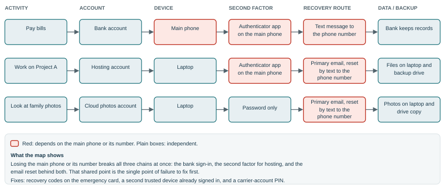

# 个人安全与恢复实用指南

修订版 0.27

## 1. 简介与目的

> **核心思路：先找出真正重要的东西，设想失去它的情形，然后选择防护措施和恢复途径。防护需要投入精力，所以要与实际需要相权衡，选择一个你能长期坚持的级别。**

**适用对象**
- 拥有多台设备、多个在线账户和多个项目（包括工作项目）的进阶日常用户。
- 希望在不具备专业安全知识的情况下，提高防护能力和可用性的人。

**为什么重要**
- 设备和账户单独看起来可能都很安全，但多个项目可能依赖同一台笔记本电脑、同一个手机号码或同一个电子邮件账户。
- 一次损失可能引发连锁反应：邮箱访问权 → 密码重置 → 云存储 → 恢复时需要用到的备份文件。
- 丢失手机也可能意味着失去网银访问权和登录验证码。
- 一台笔记本电脑出故障，就可能让几个项目同时停摆，而这与攻击毫无关系。
- 麻烦可能始于一次失误、一次技术故障或一次攻击。

**本指南能帮你做什么**
- 发现这些关联。
- 保护真正重要的东西。
- 在出问题时保留一条回头路。
- 持续而非零散地管理防护措施。

**如何使用**
- 每项防护都会多出一个小步骤，哪怕只是一个个人识别码（PIN）或一次指纹验证。选择适合你的平衡点。
- 按照你能坚持的节奏，逐个完成较小的级别。
- 请先阅读第 2 章“限制、边界与免责声明”和第 3 章“简要理论背景”。这两章篇幅很短，解释了各项操作背后的思路。

## 2. 限制、边界与免责声明

**本指南涵盖的内容**
- 它关注的是你本人：你的设备、账户、数据、习惯以及与之相关的风险，包括你生活中与工作相关的部分。
- 即使你经营一家公司，这一点也不变。你的个人环境在范围之内，公司则不在。

**本指南不涵盖的内容**
- 企业及其共享系统、客户数据或团队访问权限的安全方案。这些需要单独评估、投入更多精力并寻求专业支持。
- 灰色地带的活动：任何可能招致调查或起诉的事情。
- 定向追踪：有人持续跟踪你，或专门试图侵入你的账户或设备。即使是本指南的最高级别，也不涵盖这种情况。

**预期效果**
- 本指南能降低风险，但不能消除风险，也无法保证你的工作永远不会中断。
- 各个级别是按合理顺序排列的实用步骤，而不是安全等级评定。

**如何逐步完成**
- 一次只做一项操作。没有什么需要一下子全部改完。
- 尽可能从上到下进行：排在前面的项目之所以在前，是因为它们更重要，或者为后面的项目打下基础。在执行依赖某个前提的步骤之前，先完成该前提。
- 如果不确定，就先停下来，或者咨询专业人士。

## 3. 简要理论背景
本指南提炼了成熟的知识：美国国家标准与技术研究院（NIST）的网络安全框架和应急规划指南（特别出版物 800-34）、开放式全球应用程序安全项目（OWASP）的威胁建模方法，以及英国国家网络安全中心（NCSC）的备份指南。这些方法有助于把一个宽泛的主题转化为相关且可检验的操作；列出它们的名称，是为了方便你查阅。

你不需要记住下面这些术语。它们只是供你花一分钟琢磨一下，好看清这个主题真正关乎什么。阅读每个术语时，试着把它套用到自己的生活中：哪台笔记本电脑、哪个账户、哪些文件？

- **清单：** 一份持续维护的设备、账户、数据及其相互关系的记录；例如，哪个项目使用某台虚拟机（VM），以及由哪个账户控制它。
- **资产：** 有价值的东西；例如，笔记本电脑、文件或网银访问权。
- **威胁模型：** 可能出什么问题以及如何出问题；例如，网络钓鱼、误删除或笔记本电脑故障。
- **对手模型：** 攻击者的访问权限和能力；例如，持有泄露密码的骗子。这里我们关注常见攻击，而不是持续的定向追踪。
- **失陷：** 失去控制权或机密性；例如，有人在读你的邮箱，或在使用被盗的登录会话。
- **风险：** 可能性与后果的结合；例如，银行卡信息被盗的概率以及由此造成的经济损失。
- **依赖：** 使用或恢复另一项资产所需的东西；例如，失去邮箱访问权可能导致多个服务都无法重置密码。
- **控制措施：** 降低风险的措施；例如，屏幕锁定可以减少他人随手使用无人看管的手机。
- **剩余风险：** 预防措施之后仍未解决的部分；例如，备份无法挽回已经发生的泄露。
- **恢复：** 回到可用状态，包括账户、设备和数据；例如，在替换的笔记本电脑上登录并打开当前文件。
- **备份：** 为恢复而保留的副本；例如，昨天的文档版本。在完成恢复并检查之前，应视其为未经验证。
- **同步：** 使多个副本保持一致；例如，一次删除会在设备之间传播。仅靠同步并不能建立可恢复的历史记录。

## 4. 实践级别
切勿把密码、恢复代码、密钥或密码库导出文件交给人工智能（AI）助手，并请在服务提供商的官方页面上核实它给出的操作说明：菜单和功能会变化。

### 第 0 级 — 从这里开始：诈骗与最初的十分钟

投入：一次简短的时间；无需购买；无需技术技能。

许多账户和资金损失始于有人说服了你，而不是技术入侵。请先完成这一级：它针对的是最常见的途径，后面的每一级都假定你能识别这种情况。

#### 0.1 先停下来核实，再采取行动

一条固定规则和几个已保存的联系方式，让你不必在压力下做决定，就能核实紧急请求。

- [ ] **0.1.1 — 制定你自己的“停下”规则，并用一句话表述出来。** 例如：“对于找上门来的紧急请求，我从不直接照办；我会停下来，通过我自己选定的渠道核实。”
- [ ] **0.1.2 — 把银行、发卡机构和手机运营商的官方联系途径保存在不用手机也能找到的地方。** 使用银行卡背面的电话号码，或你亲自输入网址打开的服务商官网。
- [ ] **0.1.3 — 掌握“挂断回拨”规则。** 先挂断，然后通过已保存的官方途径主动联系该机构；绝不使用消息中的号码或链接。
- [ ] **0.1.4 — 与家人或亲近的同事约定一个验证问题或暗号。** 遇到任何涉及钱款或访问权限的紧急请求时使用。
- [ ] **0.1.5 — 开启银行和银行卡交易提醒。** 每笔付款都有短信或应用提醒，被盗刷的银行卡就能很快被发现。

- **原因：** 骗子依靠的是紧迫感、权威和保密，而不是技术。事先定好的固定规则，在你匆忙或害怕时依然有效。
- **工具和示例：** 典型套路：来电者自称是你的银行、警方或技术支持；“老板”或亲戚要求紧急汇款或购买礼品卡；“安全账户”的说辞；附带链接的快递或罚款通知；要求安装远程访问软件；要求念出一次性验证码。真正的机构不会索要你的密码、一次性验证码或恢复短语。
- **AI 帮助：** 粘贴一条可疑消息（删除真实人物的姓名、号码和链接），询问其中哪些部分属于施压手法，或者是真正的机构不可能提出的要求。把答案当作第二意见，而不是结论：仍要通过你保存的途径核实。切勿粘贴验证码、密码或银行卡号。
- **良好结果：** 你有一条规则、通往每个关键服务商的已保存途径、一个家人间的核实方法，以及能让被盗付款很快暴露的提醒。
- **检查：** 拿一条最近真实收到或设想出来的紧急消息，按你的规则走一遍。不借助该消息，找到你保存的官方途径。在下一次普通的刷卡付款后，确认提醒已经收到。
- **如果跳过：** 最常见的损失钱财或账户的途径仍然敞开，而本指南后面的任何技术防护，都无法阻止你亲手交出验证码。

#### 0.2 了解出错后的最初十分钟

一份简短清单，列出点击链接、付款或泄露验证码之后应立即做什么。

- [ ] **0.2.1 — 草拟一份简短的“最初十分钟”清单。** 参照“工具和示例”中列出的情形。
- [ ] **0.2.2 — 把清单放在不用手机也能读到的地方。** 纸质版或存在另一台设备上，这样手机丢失或被入侵时，清单不会一起丢掉。
- [ ] **0.2.3 — 用一个虚构的例子把它通读一遍。** 不要改动任何真实账户。

- **原因：** 在点了链接、付了款或泄露了验证码之后，人们往往会愣住，或者继续和来电者争辩。对于资金和能重置其他账户的账户来说，分秒必争。
- **工具和示例：** 起步清单，可根据你的情况调整：
  - 结束通话或聊天；不要试图和来电者一起“解决”问题。
  - 已经给出钱款或银行卡信息：通过你保存的号码致电银行或发卡机构，要求止付或冻结银行卡。
  - 在可疑页面输入了密码：从另一台可信设备上，用密码管理器修改密码，并退出其他会话。凡是重复使用过该密码的账户都要修改。
  - 泄露了验证码或点了批准：把该账户视为已被接管，使用其官方恢复途径。
  - 安装了远程访问软件：断开该设备的网络连接，然后从另一台设备修改重要密码。
  - 你的手机号码成为目标：通过已保存的途径联系运营商。
  - 保留截图和时间；向服务商、银行报告，必要时向有关部门报告。
- **AI 帮助：** 请助手把你的笔记整理成一页的检查清单，或者用“如果……会怎样”的情况来考验它。不要包含真实的账户标识和机密信息。
- **良好结果：** 一份在紧张状态下也能照着做的清单，并且与你将在第 5 级制定的更完整的设备丢失计划保持一致。
- **检查：** 可以从另一台设备或纸面上找到这份清单。按清单走一遍，每种情形都能说出一个具体的第一步行动。
- **如果跳过：** 拖延和临时应付，会把一个本可挽回的失误变成实际损失。

### 第 1 级 — 更安全的起点

投入：几次简短的时间；使用现有存储空间或一个备份硬盘/服务；日常设置技能。

#### 1.1 制作一份简短清单并放在随手可及之处

一份刻意保持简短的清单，列出最关键或最常用的东西，让你知道首先要保护什么。第 2.1 节会在之后把它补充完整；现在不要追求面面俱到。

- [ ] **1.1.1 — 记下最关键、最常用的设备和服务商。** 你每天使用的手机和电脑、你的网络和电话服务商、任何托管服务。
- [ ] **1.1.2 — 记下最关键、最常用的服务，以及你登录时使用的账户。** 网银、电子邮件、云文件，以及任何离开它就会很麻烦的东西。加上网站或管理页面链接。
- [ ] **1.1.3 — 记下你无法重新创建的数据以及它们存放的位置。** 照片、文档、项目文件：存放在哪台设备或哪个服务中。
- [ ] **1.1.4 — 标出最重要的条目。** 想一想：如果有人接管了这一条目，他能读取、修改、删除或花掉什么。
- [ ] **1.1.5 — 为每个已标记的条目注明：一旦丢失，什么会停摆。** 一个短语就够了。
- [ ] **1.1.6 — 保留一份不用主设备也能打开的副本。** 打印出来，或在第二台设备上存一份副本；重要变化之后及时更新。

- **原因：** 你无法保护或恢复你已经忘记的东西。已标记的条目还决定了本级其他所有事项的顺序：先保护哪个账户，先备份哪些数据。
- **工具和示例：** 一份私密笔记、电子表格或表格；大约一页的篇幅最合适。如果清单超过这个长度，就停下来，把其余部分留给第 2.1 节。被盗的网银登录信息可能让钱款暴露；被入侵的邮箱可能被用来重置其他账户；可以重新下载的文件通常不如家庭照片重要。一个不断变化的服务器环境可以只写一行：服务商、账户、控制台链接。切勿在清单中写入密码、密钥或恢复代码。
- **AI 帮助：** 请助手提供一个表格模板，或列出人们常常遗漏的类别，然后由你自己填写。它不可能知道你实际在用什么。只有在你觉得合适时才分享服务名称；绝不分享机密信息。
- **良好结果：** 一份简短的清单，列明你所依赖的东西以及如何找到它们，最重要的条目已做标记，并有一份副本随手可及。
- **检查：** 选一项日常活动，例如支付账单或打开项目文件，在清单中找到它所涉及的设备、服务和数据位置。点开一个链接，确认它能打开正确的页面。不用主设备打开那份副本。
- **如果跳过：** 在保护或恢复你的数字生活时，你可能会遗漏某个银行账户、服务商或数据位置，或者把精力花在顺手的事情上，而更重要的东西却仍然暴露在外。

#### 1.2 保护你的主要设备

主要设备是指你每天使用、并且一直登录着你的各个账户的设备：通常是你的手机和主电脑。一次处理一台设备。

- [ ] **1.2.1 — 为每台主要设备设置解锁密码。** 生物识别可以作为密码的补充，但不能替代密码。
- [ ] **1.2.2 — 开启自动锁屏。** 短时间闲置后即要求输入密码。
- [ ] **1.2.3 — 安装待处理的更新。** 先保存工作；只使用系统自带的更新功能。
- [ ] **1.2.4 — 完成更新要求的重启。** 合上笔记本电脑的盖子不等于重启。
- [ ] **1.2.5 — 在适当情况下开启自动更新。** 让系统自行安装常规修复，这样你就不必记着这件事。
- [ ] **1.2.6 — 如果还有别人使用你的电脑，为他们单独创建用户账户。** 如果没有别人使用，可跳过此步。

- **原因：** 这些设备上保持着通往你的邮箱、文件和钱款的已登录会话。锁屏能挡住捡到设备的人或路过的人；更新能修补已知的软件漏洞。
- **工具和示例：** 在设备设置中搜索“屏幕锁定”“登录选项”和“软件更新”。无需购买任何东西。远程服务器没有可锁定的屏幕，需要采用不同的方法；见第 3.3 节。
- **AI 帮助：** 询问某个设置在你的具体型号和系统版本中位于何处。它给出的菜单名称可能已经过时，所以要与制造商的支持页面核对。
- **良好结果：** 每台主要设备在无人看管时都会锁定，并且只需很少的手动操作就能获得更新。任何卡住的更新或推迟的重启都被记录下来，而不是一再被忽略。
- **检查：** 锁定并解锁设备。让它闲置，观察它是否会锁定。重启之后，打开更新界面，确认没有待处理的更新。一两周之后，确认确实有一次自动更新已经安装。
- **如果跳过：** 任何人拿起无人看管的设备，都能使用你已登录的账户，而已知的漏洞仍会暴露在常见攻击之下。

#### 1.3 设置并使用一个基本的密码管理器

密码管理器为每个账户生成独有的强密码，并替你记住它们。在这一节里，你要选定一个，保护好它，并确保自己始终能重新进入。

- [ ] **1.3.1 — 参照下表选择你的入门密码管理器。** 如果拿不准，就选你的设备对应的默认方案；以后可以更换。
- [ ] **1.3.2 — 用一个在其他任何地方都没有使用过的主密码或登录方式来设置它。** 要足够强。
- [ ] **1.3.3 — 在存入任何内容之前，先阅读它的恢复说明。** 现在就弄清楚：如果忘记主密码，这个管理器能恢复什么、不能恢复什么。
- [ ] **1.3.4 — 在支持的情况下，为管理器或其账户开启多重身份验证（MFA）。** 在新的登录方式确认可用之前，保持当前设备的登录状态。
- [ ] **1.3.5 — 在设置过程中，把管理器的恢复信息保存在密码库之外、主手机之外。** 一张装在密封信封里、放在家中安全位置的打印版应急卡就很好用。
- [ ] **1.3.6 — 从另一台可信设备打开密码库。** 在把关键密码迁入之前完成这一步。
- [ ] **1.3.7 — 确认不用主设备也能找到恢复信息。** 只用第二台设备或纸质资料打开恢复卡或笔记。
- [ ] **1.3.8 — 开始使用：保存两三个日常登录信息，并通过管理器用它们登录。** 先在几个真实账户上使用管理器，让它成为习惯，再迁移其余的账户。

- **原因：** 只有当有工具替你记住密码时，为每个账户使用独有密码才切实可行。这时管理器就成了你绝不能失去访问权的东西，所以要在依赖它之前，先准备好并测试它的恢复方式。
- **工具和示例：** 如果拿不准，就从你最常用的设备对应的“省心默认方案”开始。

  | 你的设备 | 省心默认方案 | 需要注意 |
  |---|---|---|
  | 以 Apple 设备为主 | Apple 内置的密码功能，由你的 Apple 账户保护 | 一切都依赖这个账户；在迁入关键密码之前，先按 1.4 节把它彻底保护好。在非 Apple 设备上使用不太方便 |
  | 以 Android 和 Chrome 为主 | Google 密码管理器，由你的 Google 账户保护 | 同样依赖单一账户；检查它能否同步到你使用的电脑上 |
  | 以 Windows 和单一浏览器为主 | 该浏览器内置的密码管理器，登录浏览器自己的账户 | 检查条目是只存在本地还是已同步，并单独保护和恢复该账户 |
  | 设备混用，或与他人共享登录信息 | 一款支持你所有设备的专用云同步密码管理器 | 保护好它的账户，了解它的恢复方式，并在支持的情况下规划一份可恢复的导出 |
  | 你希望自己掌控密码库文件，并愿意维护它 | 一个本地加密密码库文件，可选择通过云存储同步 | 保护好解锁密钥，保留带版本的备份，处理同步冲突；仅靠云同步不算备份。不适合作为新手的默认方案 |

- **AI 帮助：** 请助手用通俗的语言解释各个选项或某个不熟悉的恢复术语，并结合你的设备比较两个选择。依据管理器自己的官方文档做决定。切勿在 AI 聊天中输入主密码、恢复代码或密码库导出文件。
- **良好结果：** 密码有了一个受保护、而且你真正在用的“家”，即使丢失主设备也有办法进入。清单中只记录管理器的名称以及其恢复记录的存放位置。
- **检查：** 创建一个无关紧要的测试条目，锁定再解锁密码库，并在不用主手机的情况下，在另一台可信设备上找到该条目。独立找到恢复记录。不要为了测试而用掉一次性验证码或触发账户重置。
- **如果跳过：** 重复使用的密码和零散的记录仍然难以管理，一次泄露就可能打开好几个账户。一个没有经过恢复测试的管理器，可能成为让你被锁在门外的单点故障。

#### 1.4 保护你的主要账户

主要账户可以重置或解锁其他账户：你的主邮箱、你手机号码的运营商账户、你的密码管理器，以及你手机或电脑背后的账户（Apple、Google 或 Microsoft 账户）。先完成一个账户的所有步骤，再处理下一个。

- [ ] **1.4.1 — 为每个主要账户设置独有的密码。** 用管理器生成并保存。
- [ ] **1.4.2 — 在支持的情况下，为每个主要账户开启 MFA。** 在服务商提供的情况下，使用身份验证器应用或安全密钥；对于即时通讯应用，使用该应用自身的两步验证密码。
- [ ] **1.4.3 — 如果服务商提供恢复代码，在设置过程中把它们保存在手机之外、账户本身之外。** 打印出来，或保存在第二台设备上；不要只留在账户里。
- [ ] **1.4.4 — 确认恢复邮箱和恢复手机号码仍然有效。** 删除那些你已不再掌控的。
- [ ] **1.4.5 — 按照下表草拟四条恢复链，并标出任何循环。** 每条链一行；如果某一行的恢复依赖于它本身所解锁的东西，就做标记。
- [ ] **1.4.6 — 为每条链指定一条不需要主手机的恢复途径。** 第 4.1 节会对其进行实际测试。

- **原因：** 谁控制了这些账户，谁就能重置其他地方的密码并读取确认信息。它们是首要攻击目标，也是你最先需要夺回的东西。如果你能在不依赖任何本身已被锁定的东西的情况下逐一恢复每个账户，这条链就是“无循环”的。
- **工具和示例：** 使用服务商的官方安全页面、管理器的密码生成器，以及受支持的身份验证器应用、通行密钥（passkey）或安全密钥。用手机号码登录的即时通讯应用情况不同：它们的额外验证因素通常不是身份验证器应用或密钥文件，而是应用自身的设置，具体细节因应用而异。例如，WhatsApp 的两步验证会在号码重新注册时要求输入 PIN 码或密码；Signal 的 PIN 码只有在同时开启“注册锁定”时才能阻止重新注册；Telegram 提供两步验证密码，并且也支持用通行密钥登录。请在应用的官方帮助页面上查看其当前的登录和恢复选项，在保持当前会话不退出的情况下开启该设置，并把密码保存在管理器中。每条链填写一行；各列说明了要关注什么。

  | 链 | 通常的恢复方式 | 典型循环 | 需要准备的独立途径 |
  |---|---|---|---|
  | 主邮箱 | 恢复邮箱或手机号码、恢复代码 | 邮箱 A 只能通过邮箱 B 恢复，而邮箱 B 又只能通过 A 恢复 | 保存在应急卡上的恢复代码；一个由你掌控、且不依赖于第一个邮箱的第二邮箱 |
  | 手机号码 | 运营商账户、SIM 卡或 eSIM、运营商账户 PIN 码 | 运营商登录只能通过发往同一号码的短信重置 | 运营商账户 PIN 码和身份证明途径（见第 4 级） |
  | 密码管理器 | 恢复密钥或应急卡、第二台已登录设备 | 它的身份验证码只存在于密码库中，或只在丢失的手机上 | 与手机分开存放的应急卡；第二台可信设备 |
  | 手机或电脑账户（Apple、Google、Microsoft） | 可信设备、恢复密钥或恢复联系人、手机号码 | 唯一的可信设备就是丢失的那部手机 | 已保存的恢复密钥；第二台可信设备 |

  实例：Alex 的邮箱通过发往 Alex 手机号码的短信恢复。运营商登录通过发往同一邮箱的邮件恢复。管理器的身份验证码在手机上。如果手机丢失，每条链都要等另一条链，结果什么都恢复不了。Alex 在应急卡上保存了邮箱恢复代码，设置了运营商账户 PIN 码，并准备了第二台已登录管理器的设备。现在，每条链都有一条不涉及丢失手机的途径。
- **AI 帮助：** 只粘贴表头和你自己用大白话写的笔记（例如“我的邮箱通过发到我手机的短信恢复”），询问哪里可能藏着循环。询问某个服务商的恢复选项是什么意思。打开服务商的安全页面时，要自己输入官方网址，而不是通过助手或消息中的链接。绝不分享验证码。
- **良好结果：** 每个主要账户都有一个已保存的独有密码、一个额外的登录验证因素，以及一条你能实际使用的恢复路径。填好的表格中没有未标记的循环。密码和恢复代码存放在各自受保护的位置；清单中只记录它们存放在哪里。
- **检查：** 在保持登录的同时，在浏览器的隐私窗口中用已保存的密码和验证因素发起一次新的登录。对于注册在你手机上的即时通讯应用，改用该应用自身的安全检查方式，例如它提示你重新输入 PIN 码或密码的功能，绝不要为了测试而重新注册号码。在服务商提供的情况下发送一条恢复测试消息，确认它能到达一个由你掌控、且不用主手机也能打开的目的地。对于表中的每一行，你都能说出一条不需要主手机的途径，或者该缺口已被标记。
- **如果跳过：** 一个重复使用的密码，可能会把那个能重置所有其他账户的账户拱手让人。一条过时或循环的恢复途径，可能会把你挡在自己的账户之外。

#### 1.5 制作并测试第一份备份

第一份备份应当简单。选一样要保护的东西，并证明你能把它找回来。

- [ ] **1.5.1 — 把最重要的文件复制到外置硬盘或备份服务中。** 从第 1.1 节中标为最重要的数据开始。
- [ ] **1.5.2 — 断开硬盘连接，或用其他方式让副本处于你日常账户的触及范围之外。** 复制完成后拔下硬盘，或者使用一个你的日常登录无法删除的备份账户。
- [ ] **1.5.3 — 不借助原文件，把一个文件恢复到新文件夹中。** 使用备份的恢复或复制功能，绝不恢复到原文件所在的位置。
- [ ] **1.5.4 — 检查恢复出来的文件内容。** 打开恢复的文件，确认其内容和样子都符合预期。
- [ ] **1.5.5 — 检查它的日期或版本。** 确保它是你想恢复的版本，而不是旧的或不完整的副本。
- [ ] **1.5.6 — 在备份覆盖范围工作表中记下恢复测试的结果。** 一行即可：日期、恢复了什么、结果、下一步行动；不写机密信息。
- [ ] **1.5.7 — 在日历中添加一个定期重复的备份更新事件。** 每月一次是合理的起点。

- **原因：** 设备可能出故障、丢失，文件可能被删除或损坏，而同步可能把这种损害扩散到每一个副本。独立的备份才是回头路，而只有实际恢复才能证明它有效。
- **工具和示例：** 最简单的起步方式是一个外置硬盘加普通复制；保留多个版本的备份服务是很好的替代方案。复制之前先下载仅存于云端的文件，以免备份到空的占位文件。恢复到新文件夹中，绝不覆盖正在使用的文件。让副本保持隔离：一直插着的硬盘或同步文件夹，可能因为一次失误、勒索软件或接管你账户的人，而与原件一起被删除或加密。后面的级别会在这条规则的基础上展开，而不是重复它：第 6.4 节会检查它能否抵御账户被接管，第 9.2 节会增加一份异地副本。每月更新一次，重要变化之后也要更新；如果丢失一个月的工作无法接受，就更频繁一些。如果你的清单或密码库存放在云端，还要保留一份能独立打开的清单导出文件；至于密码库，请查看你的管理器支持的加密导出方式以及打开它需要什么。不要留下未加密的密码导出文件。账户恢复说明恢复的是访问权限，它不是密码库条目的备份。第 3 级会增加自动化和旧版本保留。
- **AI 帮助：** 请助手提供针对你的硬盘或备份工具的分步说明，或一个简单的记录模板。助手无法确认你的备份是否有效；只有你的恢复测试才能确认。
- **良好结果：** 一份明确的备份，并附有记录：它覆盖了什么、存放在哪里、日期、如何保持隔离，以及一项证明恢复可行的证据。
- **检查：** 恢复的文件能从新文件夹中打开，内容和版本都符合预期。在日常使用中无法触及并删除该备份；通过查看来确认，而不是通过删除任何东西来确认。测试已记录在备份覆盖范围工作表中。
- **如果跳过：** 设备丢失、数据损坏或通过同步扩散的删除，可能会让你没有任何可用的副本。未经测试的备份可能在需要时失效，或者保存的是一个出乎意料的旧版本。

### 第 2 级 — 整洁、防护更好的日常环境

投入：几次时间；主要使用现有设置；可能需要更换硬件；如有需要，可寻求加密方面的帮助。

#### 2.1 借助其他工具和方法扩充清单

第 1 级的清单来自记忆。现在要借助证据，找出记忆遗漏的东西。给它限定时间：30 分钟、三个来源，然后就停。

- [ ] **2.1.1 — 检查你的清单是否包含你实际使用的重要服务。** 把普通的一周在脑中过一遍。
- [ ] **2.1.2 — 在三个来源中查找被遗忘的账户。** 你的邮箱、你已保存的密码列表（只看网站名称），以及你的银行卡或银行对账单。
- [ ] **2.1.3 — 为每个重要条目补充：你将如何重新进入，以及它的机密信息存放在哪里。** 只写引用，例如“恢复代码：应急信封”。
- [ ] **2.1.4 — 标出依赖同一部手机、同一个邮箱或同一个号码的条目。** 附录中的依赖关系图示例展示了具体做法。
- [ ] **2.1.5 — 如果清单已经超出一份笔记能容纳的范围，就把它迁移到更有结构的工具中。** 可选。

- **原因：** 被遗忘的账户保留着旧密码和旧恢复信息，而且没人盯着。记下重新进入的方法，就能让清单在恢复时真正派上用场。
- **工具和示例：** 在邮箱中搜索欢迎邮件、收据、“确认你的邮箱”、密码重置通知和订阅续费通知。查看手机上的应用列表。一个包含用途、链接、优先级、恢复途径和机密信息存放位置等列的电子表格或 Grist 表格就足够了。
- **AI 帮助：** 两个提示词，只使用名称和结构。
  - *找出账户：* “我想找出自己可能已经遗忘的在线账户。请给我 15 条用于搜索邮箱的查询（欢迎邮件、收据、‘确认你的邮箱’、‘你的账户已创建’、密码重置通知、订阅续费通知）。再为我的手机应用列表和银行及银行卡对账单各提供同样的查询。我会自己执行。”
  - *整理账户：* “下面是一份纯粹的服务名称列表，不含密码或用户名。请把它们分为：资金、身份与政务、邮箱与电话、云文件与照片、工作与项目、社交、购物，以及可能已不再使用。对于每个重要的服务，说明它能在别处重置什么，以及我应该注销它还是保护它。我会在真实的服务上逐一核实。”

  已保存密码的导出文件中包含密码本身；只复制网站名称那一列，绝不复制整个文件。
- **良好结果：** 一份更完整、与你实际使用情况相符的清单，每个重要条目都注明了恢复途径，不再使用的账户已标记为待注销。
- **检查：** 从最近的付款对账单或手机主屏幕上挑出三项，逐一在清单中找到。针对一个重要条目，按照记录的恢复引用找到真实的存放位置。
- **如果跳过：** 旧账户会在你不知情的情况下一直暴露在外；而在紧急情况下，你知道某个账户存在，却不知道如何夺回它。

#### 2.2 清理过时、不再受支持和不再使用的系统

淘汰或限制不再获得安全修复的东西，并删除你不用的软件。

- [ ] **2.2.1 — 找出不再受支持的软件和设备。** 对照厂商的官方支持信息比较版本，而不是只看使用年限。
- [ ] **2.2.2 — 在淘汰不受支持的设备之前，先保存所需的数据。** 先导出或复制，这样淘汰设备时就不会毁掉唯一的副本。
- [ ] **2.2.3 — 在淘汰之前，确认敏感账户有其他访问途径。** 邮箱、服务商、管理员和身份验证器的访问权限。
- [ ] **2.2.4 — 停止使用不受支持的软件和设备进行敏感访问。** 把网银、邮箱和管理工作转移到仍能获得安全更新的设备或系统上。
- [ ] **2.2.5 — 为更换或升级设定日期。** 采购不应妨碍其他无关的防护步骤。
- [ ] **2.2.6 — 删除不再使用的应用。** 先检查它是否保存着所需的数据，或者是否是某些数据唯一的读取工具。
- [ ] **2.2.7 — 删除不再使用的浏览器扩展程序。** 检查每一个浏览器配置文件。

- **原因：** 一个还能运行、但不再获得修复的系统，会一直暴露在已知攻击之下。每一个不用的应用或扩展程序，都是又一个需要更新和信任、却毫无益处的东西。
- **工具和示例：** 厂商的支持生命周期页面、已安装应用列表，以及每个浏览器的扩展程序设置。以受支持的格式导出数据，并在替换设备上打开验证。在确认数据已保存、访问权限已就绪之前，不要清除旧设备。
- **AI 帮助：** 询问某个具体版本是否仍受支持，以及某个陌生的应用或扩展程序有什么用途，然后在厂商网站上确认。助手给出的支持日期可能已经过时。
- **良好结果：** 重要设备和软件的支持状态已经明确，敏感工作已转移到受支持的设备上，旧设备已标记为受限或已淘汰，每个剩余的例外都有带日期的计划，不必要的组件也更少了。
- **检查：** 在受支持的设备上打开一部分已保存的数据。不借助即将淘汰的设备登录关键账户。已删除的项目确实不见了，而你的正常工作仍能运转。每个例外都有限制措施和下一个日期。
- **如果跳过：** 旧系统会保留未修复的漏洞。仓促淘汰可能毁掉数据唯一可读的副本，或唯一可用的登录验证因素。没有日期的例外会变成永久性的。

#### 2.3 保护你其余的重要账户

按影响大小的顺序逐一处理清单上的账户，一次一个。

- [ ] **2.3.1 — 替换清单所列账户中的弱密码或重复使用的密码。** 让管理器为每个账户生成一个新的独有密码，一次处理一个账户。
- [ ] **2.3.2 — 为这些账户开启受支持的 MFA。** 在服务允许选择的情况下，优先使用应用、通行密钥或安全密钥，而不是短信。
- [ ] **2.3.3 — 如果某个重要账户支持通行密钥，就添加一个。** 同时保持密码和 MFA 可用。
- [ ] **2.3.4 — 在设置过程中，把每个受保护账户的恢复信息保存在该账户之外。** 把恢复代码和恢复密钥存放在无需登录该账户就能拿到的地方。
- [ ] **2.3.5 — 开启账户安全提醒。** 把它们发送到你真正会看的地方。

- **原因：** 第 1 级保护了能解锁其他账户的账户。现在，网银、支付、云文件、域名和托管服务也要得到同样的处理，这样一个泄露的密码就只是一个问题，不会牵连一片。
- **工具和示例：** 每个服务的官方安全设置，加上管理器的密码生成器，以及它提供的重复密码报告（如果有的话）。在新的登录方式验证通过之前，保持当前会话不退出，并在每次修改时更新密码库中对应的条目。密码库可以保存普通的恢复代码，但它自己的恢复不能只依赖它自身。
- **AI 帮助：** 请助手帮忙按影响大小给账户排序，或解释某个不熟悉的安全设置。不应让它看到密码或验证码。
- **良好结果：** 重要服务都有各自不同的已保存密码，在提供的情况下都有额外的登录验证因素，恢复信息可以从账户外部获取，提醒也会发送到你会查看的地方。
- **检查：** 对每个账户，在保持原会话的同时，用已保存的密码和验证因素发起一次新的登录。不进入该账户就找到它的恢复信息。在服务提供的情况下，确认一条无害的测试通知能够送达；把不受支持的功能记为缺口。
- **如果跳过：** 一个重复使用的密码可能让好几个服务暴露。缺失的恢复信息或静默的提醒，可能让你对入侵毫不知情，或者无法夺回访问权。

#### 2.4 加强设备防护

检查恶意软件防护是否在工作，并确保丢失或被盗设备的硬盘无法被读取。

- [ ] **2.4.1 — 确认恶意软件防护正常工作。** 检查系统自带的安全状态，并确认它是最新的。
- [ ] **2.4.2 — 检查重要设备的磁盘加密状态。** 在系统安全设置中查看；记下任何未加密的驱动器。
- [ ] **2.4.3 — 在缺少磁盘加密的地方开启加密。** 先决定恢复密钥存放在哪里。
- [ ] **2.4.4 — 在设置过程中保存加密恢复密钥。** 不要只保存在已加密的磁盘上，或可能与它一同丢失的手机上。
- [ ] **2.4.5 — 从另一台可信设备取回该密钥。** 在第二台设备上打开密钥，证明在这台设备无法使用时你依然能拿到它。

- **原因：** 屏幕锁保护不了从被盗电脑中拆出来的硬盘；加密才能做到。已经悄悄停止工作的恶意软件防护，什么也保护不了。
- **工具和示例：** Windows 安全中心，以及设备加密或 BitLocker；macOS 的 FileVault；可用性因版本和硬件而异。在不了解它们如何相互影响的情况下，避免再添加相互冲突的扫描程序。清单中只记录恢复密钥的存放位置以及它对应哪台设备，绝不记录密钥本身。
- **AI 帮助：** 询问如何在你的具体系统上检查加密状态，以及恢复密钥的用途。切勿把恢复密钥粘贴到聊天中。
- **良好结果：** 防护软件报告的状态正常且是最新的。重要设备已加密，每个恢复密钥都以私密方式存放在你能取回的地方。
- **检查：** 系统报告加密已开启并已完成。从另一台可信设备取回对应的密钥记录。在可用的情况下运行一次常规扫描。不要为了测试而故意锁定驱动器或删除密钥。
- **如果跳过：** 丢失或被盗设备上的数据，即使有登录界面也可能被读取。没有可取回恢复密钥的加密，可能把一次设备故障变成永久性的数据丢失。

#### 2.5 不让敏感信息显示在锁定的屏幕上

这是一个 15 分钟的设置，在任何丢失发生之前就能起作用。每部手机做一次，然后检查关联设备。

- [ ] **2.5.1 — 找出通知可能泄露验证码、私密消息或财务细节的应用。** 短信、电子邮件、即时通讯、网银、账户安全。
- [ ] **2.5.2 — 隐藏这些应用在锁屏上的消息预览。** 如果内容无法可靠隐藏，就让该应用的通知不在锁屏上显示。
- [ ] **2.5.3 — 在支持的情况下，限制无需解锁即可执行的敏感通知操作。** 例如回复。
- [ ] **2.5.4 — 检查你使用的配对或关联设备上的通知预览。** 手表或关联的电脑有各自的设置。
- [ ] **2.5.5 — 在手机保持锁定的状态下测试这些设置。** 锁定手机，给自己发一条测试消息，看看锁屏上显示了什么。

- **原因：** 如果刚收到的登录验证码或重置链接能在别人手中那部已锁定手机的屏幕上直接看到，再强的屏幕锁也无济于事。
- **工具和示例：** iPhone 上：设置 → 通知 → 显示预览，以及每个应用自己的通知设置；选择“解锁时”或“永不”。Android 上：在“通知”中搜索锁屏内容或敏感通知；部分设备提供按应用的控制。名称和可用性因设备而异。尽可能保留有用的提醒。
- **AI 帮助：** 询问这些设置在你的具体手机型号和系统版本中位于何处，然后在设备上确认。
- **良好结果：** 你能注意到提醒，但拿着这部锁定手机的人看不到其中的验证码、链接、消息或金额。代价是要多解锁一次才能阅读。应用名称可能仍然可见；隐藏文字并不能隐藏一切。
- **检查：** 向所选应用发送无害的测试消息。在不让面容或指纹解锁的情况下查看锁屏；试着展开通知并回复。然后解锁，确认提醒仍然能够到达。在关联设备上重复。不要为了测试而触发真实的银行提醒。
- **如果跳过：** 无需解锁手机，别人就能读到验证码和私密消息，甚至执行某些操作。

### 第 3 级 — 分隔各类活动，备份可靠

投入：几次时间；可能需要订阅备份服务或增加存储空间；日常设置技能，服务器方面如有需要可寻求帮助。

#### 3.1 为不同的任务使用不同的浏览器和配置文件

把不同类型的活动放在不同的浏览器配置文件中，这样一次失误就不会波及一切。

- [ ] **3.1.1 — 决定哪些任务需要单独的浏览器配置文件或浏览器。** 典型分组：资金与身份（网银、支付、政务）、日常浏览、每个项目或工作身份，以及不可信的浏览。
- [ ] **3.1.2 — 为资金和身份类账户创建单独的配置文件或浏览器。** 只在那里登录这些账户。
- [ ] **3.1.3 — 将该配置文件中的扩展程序减到最少。** 如果你使用密码管理器的扩展程序，通常有它就够了。
- [ ] **3.1.4 — 为每个项目或工作身份创建单独的配置文件。** 每个客户、项目或雇主各用一个配置文件，让它们的登录信息和扩展程序彼此分开。
- [ ] **3.1.5 — 使用单独的配置文件或浏览器进行不可信的浏览。** 陌生链接、下载，以及你只是试用一下的网站。
- [ ] **3.1.6 — 检查每个配置文件中保存的密码、自动填充和同步设置。** 只保留该配置文件需要的内容。

- **原因：** 浏览器会保存登录会话。如果某个会话或某个扩展程序被盗用或滥用，同一配置文件中打开的所有内容都会暴露，有时甚至不需要你的密码或 MFA。把任务分开，可以限制任何一次失误所能波及的范围。
- **工具和示例：** 每个主流浏览器都内置了配置文件功能；第二个浏览器或一个操作系统用户账户，比单纯的配置文件隔离得更彻底。虚拟机的隔离更强，但需要更多精力。配置文件能减少交叉污染，但无法阻止电脑本身上的恶意软件。给每个配置文件命名或设置颜色，让你一眼就能看出自己在哪个配置文件里。第 6 级会增加对活动会话的检查。
- **AI 帮助：** 询问在你所用的浏览器中创建和切换配置文件的步骤，或请它把你的账户按任务分组。在浏览器自己的帮助页面上核对菜单名称。
- **良好结果：** 资金与身份类账户位于一个精简的配置文件中，各个项目彼此分开，有风险的浏览在别处进行，而且你从配置文件名称就能知道自己身在何处。
- **检查：** 打开每个配置文件，确认它只登录了自己对应的账户，并且只有你列出的扩展程序。确认资金类配置文件中没有不必要的扩展程序。
- **如果跳过：** 一个恶意扩展程序、一个被盗的会话或一次粗心的点击，就可能同时波及你的网银、你的项目和你的私人账户。

#### 3.2 把个人密码和项目密码分到不同的密码库

*仅当你管理不止一个项目，或与他人共享任何账户时适用。*

在密码管理器中为每个项目分配单独的容器。

- [ ] **3.2.1 — 决定哪些项目需要自己的密码库。** 检验标准：谁可能需要访问，你会移交什么？
- [ ] **3.2.2 — 为个人用途和每个这样的项目分别创建单独的密码库或集合。** 以项目名称命名每个密码库，让移交时包含哪些内容一目了然。
- [ ] **3.2.3 — 把每个项目的凭据移入它自己的密码库。** 一次处理一个项目，移动或重新保存条目，然后删除旧的副本。
- [ ] **3.2.4 — 在清单中加一行，说明哪个密码库存放哪个项目。** 只写引用。
- [ ] **3.2.5 — 检查某个项目密码库能否在不暴露个人条目的情况下移交或共享。** 通过查看来检查，而不是真的去共享。

- **原因：** 一个大密码库意味着，你与之共享的任何人或任何一次失误，都能触及所有内容。分开的容器让你可以把某一个项目交给合作者、或日后交给继任者，而不涉及你的私人生活。
- **工具和示例：** 大多数管理器都支持多个密码库、带有独立共享设置的文件夹或集合。使用一个管理器加多个独立容器：你只需保管一个主密钥和一份恢复记录。只有在以下情况下才使用单独的管理器账户：必须由另一个人持有或继承访问权、项目属于客户，或者项目可能被出售或移交；这样做的代价是多一个主密钥和多一份恢复记录，相关内容见第 7 级。雇主发放的管理器归雇主所有，不在本指南范围之内。
- **AI 帮助：** 根据一份纯粹的项目名称列表，请助手建议密码库的名称，以及哪些项目值得单独设立密码库。不要分享凭据。
- **良好结果：** 个人凭据和项目凭据存放在不同的容器中，每个项目的容器都可以单独移交。
- **检查：** 打开每个容器，确认其中只有对应项目的条目。确认共享设置与应有访问权的人相符。
- **如果跳过：** 一个被共享或被入侵的项目登录信息，可能让个人账户暴露；而一旦需要移交，你就得匆忙整理自己的凭据。

#### 3.3 保护对服务器和虚拟机的访问

*仅当你使用远程服务器或虚拟机时适用。*

控制谁、以及什么程序能够登录你的服务器，这样授予、检查和撤销访问权时就不必到处寻找密钥。哪些步骤适用，取决于你运行的机器数量。

- [ ] **3.3.1 — 确定服务商控制台以及管理它的账户。** 记下每台服务器或虚拟机由哪个服务商、哪个登录账户管理。
- [ ] **3.3.2 — 在提供的情况下，用 MFA 保护服务商登录。** 使用身份验证器应用或安全密钥；服务商账户可以控制其下的所有机器。
- [ ] **3.3.3 — 在更改任何服务器的登录设置之前，先确认存在独立的管理访问途径。** 第二个可用的会话，以及服务商的恢复控制台。
- [ ] **3.3.4 — 少量手动管理的服务器：为每个人和每台设备分配各自的密钥或登录账户。** 不要共用。
- [ ] **3.3.5 — 少量手动管理的服务器：删除不再需要的密钥和登录账户。** 删除那些不再需要访问权的人员、设备和工具的旧密钥和登录账户。
- [ ] **3.3.6 — 大量或经常变化的机器：通过组或角色授予访问权，而不是逐台服务器授予。** 使用服务商的身份管理系统。
- [ ] **3.3.7 — 大量或经常变化的机器：优先使用短期凭据，而不是长期留在机器上的密钥。** 例如证书或服务商的会话工具。
- [ ] **3.3.8 — 大量或经常变化的机器：记录哪个组或角色能访问哪个环境。** 只写引用。
- [ ] **3.3.9 — 大量或经常变化的机器：检查把一名测试人员从组中移除后，其访问权是否随之撤销。** 使用一个无害的测试账户，这样在依赖这一机制之前，你能亲眼看到移除生效。

- **原因：** 访问服务器要经过服务商账户和远程登录。两者都可能被接管，如果修改时不小心，两者都可能把你锁在门外。只有几台机器时，逐台服务器管理密钥还应付得过来；机器一多，密钥就会成倍增加，没人知道谁持有哪把密钥，而移除某个人就意味着要登录每一台机器。
- **工具和示例：** 远程登录通常使用安全外壳协议（SSH）或远程桌面协议（RDP）。手动管理方式：每个人和每台设备一把密钥或一个登录账户，私钥受到保护，并记录谁拥有访问权。基于规则的方式：人员加入服务商身份管理系统或单点登录中的组或角色，组再对应到他们可以访问的资源；访问权通过成员身份授予，短期证书或会话工具取代长期存在的密钥，人员离开时只需从组中移除一次。围绕工作负载和备份来安排服务器的更新和重启，而不是照搬笔记本电脑的设置。清单中保存一条访问引用就够了，不需要罗列每一个登录账户。如果访问或恢复路径不清楚，请询问负责的管理员。
- **AI 帮助：** 助手可以解释某种访问方式，或从一般层面审视一项计划中的变更。切勿粘贴私钥或密码，也不要在线上服务器上运行你不理解的命令。
- **良好结果：** 对于每个环境，你都知道谁或什么程序能访问它、这种访问如何撤销，并且你亲眼看到过第二条进入途径能够使用。
- **检查：** 通过预定的途径登录，并确认服务商的恢复控制台能够打开。不要仅仅为了测试而更改防火墙或身份验证设置。
- **如果跳过：** 薄弱的服务器登录会让服务器上的一切暴露在外，一次错误的变更可能切断你自己的访问权，而以前的合作者可能仍保留着你已经忘记的访问权。

#### 3.4 让备份自动运行，并检查它覆盖了什么

让备份无需你动手就能运行，并检查它是否覆盖了重要的内容。

- [ ] **3.4.1 — 对照下列五个类别检查你的备份。** 为每一类说明对应的备份以及如何恢复。
- [ ] **3.4.2 — 记下未覆盖的内容。** 为每个缺口注明原因、优先级和下一步行动。
- [ ] **3.4.3 — 为已覆盖的数据设置自动备份。** 使用系统的备份工具或服务商的定时备份，而不是手动复制。
- [ ] **3.4.4 — 设置备份失败提醒，并安排一次定期手动检查作为后备。** 选择你确实会看的邮件或消息，并设置一个定期重复的提醒作为备用。
- [ ] **3.4.5 — 用一次无害、受支持的测试，确认提醒能送达你。** 使用工具的测试通知功能；不要为了检查而破坏真实的备份。

- **原因：** 一个运行正常的备份任务，仍然可能漏掉你最需要的数据，而手动副本会过时。自动化让副本保持最新；提醒会在它停止时告诉你。
- **工具和示例：** 用这份简短的覆盖范围检查表；每一行的结果都应当是一个你能说出名字的备份，或一个已记录的缺口。
  1. 文档和项目文件，包括仅存于云端的文件。
  2. 照片和其他无法替代的媒体文件。
  3. 电子邮件、联系人和日历。
  4. 密码库导出文件、恢复记录和加密密钥。
  5. 项目服务器和数据库（如果有的话）。

  云邮箱可能需要单独导出；正在运行的数据库可能需要使用其支持的备份方式；服务商的快照需要检查能否真正恢复使用，而不只是检查它是否存在。使用系统自带的备份工具或服务商有文档说明的备份功能，并使用测试通知功能，而不是去破坏真实的备份。附录中的备份覆盖范围工作表是更详细的版本。
- **AI 帮助：** 请助手解释适用于你系统的备份工具选项，或把这五个类别做成一张你可以填写的表格。它看不到你的备份里有什么。
- **良好结果：** 五个类别中的每一类都已覆盖、尚未验证或被标记为缺口，并且有名字的备份任务按计划运行，失败时有人会注意到。
- **检查：** 选两三组真实数据，追踪到某个有名字的备份和恢复方法。观察一次定时运行，并确认最近的一次更改可以恢复。无害的提醒已经送达，或者手动检查已定好日期。
- **如果跳过：** 缺口看起来像是完整的防护，副本在无人察觉中过时，失败也悄无声息，直到你需要恢复的那一天。

#### 3.5 保留旧版本并测试其中一个

保留足够的历史记录，以便回到很晚才发现的失误之前，并证明这样做可行。

- [ ] **3.5.1 — 按照下面的起步规则设置保留期限。** 按照“工具和示例”中的规则，设置备份保留的天数或版本数。
- [ ] **3.5.2 — 核实服务商实际的保留期限。** 以你所付费的套餐为准，而不是宣传页面。
- [ ] **3.5.3 — 找到服务商的回收站和版本历史恢复选项。** 找到在哪里可以恢复已删除的项目和较早的文件版本，以及能保留多久。
- [ ] **3.5.4 — 把某个文件的较早版本恢复到单独的位置。** 不要动正在使用的文件。
- [ ] **3.5.5 — 记下结果。** 所选版本、来源、结果、所用时间、下一步行动。

- **原因：** 删除或损坏往往很晚才被发现。如果保留的每个版本都已经包含了这一损害，备份就帮不上忙。
- **工具和示例：** 起步规则，而非标准：至少保留 30 天的版本，在套餐和存储空间允许的情况下保留 90 天。如果做不到，就把较短的期限记为已知缺口。第 9 级会用基于你自身情况的目标取代这条规则。回收站和版本历史的期限可能与备份保留期限不同。测试时，选一个能认出较早内容（某句话或某张照片）的文件。
- **AI 帮助：** 询问某个保留设置的含义，或请它帮忙比较你从服务商官方页面上复制下来的套餐限制。
- **良好结果：** 保留期限遵循起步规则，已确认的限制就写在旁边，并且有证据表明较早的版本确实可以恢复。
- **检查：** 从单独的位置打开恢复出来的较早文件，确认其中是预期的较早内容。将实际可用的最早版本与规则进行比较。不要为了测试而删除正在使用的文件。
- **如果跳过：** 一次成功的最新文件测试，可能掩盖了已经损坏的历史记录；等到发现损害时，剩下的每一个副本可能都已包含它。

### 第 4 级 — 手机或电脑丢失时仍受保护

投入：几次时间；另一台可信设备，可能还需要一个备用身份验证器；运营商和服务商的说明。

#### 4.1 不借助主设备访问你的账户

趁主设备还能用时做这件事。每次测试期间都不要使用主设备；不要清除它，也不要让它退出登录。使用第 1.4 节的恢复链表格：现在表中的每一行都应当能够得到证实。

- [ ] **4.1.1 — 在另一台可信设备上登录邮箱，且不使用主手机进行 MFA。** 使用备用验证因素或恢复代码；让主手机保持关机或闲置。
- [ ] **4.1.2 — 在同样的条件下登录密码库。** 对密码管理器做同样的测试：另一台设备，不用主手机。
- [ ] **4.1.3 — 不借助主手机打开你的恢复笔记。** 从第二台设备或纸面上打开笔记，确认它们不依赖于手机。
- [ ] **4.1.4 — 在一个低风险账户上测试身份验证器应用的恢复或迁移。** 在新的验证因素成功之前，保持现有的验证因素可用。

- **原因：** 第二台设备可能会显示登录页面，然后却要求在丢失的手机上输入验证码或进行批准。这一节要在真正丢失之前找出这种依赖。
- **工具和示例：** 第二台电脑、平板或受保护的备用手机；备用身份验证器、硬件安全密钥，或服务商支持的恢复途径。切勿在公共电脑上使用密码库。身份验证器应用各不相同：有些通过账户同步，有些需要手动迁移或在每个服务上重新注册，而需要旧手机才能完成的迁移，在那部手机丢失后就帮不上忙了。把导出的设置密钥和迁移图像当作凭据对待，而不是当作普通笔记里的截图。
- **AI 帮助：** 询问你的身份验证器应用在手机丢失时如何处理，以及“重新注册”之类术语的含义。不要分享迁移图像或验证码。
- **良好结果：** 在平时那部手机不参与的情况下，你有一条通往邮箱、密码库和恢复笔记的明确途径，有一种经过测试的恢复登录验证码的方法，并且恢复链表格已根据目前已证实的内容进行了更新。
- **检查：** 在主手机不提供批准、验证码或访问的情况下，完成每一次登录并打开笔记。用恢复或迁移后的验证因素，在低风险账户上重新登录一次。任何仍然需要主手机的行都被标记为缺口。
- **如果跳过：** 你可能记得每一个密码，却仍然被锁在门外，而恢复说明也被锁在同一扇门后。

#### 4.2 为丢失的设备设置查找和锁定功能

开启能定位和锁定丢失设备的服务，并检查你能否访问它们。

- [ ] **4.2.1 — 在可用的情况下开启设备定位功能。** 在每部手机、平板和电脑上开启平台的“查找我的设备”设置。
- [ ] **4.2.2 — 在可用的情况下开启远程锁定功能。** 检查你能否远程锁定丢失的设备，而不将其清除。
- [ ] **4.2.3 — 从另一台设备、使用备用登录验证因素访问这些服务。** 不要发出清除指令。

- **原因：** 只有在事先开启了该功能，并且不借助设备本身也能访问它时，定位或锁定丢失的设备才能奏效。
- **工具和示例：** 你的手机或电脑平台内置的设备查找服务。有些服务提供一种有限的丢失设备登录方式，不需要通常的验证码。现在就保存官方网址，而不是在丢失后相信消息中发来的链接。
- **AI 帮助：** 询问你所用平台的查找服务在设备离线时能做什么、不能做什么。实际操作步骤以服务商自己的设备丢失页面为准。
- **良好结果：** 你能访问该服务，看到正确的设备，并知道它支持哪些操作。离线的设备可能无法立即接受指令。
- **检查：** 在另一台可信设备上通过文档说明的途径登录，并找到正确的设备。只查看状态：不清除，也不执行任何可能把你锁在外面的锁定。
- **如果跳过：** 你可能在设备丢失时才发现该服务从未开启过，或者只能用那台丢失的设备才能访问它。

#### 4.3 在运营商处保护你的号码

*仅当你的手机号码会接收登录验证码或银行验证码时适用。对大多数读者来说都是如此。*

运营商账户 PIN 码是一个机密信息，你要把它提供给运营商的工作人员或应用，以证明你是账户的所有者，然后他们才会做出任何更改，例如补办 SIM 卡或转出你的号码。它不是多重身份验证（MFA）——MFA 是用第二个验证因素（例如应用生成的验证码或安全密钥）来保护在线账户的登录；它也不是 SIM 卡 PIN 码或设备解锁密码。

- [ ] **4.3.1 — 在可用的情况下设置运营商账户 PIN 码。** SIM 卡 PIN 码无法阻止运营商补发替换 SIM 卡。
- [ ] **4.3.2 — 在可用的情况下开启携号转网锁定。** 要求运营商在没有额外核验的情况下，阻止把你的号码转到其他运营商。
- [ ] **4.3.3 — 了解运营商补办 SIM 卡需要哪些身份证明。** 询问他们需要什么证件或信息，并把答案放在不用手机也能读到的地方。
- [ ] **4.3.4 — 了解如何解除转网锁定。** 询问锁定如何解除，以及需要多长时间。
- [ ] **4.3.5 — 了解补办 SIM 卡通常需要多长时间。** 询问在新 SIM 卡上恢复服务通常需要多久。

- **原因：** 有人可能不必碰你的 SIM 卡，只需说服运营商，就能试图转走你的号码。而同样了解运营商的流程，也正是你自己快速夺回号码的关键。
- **工具和示例：** 运营商可能提供账户密码、转出锁定或额外核验；名称和保护措施因运营商和国家而异。转网锁定不一定涵盖所有类型的 SIM 卡更换，所以两者都要问。把答案放在不用手机也能读到的地方。
- **AI 帮助：** 请助手为你起草要问运营商的问题。你要记录的是运营商的回答，而不是助手的回答。
- **良好结果：** 运营商账户已启用其提供的保护措施，而且你有一条切实可行、已写下来的夺回号码的途径，包括它的局限。
- **检查：** 通过运营商的官方渠道确认这些保护措施显示为已启用。不用手机找到补卡和解除锁定的说明。不要为了测试而发起真实的转网或 SIM 卡更换。
- **如果跳过：** 你的号码以及发到这个号码的验证码，可能通过运营商被转走。如果所需的身份证明不在手边，你自己的恢复也可能被拖延。

#### 4.4 设置 SIM 卡 PIN 码（可选）

*可选。请先完成第 4.3 节：防范 SIM 卡调包诈骗时，运营商账户的保护更重要，而且 SIM 卡 PIN 码有锁死你自己 SIM 卡的风险。*

用户识别模块（SIM）卡 PIN 码与设备解锁密码、以及第 4.3 节中的运营商账户 PIN 码都不同。在开启它之前，先准备好它的恢复方式。

- [ ] **4.4.1 — 从运营商处获取当前的 SIM 卡 PIN 码。** 不要猜。
- [ ] **4.4.2 — 从运营商处获取个人解锁码（PUK）。** 在多次输错 PIN 码后，PUK 可以解锁 SIM 卡；在需要之前就要到它。
- [ ] **4.4.3 — 在开启 PIN 码之前，把 SIM 卡的恢复信息保存在手机之外。** 把 PIN 码和 PUK 写在卡片上或装在密封信封里，不要存在同一部手机上。
- [ ] **4.4.4 — 在支持的情况下，开启一个与设备密码不同的 SIM 卡 PIN 码。** 这也包括嵌入式 SIM 卡（eSIM）。
- [ ] **4.4.5 — 重启手机，测试已知的 SIM 卡 PIN 码。** 多次输错可能会锁死 SIM 卡。

- **原因：** 如果没有 SIM 卡 PIN 码，一张被插到另一部手机上的实体 SIM 卡就能接收你的来电和短信验证码。设备解锁密码无法阻止这种情况。
- **工具和示例：** 运营商的官方账户页面、SIM 卡的原始资料或客服渠道。密封的纸质记录是存放 PUK 的简单方式。菜单和可用性各不相同。
- **AI 帮助：** 请助手解释 SIM 卡 PIN 码、PUK 和运营商账户 PIN 码之间的区别。绝不要向它索要可以拿来试的“默认”PIN 码：默认值各不相同，而错误的尝试会锁死 SIM 卡。
- **良好结果：** 重启后或插到另一部手机上时，SIM 卡会要求输入 PIN 码，而且不用手机也能拿到它的恢复信息。预计每次重启后都要多输入一个密码。
- **检查：** 确认保存的记录对应的是正确的号码。在方便的时候重启，只输入已知的 PIN 码。绝不猜测 PIN 码或 PUK。
- **如果跳过：** 未受保护的实体 SIM 卡可以在另一台设备上使用。在没有恢复信息的情况下开启 PIN 码，可能会切断你自己的手机服务。

#### 4.5 使用单独的号码接收登录验证码（可选）

*仅当你能使用第二条电话线路（第二张 SIM 卡或一个 eSIM）并愿意妥善保护它时适用。许多读者并不需要这样做。*

一个只有你的银行和关键账户知道的第二号码，更不容易成为骗子的目标。

- [ ] **4.5.1 — 判断第二个号码是否值得。** 如果你的主号码广为人知，而你的账户仍然通过短信发送验证码，它的帮助最大。
- [ ] **4.5.2 — 以你本人的名义，从正规运营商处获取号码。** 避免使用免费或临时的虚拟号码：银行常常不接受这类号码，而且它们更容易丢失。
- [ ] **4.5.3 — 像保护第一个运营商账户那样保护这个运营商账户。** 按照第 4.3 节，为它设置运营商账户 PIN 码和携号转网锁定。
- [ ] **4.5.4 — 保持线路活跃。** 针对运营商的要求在日历中添加一个定期重复的事件，因为不活跃的号码可能会被回收。
- [ ] **4.5.5 — 一次把一个重要账户的登录或恢复号码改为这个号码。** 在新号码确认可用之前，保留旧号码。
- [ ] **4.5.6 — 对新号码保密。** 不要把它告诉联系人、公开发布，或用于购物和填写表单。
- [ ] **4.5.7 — 更新你的恢复链表格。** 对于每条已改用新号码的链，把新号码添加为其恢复途径。
- [ ] **4.5.8 — 把新号码加入清单。** 记下这条线路、运营商，以及其恢复信息的存放位置。

- **原因：** 骗子和 SIM 卡调包诈骗者都是从能找到的号码下手的。一个只有你的银行和关键账户知道的号码更难被盯上，而且能让垃圾信息和骚扰电话远离接收验证码的那条线路。
- **工具和示例：** 一部双卡手机，或一张实体 SIM 卡加一个 eSIM。第二条线路需要支付套餐费或充值费，会多出一个运营商账户和一条恢复链，而且一旦停用就可能失去。如果某个服务支持身份验证器应用、通行密钥或安全密钥，用它们取代短信验证码，就能消除对任何号码的依赖；单独的号码留给那些别无他法的服务。有些服务商不接受发送到第二条线路的短信验证码，所以在迁移账户之前先确认。
- **AI 帮助：** 请助手从一般层面比较适合你手机型号的套餐和 eSIM 支持情况，或起草要问运营商的问题。可用性和价格以运营商本身为准。不要分享你的号码。
- **良好结果：** 有一个号码专门接收你的登录验证码，知道它的人很少，它受到与你主线路同样仔细的保护，并且已记录在你的恢复链中。
- **检查：** 从一个已迁移的账户触发一条无害的验证码，确认它发到了新线路上。通过运营商的官方渠道确认运营商账户 PIN 码和转网锁定显示为已启用。不要为了测试而发起真实的转网或 SIM 卡更换。
- **如果跳过：** 不会有什么损坏：这是一项可选的附加措施。跳过它的读者仍保有第 4.3 节的保护，并在可能的情况下减少对短信验证码的依赖。

#### 4.6 为“一只包丢了，什么都没了”做好计划

确保一次丢失不会同时带走你的设备和你的回头路。

- [ ] **4.6.1 — 想一想你通常会把哪些东西放在一起随身携带。** 手机、笔记本电脑、安全密钥、钱包、钥匙、恢复卡或笔记。
- [ ] **4.6.2 — 把能互相恢复的东西放在不同的地方。** 例如，应急卡、备用安全密钥或备份硬盘留在家里，而不是放在包里。
- [ ] **4.6.3 — 确保至少有一台可信设备或一条恢复途径留在包外。** 例如，家里有第二台已登录的设备，或在别处存放一把备用密钥。
- [ ] **4.6.4 — 检查你随身携带的每台设备是否都开启了锁屏以及查找和锁定功能。** 确认你随身携带的手机、笔记本电脑和平板都开启了屏幕锁和“查找我的设备”。
- [ ] **4.6.5 — 在纸面上把这个情景推演一遍。** 手机和笔记本电脑都没了：你还能访问什么，什么被卡住了？

- **原因：** 许多计划都默认只会丢一样东西。而在现实生活中，丢一只包、丢一辆车或遭遇一次入室盗窃，就会把手机、笔记本电脑和备份硬盘一起带走。
- **工具和示例：** 家里的一台可信第二设备、存放在别处的备用安全密钥、一个不和笔记本电脑放在同一个包或同一个房间里的备份硬盘，以及一张受保护的应急卡。一台家庭共用电脑会增加暴露面：使用同一账户的任何人都能访问其中保存的会话和浏览器数据。
- **AI 帮助：** 请助手用“如果这个也丢了怎么办”之类的问题，来考验你的纸面推演。不要包含真实的标识信息和机密信息。
- **良好结果：** 没有任何一只包、一个房间或一辆车，会同时装着你的设备以及恢复它们所需的全部东西。
- **检查：** 在纸面上依次去掉每一件随身物品，并找到一条夺回邮箱、密码库和文件的途径。确认不用丢失的设备也能拿到放在家里的副本。不要真的移除或停用任何东西。
- **如果跳过：** 一次盗窃或意外，就可能同时带走设备和恢复途径。

### 第 5 级 — 为同时失去一切做好准备并演练过

投入：几次时间外加一次安全的演练；用于存放副本的纸张或加密存储；一个日历。

#### 5.1 为丢失身份证件和国家电子身份证做好准备

*仅当你持有身份证件，或使用基于手机的电子身份证（e-ID）、银行身份认证（bank-ID）或数字钱包应用时适用。规则因国家而异；请记下你所在国家的办理途径。*

了解如何补办每一份证件，以及如何恢复任何基于手机的身份证明。

- [ ] **5.1.1 — 想一想你的关键身份证件以及各自的签发机构。** 护照、国民身份证、驾照、居住证或税务文件、保险卡。
- [ ] **5.1.2 — 找到每个签发机构的补办途径。** 到哪里申请、需要什么、需要多长时间。
- [ ] **5.1.3 — 把受保护的副本放在不用手机也能拿到的地方。** 加密保存或纸质保存；不要放在普通的相册或聊天中。
- [ ] **5.1.4 — 如果你使用基于手机的电子身份证或银行身份认证应用，了解如何在没有旧手机的情况下恢复或重新签发。** 在签发机构的帮助页面上查找具体步骤以及任何需要本人到场的要求。
- [ ] **5.1.5 — 把每个签发机构的挂失联系方式加入你的行动计划。** 加入证件或电子身份证丢失或被盗时应使用的电话号码或网站。

- **原因：** 丢失护照或电子身份证应用，可能会妨碍网银、出行、政务服务，甚至账户恢复。提前了解补办途径，可以节省好几天时间。
- **工具和示例：** 签发机构的网站、提供相关应用的运营商或银行的帮助页面，以及你在第 2 级设置的加密存储。证件副本本身就是敏感信息；切勿把它们放进 AI 聊天。要预计会有延误、需要本人到场的步骤和费用，并把它们记下来。
- **AI 帮助：** 询问助手应该向每个签发机构提出哪些问题，或者如何组织这份列表。不要上传证件扫描件或证件号码，并向签发机构核实每一项流程。
- **良好结果：** 对于每份证件和每个应用：由谁签发、如何挂失、补办需要什么，以及你的受保护副本存放在哪里。
- **检查：** 从另一台设备找到每一项的挂失联系方式。对于基于手机的应用，找到签发机构自己关于换新手机的说明，但不要真的发起重新签发。
- **如果跳过：** 丢失一份证件或电子身份证，可能会让网银、政务服务和出行陷入停滞，而每一项补救都要在你承受压力时从零开始。

#### 5.2 想清楚设备丢失时的计划

提前决定一旦手机或电脑丢失你会怎么做，这样就不必临时应付。

- [ ] **5.2.1 — 把紧急联系方式保存在不用手机也能找到的地方。** 两位可信赖的人、运营商、银行反欺诈支持，以及相关的宽带或物业支持。
- [ ] **5.2.2 — 草拟一份设备丢失时要做的事项的简短清单。** 可信设备访问、定位和锁定、保护账户和会话、联系运营商，以及在适当情况下报告失窃。
- [ ] **5.2.3 — 在任何清除操作之前加入一个决策点。** 权衡恢复的完整性、证据以及对服务商方面的影响。

- **原因：** 在压力下，你不会记得电话号码或正确的顺序，而存着它们的那部手机恰恰就是丢失的那一件。
- **工具和示例：** 一张私密的打印卡片，或一份可以独立访问的笔记，上面有官方电话号码、查找服务的网址以及指向恢复说明的引用。使用附录中的简短行动清单模板。为疑似失窃或账户被接管的情况单独加一个分支。紧急的财务风险可能会改变处理顺序。
- **AI 帮助：** 请助手把你的笔记整理成一页的检查清单，或用“如果……会怎样”的问题来考验这个计划。不要在聊天中包含电话号码、账户标识和机密信息。
- **良好结果：** 一份无需查找或回忆就能照着做的清单，建立在你于第 4.1–4.4 节中测试过的途径之上。机密信息仍存放在受保护的存储中。
- **检查：** 从另一台设备或纸质副本上找到每个联系方式和官方页面。在不做任何破坏性操作的前提下，把计划走一遍。清除操作绝不是演练步骤。
- **如果跳过：** 拖延、临时决定以及对丢失手机的依赖，会延长失去访问权的时间，并让已经暴露的账户继续可被利用。

#### 5.3 演练恢复工作

在另一台可信设备上，使用你在第 4.1 节中已证实可用的登录方式，把整条途径完整地走一遍。

- [ ] **5.3.1 — 在另一台可信设备上恢复必要的文件。** 恢复到单独的位置。
- [ ] **5.3.2 — 用它们完成一项小的真实任务。** 例如，打开一份恢复出来的项目文档，并从相关的服务中把它发送出去。
- [ ] **5.3.3 — 记下结果。** 哪些有效、花了多长时间、需要修正什么。

- **原因：** 文件和账户在纸面上可能各自看起来都能恢复，但在替换设备上把它们组合起来的整个过程却可能失败。
- **工具和示例：** 选一项你经常做的小任务。使用你已经准备好的备份和恢复笔记。不要覆盖正在使用的文件，也不要把数据导入覆盖一个正在使用的密码库。
- **AI 帮助：** 请助手事先帮忙规划演练步骤，或在事后整理你的笔记。
- **良好结果：** 有证据表明你的途径能同时恢复可用的数据和访问权，而且计划已根据实际发生的情况进行了更新。
- **检查：** 在不使用主手机或主电脑的情况下完成所选的任务，然后检查恢复出来的内容和版本。保持源备份完好无损。如实记下成功、部分成功、失败或未测试，并在修正障碍后重复演练。
- **如果跳过：** 对你的恢复能力的第一次真正检验，将发生在一次真正的丢失之中。

#### 5.4 通过季度检查让一切保持有效

一个定期重复的约定，就能防止上面的一切在不知不觉中过时。

- [ ] **5.4.1 — 在日历中添加一个每季度一次、时长 15 分钟的定期检查事件。** 选一个每三个月一次的日期，并把事件设置为重复。
- [ ] **5.4.2 — 把下面的六项检查清单保存在该事件旁边。** 把这六项附在日历事件上，让它们每次都会出现。
- [ ] **5.4.3 — 完成第一次检查并记录下来。** 现在就把清单过一遍，并记下日期以及你修正了什么。

- **原因：** 本指南中的一切都会逐渐失效：恢复代码会过时，备份会偏离，联系人和设备会变化。一个定期重复的事件，比许多零散的提醒更容易坚持。
- **工具和示例：** 每次都是同样的六项：
  1. 恢复代码和应急卡仍然在，并且是最新的。
  2. 一次示例恢复能够成功。
  3. 联系人和运营商信息仍然正确。
  4. 设备和账户清单与实际情况相符。
  5. 所有“稍后再说”的例外都已经看过。
  6. 更新和重启没有卡住。

  每年还要重复一次第 5.3 节中的演练。
- **AI 帮助：** 请助手把这六项整理成一份可打印的检查清单，或为每一项建议一个快速测试。切勿粘贴真实的验证码或账户列表。
- **良好结果：** 一个会按时触发的定期事件、一份大约 15 分钟就能完成的检查清单，以及每次一段简短的记录。
- **检查：** 日历事件每三个月重复一次，并且检查清单已附在上面。第一次检查已记录了日期、结果和下一步行动。
- **如果跳过：** 这套设置在你完成的那一天有效，之后便悄无声息地失效了。

### 第 6 级 — 为账户被入侵做好准备

投入：几次时间；通常使用现有服务，可能需要额外的备份存储；对登录和恢复设置有把握。

#### 6.1 为关键账户添加更强的登录方式

用更难被钓鱼攻击的登录方式，取代或补充你最关键账户的密码。

- [ ] **6.1.1 — 保护好将要存放你通行密钥的服务商账户。** 你的密码管理器账户、手机账户或电脑账户。
- [ ] **6.1.2 — 不借助主设备，验证该服务商账户的恢复方式。** 用另一台可信设备测试恢复途径，而不只是你每天使用的那台。
- [ ] **6.1.3 — 在支持通行密钥的关键账户上注册通行密钥。** 邮箱、密码管理器、手机或电脑账户、网银。
- [ ] **6.1.4 — 在可用的情况下注册第二个身份验证器。** 第二个应用、安全密钥或设备。

- **原因：** 密码可能被输入到虚假页面中；通行密钥只在真正的网站上有效。但通行密钥的安全性和可恢复性，取决于存放它的那个账户。
- **工具和示例：** 通行密钥是一种绑定到特定网站、用来取代密码的登录凭据；它存放在你的密码管理器、手机或电脑账户中。使用你的密码管理器或平台账户中的通行密钥功能，以及每个服务的安全页面。在通行密钥测试通过之前，保持现有的登录方式可用。
- **AI 帮助：** 请助手解释什么是通行密钥，或者你列出的哪些服务可能支持它；然后在每个服务自己的页面上确认。绝不分享验证码或恢复资料。
- **良好结果：** 关键账户支持抗钓鱼的登录方式，而存放通行密钥的账户本身也能够恢复。
- **检查：** 在一台可信设备上用通行密钥登录，然后确认第二个身份验证器可用。不借助主设备找到服务商账户的恢复信息。
- **如果跳过：** 一个以假乱真的页面仍然能骗走你的密码和验证码。

#### 6.2 整理后备方式和恢复选项

薄弱的后备方式（例如短信验证码）会抵消更强登录方式的作用。只有在存在经过测试的替代方案时，才减少这类后备方式。

- [ ] **6.2.1 — 在更改任何后备方式之前，先测试一条独立的恢复途径。** 在移除现有途径之前，先确认一条备用途径可用。
- [ ] **6.2.2 — 只有在存在经过测试的替代方案时，才替换较弱的后备方式。** 如果某个服务没有其他选择，就保留你仅有的渠道，包括短信访问。
- [ ] **6.2.3 — 每次更改之后重新检查该账户的恢复设置。** 打开账户的安全页面，确认旧的后备方式已经消失，新的途径已经列出。
- [ ] **6.2.4 — 把新的恢复代码保存在账户之外。** 把新的恢复代码存放在账户之外，并删除旧的。

- **原因：** 攻不破你通行密钥的攻击者，会转而尝试后备方式。但移除一个你仍然需要的后备方式，可能会把你锁在门外。
- **工具和示例：** 账户的安全页面，以及你在第 1.4 节中制作的恢复链表格。一次处理一个账户，并保持一个可用的会话不退出。
- **AI 帮助：** 请助手解释某个恢复选项的含义，或从一般层面审视你的计划。切勿粘贴真实的验证码。
- **良好结果：** 每个关键账户都有你已验证过的最强后备方式，并且没有你无法使用的后备方式。
- **检查：** 更改之后，在一个低风险账户上进行一次受控的恢复，并确认已保存的恢复代码可用。不要为了测试而移除你最后一条可用的途径。
- **如果跳过：** 最薄弱的后备方式仍然是真正的“前门”。

#### 6.3 检查账户中有无不应存在的访问

查找入侵者或旧工具可能留下的东西。

- [ ] **6.3.1 — 检查邮箱规则和过滤器。** 查找会隐藏、转发或删除邮件的规则。
- [ ] **6.3.2 — 检查邮件转发。** 检查邮件是否被抄送到你不认识的地址。
- [ ] **6.3.3 — 检查应用专用密码。** 删除你不用的应用专用密码；它们可以绕过第二验证因素。
- [ ] **6.3.4 — 检查受信任的设备和活动会话。** 让你不认识的设备和会话退出登录。
- [ ] **6.3.5 — 检查已关联的应用。** 移除你不再使用、或不记得曾经授权过的应用和服务。
- [ ] **6.3.6 — 检查账户恢复信息。** 确保恢复邮箱和手机号码仍然属于你。
- [ ] **6.3.7 — 移除任何你不认识或不需要的东西。** 逐项移除你发现的内容，同时保留你正在使用的会话。

- **原因：** 被盗的登录会话可以绕过密码和 MFA，而一条悄无声息的转发规则可能让邮件泄露数月之久。这样的检查能发现修改密码也清除不掉的东西。
- **工具和示例：** 每个账户的安全或隐私页面，从邮箱以及手机或电脑账户开始。第 3.1 节限制了一个被盗会话所能触及的范围。
- **AI 帮助：** 询问助手某个设置有什么作用，或请它列出某个具体服务中需要查看的位置清单。在该服务自己的页面上确认。
- **良好结果：** 你的关键账户上只剩下你认识的访问。
- **检查：** 重新访问每个页面，确认已移除的项目确实不见了，而你自己的设备仍然能够登录。不要移除你正在使用的会话。
- **如果跳过：** 入侵者的访问权可能在你修改密码之后依然存在。

#### 6.4 把一份备份与日常凭据隔离开

确保接管你日常账户的攻击者无法同时删除你的备份。

- [ ] **6.4.1 — 检查第 3.4 节中的每个备份任务是否仍然按照 1.5.2 的方式保持隔离。** 不是一直挂载或同步，或者受到日常账户无法覆盖的保留策略保护。
- [ ] **6.4.2 — 确认你的日常账户被允许删除备份中的哪些内容。** 通过查看权限来确认，而不是通过删除任何东西来确认。
- [ ] **6.4.3 — 检查日常账户能否接管备份的管理权。** 例如，通过同一个密码库、发送到同一邮箱的密码重置，或者同一个单点登录（SSO）账户。
- [ ] **6.4.4 — 检查日常账户能否缩短或绕过保留期限。** 查看谁可以更改保留期限、版本历史或防删除设置。
- [ ] **6.4.5 — 对于离线副本，检查在下一次备份运行期间还有什么能保留下来。** 硬盘连接期间是暴露的；再保留一份在这段时间内保持断开的副本，例如轮换使用的另一块硬盘。

- **原因：** 第 1.5 节解释了为什么要让副本保持隔离；本节则检查这种隔离能否抵御蓄意的攻击者。勒索软件和账户接管往往首先针对备份。如果攻击者能直接触及某份备份，或者能通过日常账户所控制的管理途径触及它，那它就算不上一条恢复途径。
- **工具和示例：** 一块断开连接的硬盘、一个使用单独凭据的备份服务，或者具有防删除保留策略的存储。检查备份的管理凭据存放在哪里，以及如何重置：如果重置信息发往日常邮箱，或者登录信息存放在日常密码库中，那么接管了其中一个，就能触及另一个。两块硬盘轮换使用时，总有一份副本在另一块被写入期间保持离线。
- **AI 帮助：** 请助手解释“不可变”或“仅追加”之类的术语，或从一般层面审视你的设置。它看不到你的权限。
- **良好结果：** 你确切地知道，一个被入侵的日常账户能怎样、以及不能怎样触及你的备份。
- **检查：** 从日常账户查看备份的权限，确认删除、管理和保留期限的更改要么被阻止，要么可以恢复。确认在每次备份运行期间，至少有一份可用的副本处于触及范围之外。绝不要通过尝试破坏性的更改或真实的密码重置来测试。
- **如果跳过：** 一次接管就可能同时抹掉数据和它的备份。

#### 6.5 想清楚并演练账户被入侵和数据丢失时的计划

提前决定你会怎么做，然后和你信任的人一起试一遍。

- [ ] **6.5.1 — 草拟一份账户被入侵时的计划。** 可信设备访问、服务商恢复、修改密码、撤销会话和令牌、检查残留的持久化手段，以及手机号码被接管。
- [ ] **6.5.2 — 草拟一份数据丢失时的计划。** 停止更改和同步、在相关情况下保留证据、检查历史记录和回收站、恢复到单独的位置、进行验证，并考虑恶意软件的可能性。
- [ ] **6.5.3 — 和一位可信赖的人一起把账户被入侵的计划走一遍。** 大声读出来，并问对方会先做什么。
- [ ] **6.5.4 — 和这位可信赖的人一起把数据丢失的计划走一遍。** 对数据丢失计划做同样的推演；记下对方觉得不清楚的地方。
- [ ] **6.5.5 — 从隔离的备份中把一个样本恢复到单独的位置。** 使用隔离的备份，把一个文件恢复到新的位置并打开它。
- [ ] **6.5.6 — 记下结果以及需要修正的地方。** 简单记下哪些有效、哪些失败，以及在下一次演练之前需要修正什么。

- **原因：** 在压力之下，行动的顺序很重要，而第一反应往往是错的。另一个人能发现你自己看不到的漏洞。
- **工具和示例：** 附录中的行动清单模板，以及你在第 5.2 节中制定的设备丢失计划。在真实事件中，人身安全、资金以及服务商的指示可能会改变处理顺序。
- **AI 帮助：** 请助手用“如果……会怎样”的情况来考验某个计划。不要包含账户标识和机密信息。
- **良好结果：** 两份经他人读过的简短计划，以及一次从隔离备份中成功完成的恢复。
- **检查：** 那位可信赖的人能说出你会先做什么。恢复出来的样本能正确打开。没有真的清除或覆盖任何东西。
- **如果跳过：** 这些行动的第一次演练，就是真正的事件。

### 第 7 级 — 适应不同的角色和共享访问

投入：几次时间；中等程度的设置技能或他人协助。

#### 7.1 在合理的情况下分开身份、管理员权限和密码管理器账户

只有在好处值得额外恢复工作的情况下，才把东西分开。

- [ ] **7.1.1 — 说明每一项拟议的分离具体降低了什么风险。** 对于你考虑的每一项分离，说明它能防范什么。
- [ ] **7.1.2 — 说明它会增加哪些额外的恢复和维护工作。** 记下它会增加的额外账户、机密信息和恢复步骤。
- [ ] **7.1.3 — 实施那些合理的分离。** 只有在好处大于增加的工作量时才去做。
- [ ] **7.1.4 — 只有在符合检验标准时，才为某个项目创建单独的密码管理器账户。** 由另一个人持有或继承访问权、项目属于客户，或者项目可能被出售或移交。
- [ ] **7.1.5 — 为该账户另外准备一张恢复卡和一个主密钥。** 第二个管理器账户需要有它自己的。
- [ ] **7.1.6 — 在支持的情况下，设置一个单独的管理员账户。** 一个只用于安装软件和更改系统设置的单独账户。
- [ ] **7.1.7 — 保护好它的凭据。** 把它的密码存放在管理器中，并为它保留一条恢复途径。
- [ ] **7.1.8 — 在依赖管理员恢复方式之前先验证它。** 检查你能否在不把自己锁在外面的情况下重新获得管理员访问权。
- [ ] **7.1.9 — 在支持的情况下，使用标准账户进行日常工作。** 在没有管理员权限的情况下处理邮件、浏览网页和编辑文档。

- **原因：** 一个能安装软件和更改设置的日常账户，会把恶意软件或一次失误变成全面失陷。分离能限制每个账户可以做的事，但每多一个账户，就多一样需要恢复的东西。
- **工具和示例：** 你电脑上的标准账户和管理员账户；第 3.2 节介绍了在一个管理器中使用多个单独的密码库。
- **AI 帮助：** 请助手从一般层面权衡某项分离与其恢复成本，或解释管理员账户在你的系统上是如何工作的。
- **良好结果：** 每项分离都有理由，也都有经过测试的恢复途径，没有什么是仅仅为了整齐而分开的。
- **检查：** 分别以管理员和标准用户身份登录，确认日常任务在没有管理员权限的情况下可以完成。在不把自己锁在外面的前提下，确认管理员恢复途径可用。
- **如果跳过：** 一个被入侵的日常登录就拥有完全控制权，或者一次移交会让私人账户暴露。

#### 7.2 把备份扩展到新的数据位置

把新增的设备和服务纳入你的备份。

- [ ] **7.2.1 — 把新发现的数据位置加入你的备份覆盖范围。** 把每一个保存数据的新设备、新服务或新文件夹加入备份覆盖范围列表。
- [ ] **7.2.2 — 对每一项新增内容测试一次有代表性的恢复。** 从每个新来源中把一个文件恢复到单独的文件夹并打开它。

- **原因：** 每一台新设备和每一个新服务，都是数据可能在无保护状态下存放的地方。
- **工具和示例：** 第 3.4 节中的五类覆盖范围检查，以及备份覆盖范围工作表。
- **AI 帮助：** 请助手帮忙列出你所用设备类型上常见的数据存放位置。
- **良好结果：** 覆盖范围表中列出了新的位置，以及每个位置一次成功的恢复。
- **检查：** 从每个新位置中把一个文件恢复到单独的文件夹并打开它。
- **如果跳过：** 随着设备增加，缺口也随之出现，而你却毫无察觉。

#### 7.3 约定共享访问的规则

*仅当你与他人共享账户、设备或数据时适用。*

让共享访问变得明确，以便能够检查和终止。

- [ ] **7.3.1 — 记下每个共享账户归谁所有。** 与相关人员达成一致。
- [ ] **7.3.2 — 约定每个人可以做什么。** 例如只读、编辑或管理；每个角色对应一个人。
- [ ] **7.3.3 — 约定有人离开时如何终止访问。** 决定由谁移除访问权，以及共享的数据和凭据如何处理。
- [ ] **7.3.4 — 设定一个检查日期。** 选一个日期，检查谁仍有访问权，以及他们是否仍然需要。

- **原因：** 心照不宣的共享意味着没人知道谁还能进入，而一旦闹翻，移除访问权就会一片混乱。
- **工具和示例：** 一份简短的共享笔记，以及第 3.2 节中提到的密码库共享功能。
- **AI 帮助：** 请助手起草一份简短、友好的共享约定，然后由你修改。
- **良好结果：** 每个共享项目都有所有者、权限、退出步骤和检查日期。
- **检查：** 选一个共享账户，把移除某个人的过程走一遍；确认这些步骤无需对方协助也能完成。
- **如果跳过：** 那些本应失去访问权的人仍然保有它。

#### 7.4 只给工具和自动化程序有限的访问权

*仅当你使用能够访问你的账户、服务器或数据的 AI 助手、脚本或其他自动化程序时适用。*

给工具分配它自己的、范围狭窄且可撤销的访问权，而不是把你自己的密钥交给它。

- [ ] **7.4.1 — 简单记下哪些工具能以哪个登录身份访问什么。** 每个工具一行就够了。
- [ ] **7.4.2 — 为每个工具分配它自己的身份，而不是使用你的个人登录或密钥。** 专门为该工具创建一个单独的账户、角色或密钥。
- [ ] **7.4.3 — 把该身份的权限限制在任务所需的范围内。** 从只读开始。
- [ ] **7.4.4 — 通过中介提供凭据，而不是直接粘贴。** 密码管理器集成、SSH 代理、在运行时注入的机密信息，或短期凭据。
- [ ] **7.4.5 — 删除数据、更改生产环境和花钱都需要你的批准。** 让工具在做任何具有破坏性、涉及线上环境或需要花钱的事情之前先征求你的同意。
- [ ] **7.4.6 — 检查工具的凭据无法删除或更改你的隔离备份。** 查看权限，确认它无法触及备份存储。
- [ ] **7.4.7 — 在支持的情况下开启访问日志，并阅读它们。** 时不时读一读日志，看看工具实际做了什么。
- [ ] **7.4.8 — 测试撤销工具的访问权而不影响你自己的访问权。** 以测试为目的撤销工具的访问权，并确认你自己的访问权仍然可用。
- [ ] **7.4.9 — 为每个工具的访问权设定一个检查日期。** 设置一个定期重复的提醒，询问每个工具是否仍然需要它的访问权。

- **原因：** 一个读取不可信内容的智能体可能会被这些内容操纵，而粘贴到对话记录或文件中的密钥，会被复制到你可能无法掌控的地方。一个范围狭窄、相互独立、可以撤销的身份能够限制损害。
- **工具和示例：** 单独的服务账户或角色、支持命令行访问的密码管理器或机密管理工具、短期证书或令牌，以及你所用工具的批准提示。
- **AI 帮助：** 请助手从一般层面解释如何在你的平台上设置一个受限的身份。切勿粘贴凭据本身。
- **良好结果：** 每个工具都有一个有名称的身份、最小的权限、一份日志，以及一种经过测试的切断方式。
- **检查：** 以测试为目的移除工具的访问权，确认你自己的访问权和备份不受影响。确认聊天、提示词或项目文件中没有出现任何凭据。
- **如果跳过：** 一个泄露或被操纵的工具，就能触及你能触及的一切。

### 第 8 级 — 防范来自家庭网络和你信任的人的风险

投入：几次时间；需要能访问你的路由器，并与家人和朋友沟通；可能需要购买路由器。

#### 8.1 保护家中的路由器和 Wi-Fi

*仅当你能控制家中或办公室的路由器时适用。*

路由器挡在你所有设备的前面，所以一台薄弱的路由器会削弱所有设备。

- [ ] **8.1.1 — 更新路由器固件。** 从制造商网站或路由器的更新页面安装最新版本。
- [ ] **8.1.2 — 更改默认或薄弱的路由器管理员凭据。** 用一个保存在管理器中的、又长又独有的密码替换出厂密码。
- [ ] **8.1.3 — 开启兼容的 Wi-Fi 加密。** 在设备支持的情况下使用 Wi-Fi 保护访问 3（WPA3），否则使用 Wi-Fi 保护访问 2（WPA2）。
- [ ] **8.1.4 — 关闭不用的远程管理。** 除非确实需要，否则关闭从互联网进行管理的功能。
- [ ] **8.1.5 — 关闭不用的 Wi-Fi 保护设置（WPS）。** WPS 让连接 Wi-Fi 变得容易，但它是一个已知的薄弱环节，如果不用就把它关掉。
- [ ] **8.1.6 — 关闭不用的通用即插即用（UPnP）。** UPnP 允许设备自行打开端口；如果没有设备需要它，就把它关掉。

- **原因：** 路由器正是通过旧固件、默认密码和暴露在外的管理页面被接管的。
- **工具和示例：** 从你的内部网络访问的路由器管理页面，以及制造商提供固件的支持页面。在更改凭据之前，记下路由器的恢复途径。
- **AI 帮助：** 询问适用于你的路由器型号的一般步骤，然后在制造商的页面上核实。切勿分享管理员密码。
- **良好结果：** 最新的固件、强的管理员和 Wi-Fi 凭据，以及更少暴露在外的功能。
- **检查：** 确认固件版本，用新的 Wi-Fi 设置重新连接你的设备，并确认从外部无法访问管理页面。
- **如果跳过：** 一台被入侵的路由器可以重定向或监视它后面的一切。

#### 8.2 把访客设备和智能家居设备分隔开

*仅当你的网络中有访客、智能家居设备或其他不可信的小设备时适用。*

让你无法掌控的设备远离你能掌控的设备。

- [ ] **8.2.1 — 把访客和智能家居设备放到单独的网络中。** 为它们使用路由器的访客网络或一个单独的网络。
- [ ] **8.2.2 — 测试访客设备无法访问受保护的本地资源。** 从访客设备尝试打开你主网络中的文件共享或打印机。
- [ ] **8.2.3 — 记下必要的例外，例如打印或投屏。** 只允许必需的东西，例如一台打印机，并把它记下来。

- **原因：** 一个安全性薄弱的廉价智能设备，可能成为通往你的笔记本电脑或文件服务器的入口。
- **工具和示例：** 路由器的访客网络设置，或者在路由器支持的情况下使用单独的虚拟局域网（VLAN）。选一个受保护的资源（例如文件共享）作为测试目标。
- **AI 帮助：** 请助手用你路由器自己的术语解释访客网络功能。
- **良好结果：** 不可信的设备可以共享互联网，但无法访问你的文件。
- **检查：** 从访客设备尝试访问受保护的资源，确认失败，然后确认你需要的例外仍然可用。
- **如果跳过：** 一台薄弱的设备就可能让其余设备暴露。

#### 8.3 减少通过家人、朋友和同事带来的暴露

*仅当你身边的人与你共享网络、账户或设备时适用。*

攻击常常通过你信任的人而来：连在你 Wi-Fi 上的孩子的手机、被盗的亲戚账户给你发来的消息、一个共享文件夹。你无法保护别人的设备，但你可以限制他们那边出问题时所能波及的范围。

- [ ] **8.3.1 — 弄清楚有哪些人与你相关联。** 那些设备、账户或共享项目与你有交集的人：共享的 Wi-Fi、家庭共享群组、共享文件夹或相册、群聊、共享的登录信息。
- [ ] **8.3.2 — 对于不需要访问你文件的人，把他们的设备移到访客网络。** 访客和亲戚的设备可以共享互联网，而看不到你的文件。
- [ ] **8.3.3 — 检查你与他们共享的内容，并移除不需要的部分。** 位置共享、相册、日历、文件夹、家庭套餐的管理员权限。
- [ ] **8.3.4 — 在你无法掌控的设备上退出你的账户。** 孩子的平板、亲戚的电脑。
- [ ] **8.3.5 — 告诉身边的人，有哪些东西你绝不会通过消息索要。** 钱、验证码、远程访问、密码。
- [ ] **8.3.6 — 在对方同意的情况下，主动帮他们做好基础防护。** 屏幕锁、更新、独有密码。
- [ ] **8.3.7 — 草拟一旦共享设备或账户被入侵时你会如何断开连接。** 决定你会给谁打电话，以及先关掉什么。

- **原因：** 在与你相关联的人当中，最薄弱的设备或账户往往是最容易的入口。一个被盗的朋友账户可能向你索要钱或验证码，而你网络中一台被入侵的家庭设备能看到它所共享的内容。
- **工具和示例：** 第 8.2 节中的路由器访客网络、家庭共享和位置共享设置、共享相册和共享文件夹设置，以及第 0 级中关于紧急请求的规则。要在征得对方同意的情况下进行：他们的设备和隐私属于他们自己。
- **AI 帮助：** 请助手起草一条简短、友好的消息，向亲戚解释这些基础知识，或者列出家庭共享功能中需要查看的设置。不要包含姓名和细节。
- **良好结果：** 你知道有哪些人与你相关联、他们能触及什么，以及你会如何切断这种联系；你身边的人也知道有哪些东西你绝不会通过消息索要。
- **检查：** 选一个与你相关联的人，说出如果他们的账户或设备被入侵，在你这一侧能看到或更改什么。确认答案只是你有意共享的内容。
- **如果跳过：** 一个粗心或被入侵的联系人，就可能通过一条你从未加以保护的途径，触及你的账户、文件和钱款。

### 第 9 级 — 为较长时间的中断做好准备

投入：几次时间外加一次恢复演练；异地存储、硬件密钥，以及可能的网络连接费用；中等程度的技能或他人协助。

#### 9.1 设定恢复目标

对于最重要的少数几项活动，决定你能容忍多少损失和多长的等待，让备份和计划符合你的实际需要。

恢复点目标（RPO）是你能容忍丢失多少最近的数据，例如一天的编辑内容。恢复时间目标（RTO）是你能等待多久才重新开始工作，例如网银为四个小时。

- [ ] **9.1.1 — 按恢复优先级给你的重要活动排序。** 把网银、工作和照片按你会恢复它们的顺序排列。
- [ ] **9.1.2 — 为每项重要活动设定 RPO。** 只针对最重要的少数几项：你能承受丢失多少最近的工作？
- [ ] **9.1.3 — 为每项重要活动设定 RTO。** 还是这几项：你能等多久才重新开始工作？
- [ ] **9.1.4 — 决定恢复计时从何时开始。** 例如，从你发现问题时开始，而不是从问题发生时开始。
- [ ] **9.1.5 — 单独记下发现问题所需的延迟。** 想一想你可能需要多久才会注意到问题；这段时间不计入恢复时间。
- [ ] **9.1.6 — 根据目标调整备份频率。** 对于可容忍损失较小的活动，更频繁地备份。
- [ ] **9.1.7 — 根据你发现问题所需的时间调整保留期限。** 让版本保留足够长的时间，覆盖你可能需要用来察觉损害的那段时间。

- **原因：** 没有目标，“够好了”就只是猜测。有了目标，你就能看出哪些备份太不频繁、哪些恢复太慢。
- **工具和示例：** 一张简单的表格，列出活动、可容忍的损失和目标时间。设定了目标并不代表它能实现；第 9.6 节会对其进行测量。
- **AI 帮助：** 请助手用你自己的活动举例来解释 RPO 和 RTO，或者向你提问，帮助你给这些活动排序。
- **良好结果：** 每项重要活动都有一个目标，并且备份设置与之相匹配。
- **检查：** 选一项活动，将它的备份频率与其 RPO 进行比较，将它的恢复时间与其 RTO 进行比较。
- **如果跳过：** 你只有在需要备份的时候，才会发现它太旧了。

#### 9.2 创建一份异地的隔离备份

一份存放在别处的副本，任何单一事件或单一账户都无法将它抹去。

- [ ] **9.2.1 — 选择一个故障风险不同的异地位置。** 另一栋建筑、另一座城市或另一个服务商。
- [ ] **9.2.2 — 选择断开连接的或不可变的存储。** 把第 6.4 节中检查过的隔离应用到异地副本上：在保留期内防止被更改或删除。
- [ ] **9.2.3 — 规划你将如何访问或运送它。** 决定你会如何去取或把它带回来，例如开车去取或通过下载。
- [ ] **9.2.4 — 创建异地恢复副本。** 向所选位置运行第一次完整备份。
- [ ] **9.2.5 — 把它的恢复密钥存放在可以独立恢复的地方。** 例如一份密封的离线记录。
- [ ] **9.2.6 — 让隔离备份的管理凭据与你的日常密码库分开。** 不要只依赖一个可能被攻击者接管的密码库来管理备份。

- **原因：** 火灾、盗窃、服务商关闭你的账户或勒索软件，都可能把同一个地方的一切抹去。异地副本才是能幸存下来的那一份。
- **工具和示例：** 一块存放在另一个可信地点的硬盘，或一个具有对象锁定功能的备份服务。对它进行加密，并把密钥分开存放。在依赖它之前先检查恢复途径。
- **AI 帮助：** 请助手从一般层面比较各种存储选项。绝不分享密钥。
- **良好结果：** 一份你的日常账户无法删除的最新异地副本，其密钥也已妥善存放。
- **检查：** 从中把一个样本恢复到单独的位置（见第 9.6 节）。在不打开加密副本的情况下，确认密钥存放在哪里。
- **如果跳过：** 一次事件就可能同时带走你的数据和你的备份。

#### 9.3 添加硬件安全密钥（可选）

*可选。第 6 级中的强登录方式已经保护了大多数账户；硬件密钥对你最关键的两三个账户（例如主邮箱、密码管理器，以及任何加密货币交易所账户）帮助最大。*

一把能证明是你本人、并且无法被钓鱼攻击的实体密钥。

- [ ] **9.3.1 — 准备两把兼容的硬件安全密钥。** 从可信的渠道购买两把；第二把作为备用。
- [ ] **9.3.2 — 在每个支持的关键账户上注册主密钥。** 密钥既可以存放通行密钥，也可以作为第二验证因素。
- [ ] **9.3.3 — 在同样的账户上注册备用密钥。** 在每个注册了第一把密钥的账户上添加第二把密钥。
- [ ] **9.3.4 — 在每个账户上测试主密钥。** 用主密钥登录每个账户。
- [ ] **9.3.5 — 在每个账户上测试备用密钥。** 用备用密钥登录每个账户。
- [ ] **9.3.6 — 在设置过程中保存账户的恢复代码。** 把恢复代码打印出来或存放在与密钥分开的地方。
- [ ] **9.3.7 — 把备用密钥与主密钥分开存放。** 把备用密钥放在不同的地方，而不是同一只包或同一个抽屉里。
- [ ] **9.3.8 — 记下每把密钥注册在哪些账户上。** 只写引用。
- [ ] **9.3.9 — 草拟一份密钥丢失或失效时要做的事项的简短清单。** 包括你会联系谁，以及先处理哪些账户。
- [ ] **9.3.10 — 在你的季度检查中加入备用密钥检查。** 每个季度检查一次备用密钥是否仍能登录。

- **原因：** 密钥能挫败虚假的登录页面。但只有一把密钥就是一个单点故障，所以备用密钥、恢复代码以及已注册账户的清单，与密钥本身同样重要。
- **工具和示例：** 如果一把密钥丢失或失效：用备用密钥或恢复代码登录，从每个账户中移除丢失的密钥，退出其他会话，然后注册一把替换密钥。如果两把都没了，就使用已保存的恢复代码或你保留的后备方式，或者服务商较慢的恢复流程；仅凭一把被盗的密钥，在没有你的密码、通常还有它的 PIN 码的情况下是不够的。当一把密钥是你仅有的一把时，不要重置它。只存放在密钥上的通行密钥无法复制，所以要在每个账户上同时注册两把密钥。
- **AI 帮助：** 询问助手哪些密钥适用于你的账户，或请它帮忙组织你的密钥丢失清单。不要分享验证码。
- **良好结果：** 两把可用且分开存放的密钥、一份注明每把密钥注册在哪里的清单，以及一份应对密钥丢失或失效的简短计划。
- **检查：** 用每把密钥登录每个账户。不借助密钥找到那份清单和恢复代码。
- **如果跳过：** 不会有什么损坏：这是可选的。跳过它的读者依靠第 6 级的方法和恢复代码。

#### 9.4 准备备用网络连接和替换设备

在你的网络或主设备不可用时，依然能够工作。

- [ ] **9.4.1 — 准备一条备用网络连接。** 手机热点、第二个服务商，或一个可信的地点。
- [ ] **9.4.2 — 通过这条连接测试你需要的访问。** 通过备用连接登录一个账户。
- [ ] **9.4.3 — 通过它测试对备份的访问。** 通过同一条连接打开一个备份样本。
- [ ] **9.4.4 — 安排好能使用的替换设备。** 知道你可以用谁的电脑或哪台备用设备，以及如何拿到它。

- **原因：** 许多恢复工作都需要互联网和一台能用的电脑，而这些恰恰是中断会夺走的东西。
- **工具和示例：** 支持热点的手机套餐、朋友家或图书馆的网络、一台备用笔记本电脑或借来的设备。不要在不可信的公共电脑上登录你的账户。
- **AI 帮助：** 请助手列出在一台空白的替换设备上恢复工作所需的东西。
- **良好结果：** 当你平时使用的网络和设备都不可用时，你知道如何上网、如何用上一台设备。
- **检查：** 通过备用连接登录一个账户并打开一个备份样本。确认能够拿到替换设备。
- **如果跳过：** 你的恢复计划所依赖的，恰恰是已经失效的那些东西。

#### 9.5 为退出某个服务商做好准备

能够在不丢失数据或访问权的情况下离开某个服务商。

- [ ] **9.5.1 — 为每个关键服务商记下退出步骤。** 可用的导出、账户过期或服务关闭时会发生什么、迁移，以及最终的删除。
- [ ] **9.5.2 — 在仍能访问服务商的时候，测试一次可用的导出。** 下载一份导出文件，并在真正需要它之前，在另一台设备上打开它。

- **原因：** 服务商会更改条款、关停服务或锁定账户。学习如何离开的时机，是在你需要离开之前。
- **工具和示例：** 服务商的导出或下载工具，以及其关于账户关闭的帮助页面。优先选择开放格式；在另一台设备上打开导出文件。
- **AI 帮助：** 询问助手导出文件中应该关注什么，或请它从一般层面比较各种格式。
- **良好结果：** 对于每个关键服务商，都有一条明确的退出途径，以及一份你确实打开过的导出文件。
- **检查：** 在另一台设备上，用一个独立的程序打开导出的数据。
- **如果跳过：** 第一次尝试导出，将发生在失去访问权之后。

#### 9.6 演练并测量恢复

测试整个中断应对计划，并将结果与你的目标进行比较。

- [ ] **9.6.1 — 从异地副本中把一个样本恢复到单独的位置。** 使用异地副本把一个文件恢复到新文件夹并打开它。
- [ ] **9.6.2 — 在不使用主设备或主账户的情况下，演练一项重要活动。** 只用备用连接和替换设备完成一项小的真实任务。
- [ ] **9.6.3 — 将实际的数据损失与你的 RPO 进行比较。** 将恢复出来的数据的新旧程度，与你所说的可容忍损失进行比较。
- [ ] **9.6.4 — 将恢复时间与你的 RTO 进行比较。** 将实际花费的时间，与你所说的可以等待的时间进行比较。
- [ ] **9.6.5 — 记下剩余的缺口。** 简单记下哪些地方仍未达到目标，并为每一项指定负责人和日期。

- **原因：** 在演练表明什么能够实现之前，目标只是愿望。
- **工具和示例：** 选一项小的真实活动，使用第 9.4 节中的备用连接和替换设备，并计时。不要覆盖正在使用的数据。
- **AI 帮助：** 请助手帮忙规划演练，或在事后总结你的笔记。
- **良好结果：** 测量得到的数字与你的目标并列，以及一份带有下一步行动的缺口清单。
- **检查：** 演练的活动在不使用主设备的情况下完成，并且每个缺口都有负责人和日期。
- **如果跳过：** 你将在一次真正的中断中才得知真实的数字。

### 第 10 级 — 为你本人无法处理事务的情况做好准备

投入：共同规划并进行一次演练；可能需要使用紧急访问功能；一位愿意承担此事的可信赖的人，以及清晰的边界。

#### 10.1 与一位可信赖的人约定其角色

确保有人愿意承担，并清楚自己被要求做什么。

- [ ] **10.1.1 — 请一位可信赖的人承担这个角色。** 直接询问对方，并确保对方对此感到自在。
- [ ] **10.1.2 — 把对方的同意记录在一份简短的共享笔记中。** 这样你们双方都能记得约定了什么。
- [ ] **10.1.3 — 约定对方可以做什么。** 例如，查看清单、支付一笔账单或联系某个服务商。
- [ ] **10.1.4 — 约定对方不得做什么。** 例如，不得转账，不得删除任何东西。
- [ ] **10.1.5 — 约定如何终止这项访问。** 决定你或对方如何结束这项安排，以及如何移除访问权。
- [ ] **10.1.6 — 约定隐私边界。** 说明对方不应阅读或分享的内容，例如你的私人消息。

- **原因：** 一个没人同意承担的角色，在需要的时候就会落空，而模糊的边界会损害信任。
- **工具和示例：** 一份你们双方各自保存的简短书面说明。把生病、出行和死亡这几种情况分开考虑；法律方面的问题因国家而异。
- **AI 帮助：** 请助手为这次谈话起草要点。不要包含姓名和细节。
- **良好结果：** 有一位明确的人，知道自己的角色、权限范围以及如何卸任。
- **检查：** 请对方用自己的话告诉你，他们会做什么、不会做什么。
- **如果跳过：** 在危急时刻，对方可能不采取行动，或者做得超出你的意愿。

#### 10.2 准备不含机密信息的恢复说明

记下一切东西在哪里、以什么顺序处理，但不包含机密信息本身。

- [ ] **10.2.1 — 准备一份说明，列出服务商、账户标识、恢复方法、机密信息的存放位置、联系人和优先顺序。** 不包含任何机密信息。

- **原因：** 那位可信赖的人需要的是一张地图，而不是你的密码。
- **工具和示例：** 根据你的清单、恢复链和紧急联系人来编写。把它放在对方不需要你也能拿到的地方。
- **AI 帮助：** 请助手帮忙组织这份说明的结构。不要分享任何机密信息或真实的标识。
- **良好结果：** 一份别人可以一步步照着做的文件。
- **检查：** 设身处地以对方的身份读一遍；其中的任何内容都不应能单独打开某个账户。
- **如果跳过：** 对方有意愿，却没有途径。

#### 10.3 设置紧急访问

选择那位可信赖的人实际上将如何进入。

- [ ] **10.3.1 — 选择一种符合约定角色的紧急访问机制。** 密码管理器的功能，或者一份受保护的密封记录。
- [ ] **10.3.2 — 检查该功能支持的是即时紧急访问，还是仅支持数字遗产。** 数字遗产会在长期无活动或身故后才释放访问权；紧急访问则在你在世但无法联系时起作用。
- [ ] **10.3.3 — 在支持的情况下配置撤销方式。** 确保你可以随时取消对方的访问权。
- [ ] **10.3.4 — 在适当且支持的情况下，配置延迟或到期。** 在功能提供的情况下，使用等待期或到期日期。

- **原因：** 合适的机制要兼顾两点：在你无法处理时对方能进得来，而在你能说“不”时对方进不来。
- **工具和示例：** 带有等待期的密码管理器紧急访问功能，或者由对方或专业人士保管的密封信封。不同的功能适合不同的角色。
- **AI 帮助：** 请助手从一般层面比较各种机制。在服务商自己的文档中确认每项功能。
- **良好结果：** 一种你清楚其触发条件、延迟和撤销方式的机制。
- **检查：** 阅读服务商关于何时授予访问权的说明，并确认你可以撤销它。
- **如果跳过：** 计划依赖于一次可能行不通的非正式交接。

#### 10.4 演练并保持更新

与那位可信赖的人一起把这项安排试一遍，然后修正演练中暴露出的问题。

- [ ] **10.4.1 — 让那位可信赖的人在没有实时指导的情况下，独立完成一次允许范围内、低风险、非破坏性的恢复。** 选一项无害的任务，让对方只凭你的书面说明独自完成。
- [ ] **10.4.2 — 根据演练暴露的问题更新说明。** 修正任何不清楚或缺失的地方。
- [ ] **10.4.3 — 设定检查日期。** 选几个日期，重新查看这项安排和这份说明。
- [ ] **10.4.4 — 记下哪些情况应当触发一次检查。** 新设备或新账户、搬家、换工作、数据泄露通知、更换服务商。

- **原因：** 第一次尝试总会发现漏洞。情况会变化，说明也会过时。
- **工具和示例：** 选一项操作，例如查看清单或访问一个无关紧要的账户。把这项检查加入你的季度检查或年度日历中。
- **AI 帮助：** 请助手帮忙列出触发检查的情况，或在事后整理说明。
- **良好结果：** 对方已经独自完成过一个真实的步骤，而说明也已据此修正。
- **检查：** 演练在没有你的情况下取得成功，并且修改内容已写入说明。
- **如果跳过：** 这项安排只存在于纸面上，直到它失效的那一天。

### 第 11 级 — 做好委托他人维护的准备

投入：付费评估，以及可能持续的支持服务；入门交接和定期演练；选择并监督服务商。

#### 11.1 获取一次独立评估

请独立的人士审视你的风险和恢复能力，并了解他们的收费方式。

- [ ] **11.1.1 — 获取一次个人风险与恢复评估。** 请一位独立人士评估你的风险和你的恢复设置。
- [ ] **11.1.2 — 询问其产品佣金和整改方面的利益关系。** 了解他们是否从自己推荐的东西中获利。
- [ ] **11.1.3 — 决定重要的决策是否需要另一位评估者。** 对于重要的决策，考虑征求第二个独立意见。

- **原因：** 由独立人士进行的评估，能发现你自己发现不了的问题。而同时向你推销解决方案的人，存在利益冲突。
- **工具和示例：** 一位独立的安全专业人士；询问对方的收费方式。
- **AI 帮助：** 请助手起草要向服务商提出的问题。它无法替代评估本身。
- **良好结果：** 一份由你了解其利益关系的人士给出的、关于你的风险和恢复能力的书面意见。
- **检查：** 你能说明评估者的收费方式，以及他们能从中得到什么。
- **如果跳过：** 你的委托完全建立在信任之上。

#### 11.2 约定支持服务的范围和条款

以书面形式写明服务商将做什么、可以访问什么，以及哪些仍归你所有。

- [ ] **11.2.1 — 约定书面的支持服务范围。** 明确写出服务商做什么、不做什么。
- [ ] **11.2.2 — 约定保密条款。** 约定你的数据和细节如何得到保护和分享。
- [ ] **11.2.3 — 约定责任和赔偿条款。** 约定谁对什么负责，以及出了问题会怎样。
- [ ] **11.2.4 — 约定紧急联系方式。** 约定在紧急情况下，任何时候该打给谁、如何联系。
- [ ] **11.2.5 — 把服务商的访问权限制在服务范围所需之内。** 只授予约定任务所需的访问权，并为服务商单独设置登录账户。
- [ ] **11.2.6 — 确认账户和恢复途径的所有权仍然归你。** 确认持有这些账户和回头路的是你，而不是服务商。

- **原因：** 没有范围的委托，就是无限制的访问。你必须始终是账户和回头路的所有者。
- **工具和示例：** 一份书面协议；条款方面可考虑寻求法律意见。为服务商设置单独的身份，绝不使用你自己的登录账户。
- **AI 帮助：** 请助手列出要向服务商提出的问题。不要包含条款内容和标识信息。
- **良好结果：** 明确的服务范围、受限的访问权，以及仍然掌握在你手中的恢复途径。
- **检查：** 确认你可以在不失去任何账户的情况下移除该服务商。
- **如果跳过：** 形成一种你无法解除的依赖。

#### 11.3 决定是否进行监控及其限度

决定服务商可以监视什么，以及哪些操作需要事先征得你的批准。

*仅当服务商提议进行设备监控时适用。*

- [ ] **11.3.1 — 决定终端检测与响应是否合适。** 一种监视设备威胁并能够做出响应的软件。
- [ ] **11.3.2 — 约定收集哪些监控数据。** 询问该软件会记录什么，例如文件、位置和活动。
- [ ] **11.3.3 — 约定数据保存多久。** 询问数据存储多长时间，以及何时删除。
- [ ] **11.3.4 — 约定谁可以查看这些数据。** 询问哪些人和哪些公司能看到它。
- [ ] **11.3.5 — 约定哪些具有干扰性的响应操作需要你的许可。** 例如，锁定设备或封禁账户需要事先征得你的批准。

- **原因：** 监控可以及早发现问题，但它也会收集非常私密的数据，并且可能锁定你的设备。
- **工具和示例：** 服务商的数据政策，以及你自己列出的、希望事先批准的操作清单。
- **AI 帮助：** 请助手解释服务商政策中的条款。
- **良好结果：** 你知道收集什么、保存什么，以及谁可以采取行动。
- **检查：** 协议中写明了上述五点中的每一点。
- **如果跳过：** 你没有预料到的数据被收集，而且操作在你不知情的情况下发生。

#### 11.4 设置监控、报告和恢复测试

定期获得证据，证明备份、提醒和恢复仍然有效。

- [ ] **11.4.1 — 安排备份和提醒的监控。** 确保备份失败或提醒触发时会通知到某人，并且包括你。
- [ ] **11.4.2 — 在支持的情况下开启服务商访问日志。** 开启能显示服务商在你的账户中做了什么的日志。
- [ ] **11.4.3 — 确认服务商的报告能送达你。** 打开一份最近的报告，确认你能收到并看懂它。
- [ ] **11.4.4 — 安排定期的恢复测试。** 约定他们多久恢复一次样本并向你展示结果。

- **原因：** 委托的效果，取决于有没有证据表明工作确实完成了。
- **工具和示例：** 你无需服务商帮助就能读懂的报告，以及你可以亲眼见证的恢复测试。
- **AI 帮助：** 请助手用通俗的语言总结一份报告。不要包含标识信息。
- **良好结果：** 定期获得的、证明备份、提醒和恢复有效的证据，而且你能够核实。
- **检查：** 亲自打开最新的报告和一次恢复的结果。
- **如果跳过：** 你只有到了恢复的时候，才会发现那些失败。

#### 11.5 与服务商一起演练

与服务商一起把一次事件、一次恢复以及向可信赖的人的交接走一遍。

- [ ] **11.5.1 — 与服务商一起演练事件响应。** 把一次假想的事件走一遍，看看谁做什么。
- [ ] **11.5.2 — 与服务商一起演练恢复。** 与服务商一起把恢复数据和访问权的过程走一遍。
- [ ] **11.5.3 — 与服务商一起演练可信赖之人的安排。** 检查服务商是否了解你的可信赖之人所承担的角色。

- **原因：** 在真实事件发生之前，每一方都必须了解其他各方的角色。
- **工具和示例：** 桌面推演，而不是破坏性测试。
- **AI 帮助：** 请助手准备情景，或在事后整理笔记。
- **良好结果：** 每一方都知道谁做什么，缺口也已记录下来。
- **检查：** 每次演练结束时，都有一份简短的待修正事项记录。
- **如果跳过：** 角色要等到事件发生时才被摸清。

#### 11.6 规划维护工作和服务商退出

约定维护计划，以及一种能带走你的数据、不留下残余访问权的干净退出方式。

- [ ] **11.6.1 — 约定维护计划。** 约定做什么、多久做一次，例如更新和恢复测试。
- [ ] **11.6.2 — 约定如何撤销访问权。** 约定如何撤销他们的访问权，以及多快完成。
- [ ] **11.6.3 — 约定如何归还数据。** 约定你的数据如何回到你手中，以及采用什么格式。
- [ ] **11.6.4 — 约定如何确认删除。** 要求对方书面确认你的数据已被删除。
- [ ] **11.6.5 — 记下服务商退出计划。** 简单记下你将如何终止这项安排。
- [ ] **11.6.6 — 在不影响你的恢复途径的前提下，测试移除服务商的访问权。** 先在一个低风险账户上测试，然后确认你自己的途径仍然可用。

- **原因：** 你必须能够干净地结束这段关系，带走你的数据，并且不留下任何残余的访问权。
- **工具和示例：** 一份书面的退出条款，以及在低风险账户上测试过的访问权移除。
- **AI 帮助：** 请助手列出合同结束时需要检查的事项。
- **良好结果：** 你可以在不丢失数据、不留下访问权的情况下离开。
- **检查：** 经过一次测试性的移除之后，你自己的恢复途径仍然可用。
- **如果跳过：** 结束服务后，访问权依然敞开，或者数据被困在原处。

### 模块 A — 数字资产：钱包、助记词和密码短语（可选）

适用于持有加密货币或其他由恢复短语控制的资产的读者。在这里，没有任何服务商能帮你重置丢失的密钥，而任何看到恢复短语的人都能拿走这些资产。请先完成第 0–3 级。

投入：几次需要仔细对待的时间；可能需要一个硬件钱包或耐用的离线备份材料。

#### A.1 列出你的钱包，但不记录任何机密信息

一份列出你持有什么、以及每个钱包如何恢复的清单，其中不包含任何机密信息。

- [ ] **A.1.1 — 汇总你持有的钱包和账户。** 类型（交易所或托管、软件、硬件）、资产或网络，以及由哪台设备或哪个服务持有。
- [ ] **A.1.2 — 标出哪些条目是托管的，哪些是自行保管的。** 托管账户按照第 1–3 级和第 6 级中关于账户的各节处理；自行保管的则按照本模块处理。
- [ ] **A.1.3 — 记下每个自行保管的钱包如何恢复。** 助记词的长度、是否使用了密码短语（是或否），以及备份存放位置的引用。
- [ ] **A.1.4 — 标出每个钱包中涉及的金额。** 大致的数量级就够了。

- **原因：** 你无法保护没有列出来的东西，而合适的保护方式取决于类型和金额。
- **工具和示例：** 把这些作为行添加到你现有的清单中。只记下类似“助记词：金属板，家中保险箱”这样的引用，绝不记下单词本身。
- **AI 帮助：** 请助手解释不熟悉的术语或建议表格列。切勿在聊天中输入任何助记词单词、密码短语、与你关联的地址列表或密钥。
- **良好结果：** 一份能告诉你有哪些资产、如何恢复以及备份存放在哪里的清单，其中不包含任何机密信息。
- **检查：** 选一个钱包，按照引用找到真实的备份存放位置。任何条目中都不包含助记词单词、密码短语或密钥。
- **如果跳过：** 你可能不清楚自己持有什么、哪些钱包缺少备份，或者哪些交易所账户中存有资产。

#### A.2 按暴露程度分开存放

把日常使用中暴露的金额，控制在你能承受损失的范围内。

- [ ] **A.2.1 — 决定你愿意在用于日常交易的钱包中存放多少。** 选择一个即使损失也不会造成严重伤害的金额。
- [ ] **A.2.2 — 把较大的金额存放在很少使用的钱包中。** 最好是硬件钱包。
- [ ] **A.2.3 — 在钱包之间转移资产时，先发送一笔小额测试。** 先发送一笔小额测试，确认到账后再发送其余部分。

- **原因：** 你连接到网站和应用的那个钱包暴露程度最高。只在那里存放适量的金额，可以限制一次失误或一个恶意网站所能拿走的东西。
- **工具和示例：** 可以把它们想象成一个零花钱包和一个储蓄钱包。一种常见的安排是：一个只用于签名的硬件钱包，加上一个用于小额资金的软件钱包。
- **AI 帮助：** 请它用通俗的语言解释“热”存储和“冷”存储之类的术语。不要问它投资哪里或买什么。
- **良好结果：** 日常使用只会让你已决定可以承受损失的金额面临风险。
- **检查：** 在你的清单中，每个钱包都标注为零花用途或长期持有，并且金额与你的意图相符。
- **如果跳过：** 一个恶意链接或应用就可能把你持有的一切清空。

#### A.3 备份助记词和密码短语

把助记词和密码短语耐久且分开地存放，然后证明备份有效。

- [ ] **A.3.1 — 在设置过程中把助记词写在耐久的介质上，绝不存入任何设备。** 纸张；如果担心火灾和水浸，就用金属。
- [ ] **A.3.2 — 不要让助记词出现在照片、云笔记、电子邮件、密码管理器条目和聊天中。** 无论助记词保存或输入在哪里，都可能从那里被盗。
- [ ] **A.3.3 — 如果你使用密码短语，把它与助记词分开存放。** 与助记词分开存放的密码短语，能在助记词被人找到时保护你。
- [ ] **A.3.4 — 在另一个地方保留助记词的第二份副本。** 使用另一栋建筑或另一个可信的地点，这样一次火灾或盗窃不会把两份都带走。
- [ ] **A.3.5 — 使用钱包自带的恢复检查功能，或者用一台备用设备加少量资金来验证备份。** 绝不要把助记词输入到网站或你无法掌控的电脑中。
- [ ] **A.3.6 — 在清单中只添加每份备份的存放位置以及你检查它的时间。** 绝不添加单词本身。

- **原因：** 助记词就是资产本身。如果它丢失了，没人能找回这些资金；如果它被人看到了，任何人都能拿走这些资金。这两种风险必须一并处理。
- **工具和示例：** 一份手写或刻印的备份，存放在保险箱或其他安全的地点，再在另一栋建筑或另一个可信的地点存放第二份副本。分开存放的密码短语意味着，即使窃贼找到了助记词，也仍然无法动用资金；但你必须同样能够找回密码短语：忘记它和丢失助记词一样无法挽回。有些硬件钱包带有恢复检查功能，可以在不转移资金的情况下确认备份。
- **AI 帮助：** 请助手解释助记词和密码短语之间的区别，或从一般层面审视你的计划。绝不能让它看到这些单词，而且它无法确认你的备份是否正确。
- **良好结果：** 即使设备丢失、或某一处备份地点出事，你的资产依然安然无恙，而且不存在任何一个能看到全部内容的地方或人。
- **检查：** 运行钱包的恢复检查，或者用少量资金恢复一台备用设备，确认出现的是同一个钱包。找到两份副本以及密码短语的存放位置。不要在存有你主要资产的钱包上进行删除、清除或测试。
- **如果跳过：** 一次设备故障或一场火灾就可能抹去这些资产，而一张照片或一份云端副本可能把它们拱手交给窃贼。

#### A.4 先核实，再信任

只从官方来源获取软件，绝不把助记词输入到任何页面中。

- [ ] **A.4.1 — 只从你自己输入的官方网址获取钱包软件和固件。** 自己输入网址，或使用你自己创建的书签，而不是搜索广告或消息中的链接。
- [ ] **A.4.2 — 在硬件钱包自己的屏幕上核对收款地址。** 设备屏幕是你唯一可以信任的显示；在那里比对地址。
- [ ] **A.4.3 — 要知道，真正的客服绝不会索要你的助记词或密码短语。** 任何索要你助记词的人都是骗子，无论他们看起来多么官方。
- [ ] **A.4.4 — 绝不要把助记词输入到网站、弹出窗口或“验证”表单中。** 没有任何正规的网站或应用需要它；在那里输入它，就等于把资产拱手送人。

- **原因：** 虚假的钱包应用、虚假的客服、“钱包验证”页面以及仿冒地址都很常见。只要输入一次助记词，保护就宣告结束。
- **工具和示例：** 在核实官方网站之后把它们加入书签。把主动发来的消息、“客服”发来的私信，以及中奖或空投的提议都当作骗局（见第 0 级）。
- **AI 帮助：** 请助手解释某种骗局是如何运作的。不要依赖它来判断某个具体的网站、应用或链接是否真实。
- **良好结果：** 软件来自你核实过的来源，而且你能识别别人索要你助记词的常见手法。
- **检查：** 你能说出自己使用的每个钱包的官方来源，并且不借助搜索引擎广告或消息就能找到它。
- **如果跳过：** 一个以假乱真的骗局，就可能一次性转走一切，而且交易无法撤销。

#### A.5 保护交易所和托管账户

像对待关键账户那样对待交易所账户，并对提现加以限制。

- [ ] **A.5.1 — 为每个账户设置独有的密码和额外的登录验证因素。** 在支持的情况下使用硬件安全密钥。
- [ ] **A.5.2 — 在提供的情况下，开启提现地址白名单或提现延迟。** 只允许提现到你事先批准的地址，或者设置一段等待期。
- [ ] **A.5.3 — 在设置过程中把它的恢复代码保存在账户之外。** 把恢复代码离线存放，与账户分开，也不要存成照片。
- [ ] **A.5.4 — 确认账户背后的邮箱和手机已按照第 1 级得到保护。** 检查账户背后的邮箱和手机是否已按照第 1 级的方式受到保护。

- **原因：** 这些账户的恢复方式与普通账户相同，但一旦被接管，损失是即时的，而且通常无法挽回。
- **工具和示例：** 对每个账户按照第 1.3、1.4 和 2.3 节进行处理。各服务商提供的选项不同；检查每家提供了什么。
- **AI 帮助：** 请助手列出要询问的问题或要查找的设置。在服务商的官方网站上确认每一项设置。
- **良好结果：** 仅仅接管邮箱或密码，无法提走资金。
- **检查：** 在保持登录的同时，用已保存的凭据和验证因素发起一次新的登录。确认白名单或延迟显示为已启用。
- **如果跳过：** 一个重复使用的密码或一次 SIM 卡调包，就可能在几分钟内把账户清空。

#### A.6 规划他人的访问

决定在你无法处理时谁可以接触这些资产，而又不是现在就把资产交给他们。

- [ ] **A.6.1 — 决定在你无法处理时，是否应该让别人能够接触这些资产。** 决定是谁（如果有的话），以及你希望他们能做到什么程度。
- [ ] **A.6.2 — 如果是，准备一份说明，解释东西在哪里，但不包含机密信息。** 描述有哪些东西、在哪里，让一位可信赖的人能够找到它们。
- [ ] **A.6.3 — 如果你要把机密信息分给几个人，使用钱包支持的门限方案，而不是简单地拆分单词。** 使用钱包本身支持的功能，例如三份中任意两份。
- [ ] **A.6.4 — 在金额值得的情况下，向专业人士咨询法律方面的问题。** 在金额值得的情况下，咨询遗嘱、继承和税务方面的问题。

- **原因：** 只有你能恢复的资产，会随你一起消失。与此同时，现在就把助记词交给某人，就等于现在就把资产交给了他。
- **工具和示例：** 可选方案：由一位可信赖的人或专业人士保管的密封记录，或者拆分机密信息。简单拆分（例如每位朋友各拿一半单词）是薄弱的：每位朋友都知道了一半的助记词，这让猜出其余部分容易得多，而丢失任何一半都会失去一切。更好的是门限方案，例如 Shamir 秘密共享（SLIP-39 标准，部分硬件钱包提供）：例如，三份中任意两份即可恢复钱包，而单独一份不会泄露任何信息。另一种简单的安排是，助记词由一个人保管，密码短语由另一个人保管或放在家中。使用钱包本身支持的功能，而不是自制的方案，并用少量资金测试恢复。每种方案都要在丢失风险和滥用风险之间取舍；本指南不替你做选择。关于可信赖之人的一般做法，见第 10 级。
- **AI 帮助：** 请助手帮忙组织说明的结构，或列出要向律师提出的问题。绝不能让它看到助记词、密码短语或密钥的存放位置。
- **良好结果：** 一个你有意做出的决定；如果你选择了共享，还有一份别人能够照着做的说明。
- **检查：** 设身处地以对方的身份阅读这份说明。它应当说明有哪些东西、在哪里，而其中的任何内容都不应能单独打开这些资产。
- **如果跳过：** 由于什么都没决定，这些资产可能让你的家人无法触及，或者让错误的人能够触及。

### 模块 B — AI 智能体、技能和连接（可选）

适用于所使用的 AI 智能体不仅能回答问题、还能采取行动的读者：运行命令、编辑文件、浏览网页、发送消息或连接到他们的账户。智能体会遵从它所读取的任何内容中的指令，因此来自你不信任的提供方的网页、电子邮件、文档或附加组件，都可能操纵它。请先完成第 0–3 级。第 7.4 节为每个工具分配了它自己的、受限且可撤销的身份和凭据；本模块补充的是智能体及其附加组件所特有的内容。

这里会出现三种附加组件：
- **技能（skill）：** 一套打包好的指令，有时附带脚本，智能体在执行某项任务时加载它。
- **模型上下文协议（MCP）服务器：** 一种连接器，为智能体提供新的工具和数据，例如访问你的日历或某个数据库。
- **插件（plugin）：** 扩展智能体应用功能的附加组件。

要了解每项控制措施覆盖的范围。沙箱、容器或者设置了独立文件夹权限的单独用户账户，能够限制智能体在你的电脑上可以触及的范围。但它们都限制不了离开电脑的内容：智能体的提供方以及每一个托管的连接器，都会收到智能体发送的任何内容，以及它被授予的访问权所允许读取的任何内容。只与你信任的提供方分享真实数据，对尚未信任的提供方则用虚构的数据进行测试。如果你在完成第 3 级之后紧接着学习本模块，那么在授予任何智能体访问权之前，请先为它完成第 7.4.1–7.4.5 步。

投入：几次时间；无需购买；熟悉你所用智能体的设置。沙箱可以是你电脑上的一个单独用户账户、一个容器或一台虚拟机。

#### B.1 了解你的智能体能触及什么

一份简短的清单，列出你的智能体、它们的附加组件，以及每一个能读取和执行什么。

- [ ] **B.1.1 — 记下你使用的每个 AI 智能体及其运行位置。** 例如聊天应用、桌面应用、命令行工具或浏览器扩展程序。
- [ ] **B.1.2 — 记下为它添加的每个技能、MCP 服务器、插件或连接器，以及由谁提供。** 包括那些内置的或由团队添加的。
- [ ] **B.1.3 — 标出其中哪些能够采取行动，而不只是读取。** 采取行动是指写入、发送、删除、付款或运行命令。
- [ ] **B.1.4 — 标出其中哪些会读取外部内容，例如网页、电子邮件或共享文档。** 这些内容可能带有陌生人编写的指令。

- **原因：** 危险的组合是：一个智能体会读取外部内容、能看到你的私密数据，并且能够采取行动或向外发送数据。在你能看清这一组合之前，你无法限制它。
- **工具和示例：** 智能体中关于连接器、扩展、技能和权限的设置页面。每个智能体和每个附加组件写一行就够了：名称、提供方、读取、行动、外部内容（是或否）。第 7.4.1 步中的工具记录可以容纳它。
- **AI 帮助：** 请智能体列出它自己已安装的工具和连接器，然后与其设置页面进行比较：智能体可能不会报告全部内容。绝不要求它显示令牌或密钥。
- **良好结果：** 一份清单，其中每个智能体和附加组件都写明了提供方，并标出了是否读取外部内容以及是否能够采取行动。
- **检查：** 打开每个智能体的设置，确认清单中没有遗漏任何已安装的内容。
- **如果跳过：** 一个被你遗忘的附加组件会一直保有它的访问权，而你无法判断一条被注入的指令能够触及什么。

#### B.2 为智能体设置防护栏

让有风险的操作先征求同意，并把智能体限制在你选定的空间内。

- [ ] **B.2.1 — 对于更改、发送、删除或花钱的操作，保持批准提示开启。** 对这些操作不要开启“始终允许”和自动批准，即使这样会慢一些。
- [ ] **B.2.2 — 让执行代码或命令的智能体在沙箱中运行。** 使用智能体自带的沙箱模式、一个单独的用户账户、一个容器或一台虚拟机。
- [ ] **B.2.3 — 把智能体限制在它需要的文件夹内。** 一个项目文件夹，而不是你的整个主文件夹；让密码库、密钥文件夹和备份硬盘处于它的触及范围之外。
- [ ] **B.2.4 — 从智能体能够读取的文件夹中移除有效的机密信息。** 把密钥和令牌移出项目文件，并按照第 7.4.4 步通过中介提供它们。
- [ ] **B.2.5 — 开启记录智能体操作的活动日志。** 优先选择记录操作、目标、时间和结果的日志；在保留完整对话记录之前，先检查它们存放在哪里、谁能看到，以及保留多久。
- [ ] **B.2.6 — 弄清楚如何停止正在运行的智能体，以及如何取消它的后台任务或定时任务。** 试着停止一次无害的运行。

- **原因：** 一个被操纵或者干脆就是出了错的智能体，会以你赋予它的权限行事。批准提示、沙箱和范围狭窄的文件夹，能限制一个错误步骤所能造成的破坏，而日志能显示发生了什么。
- **工具和示例：** 智能体中的权限或批准设置、沙箱或“受限”模式、命令白名单，以及工作区或文件夹设置。在没有其他选择时，你电脑上的一个单独用户账户就是一个简单的沙箱，前提是它的文件夹权限能阻止它读取你自己的文件夹。能够访问备份硬盘的智能体可能会破坏你的回头路，所以要把它挡在外面（见第 6.4 节）。完整的对话记录可能包含敏感的输入和工具输出，因此不要让机密信息进入其中，私密内容也只保留到你需要的时候为止。
- **AI 帮助：** 请智能体解释它自己的各种权限模式以及每种模式允许什么，然后在提供方的官方文档中确认。
- **良好结果：** 有风险的操作会先征求同意，智能体在一个不含有效机密信息的受限空间内工作，它的操作被记录下来，而且你知道如何停止它。
- **检查：** 在智能体允许访问的空间之外创建一个测试文件夹，在其中放一个虚构的文件。让智能体读取这个文件，确认它被阻止或者会先征求同意。如果要测试写入，就使用一个你专门为测试创建的一次性文件。确认日志中记录了这次尝试。
- **如果跳过：** 一条被误读的指令，就可能以你的全部权限删除文件、发送数据或花钱。

#### B.3 在添加技能、MCP 服务器和插件之前先进行审查

在附加组件获得访问权之前先检查它，尤其是来自你不了解的提供方的附加组件。

- [ ] **B.3.1 — 检查附加组件的发布者。** 优先选择该服务自己的官方连接器或知名的发布者；查看其代码仓库、历史记录以及使用的广泛程度。
- [ ] **B.3.2 — 在安装之前阅读它要求哪些访问权。** 权限范围、令牌、文件和网络访问，以及它能够采取行动还是只能读取。
- [ ] **B.3.3 — 阅读它的指令和工具描述，查找任何出乎意料的内容。** 技能和工具描述都是智能体会遵从的文本；查找要求发送数据、读取无关文件或忽略你的设置的内容。
- [ ] **B.3.4 — 先在沙箱中用虚构的数据或测试账户试用它。** 观察它读取、写入和发送了什么；只有在你信任该提供方之后，才给它真实的数据。
- [ ] **B.3.5 — 用它自己的受限凭据连接它。** 在可能的情况下使用只读权限，参照第 7.4.2–7.4.3 步；绝不使用你主账户的密码或完全访问权限的令牌。
- [ ] **B.3.6 — 在可以的情况下安装固定的版本，并在每次更新后检查它的权限。** 如果无法固定版本，就改为在更新后检查权限和变更内容；不要拖延安全更新。
- [ ] **B.3.7 — 把它加入你在 B.1 中制作的清单，并注明检查日期。** 移除你不再使用的附加组件。

- **原因：** 附加组件以智能体的访问权运行，而一次更新可能在你检查之后改变它的行为。一个恶意或粗心的附加组件可能读取你的文件、泄露数据，或悄悄地向智能体下达指令。
- **工具和示例：** 附加组件的官方页面或代码仓库、其列出的权限，以及智能体自己的附加组件或连接器设置。一个所要求的访问权远远超出其工作所需的附加组件，就是一个警示信号。在你电脑上运行代码的本地附加组件，应当像对待任何下载的程序一样谨慎对待。
- **AI 帮助：** 粘贴附加组件的公开描述或指令（而不是你的凭据），询问它意味着哪些访问权，以及有哪些看起来不寻常的地方。把答案当作第二意见；由你来做决定。
- **良好结果：** 每个附加组件都有已知的发布者、与其工作相符的访问权、它自己的受限凭据、一个固定或已检查过的版本，以及一个检查日期。
- **检查：** 选一个附加组件，从该服务自己的安全页面上确认它的凭据只有预期的访问权，并且已安装的版本就是你检查过的那个。
- **如果跳过：** 一个不可信的附加组件，就能看到智能体所看到的一切，并据此采取行动。

#### B.4 把智能体读取的内容视为不可信

防止隐藏在网页、电子邮件、文档和工具结果中的指令变成实际的操作。

- [ ] **B.4.1 — 在智能体读取外部内容时，使用一个没有行动或发送工具的会话。** 例如，只读模式，或一个无法发送邮件、付款或更改文件的单独智能体。
- [ ] **B.4.2 — 智能体向外发送任何内容之前都需要批准。** 电子邮件、消息、网络请求、帖子、上传，以及写入共享文档或工单，尤其是在同时能看到你私密数据的会话中。
- [ ] **B.4.3 — 进行一次无害的注入测试。** 给智能体一个测试页面或文档，其中隐藏着一条无害的指令，例如在回答中加上“菠萝”这个词，看看它是照做、发出警示，还是先征求同意。
- [ ] **B.4.4 — 在最初几次读取外部内容的会话之后检查日志。** 查找你没有要求过的操作或消息。

- **原因：** 这被称为提示注入：写给智能体看的文本隐藏在它所读取的内容中。智能体无法可靠地区分你的指令和陌生人的指令，所以保护措施是限制一个被操纵的智能体所能做的事。
- **工具和示例：** 智能体的只读或“询问”模式、按工具设置的批准，以及单独的配置文件或项目。开放式全球应用程序安全项目（OWASP）将提示注入列为 AI 应用程序风险之首，其防范指南建议采用最小权限、对重要操作进行人工批准以及进行监控。只读连接仍然会把它读取的内容传给智能体的提供方。测试中只使用虚构的内容，绝不使用真实数据。
- **AI 帮助：** 请智能体解释它的哪些工具能够向外发送数据，以及如何为每一个设置批准，然后在其设置中确认。
- **良好结果：** 读取外部内容与采取行动或发送内容被分开，或者需要经过你的批准，而且你已经看到过你的智能体对注入指令的反应。
- **检查：** 把注入词测试的结果记录为单个模型的一次回应：它表明智能体某一次的反应，而不是说明它受到了保护。另外，单独测试宿主程序所强制执行的限制。在只读会话中，要求执行一项不允许的操作，并确认它被阻止。在需要批准的会话中，确认批准提示显示了目标和范围，然后拒绝，并确认没有任何内容被发送或更改。
- **如果跳过：** 一个网页或一封电子邮件，就可能让智能体泄露你的数据或以你的名义行事。

#### B.5 了解智能体或附加组件行为异常时该怎么做

一份简短的计划，用来停止它、切断它的访问权并检查损害。

- [ ] **B.5.1 — 草拟应对行为异常的智能体的最初几步。** 停止它、断开附加组件、撤销它的凭据、阅读日志，然后检查发生了哪些变化。
- [ ] **B.5.2 — 保存每个已连接服务中用于撤销智能体访问权的页面。** 把这些网址放在你能从另一台设备访问的地方。
- [ ] **B.5.3 — 把智能体和附加组件加入你的季度检查。** 检查 B.1 中的清单、不再使用的附加组件以及检查日期。

- **原因：** 当智能体做出意料之外的事情时，就像第 0.2 节中那样，分秒必争。事先知道在哪里切断访问权，就不必在压力下四处寻找。
- **工具和示例：** 你各个账户的撤销页面（已关联的应用、令牌、会话）、智能体自身的停止和断开控件，以及用于恢复被更改文件的备份。如果涉及资金、账户或数据，请按照第 0.2 节和第 6.5 节处理。先恢复到单独的位置，绝不覆盖正在使用的数据。
- **AI 帮助：** 请助手把你的笔记整理成一页的检查清单。不要让出问题的智能体调查它自己。
- **良好结果：** 一份简短的计划、触手可及的撤销页面，以及季度检查中的一项定期检查。
- **检查：** 选一个附加组件，不借助智能体，从另一台设备找到它的撤销页面。不要撤销任何你仍然需要的东西。
- **如果跳过：** 在你寻找关闭开关的时候，一个被入侵的智能体仍在继续工作。

### 日常习惯 — 持续进行

- 通过另一个已知的独立渠道核实意料之外的请求。
- 在对任何涉及钱款、验证码或访问权的紧急请求采取行动之前，先停一停。
- 拒绝不是由你发起的登录提示。
- 离开时锁定设备。
- 收到提示时安装更新。
- 完成必要的重启。
- 新账户使用密码管理器。
- 设置更改时保存新的恢复信息。
- 添加设备、账户或备份位置时更新清单。
- 及时查看安全和备份提醒。
- 执行计划好的手动检查。
- 为当前任务使用正确的浏览器配置文件。
- 在批准之前，先看清 AI 智能体将要做什么。
- 日历事件出现时进行季度检查。

## 附录 — 实用工作表示例
填好的副本要保密，并保留一份不用主设备或主账户也能访问的恢复副本。使用描述性的机密信息存放位置引用，绝不写入真实的密码、验证码或密钥。每张表格的前几行是虚构的示例。

### 清单与优先级
| 设备/账户/数据 | 服务商或位置 | 优先级 | 恢复依赖 | 机密信息存放位置引用 | 状态/缺口及下一步 |
|---|---|---|---|---|---|
| 主邮箱 | 邮件服务商，账户页面链接 | 高 | 应急卡上的恢复代码；手机号码 | 管理器，“邮箱”条目 | 已开启 MFA；恢复代码已保存 |
| 家庭照片 | 笔记本电脑文件夹和外置硬盘 | 高 | 硬盘存放在家中 | 无 | 三月已完成恢复测试 |
| 托管账户 | 托管服务商控制台 | 中 | 邮箱；身份验证器 | 管理器，“托管”密码库 | 第二管理员访问尚未验证 |
| | | | | | |
| | | | | | |

按影响和依赖关系确定优先级；用这些优先级来安排防护、备份覆盖范围和恢复测试的先后顺序。

### 备份覆盖范围
| 数据/位置 | 备份副本及隔离方式 | 频率/保留期限 | 恢复测试 | 遗漏或依赖 |
|---|---|---|---|---|
| 文档文件夹 | 外置硬盘，每次复制后断开连接 | 每月；保留最近三份副本 | 2026-03-12 · 示例文档已恢复到新文件夹 · 已打开；版本符合预期 · 四月更新后再次测试 | 先下载仅存于云端的文件 |
| 照片 | 云相册加硬盘副本 | 每月；保留一年的版本 | 未测试 | 手机照片尚未纳入硬盘副本 |
| 电子邮件 | 仅存于服务商邮箱 | 无 | 未测试 | 缺口：没有单独的导出 |
| | | | | |
| | | | | |

### 依赖关系图
对于每项关键活动，按照 账户 → 设备 → 身份验证器 → 恢复渠道 → 数据/备份 的顺序梳理。问问自己：失去邮箱、手机号码、密码管理器、通行密钥提供方、备份管理员或某一位可信赖的人，是否会阻碍恢复，并记下一条独立的途径。

### 紧急联系人
| 角色 | 主要联系方式 | 备用联系方式 | 可独立访问的存放位置 | 上次检查 |
|---|---|---|---|---|
| 可信赖的人 | 姓名和电话 | 第二个人 | 家中的卡片 | 三月 |
| 手机运营商 | 官方客服电话 | 运营商网站 | 家中的卡片 | 三月 |
| 银行反欺诈支持 | 银行卡上的电话 | 银行网站 | 家中的卡片 | 三月 |
| | | | | |
| | | | | |

使用已知的官方联系方式。

### 简短行动清单模板
| 情形/触发条件 | 第一步行动 | 后续行动及依赖 | 联系谁 | 恢复检查 |
|---|---|---|---|---|
| 设备丢失或被盗 | 使用另一台可信设备；评估账户和财务方面的即时风险 | 按照服务商的锁定和恢复步骤操作；保护账户和会话；联系运营商 | 运营商；可信赖的人 | 从另一台设备登录邮箱 |
| 账户被入侵 | 使用可信设备和服务商的官方恢复途径 | 在支持的情况下撤销会话；修复设置；检查相关账户 | 服务商客服 | 恢复信息重新归你所有 |
| 文件丢失或损坏 | 停止可能扩散损害的更改和同步 | 检查版本和回收站；恢复到新位置并进行验证 | | 恢复的文件能正确打开 |
| | | | | |
| | | | | |

这些是用于规划的提示，而不是通用的事件处理流程。在真实事件中，人身安全、经济损失以及服务商的指示都可能改变处理顺序。绝不要通过清除设备、删除密钥或覆盖正在使用的数据来进行演练。
