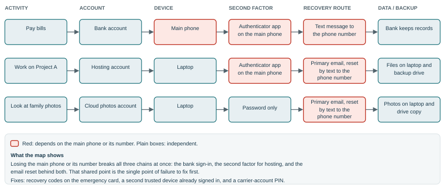

# Practical security and recovery guidance

Revision 0.27

## 1. Description and purposes

> **The main idea: start with what matters, imagine losing it, then choose protection and a way back. Protection takes effort, so balance it against what you actually need, and choose a level you can keep up.**

**Who this is for**
- Advanced everyday users with several devices, online accounts, and projects, including for work.
- People who want better protection and availability without specialist security knowledge.

**Why it matters**
- Devices and accounts can look safe one by one, yet several projects may depend on the same laptop, phone number, or email account.
- One loss can cascade: email access → password reset → cloud storage → the files you need a backup to restore.
- A lost phone can also mean lost banking access and sign-in codes.
- A failed laptop can stop several projects at once, with no attack involved.
- Trouble can start with a mistake, a technical failure, or an attack.

**What this guide helps you do**
- Spot these connections.
- Protect what matters.
- Keep a way back when something goes wrong.
- Manage protection consistently rather than sporadically.

**How to use it**
- Each protection adds a small step, even a personal identification number (PIN) or a fingerprint. Choose the balance that suits you.
- Work through small levels at a pace you can sustain.
- First read chapter 2, “Limitations, boundaries, and disclaimers,” and chapter 3, “Brief theoretical background.” They are short and explain the ideas behind the actions.

## 2. Limitations, boundaries, and disclaimers

**What the guide covers**
- It is about you: your devices, accounts, data, habits, and the risks around them, including the part of your life that involves work.
- That holds even if you run a company. Your personal setup is in scope; the company is not.

**What it does not cover**
- A security plan for a business, its shared systems, client data, or team access. These need their own assessment, more effort, and professional support.
- Grey-area activities: anything that could draw an investigation or prosecution.
- Targeted pursuit: someone persistently tracking you, or trying to break into your accounts or devices in particular. Even the highest level here does not cover this.

**What to expect**
- The guide reduces risk. It does not remove it, and it cannot promise that nothing will ever interrupt your work.
- The levels are practical steps in a sensible order, not security ratings.

**How to work through it**
- Take one action at a time. Nothing has to change all at once.
- Go from top to bottom where you can: earlier items come first because they matter more or prepare the ground for later ones. Finish any stated prerequisite before the step that depends on it.
- If you are unsure, pause or ask a professional.

## 3. Brief theoretical background
This guide distils established knowledge: the National Institute of Standards and Technology (NIST) Cybersecurity Framework and contingency-planning guidance (Special Publication 800-34), Open Worldwide Application Security Project (OWASP) threat modeling, and National Cyber Security Centre (NCSC) backup guidance. These methods help turn a broad subject into relevant, testable actions; they are named so you can look them up.

You do not need to memorize the terms below. They are here to turn over in your mind for a minute, so you can see what the subject is really about. As you read each one, try it on your own life: which laptop, which account, which files?

- **Inventory:** a maintained record of devices, accounts, data, and their relationships; e.g., which project uses a virtual machine (VM) and which account controls it.
- **Asset:** something valuable; e.g., a laptop, files, or banking access.
- **Threat model:** what can go wrong and how; e.g., phishing, accidental deletion, or laptop failure.
- **Adversary model:** an attacker's access and capabilities; e.g., a scammer with a leaked password. Here we focus on commonplace attacks, not sustained targeted pursuit.
- **Compromise:** loss of control or confidentiality; e.g., someone reading your mailbox or using a stolen sign-in session.
- **Risk:** likelihood and consequences together; e.g., the chance of card-detail theft and the resulting financial loss.
- **Dependency:** something needed to use or recover another asset; e.g., losing email access can block password resets across several services.
- **Control:** a measure that reduces risk; e.g., a screen lock reduces casual access to an unattended phone.
- **Remaining risk:** what precautions leave unresolved; e.g., backups cannot undo a leak.
- **Recovery:** returning to a usable state, including accounts, devices, and data; e.g., signing in and opening current files on a replacement laptop.
- **Backup:** a copy kept for recovery; e.g., yesterday's document version. Until restored and checked, treat it as unverified.
- **Synchronization:** keeping copies aligned; e.g., a deletion spreading between devices. Sync alone does not establish a recoverable history.

## 4. Practical levels
Never give an artificial intelligence (AI) assistant passwords, recovery codes, keys, or password-vault exports, and confirm its instructions on the provider's official pages: menus and features change.

### Level 0 — Start here: scams and the first ten minutes

Investment: one short session; no purchases; no technical skills.

Many account and money losses start with someone persuading you, not with a technical break-in. Do this level first: it addresses the most common route, and every later level assumes you can recognize it.

#### 0.1 Stop and verify before you act

A fixed rule and a few saved contacts, so you can check an urgent request without deciding under pressure.

- [ ] **0.1.1 — Decide your own “stop” rule and put it in one sentence.** For example: “I never act on an urgent request that reaches me; I stop and check through a channel I chose.”
- [ ] **0.1.2 — Save official contact routes for your bank, card issuer, and phone carrier where you can reach them without your phone.** Use the number on the back of the card or the provider's own website, typed by you.
- [ ] **0.1.3 — Learn the call-back rule.** Hang up, then contact the organization yourself through a saved official route; never use the number or link in the message.
- [ ] **0.1.4 — Agree a verification question or code word with family or close colleagues.** Use it for any urgent request for money or access.
- [ ] **0.1.5 — Turn on bank and card transaction alerts.** A text or app alert on every payment makes a stolen card visible quickly.

- **Why:** Scammers rely on urgency, authority, and secrecy, not on skill. A fixed rule decided in advance works when you are rushed or frightened.
- **Tools and examples:** Typical patterns: a caller claiming to be your bank, the police, or technical support; a “boss” or relative asking for urgent money or gift cards; a “safe account” story; a delivery or fine notice with a link; a request to install remote-access software; a request to read out a one-time code. A genuine organization will not ask for your password, a one-time code, or a recovery phrase.
- **AI help:** Paste a suspicious message (with names, numbers, and links of real people removed) and ask which parts are pressure tactics or impossible for a real organization to ask. Treat the answer as a second opinion, not a verdict: still verify through your saved route. Never paste codes, passwords, or card numbers.
- **Good result:** You have a rule, a saved route to each key provider, a family check, and alerts that make a stolen payment visible quickly.
- **Check:** Take a recent real or imagined urgent message and walk through your rule. Find the official route you saved without using the message. After your next ordinary card payment, confirm the alert arrived.
- **If skipped:** The most common way of losing money or an account stays open, and no technical protection later in this guide stops you from handing over a code yourself.

#### 0.2 Know the first ten minutes after a mistake

A short list of what to do right after a click, a payment, or a shared code.

- [ ] **0.2.1 — Sketch a short “first ten minutes” list.** Use the situations in Tools and examples.
- [ ] **0.2.2 — Keep the list where you can read it without your phone.** On paper or on another device, so a lost or hacked phone does not take it too.
- [ ] **0.2.3 — Read it through once using an invented example.** Change nothing on a real account.

- **Why:** After clicking, paying, or sharing a code, people freeze or keep arguing with the caller. Minutes matter most for money and for accounts that can reset others.
- **Tools and examples:** Starting list, adjusted to your situation:
  - Stop the call or chat; do not try to “fix” it with the caller.
  - Money or card details given: call the bank or card issuer through your saved number and ask for a payment stop or card block.
  - Password entered on a suspicious page: from another trusted device, change it using your manager and sign out other sessions. Change any account where you reused it.
  - Code shared or approval tapped: treat that account as taken over and use its official recovery route.
  - Remote-access software installed: disconnect the device from the internet, then change important passwords from another device.
  - Your phone number targeted: contact the carrier through the saved route.
  - Keep screenshots and times; report to the provider, bank, and, where appropriate, the authorities.
- **AI help:** Ask an assistant to turn your notes into a one-page checklist or to challenge it with “what if” cases. Keep real account identifiers and secrets out.
- **Good result:** A list you can follow while stressed, consistent with the longer lost-device plan you will build in Level 5.
- **Check:** The list is reachable from another device or on paper. Walking through it names one concrete first action for each situation.
- **If skipped:** Delay and improvisation turn a recoverable mistake into a loss.

### Level 1 — A safer starting point

Investment: several short sessions; existing storage or a backup drive/service; everyday settings skills.

#### 1.1 Make a short inventory and keep it within reach

A deliberately short list of what is critical or used most, so you know what to protect first. Section 2.1 completes it later; do not try to be exhaustive now.

- [ ] **1.1.1 — Jot down the critical and most-used devices and providers.** The phone and computer you use daily, your internet and phone providers, any hosting.
- [ ] **1.1.2 — Jot down the critical and most-used services, with the account you sign in with.** Banking, email, cloud files, and anything you would struggle without. Add the website or management link.
- [ ] **1.1.3 — Jot down the data you could not recreate, and where it lives.** Photos, documents, project files: which device or service holds them.
- [ ] **1.1.4 — Mark the entries that matter most.** Ask what someone could read, change, delete, or spend if they took the entry over.
- [ ] **1.1.5 — Note what would stop if each marked entry were lost.** One short phrase is enough.
- [ ] **1.1.6 — Keep a copy you can open without your main device.** A printout or a copy on a second device; update it after important changes.

- **Why:** You cannot protect or recover what you have forgotten. The marked entries also set the order of everything else in this level: which account to protect first and which data to back up first.
- **Tools and examples:** A private note, spreadsheet, or table; roughly one page is the right size. If the list grows past that, stop and leave the rest for section 2.1. A stolen banking login can expose money; hacked email may reset other accounts; replaceable downloads usually matter less than family photos. A changing server environment can be one line: provider, account, console link. Never put passwords, keys, or recovery codes in the list.
- **AI help:** Ask an assistant for a table template, or for categories people commonly forget, then fill it in yourself. It cannot know what you actually use. Share service names only if you are comfortable with that; never secrets.
- **Good result:** A short list of what you depend on and how to find it, with the most important entries marked and a copy within reach.
- **Check:** Pick an ordinary activity, such as paying a bill or opening project files, and find its device, service, and data location in the list. Follow one link to confirm it reaches the right page. Open the copy without your main device.
- **If skipped:** You may forget a bank account, provider, or data location when protecting or recovering your digital life, or spend effort on convenient tasks while something more important stays exposed.

#### 1.2 Protect your primary devices

Primary devices are the ones you use daily and that stay signed in to your accounts: usually your phone and main computer. Do one device at a time.

- [ ] **1.2.1 — Set a device-unlock code on each primary device.** Biometrics can complement the code, not replace it.
- [ ] **1.2.2 — Turn on automatic screen locking.** Require the code after a short idle period.
- [ ] **1.2.3 — Install pending updates.** Save your work first; use only the system's own update function.
- [ ] **1.2.4 — Complete the restarts the updates ask for.** Closing a laptop lid is not a restart.
- [ ] **1.2.5 — Turn on automatic updates where appropriate.** Let the system install routine fixes on its own, so you do not have to remember.
- [ ] **1.2.6 — If anyone else uses your computer, give them their own user account.** Skip this if nobody does.

- **Why:** These devices hold open sessions to your email, files, and money. A lock keeps a finder or passer-by out; updates close known software weaknesses.
- **Tools and examples:** Search the device settings for “screen lock”, “sign-in options”, and “software update”. Nothing to buy. Remote servers have no screen to lock and need a different approach; see section 3.3.
- **AI help:** Ask where a setting lives on your exact model and system version. Menu names it gives may be out of date, so compare with the manufacturer's support page.
- **Good result:** Each primary device locks when unattended and receives updates with little manual effort. Any stuck update or postponed restart is written down, not repeatedly dismissed.
- **Check:** Lock and unlock the device. Leave it idle and watch it lock. After restarting, open the update screen and confirm nothing is pending. A week or two later, confirm an automatic update actually installed.
- **If skipped:** Anyone who picks up an unattended device can use your signed-in accounts, and known weaknesses stay open to common attacks.

#### 1.3 Set up and use a basic password manager

A password manager gives every account its own strong password and remembers it for you. Here you choose one, protect it, and make sure you can always get back in.

- [ ] **1.3.1 — Choose your starting manager using the table below.** If unsure, take the default for your devices; you can change later.
- [ ] **1.3.2 — Set it up with a master password or sign-in used nowhere else.** Make it strong.
- [ ] **1.3.3 — Read its recovery instructions before saving anything in it.** Learn now what the manager can and cannot restore if you forget the master password.
- [ ] **1.3.4 — Turn on multi-factor authentication (MFA) for the manager or its account where supported.** Stay signed in on your current device until the new sign-in works.
- [ ] **1.3.5 — Save the manager's recovery information outside the vault and outside your main phone, during setup.** A printed emergency card in a sealed envelope, kept somewhere secure at home, works well.
- [ ] **1.3.6 — Open the vault from another trusted device.** Do this before moving critical passwords in.
- [ ] **1.3.7 — Confirm you can reach the recovery information without your main device.** Open the recovery card or notes using only a second device or paper.
- [ ] **1.3.8 — Start using it: save two or three everyday sign-ins and sign in with them from the manager.** Use the manager for a few real accounts so it becomes a habit before you move the rest.

- **Why:** Unique passwords for every account are only practical when something remembers them for you. The manager then becomes something you must not lose access to, so its recovery is prepared and tested before you rely on it.
- **Tools and examples:** If unsure, start with the “boring default” for the devices you use most.

  | Your devices | Boring default | Watch out for |
  |---|---|---|
  | Mostly Apple devices | The built-in Apple passwords feature, protected by your Apple account | Everything now depends on that account; secure it fully in 1.4 before moving critical passwords. Less convenient on non-Apple devices |
  | Mostly Android and Chrome | The Google password manager, protected by your Google account | Same dependency on one account; check that it syncs to the computers you use |
  | Mostly Windows with one browser | That browser's built-in manager, signed in to the browser's own account | Check whether entries are local or synced, and protect and recover that account separately |
  | Mixed devices, or you share logins with others | A dedicated cloud-synced manager that supports all your devices | Protect its account, understand its recovery, and plan a recoverable export where supported |
  | You want control of the vault file and will maintain it | A local encrypted vault file, optionally synced through cloud storage | Protect the unlock secret, keep versioned backups, handle sync conflicts; cloud sync alone is not a backup. Not a beginner default |

- **AI help:** Ask an assistant to explain the options or an unfamiliar recovery term in plain words, and to compare two choices against your devices. Decide from the manager's own documentation. Never type a master password, recovery code, or vault export into an AI chat.
- **Good result:** Passwords have one protected home that you actually use, with a way in that survives losing your main device. The inventory holds only the manager's name and where its recovery record is kept.
- **Check:** Create a harmless test entry, lock and unlock the vault, and find the entry on another trusted device without the main phone. Locate the recovery record independently. Do not use up one-time codes or trigger an account reset as a test.
- **If skipped:** Reused passwords and scattered notes stay hard to manage, so one leak can open several accounts. A manager without tested recovery can become a single point of lockout.

#### 1.4 Protect your primary accounts

Primary accounts can reset or unlock others: your main email, your phone number's carrier account, your password manager, and the account behind your phone or computer (an Apple, Google, or Microsoft account). Do the steps for one account, then the next.

- [ ] **1.4.1 — Give each primary account a unique password.** Generate and save it with the manager.
- [ ] **1.4.2 — Turn on MFA for each primary account where supported.** Use an authenticator app or key where the provider offers one; for a messenger, use the app's own two-step verification passcode.
- [ ] **1.4.3 — Where the provider offers recovery codes, save them outside the phone and outside the account itself, during setup.** Print them or keep them on a second device; do not leave them only in the account.
- [ ] **1.4.4 — Confirm that recovery addresses and phone numbers still work.** Remove ones you no longer control.
- [ ] **1.4.5 — Sketch the four recovery chains from the table below and mark any loop.** One row per chain; mark any row where recovery depends on something it also unlocks.
- [ ] **1.4.6 — Name, for each chain, a recovery route that does not need your main phone.** Section 4.1 tests it live.

- **Why:** Whoever controls these accounts can reset passwords elsewhere and read the confirmations. They are the first target and the first thing you need back. A chain is “loop-free” when you can regain each one without needing something that is itself locked.
- **Tools and examples:** Use the provider's official security page, the manager's generator, and a supported authenticator app, passkey, or security key. Messengers that sign you in by phone number work differently: their additional factor is usually not an authenticator app or a key file but the app's own setting, and the details differ by app. For example, WhatsApp's two-step verification asks for a PIN or password when the number is registered again; Signal's PIN blocks re-registration only when Registration Lock is also turned on; Telegram offers a two-step verification password and also supports passkeys for signing in. Check the app's current sign-in and recovery options on its official help pages, turn the setting on while your current session stays open, and save the passcode in your manager. Fill in one row per chain; the columns show what to look for.

  | Chain | Usually recovered through | Typical loop | Independent route to prepare |
  |---|---|---|---|
  | Primary email | Recovery address or phone number, recovery codes | Email A recovers only through email B, which recovers only through A | Saved recovery codes on the emergency card; a second email you control that does not depend on the first |
  | Phone number | Carrier account, SIM or eSIM, carrier-account PIN | The carrier login resets only by a text message to that same number | Carrier-account PIN and identification route (see Level 4) |
  | Password manager | Recovery key or emergency card, a second signed-in device | Its authenticator codes live only in the vault, or only on the lost phone | Emergency card kept apart from the phone; a second trusted device |
  | Phone or computer account (Apple, Google, Microsoft) | Trusted device, recovery key or contact, phone number | The only trusted device is the lost phone | Saved recovery key; a second trusted device |

  Worked example: Alex's email recovers through a text message to Alex's phone number. The carrier login recovers through an email to that same address. The manager's authenticator codes are on the phone. If the phone is lost, each chain waits on another, and nothing can be regained. Alex adds a saved email recovery code on the emergency card, a carrier-account PIN, and a second device already signed in to the manager. Now each chain has a route that does not touch the lost phone.
- **AI help:** Paste only the table headings and your own plain-words notes (for example, “my email recovers by text to my phone”) and ask where a loop could hide. Ask what a provider's recovery option means. Open the provider's security page by typing the official address yourself, not through a link from an assistant or a message. Never share codes.
- **Good result:** Each primary account has a unique saved password, an additional sign-in factor, and a recovery path you can use. A completed table shows no unmarked loop. Passwords and recovery codes stay in their protected places; the inventory holds only references to where.
- **Check:** While staying signed in, start a new sign-in in a private browser window with the saved password and factor. For a messenger registered to your phone, use the app's own safe check instead, such as its reminder to re-enter the PIN or password, and never re-register the number as a test. Send a recovery test message, where the provider offers one, and confirm it reaches a destination you control and can open without the main phone. For each table row, you can state a route that does not need your main phone, or the gap is marked.
- **If skipped:** A reused password can hand over the account that resets all the others. An outdated or circular recovery route can keep you out of your own account.

#### 1.5 Make and test a first backup

A first backup should be simple. Choose one thing to protect and prove that you can get it back.

- [ ] **1.5.1 — Copy your most important files to an external drive or a backup service.** Start with the data marked most important in section 1.1.
- [ ] **1.5.2 — Disconnect the drive or otherwise keep the copy out of reach of your everyday account.** Unplug the drive after the copy finishes, or use a backup account your daily login cannot delete.
- [ ] **1.5.3 — Restore one file to a new folder without using the original.** Use the backup's restore or copy function, never the original file location.
- [ ] **1.5.4 — Check the restored file's content.** Open the restored file and confirm it reads and looks as expected.
- [ ] **1.5.5 — Check its date or version.** Make sure it is the version you meant to restore, not an old or partial copy.
- [ ] **1.5.6 — Note the restore-test result in the backup coverage worksheet.** One line: date, what you restored, result, next action; no secrets.
- [ ] **1.5.7 — Add a backup refresh to your calendar as a recurring event.** Monthly is a reasonable starting point.

- **Why:** A device can fail, be lost, or have files deleted or corrupted, and synchronization can spread that damage to every copy. A separate backup is the way back, and only a restore shows that it works.
- **Tools and examples:** The simplest start is an external drive and a plain copy; a backup service that keeps versions is a good alternative. Download cloud-only files before copying so you do not back up empty placeholders. Restore into a new folder, never over a working file. Keep the copy apart: a drive that stays plugged in, or a synced folder, can be deleted or encrypted together with the original by a mistake, ransomware, or someone who takes over your account. Later levels build on this rule rather than repeating it: section 6.4 checks it against an account takeover, and section 9.2 adds an off-site copy. Refresh monthly and after important changes; sooner if a month of lost work is unacceptable. If your inventory or password vault lives in the cloud, also keep an export of the inventory you can open independently; for the vault, see your manager's supported encrypted export and what is needed to open it. Do not leave an unencrypted password export behind. Account recovery instructions restore access; they are not a backup of the vault's entries. Level 3 adds automation and older versions.
- **AI help:** Ask an assistant for step-by-step instructions for your drive or backup tool, or a simple note template. An assistant cannot confirm that your backup works; only your restore test can.
- **Good result:** A known backup, with a note of what it covers, where it is, its date, how it is kept apart, and one piece of evidence that a restore works.
- **Check:** The restored file opens from its new folder and has the expected content and version. The backup is not reachable for deletion from everyday use; verify by looking, not by deleting anything. The test is noted in the backup coverage worksheet.
- **If skipped:** Device loss, corruption, or a deletion that spreads through sync may leave no usable copy. An untested backup may fail when needed or hold an unexpectedly old version.

### Level 2 — A tidy, better-protected everyday setup

Investment: several sessions; mostly existing settings; possible replacement hardware; help with encryption if needed.

#### 2.1 Extend the inventory with other tools and methods

The Level 1 list came from memory. Now use evidence to find what memory missed. Time-box it: 30 minutes, three sources, then stop.

- [ ] **2.1.1 — Check that your list includes the important services you actually use.** Walk through an ordinary week.
- [ ] **2.1.2 — Search three sources for forgotten accounts.** Your mailbox, your saved-password list (site names only), and your card or bank statements.
- [ ] **2.1.3 — Add, for each important entry, how you would get back in and where its secrets are kept.** References only, such as “recovery codes: emergency envelope”.
- [ ] **2.1.4 — Mark entries that depend on the same phone, email, or number.** The dependency-map example in the appendix shows how.
- [ ] **2.1.5 — Move the list to a more structured tool if it has outgrown a note.** Optional.

- **Why:** Forgotten accounts keep old passwords and old recovery details, and nobody watches them. Recording the way back in turns the list into something you can use during a recovery.
- **Tools and examples:** Search your mailbox for welcome messages, receipts, “confirm your email”, password-reset notices, and subscription renewals. Look at the app list on your phone. A spreadsheet or Grist table with columns for purpose, link, priority, recovery route, and secret-storage reference is enough.
- **AI help:** Two prompts, using names and structure only.
  - *Find them:* “I want to find online accounts I may have forgotten. Give me 15 search queries for my email inbox (welcome messages, receipts, ‘confirm your email’, ‘your account has been created’, password-reset notices, subscription renewals). Add the same for my phone's app list and my bank and card statements. I'll run them myself.”
  - *Sort them:* “Below is a plain list of service names only, with no passwords or usernames. Sort them into: money, identity and government, email and phone, cloud files and photos, work and projects, social, shopping, and probably unused. For each important one, say what it could reset elsewhere and whether I should close it or protect it. I'll verify everything on the real service.”

  A saved-password export contains the passwords themselves; copy only the site-name column, never the file.
- **Good result:** A fuller list that matches what you really use, with a recovery route noted for each important entry and unused accounts marked for closing.
- **Check:** Pick three items from a recent payment statement or your phone's home screen and find each in the list. For one important entry, follow the recorded recovery reference to the real place.
- **If skipped:** Old accounts stay exposed without your knowledge, and in an emergency you know that an account exists but not how to regain it.

#### 2.2 Get rid of outdated, unsupported, and unused systems

Retire or restrict what no longer gets security fixes, and remove software you do not use.

- [ ] **2.2.1 — Identify unsupported software and devices.** Compare versions with the vendor's official support information, not age alone.
- [ ] **2.2.2 — Preserve needed data before retiring unsupported equipment.** Export or copy it first, so retiring the device cannot destroy the only copy.
- [ ] **2.2.3 — Verify alternative access to sensitive accounts before retiring it.** Email, provider, administrator, and authenticator access.
- [ ] **2.2.4 — Stop using unsupported software and devices for sensitive access.** Move banking, email, and admin work to a device or system that still gets security updates.
- [ ] **2.2.5 — Set dates for replacement or upgrade.** A purchase must not block unrelated protection steps.
- [ ] **2.2.6 — Remove unused applications.** First check whether one holds needed data or is its only reader.
- [ ] **2.2.7 — Remove unused browser extensions.** Check every browser profile.

- **Why:** A system that works but no longer receives fixes stays open to known attacks. Every unused application or extension is one more thing to update and trust for no benefit.
- **Tools and examples:** Vendor support-lifecycle pages, the installed-apps list, and each browser's extension settings. Export data in supported formats and open it on the replacement device. Do not wipe old equipment until preservation and access are confirmed.
- **AI help:** Ask whether a specific version is still supported and what an unfamiliar application or extension does, then confirm on the vendor's site. An assistant's support dates can be out of date.
- **Good result:** Known support status for important devices and software, sensitive work moved to supported ones, old equipment marked restricted or retired, a dated plan for each remaining exception, and fewer unnecessary components.
- **Check:** Open a sample of the preserved data on a supported device. Sign in to critical accounts without the retiring equipment. Removed items are gone and your normal work still runs. Each exception has a restriction and a next date.
- **If skipped:** Old systems keep unfixed weaknesses. Abrupt retirement can destroy the only readable copy of data or the only working sign-in factor. An undated exception becomes permanent.

#### 2.3 Protect the rest of your important accounts

Work through the list in order of impact, one account at a time.

- [ ] **2.3.1 — Replace weak or reused passwords on the listed accounts.** Let the manager generate a new unique password for each, one account at a time.
- [ ] **2.3.2 — Turn on supported MFA on those accounts.** Prefer an app, passkey, or key over text messages where the service offers a choice.
- [ ] **2.3.3 — Add a passkey where an important account offers one.** Keep the password and MFA working alongside it.
- [ ] **2.3.4 — Save recovery information outside each protected account, during setup.** Keep codes and recovery keys somewhere you can reach without signing in to that account.
- [ ] **2.3.5 — Turn on account-security alerts.** Send them somewhere you actually read.

- **Why:** Level 1 protected the accounts that unlock others. Banking, payments, cloud files, domains, and hosting now get the same treatment, so one leaked password stays one problem.
- **Tools and examples:** Each service's official security settings, plus the manager's generator and reuse report if it has one. Keep the working session open until the new sign-in is verified, and update the right vault entry during each change. The vault may hold ordinary recovery codes, but its own recovery cannot depend only on itself.
- **AI help:** Ask an assistant to help order accounts by impact or explain an unfamiliar security setting. It should not see passwords or codes.
- **Good result:** Important services have distinct saved passwords, an additional sign-in factor where offered, recovery information you can reach from outside the account, and alerts arriving where you look.
- **Check:** For each account, start a new sign-in with the saved password and factor while keeping the original session. Find its recovery information without entering the account. Confirm that a harmless test notification arrives where the service offers one; note unsupported features as gaps.
- **If skipped:** One reused password may expose several services. Missing recovery information or silent alerts can leave you unaware of a break-in or unable to regain access.

#### 2.4 Strengthen device protection

Check that malware protection works and that the disk of a lost or stolen device cannot be read.

- [ ] **2.4.1 — Confirm malware protection works.** Check the system's own security status and that it is up to date.
- [ ] **2.4.2 — Check disk-encryption status on important devices.** Look in the system security settings; note any drive that is not encrypted.
- [ ] **2.4.3 — Enable disk encryption where it is missing.** First decide where the recovery key will be kept.
- [ ] **2.4.4 — Save the encryption recovery key during setup.** Not only on the encrypted disk or a phone that could be lost with it.
- [ ] **2.4.5 — Retrieve that key from another trusted device.** Open the key from a second device to prove you can get it when this one is unusable.

- **Why:** A screen lock does not protect a disk removed from a stolen computer; encryption does. Malware protection that has silently stopped protects nothing.
- **Tools and examples:** Windows Security, and device encryption or BitLocker; macOS FileVault; availability differs by edition and hardware. Avoid adding competing scanners without understanding how they interact. The inventory holds only where the recovery key is kept and which device it matches, never the key.
- **AI help:** Ask how to check encryption status on your exact system and what the recovery key is for. Never paste the recovery key into a chat.
- **Good result:** Protection reports a healthy, current status. Important devices are encrypted, and each recovery key is stored privately where you can retrieve it.
- **Check:** The system reports encryption enabled and complete. Retrieve the matching key record from another trusted device. Run a normal scan where available. Do not deliberately lock the drive or delete keys as a test.
- **If skipped:** Data on a lost or stolen device may be readable despite the login screen. Encryption without a reachable recovery key can turn a device fault into permanent data loss.

#### 2.5 Keep sensitive information off the locked screen

This is a 15-minute setting that works before any loss. Do it once per phone, then check linked devices.

- [ ] **2.5.1 — Identify apps whose notifications can reveal codes, private messages, or financial details.** Text messages, email, messaging, banking, account security.
- [ ] **2.5.2 — Hide lock-screen message previews for those apps.** If content cannot be hidden reliably, remove that app's notifications from the lock screen.
- [ ] **2.5.3 — Restrict sensitive notification actions available without unlocking, where supported.** Replying, for example.
- [ ] **2.5.4 — Review notification previews on paired or linked devices you use.** A watch or linked computer has its own settings.
- [ ] **2.5.5 — Test the settings while the phone stays locked.** Lock the phone, send yourself a dummy message, and read what shows on the locked screen.

- **Why:** A strong screen lock does not help if a newly arrived sign-in code or reset link is readable on the locked screen of a phone someone else is holding.
- **Tools and examples:** On iPhone: Settings → Notifications → Show Previews, plus each app's own notification settings; choose When Unlocked or Never. On Android: search Notifications for lock-screen content or sensitive notifications; some devices offer per-app controls. Names and availability vary. Keep useful alerts enabled where possible.
- **AI help:** Ask where these settings are on your exact phone model and system version, then confirm on the device.
- **Good result:** You notice an alert without its code, link, message, or amount being shown to someone holding the locked phone. The cost is one extra unlock to read it. App names may still be visible; hiding text does not hide everything.
- **Check:** Send harmless dummy messages to the chosen apps. Look at the locked screen without letting face or fingerprint unlock it; try expanding the notification and replying. Then unlock and confirm that alerts still arrive. Repeat on linked devices. Do not provoke real bank alerts as a test.
- **If skipped:** Codes and private messages can be read, and some actions taken, without unlocking the phone.

### Level 3 — Separated activities and dependable backups

Investment: several sessions; possible backup subscription or extra storage; everyday settings skills, with help for servers if needed.

#### 3.1 Use separate browsers and profiles for different tasks

Keep different kinds of activity in different browser profiles, so one mistake does not reach everything.

- [ ] **3.1.1 — Decide which tasks get their own browser profile or browser.** Typical groups: money and identity (banking, payments, government), everyday browsing, each project or work identity, and untrusted browsing.
- [ ] **3.1.2 — Create a separate profile or browser for money and identity accounts.** Sign in to those accounts only there.
- [ ] **3.1.3 — Keep that profile's extensions to the minimum.** The password manager's extension, if you use one, is usually enough.
- [ ] **3.1.4 — Create a separate profile for each project or work identity.** One profile per client, project, or employer keeps their logins and extensions apart.
- [ ] **3.1.5 — Use a separate profile or browser for untrusted browsing.** Unknown links, downloads, and sites you are only testing.
- [ ] **3.1.6 — Review saved passwords, autofill, and sync settings for each profile.** Keep only what that profile needs.

- **Why:** A browser stores sign-in sessions. If one session or one extension is stolen or misused, everything open in the same profile is exposed, sometimes without needing your password or MFA. Separating tasks limits what any single mistake can reach.
- **Tools and examples:** Profiles are built into every mainstream browser; a second browser or an operating-system user account separates more strongly than a profile alone. A virtual machine separates more strongly still, at more effort. Profiles reduce cross-contamination; they do not stop malware on the computer itself. Name or colour each profile so you can see at a glance where you are. Level 6 adds a review of active sessions.
- **AI help:** Ask for the steps to create and switch profiles in your specific browser, or for a grouping of your accounts into tasks. Confirm menu names on the browser's own help page.
- **Good result:** Money and identity accounts live in a minimal profile, projects stay apart, risky browsing happens elsewhere, and you know from the profile name which one you are in.
- **Check:** Open each profile and confirm that it signs in only to its own accounts and has only the extensions you listed. Confirm that the money profile has no unnecessary extensions.
- **If skipped:** One malicious extension, stolen session, or careless click can reach your banking, your projects, and your private accounts together.

#### 3.2 Separate personal and project passwords into vaults

*Only if you manage more than one project or share any accounts with other people.*

Give each project its own container in your password manager.

- [ ] **3.2.1 — Decide which projects need their own vault.** Test: who might need access, and what would you hand over?
- [ ] **3.2.2 — Create separate vaults or collections for personal use and for each such project.** Name each vault after the project so it is clear what a handover would include.
- [ ] **3.2.3 — Move each project's credentials into its own vault.** Move or re-save the entries one project at a time, then remove the old copies.
- [ ] **3.2.4 — Add a line to your inventory saying which vault holds which project.** References only.
- [ ] **3.2.5 — Check that a project vault could be handed over or shared without exposing personal items.** By looking, not by sharing.

- **Why:** One big vault means anyone you share with, or any single mistake, reaches everything. Separate containers let you give a collaborator, or later a successor, one project without your private life.
- **Tools and examples:** Most managers support several vaults, folders with their own sharing, or collections. Use one manager with separate containers: you keep one master secret and one recovery record. Use separate manager accounts only when a different person must hold or inherit access, the project belongs to a client, or the project may be sold or handed over; that costs a second master secret and a second recovery record, and is covered in Level 7. A manager issued by your employer belongs to your employer and is outside this guide.
- **AI help:** Ask an assistant to suggest vault names and which of your projects deserve their own, from a plain list of project names. Do not share credentials.
- **Good result:** Personal and project credentials sit in separate containers, and each project's container could be handed over on its own.
- **Check:** Open each container and confirm it holds only its project's items. Confirm that the sharing setting matches who should have access.
- **If skipped:** A shared or compromised project login can expose personal accounts, and a handover means sorting your credentials in a hurry.

#### 3.3 Secure access to servers and virtual machines

*Only if you use remote servers or virtual machines.*

Control who and what can sign in to your servers, so access can be granted, checked, and removed without hunting for keys. Which steps apply depends on how many machines you run.

- [ ] **3.3.1 — Identify the provider console and the account that administers it.** Note which provider and which login manages each server or virtual machine.
- [ ] **3.3.2 — Protect the provider sign-in with MFA where offered.** Use an authenticator app or key; the provider account can control every machine under it.
- [ ] **3.3.3 — Verify independent administration access before changing any server's sign-in setup.** A second working session and the provider's recovery console.
- [ ] **3.3.4 — A few servers by hand: give each person and device its own key or login.** Do not share one.
- [ ] **3.3.5 — A few servers by hand: remove keys and logins that are no longer needed.** Delete old keys and logins of people, devices, and tools that no longer need access.
- [ ] **3.3.6 — Many or changing machines: grant access through groups or roles, not per server.** Use the provider's identity system.
- [ ] **3.3.7 — Many or changing machines: prefer short-lived credentials over long-lived keys left on machines.** For example, certificates or the provider's session tools.
- [ ] **3.3.8 — Many or changing machines: record which group or role reaches which environment.** References only.
- [ ] **3.3.9 — Many or changing machines: check that removing a test person from a group removes their access.** Use a harmless test account so you see the removal work before you rely on it.

- **Why:** A server is reached through a provider account and a remote sign-in. Either can be taken over, and either can lock you out if changed carelessly. With a handful of machines, per-server keys are manageable; with many, keys multiply, nobody knows who holds which, and removing someone means visiting every machine.
- **Tools and examples:** Remote sign-in is usually Secure Shell (SSH) or Remote Desktop Protocol (RDP). Hand-managed route: one key or login per person and device, protected private keys, and a note of who has access. Rule-based route: people join groups or roles in the provider's identity system or single sign-on, and the groups map to what they may reach; access is granted by membership, short-lived certificates or session tools replace standing keys, and offboarding removes the person from the group once. Schedule server updates and restarts around workloads and backups rather than copying laptop settings. A saved access reference in the inventory is enough; no catalogue of every login is needed. Ask the responsible administrator if the access or recovery path is unclear.
- **AI help:** An assistant can explain an access method or review a planned change in general terms. Never paste private keys or passwords, and do not run commands you do not understand on a live server.
- **Good result:** For each environment you know who or what can reach it and how that access is removed, and you have seen a second way in work.
- **Check:** Sign in through the intended route and confirm that the provider's recovery console opens. Do not change firewall or authentication settings merely to test them.
- **If skipped:** A weak server sign-in exposes whatever the server holds, a mistaken change can cut off your own access, and former collaborators may keep access you forgot about.

#### 3.4 Make backups automatic and check what they cover

Make backups run without you, and check that they cover what matters.

- [ ] **3.4.1 — Check your backups against the five groups below.** For each, name the backup and how it would be restored.
- [ ] **3.4.2 — Note what is not covered.** Give each gap a reason, a priority, and a next action.
- [ ] **3.4.3 — Automate backups for the covered data.** Use the system's backup tool or the provider's scheduled backup, not a manual copy.
- [ ] **3.4.4 — Set a backup-failure alert, and a scheduled manual check as a fallback.** Choose email or a message you will actually read, and put a recurring reminder as backup.
- [ ] **3.4.5 — Test that the alert reaches you, using a harmless supported test.** Use the tool's test-notification feature; do not break a real backup to check.

- **Why:** A healthy backup job can still miss the data you need most, and manual copies go stale. Automation keeps copies current; alerts tell you when it stops.
- **Tools and examples:** Use this short coverage check; each line should end in a backup you can name or a noted gap.
  1. Documents and project files, including cloud-only files.
  2. Photos and other irreplaceable media.
  3. Email, contacts, and calendars.
  4. Password vault export, recovery records, and encryption keys.
  5. Project servers and databases, if any.

  A cloud mailbox may need its own export; a live database may need its supported backup method; provider snapshots need a usable-restore check, not just an existence check. Use the system's own backup tools or a provider's documented backup function, and a test-notification feature rather than breaking a real backup. The backup-coverage worksheet in the appendix is the longer form.
- **AI help:** Ask an assistant to explain backup-tool options for your system, or to turn the five groups into a table you can fill in. It cannot see what your backups contain.
- **Good result:** Each of the five groups is covered, unverified, or marked as a gap, and named backup jobs run on a schedule with someone noticing failures.
- **Check:** Trace two or three real datasets to a named backup and restore method. Watch a scheduled run and confirm a recent change is recoverable. The harmless alert arrives, or the manual check has a date.
- **If skipped:** Gaps look like complete protection, copies age unnoticed, and failures stay silent until the day you need a restore.

#### 3.5 Keep older versions and test one

Keep enough history to go back past a mistake you notice late, and prove that it works.

- [ ] **3.5.1 — Set retention using the starting rule below.** Set the number of days or versions the backup keeps, following the rule in Tools and examples.
- [ ] **3.5.2 — Verify the provider's actual retention limits.** The plan you pay for, not the marketing page.
- [ ] **3.5.3 — Find the provider's trash and version-history recovery options.** Find where deleted items and earlier file versions can be recovered, and for how long.
- [ ] **3.5.4 — Restore an older file version to a separate location.** Leave the working file untouched.
- [ ] **3.5.5 — Make a note of the result.** Version chosen, source, outcome, time taken, next action.

- **Why:** Deletion or corruption is often noticed late. If every kept version already contains the damage, the backup cannot help.
- **Tools and examples:** Starting rule, not a standard: keep at least 30 days of versions, and 90 where your plan and storage allow. If you cannot, note the shorter period as a known gap. Level 9 replaces this rule with targets based on your own situation. Trash and version-history limits may differ from backup retention. For the test, choose a file with a recognizable earlier sentence or photo.
- **AI help:** Ask what a retention setting means, or for help comparing plan limits that you have copied from the provider's own page.
- **Good result:** Retention that follows the starting rule, confirmed limits written beside it, and evidence that an older version can really be recovered.
- **Check:** Open the recovered older file from its separate location and confirm the expected earlier content. Compare the oldest version actually available with the rule. Do not delete live files to test this.
- **If skipped:** A successful recent-file test can hide broken history, and by the time damage is found, every remaining copy may contain it.

### Level 4 — Protected when a phone or computer goes missing

Investment: a few sessions; another trusted device and possibly a spare authenticator; carrier and provider instructions.

#### 4.1 Reach your accounts without your main device

Do this while the main device still works. Leave it unused during each test; do not erase it or sign it out. Use the recovery-chains table from section 1.4: each row should now be provable.

- [ ] **4.1.1 — Sign in to email on another trusted device without using the main phone for MFA.** Use a spare factor or recovery code; leave the main phone switched off or unused.
- [ ] **4.1.2 — Sign in to the password vault under the same conditions.** Same test for the password manager: another device, no main phone.
- [ ] **4.1.3 — Open your recovery notes without the main phone.** Open the notes from a second device or paper to confirm they do not depend on the phone.
- [ ] **4.1.4 — Test authenticator-app recovery or transfer on one low-risk account.** Keep the existing factor working until the new one succeeds.

- **Why:** A second device may show the sign-in page and then ask for a code or approval on the missing phone. This section finds that dependency before a loss does.
- **Tools and examples:** A second computer, tablet, or protected spare phone; a spare authenticator, hardware security key, or provider-supported recovery route. Never use a public computer for the vault. Authenticator apps differ: some sync through an account, others need a manual transfer or re-enrolling each service, and a transfer that needs the old phone does not help after that phone is lost. Treat exported setup secrets and transfer images as credentials, not as screenshots for ordinary notes.
- **AI help:** Ask how your authenticator app handles a lost phone and what a term such as “re-enrollment” means. Do not share transfer images or codes.
- **Good result:** A known route to email, the vault, and your recovery notes with the usual phone out of the picture, a tested way to recover sign-in codes, and your chains table updated with what is now proven.
- **Check:** Complete each sign-in and open the notes without the main phone giving approval, codes, or access. Make a fresh sign-in to the low-risk account with the recovered or transferred factor. Any row that still needs the main phone is marked as a gap.
- **If skipped:** You may know every password and still be locked out, with the recovery instructions behind the same lock.

#### 4.2 Set up find and lock for a lost device

Switch on the services that locate and lock a lost device, and check that you can reach them.

- [ ] **4.2.1 — Turn on device-location features where available.** Turn on the platform's find-my-device setting on each phone, tablet, and computer.
- [ ] **4.2.2 — Turn on remote-lock features where available.** Check that you can lock a lost device remotely, without erasing it.
- [ ] **4.2.3 — Reach those services from another device with an alternative sign-in factor.** Do not issue an erase command.

- **Why:** Locating or locking a lost device only works if the feature was switched on beforehand and you can reach it without the device itself.
- **Tools and examples:** The device-finding service built into your phone or computer platform. Some offer a limited lost-device sign-in that does not need the usual verification code. Save the official address now rather than trusting a link that arrives in a message after a loss.
- **AI help:** Ask what your platform's finding service can and cannot do when a device is offline. Follow the provider's own lost-device page for the actual steps.
- **Good result:** You can reach the service, see the right device, and know which actions it supports. An offline device may not accept a command straight away.
- **Check:** Sign in through the documented route on another trusted device and identify the correct device. Look at status only: no erase, and no lock that could shut you out.
- **If skipped:** You may discover during the loss that the service was never enabled, or can only be reached with the missing device.

#### 4.3 Protect your number at the carrier

*Only if your phone number receives sign-in or bank codes. That is true for most readers.*

A carrier-account PIN is a secret you give the carrier's staff or app to prove you own the account before they change anything, such as issuing a replacement SIM or moving your number. It is not multi-factor authentication (MFA), which protects signing in to an online account with a second factor such as an app code or a key, and it is not the SIM PIN or the device-unlock code.

- [ ] **4.3.1 — Add a carrier-account PIN where available.** The SIM PIN does not stop the carrier issuing a replacement SIM.
- [ ] **4.3.2 — Enable a number-transfer lock where available.** Ask the carrier to block moving your number to another carrier without extra checks.
- [ ] **4.3.3 — Find out what identification the carrier requires for a replacement SIM.** Ask what ID or details they require, and keep the answer where you can read it without the phone.
- [ ] **4.3.4 — Find out how the transfer lock can be lifted.** Ask how the lock is removed and how long that takes.
- [ ] **4.3.5 — Find out how long a replacement SIM usually takes.** Ask how long it normally takes to get service back on a new SIM.

- **Why:** Someone can try to move your number by persuading the carrier, without ever touching your SIM. The same knowledge of the carrier's process is what gets your own number back quickly.
- **Tools and examples:** Carriers may offer an account passcode, port-out lock, or extra verification; names and protections differ by provider and country. A transfer lock may not cover every kind of SIM replacement, so ask about both. Keep the answers where you can read them without the phone.
- **AI help:** Ask an assistant to draft the questions for your carrier. The carrier's answers, not the assistant's, are what you record.
- **Good result:** The carrier account is protected with the controls it offers, and you have a realistic, written route to regain your number, including its limits.
- **Check:** The controls show as enabled through an official carrier channel. Find the replacement and lock-removal instructions without your phone. Do not start a real transfer or SIM replacement as a test.
- **If skipped:** Your number, and the codes sent to it, may be moved through the carrier. Your own recovery can be delayed if the required identification is not at hand.

#### 4.4 Add a SIM PIN (optional)

*Optional. Do section 4.3 first: the carrier-account protection matters more against SIM-swap fraud, and a SIM PIN carries the risk of blocking your own SIM.*

The Subscriber Identity Module (SIM) PIN is a different code from the device-unlock code and from the carrier-account PIN in section 4.3. Prepare its recovery before switching it on.

- [ ] **4.4.1 — Get the current SIM PIN from the carrier.** Do not guess it.
- [ ] **4.4.2 — Get the Personal Unlocking Key (PUK) from the carrier.** The PUK unblocks a SIM after too many wrong PINs; ask for it before you need it.
- [ ] **4.4.3 — Store the SIM recovery information outside the phone before enabling the PIN.** Keep the PIN and PUK on a card or in a sealed envelope, not on the same phone.
- [ ] **4.4.4 — Enable a SIM PIN different from the device code, where supported.** This includes an embedded SIM (eSIM).
- [ ] **4.4.5 — Restart the phone to test the known SIM PIN.** Repeated wrong codes can block the SIM.

- **Why:** Without a SIM PIN, a physical SIM moved to another phone can receive your calls and text-message codes. The device-unlock code does not prevent that.
- **Tools and examples:** The carrier's official account page, original SIM documentation, or support channel. A sealed paper record is a simple place for the PUK. Menus and availability vary.
- **AI help:** Ask an assistant to explain the difference between a SIM PIN, a PUK, and a carrier-account PIN. Never ask it for a “default” PIN to try: defaults vary, and wrong attempts block the SIM.
- **Good result:** The SIM asks for its PIN after a restart or when moved to another phone, and its recovery information is available without the phone. Expect one extra code after each restart.
- **Check:** Confirm that the stored record belongs to the right line. Restart at a convenient time and enter only the known PIN. Never guess a PIN or PUK.
- **If skipped:** An unprotected physical SIM can be used in another device. Enabling a PIN without the recovery information can cut off your own phone service.

#### 4.5 Use a separate number for sign-in codes (optional)

*Only if you can run a second phone line (a second SIM or an eSIM) and are willing to keep it protected. Many readers will not need this.*

A second number that only your banks and key accounts know is harder for scammers to target.

- [ ] **4.5.1 — Decide whether a second number is worth it.** It helps most if your main number is widely known and your accounts still send codes by text message.
- [ ] **4.5.2 — Get the number from a real carrier, in your name.** Avoid free or temporary virtual numbers: banks often refuse them and they are easier to lose.
- [ ] **4.5.3 — Protect that carrier account like the first.** Add its carrier-account PIN and number-transfer lock, as in section 4.3.
- [ ] **4.5.4 — Keep the line active.** Add a recurring calendar event for whatever the carrier requires, because inactive numbers can be recycled.
- [ ] **4.5.5 — Move the sign-in or recovery number of one important account at a time to it.** Keep the old number until the new one is confirmed working.
- [ ] **4.5.6 — Keep the new number private.** Do not give it to contacts, post it, or use it for shops and forms.
- [ ] **4.5.7 — Update your recovery-chains table.** Add the new number as the recovery route for any chain you moved to it.
- [ ] **4.5.8 — Add the new number to the inventory.** Note the line, the carrier, and where its recovery details are kept.

- **Why:** Scammers and SIM-swap fraudsters start from numbers they can find. A number that only your banks and key accounts know is harder to target, and it keeps spam and calls from reaching the line that receives your codes.
- **Tools and examples:** A dual-SIM phone, or a physical SIM plus an eSIM. The second line costs a plan or a top-up, adds a second carrier account and a second recovery chain, and can be lost if it lapses. Where a service supports an authenticator app, passkey, or security key, using that instead of text-message codes removes the dependency on any number; keep the separate number for services that offer nothing else. Some providers will not accept codes by text to a second line, so check before moving an account.
- **AI help:** Ask an assistant to compare plans and eSIM support for your phone model in general terms, or to draft questions for the carrier. Confirm availability and prices with the carrier itself. Do not share your numbers.
- **Good result:** One number receives your sign-in codes and is known to few, protected as carefully as your main line, and recorded in your recovery chains.
- **Check:** Trigger a harmless code from one moved account and confirm it arrives on the new line. Confirm the carrier-account PIN and transfer lock show as enabled through an official carrier channel. Do not start a real transfer or SIM replacement as a test.
- **If skipped:** Nothing breaks: this is an optional extra. Readers who skip it keep the 4.3 protections and, where possible, reduce their reliance on text-message codes.

#### 4.6 Plan for “one bag, everything gone”

Make sure one loss does not take your devices and your way back together.

- [ ] **4.6.1 — Think about what you usually carry together.** Phone, laptop, security key, wallet, keys, recovery card or notes.
- [ ] **4.6.2 — Keep the things that recover each other in different places.** For example, the emergency card, spare security key, or backup drive stay at home, not in the bag.
- [ ] **4.6.3 — Make sure at least one trusted device or recovery route stays outside the bag.** For example, a second signed-in device at home, or a spare key kept elsewhere.
- [ ] **4.6.4 — Check that each device you carry has a lock and find-and-lock enabled.** Confirm the screen lock and find-my-device are on for the phone, laptop, and tablet you carry.
- [ ] **4.6.5 — Walk through the scenario on paper.** Phone and laptop are both gone: what can you still reach, and what is stuck?

- **Why:** Many plans quietly assume that only one thing is lost. In real life a bag, a car, or a burglary takes the phone, the laptop, and the backup drive together.
- **Tools and examples:** A trusted second device at home, a spare security key kept elsewhere, a backup drive that is not in the same bag or room as the laptop, and a protected emergency card. A shared family computer adds exposure: its saved sessions and browser data are available to whoever uses the same account.
- **AI help:** Ask an assistant to challenge your paper walk-through with “what if this is also missing” questions. Keep real identifiers and secrets out.
- **Good result:** No single bag, room, or car holds both your devices and everything needed to recover them.
- **Check:** On paper, remove each carried item in turn and find a route to regain email, the vault, and your files. Verify the home copies are reachable without the lost devices. Do not remove or disable anything for real.
- **If skipped:** One theft or accident can remove the devices and the recovery route at once.

### Level 5 — Prepared and rehearsed for losing everything at once

Investment: several sessions and a safe rehearsal; paper or encrypted storage for copies; a calendar.

#### 5.1 Prepare for lost identity documents and national e-ID

*Only if you hold identity documents or use a phone-based e-ID, bank-ID, or digital-wallet app. Rules differ by country; note your own country's route.*

Know how to replace each document and how to restore any phone-based ID.

- [ ] **5.1.1 — Think of your key identity documents and who issued each.** Passport, national ID, driver's licence, residence or tax documents, insurance cards.
- [ ] **5.1.2 — Find each issuer's replacement route.** Where to apply, what is required, how long it takes.
- [ ] **5.1.3 — Keep protected copies where you can reach them without your phone.** Encrypted or on paper; not in an ordinary photo gallery or chat.
- [ ] **5.1.4 — If you use a phone-based e-ID or bank-ID app, find out how to restore or reissue it without the old phone.** Look in the issuer's help pages for the steps and any in-person requirements.
- [ ] **5.1.5 — Add each issuer's loss-reporting contact to your action plan.** Add the number or website to use if a document or e-ID is lost or stolen.

- **Why:** A lost passport or e-ID app can block banking, travel, official services, and even account recovery. Knowing the replacement route in advance saves days.
- **Tools and examples:** Issuer websites, the carrier or bank help page for their app, and the encrypted storage you set up in Level 2. Copies of documents are themselves sensitive; never put them in an AI chat. Expect delays, in-person steps, and fees, and write them down.
- **AI help:** Ask an assistant what questions to put to each issuer, or how to structure the list. Do not upload document scans or numbers, and confirm every procedure with the issuer.
- **Good result:** For each document and app: who issued it, how to report loss, what replacement needs, and where your protected copy is.
- **Check:** Locate the loss-reporting contact for each item from another device. For the phone-based app, find the issuer's own instructions for a new phone without starting a real reissue.
- **If skipped:** A lost document or e-ID can stall banking, official services, and travel, and each fix starts from zero while you are under stress.

#### 5.2 Think through a lost-device plan

Decide in advance what you would do if a phone or computer is lost, so you are not improvising.

- [ ] **5.2.1 — Save emergency contacts where you can reach them without the phone.** Two trusted people, carrier, bank fraud support, and relevant broadband or building support.
- [ ] **5.2.2 — Sketch a short list of what you would do if a device is lost.** Trusted-device access, locate and lock, protecting accounts and sessions, carrier contact, and reporting theft where appropriate.
- [ ] **5.2.3 — Add a decision point before any erase.** Weigh recovery completeness, evidence, and provider consequences.

- **Why:** Under stress you will not remember numbers or the right order, and the phone that holds them is the thing that is missing.
- **Tools and examples:** A private printed card or independently reachable note with official numbers, the finding-service address, and references to recovery instructions. Use the short action-list template in the appendix. Add a separate branch for suspected theft or account takeover. Urgent financial exposure may change the order.
- **AI help:** Ask an assistant to turn your notes into a one-page checklist or to challenge the plan with “what if” questions. Keep phone numbers, account identifiers, and secrets out of the chat.
- **Good result:** A list you can follow without searching or remembering, built on the routes you tested in sections 4.1–4.4. Secrets stay in their protected store.
- **Check:** From another device or the paper copy, find each contact and official page. Walk through the plan without doing anything destructive. An erase is never a rehearsal step.
- **If skipped:** Delays, improvised decisions, and dependence on the missing phone prolong the loss of access and leave exposed accounts usable.

#### 5.3 Rehearse getting back to work

Try the whole route once on another trusted device, using the sign-ins you already proved in section 4.1.

- [ ] **5.3.1 — Restore essential files on another trusted device.** To a separate location.
- [ ] **5.3.2 — Complete one small real task with them.** For example, open a recovered project document and send it from the related service.
- [ ] **5.3.3 — Note the result.** What worked, how long it took, what to fix.

- **Why:** Files and accounts can each look recoverable on paper while the combined process fails on a replacement device.
- **Tools and examples:** Choose a small task you do regularly. Use the backup and recovery notes you already prepared. Do not overwrite live files or import over a working vault.
- **AI help:** Ask an assistant to help plan the rehearsal steps beforehand or to tidy your notes afterwards.
- **Good result:** Evidence that your route restores usable data and access together, and a plan updated with what actually happened.
- **Check:** Finish the chosen task without the main phone or computer, then inspect the restored content and version. Keep the source backup intact. Note success, partial success, failure, or not tested honestly, and repeat after fixing a blocker.
- **If skipped:** The first real test of your recovery happens during a real loss.

#### 5.4 Keep it working with a quarterly review

One recurring appointment keeps everything above from quietly going stale.

- [ ] **5.4.1 — Add a quarterly 15-minute review to your calendar as a recurring event.** Pick a date every three months and make the event repeat.
- [ ] **5.4.2 — Save the six-item checklist below next to that event.** Attach the six items to the calendar event so they appear each time.
- [ ] **5.4.3 — Do the first review and log it.** Run through the list once now, and note the date and anything you fixed.

- **Why:** Everything in this guide decays: recovery codes go stale, backups drift, contacts and devices change. One recurring event is easier to keep than many reminders.
- **Tools and examples:** The same six items every time:
  1. Recovery codes and the emergency card are still present and current.
  2. One sample restore works.
  3. Contacts and the carrier's details are still right.
  4. The device and account list matches reality.
  5. Any “skip until later” exceptions have been looked at.
  6. Updates and restarts are not stuck.

  Once a year, also repeat the rehearsal in section 5.3.
- **AI help:** Ask an assistant to turn the six items into a printable checklist or to suggest one quick test for each. Never paste real codes or account lists.
- **Good result:** A recurring event that fires, a checklist you can finish in about 15 minutes, and a short note each time.
- **Check:** The calendar event repeats every three months and the checklist is attached to it. The first review is logged with date, result, and next action.
- **If skipped:** The setup works on the day you finish it and quietly stops working afterwards.

### Level 6 — Prepared for an account compromise

Investment: several sessions; usually existing services, possibly extra backup storage; confidence with sign-in and recovery settings.

#### 6.1 Add stronger sign-in to critical accounts

Replace or back up passwords on your most critical accounts with sign-in methods that are harder to phish.

- [ ] **6.1.1 — Secure the provider account that will hold your passkeys.** Your manager, phone, or computer account.
- [ ] **6.1.2 — Verify that provider account's recovery without your main device.** Test the recovery route with another trusted device, not only the one you use daily.
- [ ] **6.1.3 — Register passkeys on critical accounts that support them.** Email, manager, phone or computer account, banking.
- [ ] **6.1.4 — Register a second authenticator where available.** A second app, key, or device.

- **Why:** A password can be typed into a fake page; a passkey only works on the real site. But a passkey is only as safe and as recoverable as the account that stores it.
- **Tools and examples:** A passkey is a site-bound sign-in credential that replaces the password; it lives with your manager, phone, or computer account. Use the passkey support in your manager or platform account, and each service's security page. Keep the existing sign-in working until the passkey is tested.
- **AI help:** Ask an assistant to explain what a passkey is, or which of your listed services are likely to support one; confirm on each service's own page. Never share codes or recovery material.
- **Good result:** Critical accounts accept a phishing-resistant sign-in, and the account that holds the passkeys can itself be recovered.
- **Check:** Sign in with the passkey on a trusted device, then confirm the second authenticator works. Locate the provider account's recovery information without the main device.
- **If skipped:** A convincing fake page can still collect your password and codes.

#### 6.2 Tidy fallback and recovery options

Weak fallbacks, such as text-message codes, undo stronger sign-in. Reduce them only where a tested alternative exists.

- [ ] **6.2.1 — Test an independent recovery route before changing any fallback.** Confirm a backup route works before you remove the one you have now.
- [ ] **6.2.2 — Replace a weaker fallback only where a tested alternative exists.** Keep the only channel you have, including text-message access, where a service offers nothing else.
- [ ] **6.2.3 — Recheck the account's recovery settings after each change.** Open the account's security page and confirm the old fallback is gone and the new route is listed.
- [ ] **6.2.4 — Save the new recovery codes outside the account.** Store the new codes outside the account and delete the old ones.

- **Why:** An attacker who cannot beat your passkey will try the fallback. But removing a fallback you still need can lock you out.
- **Tools and examples:** The account's security page and your recovery-chains table from section 1.4. Do one account at a time and keep a working session open.
- **AI help:** Ask an assistant to explain what a given recovery option means, or to review your plan in general terms. Never paste real codes.
- **Good result:** Each critical account has the strongest fallback you have verified, and no fallback you cannot use.
- **Check:** After the change, run a controlled recovery on a low-risk account and confirm the saved codes work. Do not remove your last working route to test.
- **If skipped:** The weakest fallback stays the real front door.

#### 6.3 Review accounts for unwanted access

Look for things an intruder, or an old tool, may have left behind.

- [ ] **6.3.1 — Review mailbox rules and filters.** Look for rules that hide, forward, or delete messages.
- [ ] **6.3.2 — Review email forwarding.** Check whether mail is being copied to an address you do not know.
- [ ] **6.3.3 — Review app-specific passwords.** Delete any you do not use; they can bypass the second factor.
- [ ] **6.3.4 — Review trusted devices and active sessions.** Sign out devices and sessions you do not recognize.
- [ ] **6.3.5 — Review connected applications.** Remove apps and services you no longer use or do not remember allowing.
- [ ] **6.3.6 — Review account recovery details.** Make sure the recovery email and phone number are still yours.
- [ ] **6.3.7 — Remove anything you do not recognize or need.** Take away each item you found, one at a time, keeping the session you are using.

- **Why:** Stolen sign-in sessions can bypass passwords and MFA, and a quiet forwarding rule can leak mail for months. A review finds what a password change would not remove.
- **Tools and examples:** Each account's security or privacy page, starting with email and the phone or computer account. Section 3.1 limits what one stolen session can reach.
- **AI help:** Ask an assistant what a given setting does, or for a checklist of places to look in a specific service. Confirm on the service's own page.
- **Good result:** Only access you recognize remains, on your critical accounts.
- **Check:** Revisit each page and confirm the removed items are gone and your own devices still sign in. Do not remove the session you are using.
- **If skipped:** An intruder's access can survive a password change.

#### 6.4 Isolate a backup from everyday credentials

Make sure an attacker who takes over your everyday account cannot also delete your backups.

- [ ] **6.4.1 — Check that each backup job from section 3.4 is still kept apart, as in 1.5.2.** Not continuously mounted or synced, or protected by retention the everyday account cannot override.
- [ ] **6.4.2 — Verify what your everyday account is allowed to delete in the backup.** By looking at permissions, not by deleting anything.
- [ ] **6.4.3 — Check whether the everyday account could take over the backup's administration.** For example through the same password vault, a password reset sent to the same mailbox, or the same single sign-on (SSO) login.
- [ ] **6.4.4 — Check whether the everyday account could shorten or bypass retention.** Look at who may change retention, version history, or deletion-protection settings.
- [ ] **6.4.5 — For an offline copy, check what survives while the next backup runs.** While the drive is connected it is exposed; keep a second copy, such as a rotated drive, that stays disconnected during that time.

- **Why:** Section 1.5 explains why a copy is kept apart; this section checks that it holds against a deliberate attacker. Ransomware and account takeover often go after backups first. A backup the attacker can reach directly, or through an administration route the everyday account controls, is not a recovery route.
- **Tools and examples:** A disconnected drive, a backup service with separate credentials, or storage with deletion-resistant retention. Check where the backup's administration credentials are kept and how they are reset: if the reset goes to the everyday mailbox or the login lives in the everyday vault, a takeover of one reaches the other. Two drives used in turn leave one copy offline while the other is being written.
- **AI help:** Ask an assistant to explain terms such as “immutable” or “append-only”, or to review your setup in general terms. It cannot see your permissions.
- **Good result:** You know exactly how a compromised everyday account could and could not touch your backups.
- **Check:** From the everyday account, look at the backup's permissions and confirm deletion, administration, and retention changes are blocked or recoverable. Confirm that at least one usable copy stays out of reach during each backup run. Never test by attempting a destructive change or a real password reset.
- **If skipped:** One takeover can remove both the data and its backups.

#### 6.5 Think through and rehearse compromise and data-loss plans

Decide in advance what you would do, then try it with someone you trust.

- [ ] **6.5.1 — Sketch an account-compromise plan.** Trusted-device access, provider recovery, password changes, session and token revocation, persistence checks, and phone-number takeover.
- [ ] **6.5.2 — Sketch a data-loss plan.** Stop changes and sync, keep evidence where relevant, check history and trash, restore to a separate place, verify, and consider malware.
- [ ] **6.5.3 — Walk through the account-compromise plan with a trusted person.** Read it aloud and ask them what they would do first.
- [ ] **6.5.4 — Walk through the data-loss plan with that person.** Same walk-through for the data-loss plan; note anything they find unclear.
- [ ] **6.5.5 — Restore a sample from the isolated backup to a separate location.** Use the isolated backup to restore one file to a new location and open it.
- [ ] **6.5.6 — Note the results and what to fix.** Jot down what worked, what failed, and what to fix before the next rehearsal.

- **Why:** Under stress, the order of actions matters and the first reaction is often the wrong one. A second person finds gaps you cannot see.
- **Tools and examples:** The action-list template in the appendix and your lost-device plan from section 5.2. In a real incident, safety, money, and provider instructions may change the order.
- **AI help:** Ask an assistant to challenge a plan with “what if” cases. Keep account identifiers and secrets out.
- **Good result:** Two short plans that someone else has read, and a restore from the isolated backup that worked.
- **Check:** The trusted person can say what you would do first. The restored sample opens correctly. Nothing was erased or overwritten for real.
- **If skipped:** The first rehearsal of these actions is the real incident.

### Level 7 — Adapted to separate roles and shared access

Investment: several sessions; moderate settings skills or assistance.

#### 7.1 Separate identities, administrator rights, and manager accounts where justified

Split things apart only where the benefit is worth the extra recovery work.

- [ ] **7.1.1 — Say what specific risk each proposed separation reduces.** For each separation you consider, say what it protects against.
- [ ] **7.1.2 — Say what extra recovery and maintenance work it adds.** Note the extra accounts, secrets, and recovery steps it would add.
- [ ] **7.1.3 — Create the separations that are justified.** Go ahead only where the benefit is greater than the added effort.
- [ ] **7.1.4 — Create a separate password-manager account for a project only where the test applies.** A different person holds or inherits access, the project belongs to a client, or it may be sold or handed over.
- [ ] **7.1.5 — Set aside an extra recovery card and master secret for that account.** A second manager account needs its own.
- [ ] **7.1.6 — Set up a separate administrator account where supported.** A separate account used only for installs and system changes.
- [ ] **7.1.7 — Protect its credentials.** Store its password in the manager, and keep a recovery route for it.
- [ ] **7.1.8 — Verify administrator recovery before relying on it.** Check that you can regain administrator access without locking yourself out.
- [ ] **7.1.9 — Use a standard account for everyday work where supported.** Do email, browsing, and documents without administrator rights.

- **Why:** An everyday account that can install software and change settings turns malware or a mistake into a full compromise. Separation limits what each account can do, but every extra account is one more thing to recover.
- **Tools and examples:** Your computer's standard and administrator accounts; section 3.2 covers separate vaults inside one manager.
- **AI help:** Ask an assistant to weigh a separation against its recovery cost in general terms, or to explain how administrator accounts work on your system.
- **Good result:** Each separation has a reason and a tested recovery route, and nothing is split just for tidiness.
- **Check:** Sign in as administrator and as standard user, and confirm everyday tasks work without administrator rights. Confirm the administrator recovery route without locking yourself out.
- **If skipped:** One compromised everyday login has full control, or a handover exposes private accounts.

#### 7.2 Extend backups to new data locations

Bring newly added devices and services into your backups.

- [ ] **7.2.1 — Add the newly found data locations to your backup coverage.** Add each new device, service, or folder that holds data to the backup coverage list.
- [ ] **7.2.2 — Test a representative restore from each addition.** Restore one file from each new source to a separate folder and open it.

- **Why:** Every new device and service is a place data can live unprotected.
- **Tools and examples:** The five-group coverage check in section 3.4 and the backup-coverage worksheet.
- **AI help:** Ask an assistant to help list typical data locations on your device types.
- **Good result:** The coverage table shows the new locations and a restore that worked from each.
- **Check:** Restore one file from each new location to a separate folder and open it.
- **If skipped:** Gaps appear as devices are added, with nothing to show for them.

#### 7.3 Agree shared-access rules

*Only if you share accounts, devices, or data with other people.*

Make shared access explicit so it can be reviewed and ended.

- [ ] **7.3.1 — Note who owns each shared account.** Agree it with the people involved.
- [ ] **7.3.2 — Agree what each person may do.** For example, view only, edit, or administer; one person per role.
- [ ] **7.3.3 — Agree how access ends when someone leaves.** Decide who removes access, and what happens to shared data and credentials.
- [ ] **7.3.4 — Set a review date.** Pick a date to check who still has access and whether they still need it.

- **Why:** Unspoken sharing means nobody knows who can still get in, and removal after a falling-out is chaos.
- **Tools and examples:** A short shared note, and the vault sharing features from section 3.2.
- **AI help:** Ask an assistant to draft a short, friendly sharing agreement you then edit.
- **Good result:** Each shared item has an owner, permissions, an exit step, and a review date.
- **Check:** Pick one shared account and walk through removing a person; confirm the steps are possible without the person's help.
- **If skipped:** People keep access they should have lost.

#### 7.4 Give tools and automation limited access

*Only if you use AI assistants, scripts, or other automation that can reach your accounts, servers, or data.*

Give a tool its own narrow, removable access instead of your own keys.

- [ ] **7.4.1 — Keep a short note of which tools can reach what, under which login.** One line per tool is enough.
- [ ] **7.4.2 — Give each tool its own identity instead of your personal login or key.** Create a separate account, role, or key just for that tool.
- [ ] **7.4.3 — Limit that identity to what the task needs.** Start read-only.
- [ ] **7.4.4 — Supply credentials through a broker, not by pasting them.** A manager integration, an SSH agent, secrets injected at run time, or short-lived credentials.
- [ ] **7.4.5 — Require your approval for deleting data, changing production, and spending money.** Make the tool ask you first for anything destructive, live, or costly.
- [ ] **7.4.6 — Check that the tool's credentials cannot delete or alter your isolated backups.** Look at the permissions to confirm it cannot reach the backup storage.
- [ ] **7.4.7 — Turn on access logs where supported, and read them.** Read the logs now and then to see what the tool actually did.
- [ ] **7.4.8 — Test removing the tool's access without affecting your own.** Revoke the tool's access on a test basis and confirm your own still works.
- [ ] **7.4.9 — Set a review date for each tool's access.** Put a recurring reminder to ask whether each tool still needs its access.

- **Why:** An agent that reads untrusted content can be steered by it, and a key pasted into a transcript or file is copied somewhere you may not control. A narrow, separate, revocable identity limits the damage.
- **Tools and examples:** Separate service accounts or roles, a password-manager or secrets tool with command-line access, short-lived certificates or tokens, and the approval prompts of your tool.
- **AI help:** Ask an assistant to explain how to set up a limited identity on your platform in general terms. Never paste the credential itself.
- **Good result:** Each tool has a named identity, minimal rights, a log, and a tested way to cut it off.
- **Check:** Remove the tool's access on a test basis and confirm your own access and backups are untouched. Confirm no credential appears in chats, prompts, or project files.
- **If skipped:** One leaked or manipulated tool can reach everything you can.

### Level 8 — Protected from risks that come through your home and the people you trust

Investment: a few sessions; access to your router and conversations with family and friends; possible router purchase.

#### 8.1 Secure the home router and Wi-Fi

*Only if you control your home or office router.*

The router sits in front of every device you have, so a weak one weakens them all.

- [ ] **8.1.1 — Update the router firmware.** Install the latest version from the manufacturer's site or the router's update page.
- [ ] **8.1.2 — Change default or weak router administrator credentials.** Replace the factory password with a long unique one stored in the manager.
- [ ] **8.1.3 — Enable compatible Wi-Fi encryption.** Use Wi-Fi Protected Access 3 (WPA3) where devices support it, otherwise Wi-Fi Protected Access 2 (WPA2).
- [ ] **8.1.4 — Disable unused remote administration.** Turn off management from the internet unless you truly need it.
- [ ] **8.1.5 — Disable unused Wi-Fi Protected Setup (WPS).** WPS makes joining Wi-Fi easy but is a known weak spot, so turn it off if you do not use it.
- [ ] **8.1.6 — Disable unused Universal Plug and Play (UPnP).** UPnP lets devices open ports on their own; turn it off if nothing needs it.

- **Why:** Old firmware, default passwords, and exposed management pages are how routers are taken over.
- **Tools and examples:** The router's admin page, reached from inside your network, and the manufacturer's support page for firmware. Note the router's recovery route before changing credentials.
- **AI help:** Ask for general steps for your router model, then verify on the manufacturer's page. Never share the admin password.
- **Good result:** Current firmware, strong admin and Wi-Fi credentials, and fewer exposed features.
- **Check:** Confirm the firmware version, reconnect your devices with the new Wi-Fi settings, and confirm the admin page is not reachable from outside.
- **If skipped:** A compromised router can redirect or watch everything behind it.

#### 8.2 Separate guest and smart-home devices

*Only if you have guests, smart-home devices, or other untrusted gadgets on your network.*

Keep devices you do not control away from the ones you do.

- [ ] **8.2.1 — Put guests and smart-home devices on a separate network.** Use the router's guest network or a separate network for them.
- [ ] **8.2.2 — Test that a guest device cannot reach a protected local resource.** From a guest device, try to open a file share or printer on your main network.
- [ ] **8.2.3 — Note necessary exceptions, such as printing or casting.** Allow only what is needed, for example one printer, and write it down.

- **Why:** A cheap smart device with weak security can become the way into your laptop or file server.
- **Tools and examples:** The router's guest-network setting, or a separate virtual local area network (VLAN) if it offers one. Choose one protected resource, such as a file share, as the test target.
- **AI help:** Ask an assistant to explain the guest-network feature in your router's own terms.
- **Good result:** Untrusted devices share the internet but not your files.
- **Check:** From a guest device, try to reach the protected resource and confirm it fails, then confirm that the exceptions you need still work.
- **If skipped:** One weak device can expose the rest.

#### 8.3 Reduce exposure through family, friends, and colleagues

*Only if people close to you share your network, accounts, or devices.*

Attacks often arrive through someone you trust: a child's phone on your Wi-Fi, a relative's hacked account messaging you, a shared folder. You cannot secure other people's devices, but you can limit what a problem on their side can reach.

- [ ] **8.3.1 — Work out who is connected to you.** People whose devices, accounts, or shared items touch yours: shared Wi-Fi, family-sharing groups, shared folders or albums, group chats, shared logins.
- [ ] **8.3.2 — Move their devices to the guest network where they do not need your files.** Guests and relatives' devices can share the internet without seeing your files.
- [ ] **8.3.3 — Review what you share with them and remove what is not needed.** Location sharing, albums, calendars, folders, family-plan administrator rights.
- [ ] **8.3.4 — Sign out your accounts on devices you do not control.** A child's tablet, a relative's computer.
- [ ] **8.3.5 — Tell the people close to you what you will never ask for by message.** Money, codes, remote access, passwords.
- [ ] **8.3.6 — Offer to help them with the basics, if they agree.** Screen lock, updates, unique passwords.
- [ ] **8.3.7 — Sketch how you would disconnect a shared device or account if it is compromised.** Decide who you would call and what you would switch off first.

- **Why:** The weakest device or account among the people you are connected to is often the easiest way in. A hacked friend's account can ask you for money or codes, and a compromised family device on your network can see what it shares.
- **Tools and examples:** The router's guest network from section 8.2, family-sharing and location-sharing settings, shared-album and shared-folder settings, and the Level 0 rules for urgent requests. Do this with people's agreement: their devices and privacy are theirs.
- **AI help:** Ask an assistant to draft a short, friendly message explaining the basics to a relative, or a list of settings to look at in a family-sharing feature. Keep names and details out.
- **Good result:** You know who is connected to you, what they can reach, and how you would cut the link; people close to you know what you will never ask for by message.
- **Check:** Pick one connected person and say what a compromise of their account or device could see or change on your side. Confirm the answer is only what you intended.
- **If skipped:** One careless or compromised contact can reach your accounts, files, and money through a route you never protected.

### Level 9 — Prepared for a longer disruption

Investment: several sessions plus a recovery exercise; off-site storage, hardware keys, and possible connectivity costs; moderate skills or assistance.

#### 9.1 Set recovery targets

Decide how much loss and waiting you can tolerate for the few activities that matter most, so backups and plans fit your actual needs.

The Recovery Point Objective (RPO) is how much recent data loss you can tolerate, such as one day's edits. The Recovery Time Objective (RTO) is how long you can wait to be working again, such as four hours for banking.

- [ ] **9.1.1 — Rank your important activities by recovery priority.** Put banking, work, and photos in the order you would restore them.
- [ ] **9.1.2 — Set an RPO for each important activity.** Only for the few that matter most: how much recent work could you afford to lose?
- [ ] **9.1.3 — Set an RTO for each important activity.** Same few: how long could you wait to be working again?
- [ ] **9.1.4 — Decide when the recovery clock starts.** For example, when you notice, not when it happened.
- [ ] **9.1.5 — Note the detection delay separately.** Think about how long it might take you to notice a problem; it is not part of recovery time.
- [ ] **9.1.6 — Adjust backup frequency to the targets.** Back up more often for activities with a small tolerable loss.
- [ ] **9.1.7 — Adjust retention to your detection window.** Keep versions long enough to cover the time it may take you to notice damage.

- **Why:** Without targets, “good enough” is a guess. With them, you can see which backups are too infrequent and which recoveries are too slow.
- **Tools and examples:** A simple table of activity, tolerable loss, and target time. Setting a target does not show it is achievable; section 9.6 measures it.
- **AI help:** Ask an assistant to explain RPO and RTO with examples from your own activities, or to ask you questions that help you rank them.
- **Good result:** A target for each important activity, and backup settings that match it.
- **Check:** For one activity, compare its backup frequency with its RPO and its restore time with its RTO.
- **If skipped:** You find out your backup was too old only when you need it.

#### 9.2 Create an off-site, isolated backup

A copy somewhere else, that a single event or a single account cannot erase.

- [ ] **9.2.1 — Choose an off-site location with different failure risks.** Another building, city, or provider.
- [ ] **9.2.2 — Choose disconnected or immutable storage.** The separation checked in section 6.4, applied to the off-site copy: protected from alteration or deletion during retention.
- [ ] **9.2.3 — Plan how you will reach or transport it.** Decide how you will get to it or bring it back, for example by car or a download.
- [ ] **9.2.4 — Create the off-site recovery copy.** Run the first full backup to the chosen location.
- [ ] **9.2.5 — Store its recovery keys somewhere independently recoverable.** For example, a sealed offline record.
- [ ] **9.2.6 — Keep the isolated backup's administration credentials separate from your everyday vault.** Do not rely only on the vault that an attacker could take over to manage the backup.

- **Why:** Fire, theft, a provider closing your account, or ransomware can erase everything in one place. The off-site copy is the one that survives.
- **Tools and examples:** A drive kept at another trusted location, or a backup service with object lock. Encrypt it and keep the key separate. Check the restore route before depending on it.
- **AI help:** Ask an assistant to compare storage options in general terms. Never share keys.
- **Good result:** A recent off-site copy that your everyday account cannot delete, with its keys safely stored.
- **Check:** Restore a sample from it to a separate location (see 9.6). Confirm where the keys are without opening the encrypted copy.
- **If skipped:** One event can take your data and your backups together.

#### 9.3 Add hardware security keys (optional)

*Optional. Strong sign-in methods from Level 6 already protect most accounts; a hardware key adds most for your two or three most critical accounts, such as primary email, the password manager, and any crypto exchange account.*

A physical key that proves it is you and cannot be phished.

- [ ] **9.3.1 — Get two compatible hardware security keys.** Buy two from a trusted source; the second is the spare.
- [ ] **9.3.2 — Register the primary key on each critical account that supports it.** A key may hold a passkey or be a second factor.
- [ ] **9.3.3 — Register the spare key on the same accounts.** Add the second key to every account where the first is registered.
- [ ] **9.3.4 — Test the primary key on each account.** Sign in to each account with the primary key.
- [ ] **9.3.5 — Test the spare key on each account.** Sign in to each account with the spare key.
- [ ] **9.3.6 — Save account recovery codes during setup.** Print or store the codes apart from the keys.
- [ ] **9.3.7 — Store the spare key apart from the primary.** Keep the spare in a different place, not in the same bag or drawer.
- [ ] **9.3.8 — Note which accounts each key is registered on.** References only.
- [ ] **9.3.9 — Sketch a short list of what you would do if a key is lost or fails.** Include who you would contact and which accounts you would fix first.
- [ ] **9.3.10 — Add a spare-key check to your quarterly review.** Check once a quarter that the spare still signs in.

- **Why:** A key defeats fake sign-in pages. But a single key is a single point of failure, so the spare, the recovery codes, and the list of registered accounts matter as much as the key.
- **Tools and examples:** If one key is lost or fails: sign in with the spare or recovery codes, remove the lost key from each account, sign out other sessions, then register a replacement. If both are gone, use the saved recovery codes or a fallback you kept, or the provider's slower recovery; a stolen key alone is not enough without your password and usually its PIN. Do not reset a key while it is your only one. Passkeys stored only on a key cannot be copied, so register both keys on each account.
- **AI help:** Ask an assistant which keys work with your accounts, or to help structure your lost-key list. Do not share codes.
- **Good result:** Two working keys stored apart, a list of where each is registered, and a short plan for a lost or failed key.
- **Check:** Sign in with each key to each account. Find the list and the recovery codes without the keys.
- **If skipped:** Nothing breaks: this is optional. Readers who skip it rely on the Level 6 methods and the recovery codes.

#### 9.4 Arrange alternative connectivity and a replacement device

Be able to work when your internet or main device is gone.

- [ ] **9.4.1 — Arrange an alternative connection.** A phone hotspot, a second provider, or a trusted location.
- [ ] **9.4.2 — Test the access you need through that connection.** Sign in to one account over the alternative connection.
- [ ] **9.4.3 — Test backup access through it.** Open a backup sample over the same connection.
- [ ] **9.4.4 — Arrange access to a replacement device.** Know whose computer or which spare device you could use, and how to reach it.

- **Why:** Many recoveries need the internet and a working computer, and those are what a disruption removes.
- **Tools and examples:** A hotspot-capable phone plan, a friend's or a library's connection, a spare laptop or borrowed device. Do not sign in to your accounts on an untrusted public computer.
- **AI help:** Ask an assistant to list what you would need to restore work on a bare replacement device.
- **Good result:** You know how to get online and onto a device if your usual ones are unavailable.
- **Check:** Over the alternative connection, sign in to one account and open a backup sample. Confirm the replacement device can be reached.
- **If skipped:** Your recovery plan assumes the very things that have failed.

#### 9.5 Prepare a provider exit

Be able to leave a provider without losing your data or access.

- [ ] **9.5.1 — Note the exit steps for each critical provider.** Usable exports, what happens if the account lapses or the service shuts down, migration, and eventual deletion.
- [ ] **9.5.2 — Test one usable export while provider access still works.** Download an export and open it on another device before you ever need it.

- **Why:** Providers change terms, shut down, or lock accounts. The time to learn how to leave is before you need to.
- **Tools and examples:** The provider's export or download tool, and its help page on closure. Prefer open formats; open the export on another device.
- **AI help:** Ask an assistant what to look for in an export, or to compare formats in general terms.
- **Good result:** For each critical provider, a known exit route and one export you have actually opened.
- **Check:** Open the exported data in an independent program on a separate device.
- **If skipped:** The first export attempt happens after access is lost.

#### 9.6 Rehearse and measure recovery

Test the whole disruption plan and compare it with your targets.

- [ ] **9.6.1 — Restore a sample from the off-site copy to a separate location.** Use the off-site copy to restore a file to a new folder and open it.
- [ ] **9.6.2 — Rehearse one important activity without your primary device or account.** Do a small real task using only the alternative connection and replacement device.
- [ ] **9.6.3 — Measure the actual data loss against your RPO.** Compare how old the restored data was with the loss you said you could tolerate.
- [ ] **9.6.4 — Measure the recovery time against your RTO.** Compare how long it took with the time you said you could wait.
- [ ] **9.6.5 — Note the remaining gaps.** Jot down what still falls short of your targets, with an owner and a date for each.

- **Why:** Targets are only wishes until a rehearsal shows what is achievable.
- **Tools and examples:** Choose a small real activity, use the alternative connection and replacement device from 9.4, and time it. Do not overwrite live data.
- **AI help:** Ask an assistant to help plan the rehearsal or summarize your notes afterwards.
- **Good result:** Measured numbers beside your targets, and a list of gaps with next actions.
- **Check:** The rehearsed activity completed without the primary device, and each gap has an owner and a date.
- **If skipped:** You will learn the real numbers during a real disruption.

### Level 10 — Prepared for your own unavailability

Investment: joint planning and a rehearsal; possibly an emergency-access feature; a willing trusted person and clear boundaries.

#### 10.1 Agree the role with a trusted person

Make sure someone is willing and clear about what they are being asked to do.

- [ ] **10.1.1 — Ask a trusted person to take on the role.** Ask them directly and make sure they are comfortable with it.
- [ ] **10.1.2 — Capture their agreement in a short shared note.** So both of you remember what was agreed.
- [ ] **10.1.3 — Agree what they may do.** For example, reach the inventory, pay a bill, or contact a provider.
- [ ] **10.1.4 — Agree what they must not do.** For example, no transfers and no deleting anything.
- [ ] **10.1.5 — Agree how the access can be ended.** Decide how you or they can end the arrangement, and how access is removed.
- [ ] **10.1.6 — Agree privacy boundaries.** Say what they should not read or share, for example your personal messages.

- **Why:** A role nobody agreed to fails when it is needed, and unclear boundaries damage trust.
- **Tools and examples:** A short written note both of you keep. Think about illness, travel, and death separately; the legal side varies by country.
- **AI help:** Ask an assistant to draft talking points for the conversation. Keep names and details out.
- **Good result:** A named person who knows the role, the limits, and how to step down.
- **Check:** Ask the person to tell you in their own words what they would and would not do.
- **If skipped:** In a crisis, a person may not act, or may act beyond what you wanted.

#### 10.2 Prepare recovery instructions without secrets

Note where everything is and in what order, without the secrets themselves.

- [ ] **10.2.1 — Prepare instructions listing providers, account identifiers, recovery methods, secret-storage references, contacts, and priorities.** Include no secrets.

- **Why:** The trusted person needs a map, not your passwords.
- **Tools and examples:** Build it from your inventory, recovery chains, and emergency contacts. Put it where the person can reach it without you.
- **AI help:** Ask an assistant to structure the instructions. Share no secrets or real identifiers.
- **Good result:** One document someone else can follow step by step.
- **Check:** Read it as if you were that person; nothing in it should open an account by itself.
- **If skipped:** The person has willingness but no route.

#### 10.3 Set up emergency access

Choose how the trusted person would actually get in.

- [ ] **10.3.1 — Choose an emergency-access mechanism that fits the agreed role.** A password-manager feature or a protected sealed record.
- [ ] **10.3.2 — Check whether the feature supports immediate emergency access or only digital legacy.** Digital legacy releases access after long inactivity or on death; emergency access works while you are alive but unreachable.
- [ ] **10.3.3 — Configure revocation where supported.** Make sure you can cancel their access at any time.
- [ ] **10.3.4 — Configure a delay or expiry where appropriate and supported.** Use a waiting period or an expiry date where the feature offers it.

- **Why:** The right mechanism balances getting in when you cannot, and not getting in when you can say no.
- **Tools and examples:** Manager emergency-access features with a waiting period, or a sealed envelope held by the person or a professional. Different features suit different roles.
- **AI help:** Ask an assistant to compare mechanisms in general terms. Confirm each feature in the provider's own documentation.
- **Good result:** A mechanism whose trigger, delay, and revocation you understand.
- **Check:** Read the provider's description of when access is granted, and confirm you can revoke it.
- **If skipped:** The plan depends on an informal handover that may not work.

#### 10.4 Rehearse and keep it current

Try the arrangement once with the trusted person, then correct what the rehearsal shows.

- [ ] **10.4.1 — Have the trusted person complete one permitted, low-risk, non-destructive recovery without live coaching.** Pick a harmless task and let them do it alone, using only your written instructions.
- [ ] **10.4.2 — Update the instructions from what the rehearsal showed.** Correct whatever was unclear or missing.
- [ ] **10.4.3 — Set review dates.** Pick dates to look at the arrangement and the instructions again.
- [ ] **10.4.4 — Note what should trigger a review.** A new device or account, a move, a job change, a breach notice, a provider change.

- **Why:** The first attempt always finds gaps. Circumstances change, and instructions go stale.
- **Tools and examples:** Choose an action such as reaching the inventory or a harmless account. Add the review to your quarterly review or yearly calendar.
- **AI help:** Ask an assistant to help list the review triggers or tidy the instructions afterwards.
- **Good result:** A person who has done one real step alone, and instructions corrected from it.
- **Check:** The rehearsal succeeded without you, and the changes are in the instructions.
- **If skipped:** The arrangement exists on paper until the day it fails.

### Level 11 — Prepared to delegate maintenance

Investment: paid review and potentially recurring support; onboarding and periodic exercises; provider selection and oversight.

#### 11.1 Get an independent review

Have someone independent look at your risks and recovery, and understand how they are paid.

- [ ] **11.1.1 — Get a personal-risk and recovery review.** Have someone independent assess your risks and your recovery setup.
- [ ] **11.1.2 — Ask about product commissions and remediation interests.** Find out whether they earn money from what they recommend.
- [ ] **11.1.3 — Decide whether important decisions need a separate reviewer.** For important decisions, consider a second, independent opinion.

- **Why:** A review by someone independent finds what you cannot. Someone who also sells you the fix has a conflict of interest.
- **Tools and examples:** An independent security professional; ask how they are paid.
- **AI help:** Ask an assistant to draft questions for a provider. It cannot replace the review.
- **Good result:** A written view of your risks and recovery from someone whose interests you understand.
- **Check:** You can state how the reviewer is paid and what they have to gain.
- **If skipped:** You delegate on trust alone.

#### 11.2 Agree the support scope and terms

Put in writing what the provider will do, what they may access, and what stays yours.

- [ ] **11.2.1 — Agree the written support scope.** Spell out exactly what the provider does and does not do.
- [ ] **11.2.2 — Agree confidentiality terms.** Agree how your data and details are protected and shared.
- [ ] **11.2.3 — Agree responsibilities and liability terms.** Agree who is responsible for what, and what happens if something goes wrong.
- [ ] **11.2.4 — Agree emergency contacts.** Agree who to call and how, at any hour, in an emergency.
- [ ] **11.2.5 — Limit the provider's access to what the scope requires.** Give only the access the agreed tasks need, with a separate login for the provider.
- [ ] **11.2.6 — Verify that you retain ownership of accounts and recovery routes.** Confirm that you, not the provider, hold the accounts and the way back in.

- **Why:** Delegation without a scope is open-ended access. You must remain the owner of the accounts and the way back.
- **Tools and examples:** A written agreement; consider legal advice for terms. Give the provider separate identities, never your own login.
- **AI help:** Ask an assistant to list questions to put to a provider. Keep terms and identifiers out.
- **Good result:** A clear scope, limited access, and recovery routes still in your hands.
- **Check:** Confirm you could remove the provider without losing any account.
- **If skipped:** A dependency you cannot undo.

#### 11.3 Decide on monitoring and its limits

Decide what the provider may watch, and which actions need your approval first.

*Only if the provider proposes device monitoring.*

- [ ] **11.3.1 — Decide whether endpoint detection and response is appropriate.** Software that watches a device for threats and can respond.
- [ ] **11.3.2 — Agree what monitoring data is collected.** Ask what the software records, for example files, locations, and activity.
- [ ] **11.3.3 — Agree how long it is kept.** Ask how long the data is stored and when it is deleted.
- [ ] **11.3.4 — Agree who can see it.** Ask which people and companies can see it.
- [ ] **11.3.5 — Agree where disruptive response actions need your permission.** For example, locking a device or blocking an account needs your approval first.

- **Why:** Monitoring can catch problems early, and it collects intimate data and can lock your device.
- **Tools and examples:** The provider's data policy, and your own list of which actions you want to approve first.
- **AI help:** Ask an assistant to explain the terms in the provider's policy.
- **Good result:** You know what is collected, kept, and who can act.
- **Check:** The agreement states each of the five points.
- **If skipped:** Data you did not expect is collected, and actions happen without you.

#### 11.4 Set up monitoring, reporting, and restore tests

Get regular evidence that backups, alerts, and restores still work.

- [ ] **11.4.1 — Arrange backup and alert monitoring.** Make sure someone is told when a backup fails or an alert fires, and that it includes you.
- [ ] **11.4.2 — Turn on provider-access logs where supported.** Turn on logs that show what the provider did in your accounts.
- [ ] **11.4.3 — Verify the provider's reports reach you.** Open a recent report and confirm you receive and understand it.
- [ ] **11.4.4 — Arrange periodic restore tests.** Agree how often they restore a sample and show you the result.

- **Why:** Delegation is only as good as the evidence that the work is done.
- **Tools and examples:** Reports you can read without the provider's help, and restore tests that you can witness.
- **AI help:** Ask an assistant to summarize a report in plain words. Keep identifiers out.
- **Good result:** Regular evidence that backups, alerts, and restores work, which you can verify.
- **Check:** Open the latest report and a restore result yourself.
- **If skipped:** You only learn about failures at recovery time.

#### 11.5 Rehearse with the provider

Walk through an incident, a recovery, and the trusted-person handover with the provider.

- [ ] **11.5.1 — Rehearse an incident response with the provider.** Walk through a pretend incident and see who does what.
- [ ] **11.5.2 — Rehearse recovery with the provider.** Walk through restoring data and access with the provider.
- [ ] **11.5.3 — Rehearse the trusted-person arrangement with the provider.** Check that the provider knows the role of your trusted person.

- **Why:** Each party must know the others' roles before a real event.
- **Tools and examples:** A tabletop walk-through, not a destructive test.
- **AI help:** Ask an assistant to prepare scenarios or to tidy the notes afterwards.
- **Good result:** Each side knows who does what, and the gaps are noted.
- **Check:** Each rehearsal ends with a short note of what to fix.
- **If skipped:** Roles are discovered during the incident.

#### 11.6 Plan maintenance and provider exit

Agree the maintenance schedule and a clean way out, with your data and without leftover access.

- [ ] **11.6.1 — Agree a maintenance schedule.** Agree what is done and how often, for example updates and restore tests.
- [ ] **11.6.2 — Agree how access is revoked.** Agree how and how quickly their access is removed.
- [ ] **11.6.3 — Agree how data is returned.** Agree how your data comes back to you, and in what format.
- [ ] **11.6.4 — Agree how deletion will be confirmed.** Ask for a written confirmation that your data has been deleted.
- [ ] **11.6.5 — Note the provider-exit plan.** Keep a short note of how you would end the arrangement.
- [ ] **11.6.6 — Test removing the provider's access without disturbing your recovery routes.** Test on a low-risk account first, then confirm your own routes still work.

- **Why:** You must be able to end the relationship cleanly, with your data and without leftover access.
- **Tools and examples:** A written exit clause and a tested access removal on a low-risk account.
- **AI help:** Ask an assistant to list what to check at the end of a contract.
- **Good result:** You can leave without losing data or leaving access behind.
- **Check:** After a test removal, your own recovery routes still work.
- **If skipped:** Ending the service leaves access open or data stranded.

### Module A — Digital assets: wallets, seeds, and passphrases (optional)

For readers who hold cryptocurrency or other assets controlled by a recovery phrase. Here there is no provider to reset a lost key, and whoever sees the phrase can take the assets. Do Levels 0–3 first.

Investment: a few careful sessions; a hardware wallet or durable offline backup material may be needed.

#### A.1 List your wallets without recording any secrets

A list of what you hold and how each wallet recovers, with no secret in it.

- [ ] **A.1.1 — Gather the wallets and accounts you hold.** Type (exchange or custodial, software, hardware), assets or networks, and which device or service holds it.
- [ ] **A.1.2 — Mark which entries are custodial and which are self-held.** Custodial accounts follow the account sections of Levels 1–3 and Level 6; self-held ones follow this module.
- [ ] **A.1.3 — Note how each self-held wallet is recovered.** Seed phrase length, whether a passphrase is used (yes or no), and a reference to where the backup is kept.
- [ ] **A.1.4 — Mark how much is at stake in each.** Rough order of magnitude is enough.

- **Why:** You cannot protect what you have not listed, and the right protection depends on the type and the amount.
- **Tools and examples:** Add these as rows in your existing inventory. Note references like “seed: metal plate, safe at home” and never the words themselves.
- **AI help:** Ask an assistant to explain unfamiliar terms or to suggest columns. Never type any seed word, passphrase, address list tied to you, or key into a chat.
- **Good result:** A list that tells you what exists, how it recovers, and where the backup is kept, without containing a secret.
- **Check:** For one wallet, follow the reference to the real backup location. No entry contains a seed word, passphrase, or key.
- **If skipped:** You may not know what you hold, which wallets lack a backup, or which exchange accounts hold assets.

#### A.2 Split by exposure

Keep the amount exposed in everyday use to what you could lose.

- [ ] **A.2.1 — Decide how much you are willing to keep in a wallet used for everyday transactions.** Choose an amount you could lose without serious harm.
- [ ] **A.2.2 — Keep larger amounts in a wallet used rarely.** Preferably a hardware wallet.
- [ ] **A.2.3 — When moving assets between wallets, send a small test amount first.** Send a small test first, and confirm it arrives before sending the rest.

- **Why:** The wallet you connect to websites and apps is the most exposed. Keeping only a modest amount there limits what a mistake or a malicious site can take.
- **Tools and examples:** Think of a spending wallet and a savings wallet. A hardware wallet used only for signing, and a software wallet for small amounts, is a common arrangement.
- **AI help:** Ask for plain explanations of terms such as “hot” and “cold” storage. Do not ask it where to invest or what to buy.
- **Good result:** Everyday use risks only an amount you have decided you can lose.
- **Check:** Each wallet is labelled as spending or long-term in your list, and the amounts match your intention.
- **If skipped:** One malicious link or app can empty everything you hold.

#### A.3 Back up the seed phrase and passphrase

Store the seed and passphrase durably and apart, then prove the backup works.

- [ ] **A.3.1 — Write the seed phrase onto a durable medium during setup, never into a device.** Paper, or metal if fire and water are a concern.
- [ ] **A.3.2 — Keep the seed phrase out of photos, cloud notes, email, password-manager entries, and chats.** Phrases can be stolen from anywhere they are saved or typed.
- [ ] **A.3.3 — If you use a passphrase, store it separately from the seed phrase.** A passphrase kept apart from the seed protects you if the seed is found.
- [ ] **A.3.4 — Keep a second copy of the seed phrase in a different place.** Use a different building or trusted place, so one fire or theft cannot take both.
- [ ] **A.3.5 — Verify the backup using the wallet's own recovery check, or a spare device with a small amount.** Never type the phrase into a website or a computer you do not control.
- [ ] **A.3.6 — Add to your inventory only where each backup is and when you checked it.** Never the words themselves.

- **Why:** The seed phrase is the asset. If it is lost, nobody can recover the funds; if it is seen, anyone can take them. Both risks have to be handled together.
- **Tools and examples:** A written or stamped backup stored in a safe or other secure location, and a second copy in a separate building or trusted place. A passphrase kept separately means a thief who finds the seed still cannot open the funds, but you must be able to recover the passphrase too: forgetting it is as final as losing the seed. Some hardware wallets include a recovery check that confirms the backup without moving funds.
- **AI help:** Ask an assistant to explain the difference between a seed and a passphrase or to review your plan in general terms. It must never see the words, and it cannot confirm that your backup is correct.
- **Good result:** Your assets survive loss of the device and loss of one backup location, without a single place or person that can see everything.
- **Check:** Run the wallet's recovery check, or restore a spare device with a small amount, and confirm the same wallet appears. Locate both copies and the passphrase storage. Do not delete, wipe, or test over a wallet that holds your main assets.
- **If skipped:** A device failure or a fire can erase the assets, and a photo or cloud copy can hand them to a thief.

#### A.4 Verify before you trust

Take software only from official sources and never type a seed phrase into a page.

- [ ] **A.4.1 — Get wallet software and firmware only from the official address you typed yourself.** Type the address yourself or use a bookmark you made, not a search ad or message link.
- [ ] **A.4.2 — Check receiving addresses on the hardware wallet's own screen.** The device screen is the one display you can trust; compare the address there.
- [ ] **A.4.3 — Know that real support never asks for your seed phrase or passphrase.** Anyone who asks for your phrase is a scammer, however official they look.
- [ ] **A.4.4 — Never enter the seed phrase into a website, a pop-up, or a “verification” form.** No genuine site or app needs it; typing it there gives the assets away.

- **Why:** Fake wallet apps, fake support, “wallet validation” pages, and lookalike addresses are common. A single entry of the seed phrase ends the protection.
- **Tools and examples:** Bookmark the official sites after checking them. Treat unsolicited messages, direct messages from “support”, and prize or airdrop offers as scams (see Level 0).
- **AI help:** Ask an assistant to explain how a given scam works. Do not rely on it to judge whether a particular site, app, or link is genuine.
- **Good result:** Software comes from sources you checked, and you recognize the common ways of being asked for your phrase.
- **Check:** You can state the official source for each wallet you use and find it without a search-engine ad or a message.
- **If skipped:** One convincing fake can transfer everything at once, and the transaction cannot be reversed.

#### A.5 Protect exchange and custodial accounts

Treat exchange accounts like critical accounts, with limits on withdrawal.

- [ ] **A.5.1 — Give each account a unique password and an additional sign-in factor.** A hardware security key where supported.
- [ ] **A.5.2 — Turn on a withdrawal-address allow-list or withdrawal delay where offered.** Allow withdrawals only to addresses you pre-approved, or with a waiting period.
- [ ] **A.5.3 — Save its recovery codes outside the account during setup.** Store the codes offline, apart from the account, and not in a photo.
- [ ] **A.5.4 — Confirm that the email and phone behind the account are protected by Level 1.** Check that the email and phone behind the account are protected as in Level 1.

- **Why:** These accounts recover like ordinary ones, but the damage from a takeover is immediate and usually final.
- **Tools and examples:** Follow sections 1.3, 1.4, and 2.3 for each account. Provider options differ; check what each offers.
- **AI help:** Ask an assistant to list questions to ask or settings to look for. Confirm every setting on the provider's official site.
- **Good result:** A takeover of the email or password alone cannot withdraw funds.
- **Check:** Start a new sign-in with the saved credentials and factor while staying signed in. Confirm the allow-list or delay shows as enabled.
- **If skipped:** One reused password or a SIM swap can empty the account in minutes.

#### A.6 Plan access for others

Decide who could reach the assets if you cannot, without giving them the assets now.

- [ ] **A.6.1 — Decide whether anyone else should be able to reach these assets if you cannot.** Decide who, if anyone, and how much you want them to be able to do.
- [ ] **A.6.2 — If yes, prepare instructions that explain where things are, without containing the secrets.** Describe what exists and where, so a trusted person can find it.
- [ ] **A.6.3 — If you split the secret between people, use a threshold scheme the wallet supports, not a plain split of the words.** Use the wallet's own supported feature, for example two of three shares.
- [ ] **A.6.4 — Ask a professional about the legal side where the amounts justify it.** Ask about wills, inheritance, and tax where the amounts justify it.

- **Why:** Assets that only you can recover are lost with you. At the same time, giving someone the seed phrase now gives them the assets now.
- **Tools and examples:** Options: a sealed record kept by a trusted person or a professional, or splitting the secret. A plain split, such as half the words to each friend, is weak: each friend learns half the phrase, which makes guessing the rest far easier, and losing either half loses everything. Better is a threshold scheme such as Shamir's secret sharing (the SLIP-39 standard, offered by some hardware wallets): for example, any two of three shares recover the wallet and one share alone reveals nothing. Another simple arrangement keeps the seed with one person and the passphrase with another or at home. Use the wallet's own supported feature, not a homemade scheme, and test recovery with a small amount. Each option trades risk of loss against risk of misuse; this guide does not choose for you. See Level 10 for the general trusted-person approach.
- **AI help:** Ask an assistant to help structure the instructions or list questions for a lawyer. It must not see the seed phrase, passphrase, or key locations.
- **Good result:** A decision you have made on purpose, and where you chose to share, instructions that someone could follow.
- **Check:** Read the instructions as if you were the other person. They should explain what exists and where, and nothing in them should open the assets on its own.
- **If skipped:** The assets may be unreachable for your family, or reachable by the wrong person, because nothing was decided.

### Module B — AI agents, skills, and connections (optional)

For readers who use AI agents that can act, not only answer: run commands, edit files, browse, send messages, or connect to their accounts. An agent follows instructions in whatever it reads, so a web page, email, document, or add-on from a provider you do not trust can steer it. Do Levels 0–3 first. Section 7.4 gives each tool its own limited, removable identity and credentials; this module adds what is specific to agents and their add-ons.

Three kinds of add-on appear here:
- **Skill:** a packaged set of instructions, sometimes with scripts, that an agent loads for a task.
- **Model Context Protocol (MCP) server:** a connector that gives an agent new tools and data, such as access to your calendar or a database.
- **Plugin:** an add-on that extends the agent's app.

Know what each control covers. A sandbox, a container, or a separate user account with its own folder permissions limits what the agent can reach on your computer. None of them limits what leaves it: the agent's provider, and every hosted connector, receives whatever the agent sends and whatever its granted access lets it read. Share real data only with providers you trust, and test a provider you do not yet trust with invented data. If you take this module straight after Level 3, do steps 7.4.1–7.4.5 for any agent before you give it access.

Investment: a few sessions; no purchases; comfort with your agent's settings. A sandbox can be a separate user account on your computer, a container, or a virtual machine.

#### B.1 Know what your agents can reach

A short list of your agents, their add-ons, and what each can read and do.

- [ ] **B.1.1 — Note each AI agent you use and where it runs.** For example a chat app, a desktop app, a command-line tool, or a browser extension.
- [ ] **B.1.2 — Note each skill, MCP server, plugin, or connector added to it, and who provides it.** Include ones that came built in or were added by a team.
- [ ] **B.1.3 — Mark which of them can act, not only read.** Acting means writing, sending, deleting, paying, or running commands.
- [ ] **B.1.4 — Mark which of them read content from outside, such as web pages, email, or shared documents.** That content can carry instructions written by strangers.

- **Why:** The risky combination is an agent that reads outside content, can see your private data, and can act or send data out. You cannot limit that combination until you can see it.
- **Tools and examples:** The agent's settings pages for connectors, extensions, skills, and permissions. One line per agent and per add-on is enough: name, provider, reads, acts, outside content (yes or no). Section 7.4.1's tool note can hold it.
- **AI help:** Ask the agent to list its own installed tools and connectors, then compare with its settings page: the agent may not report everything. Never ask it to show tokens or keys.
- **Good result:** A list where every agent and add-on has a provider and a mark for reading outside content and for acting.
- **Check:** Open each agent's settings and confirm that nothing installed is missing from your list.
- **If skipped:** An add-on you forgot about keeps its access, and you cannot judge what an injected instruction could reach.

#### B.2 Put guardrails around the agent

Make risky actions ask first, and keep the agent inside a space you chose.

- [ ] **B.2.1 — Keep approval prompts on for actions that change, send, delete, or spend.** Leave “always allow” and automatic approval off for these, even when it is slower.
- [ ] **B.2.2 — Run agents that execute code or commands in a sandbox.** Use the agent's own sandbox mode, a separate user account, a container, or a virtual machine.
- [ ] **B.2.3 — Limit the agent to the folders it needs.** One project folder, not your whole home folder; keep the password vault, key folders, and backup drives out of reach.
- [ ] **B.2.4 — Remove live secrets from the folders the agent can read.** Move keys and tokens out of project files, and supply them through a broker as in 7.4.4.
- [ ] **B.2.5 — Turn on an activity log of the agent's actions.** Prefer one that records the action, destination, time, and outcome; before keeping full transcripts, check where they are stored, who can see them, and how long they are kept.
- [ ] **B.2.6 — Find how to stop a running agent and cancel its background or scheduled tasks.** Try stopping a harmless run once.

- **Why:** An agent that is steered, or simply wrong, acts with the permissions you gave it. Approval prompts, a sandbox, and a narrow folder limit what one bad step can do, and the log shows what happened.
- **Tools and examples:** Permission or approval settings, sandbox or “restricted” modes, allow-lists of commands, and workspace or folder settings in your agent. A separate user account on your computer is a simple sandbox when nothing else is offered, provided its folder permissions stop it reading your own folders. An agent with access to a backup drive can damage your way back, so keep it out (see 6.4). A full transcript can hold sensitive input and tool output, so keep secrets out of it and keep private content only as long as you need it.
- **AI help:** Ask the agent to explain its own permission modes and what each allows, then confirm them on the provider's official documentation.
- **Good result:** Risky actions ask first, the agent works inside a limited space with no live secrets, its actions are logged, and you know how to stop it.
- **Check:** Create a test folder outside the agent's allowed space with an invented file in it. Ask the agent to read that file and confirm it is blocked or asks first. If you test a write, use a disposable file you created for the test. Confirm the log shows the attempt.
- **If skipped:** One misread instruction can delete files, send data, or spend money with your full rights.

#### B.3 Vet skills, MCP servers, and plugins before you add them

Check an add-on before it gets access, especially from a provider you do not know.

- [ ] **B.3.1 — Check who publishes the add-on.** Prefer the service's own official connector or a well-known publisher; look at the repository, its history, and how widely it is used.
- [ ] **B.3.2 — Read what access it asks for before installing.** Scopes, tokens, file and network access, and whether it can act or only read.
- [ ] **B.3.3 — Read its instructions and tool descriptions for anything unexpected.** Skills and tool descriptions are text the agent obeys; look for requests to send data, read unrelated files, or ignore your settings.
- [ ] **B.3.4 — Try it first in the sandbox with invented data or a test account.** Watch what it reads, writes, and sends; give it real data only once you trust the provider.
- [ ] **B.3.5 — Connect it with its own limited credentials.** Read-only where possible, as in 7.4.2–7.4.3; never your main account's password or a full-access token.
- [ ] **B.3.6 — Install a fixed version where you can, and review its permissions after each update.** Where versions cannot be fixed, check the permissions and changes after updates instead; do not delay security updates.
- [ ] **B.3.7 — Add it to your list from B.1 with a review date.** Remove add-ons you no longer use.

- **Why:** An add-on runs with the agent's access, and an update can change what it does after you checked it. A malicious or careless one can read your files, leak data, or quietly instruct the agent.
- **Tools and examples:** The add-on's official page or repository, its listed permissions, and the agent's own add-on or connector settings. An add-on that asks for far more access than its job needs is a warning sign. Local add-ons that run code on your computer deserve the same caution as any downloaded program.
- **AI help:** Paste an add-on's public description or instructions, not your credentials, and ask what access it implies and what looks unusual. Treat the answer as a second opinion; you decide.
- **Good result:** Every add-on has a known publisher, access that fits its job, its own limited credentials, a fixed or reviewed version, and a review date.
- **Check:** For one add-on, confirm from the service's own security page that its credential has only the expected access, and that the installed version is the one you reviewed.
- **If skipped:** A single untrusted add-on can see everything the agent sees and act on it.

#### B.4 Treat what the agent reads as untrusted

Keep instructions hidden in pages, emails, documents, and tool results from turning into actions.

- [ ] **B.4.1 — Use a session without acting or sending tools when the agent reads outside content.** For example, a read-only mode, or a separate agent with no access to email sending, payments, or file changes.
- [ ] **B.4.2 — Require approval before the agent sends anything out.** Email, messages, web requests, posts, uploads, and writes to shared documents or tickets, especially in sessions that also see your private data.
- [ ] **B.4.3 — Run a harmless injection test.** Give the agent a test page or document with a hidden, harmless instruction, such as adding the word “pineapple” to its answer, and see whether it obeys, flags it, or asks.
- [ ] **B.4.4 — Review the log after the first few sessions that read outside content.** Look for actions or messages you did not ask for.

- **Why:** This is called prompt injection: text written for the agent hides inside content it reads. Agents cannot reliably tell your instructions from a stranger's, so the protection is to limit what a steered agent can do.
- **Tools and examples:** The agent's read-only or “ask” modes, per-tool approval settings, and separate profiles or projects. The Open Worldwide Application Security Project (OWASP) lists prompt injection first among risks for AI applications, and its prevention guidance recommends minimal permissions, human approval for consequential actions, and monitoring. A read-only connection still passes what it reads to the agent's provider. Use only invented content in the test, never real data.
- **AI help:** Ask the agent to explain which of its tools can send data out and how to require approval for each, then confirm in its settings.
- **Good result:** Reading outside content and acting or sending are separated or gated by your approval, and you have seen how your agent reacts to an injected instruction.
- **Check:** Note the injected-word result as one response of one model: it shows how the agent reacted once, not that it is protected. Separately, test what the host enforces. In a read-only session, ask for a disallowed action and confirm it is blocked. In an approval-gated session, confirm the prompt shows the destination and scope, deny it, and confirm nothing was sent or changed.
- **If skipped:** A web page or email can make the agent leak your data or act in your name.

#### B.5 Know what to do if an agent or add-on misbehaves

A short plan to stop it, cut its access, and check the damage.

- [ ] **B.5.1 — Sketch the first steps for a misbehaving agent.** Stop it, disconnect the add-on, revoke its credentials, read the log, then check what changed.
- [ ] **B.5.2 — Save the page where each connected service lets you revoke the agent's access.** Keep the addresses where you can reach them from another device.
- [ ] **B.5.3 — Add agents and add-ons to your quarterly review.** Check the B.1 list, unused add-ons, and review dates.

- **Why:** When an agent does something unexpected, minutes matter, just as in section 0.2. Knowing where to cut access avoids searching under pressure.
- **Tools and examples:** The revocation pages of your accounts (connected apps, tokens, sessions), the agent's own stop and disconnect controls, and your backups for restoring changed files. Follow sections 0.2 and 6.5 if money, accounts, or data are affected. Restore into a separate place first, never over live data.
- **AI help:** Ask an assistant to turn your notes into a one-page checklist. Do not use the affected agent to investigate itself.
- **Good result:** A short plan, revocation pages within reach, and a recurring check in the quarterly review.
- **Check:** For one add-on, find its revocation page from another device without using the agent. Do not revoke anything you still need.
- **If skipped:** A compromised agent keeps working while you look for the off switch.

### Everyday habits — ongoing

- Verify unexpected requests through a separate known channel.
- Pause before acting on any urgent request for money, codes, or access.
- Reject sign-in prompts you did not initiate.
- Lock devices when leaving them unattended.
- Install updates when prompted.
- Complete required restarts.
- Use the password manager for new accounts.
- Preserve new recovery information when settings change.
- Update the inventory when adding devices, accounts, or backup locations.
- Check security and backup alerts promptly.
- Perform scheduled manual checks.
- Use the right browser profile for the task.
- Read what an AI agent is about to do before approving it.
- Do the quarterly review when the calendar event appears.

## Appendix — practical worksheet examples
Keep completed copies private, with a recovery copy accessible without your main device or account. Use descriptive secret-storage references, never actual passwords, codes, or keys. The first rows of each table are fictional examples.

### Inventory and priorities
| Device/account/data | Provider or location | Priority | Recovery dependency | Secret-storage reference | Status/gap and next step |
|---|---|---|---|---|---|
| Main email | Mail provider, account page link | High | Recovery code on emergency card; phone number | Manager, “Email” item | MFA on; recovery code saved |
| Family photos | Laptop folder and external drive | High | Drive kept at home | None | Restore test done in March |
| Hosting account | Hosting provider console | Medium | Email; authenticator | Manager, “Hosting” vault | Second admin access not yet verified |
| | | | | | |
| | | | | | |

Prioritize by impact and dependencies; use the priorities to order protection, backup coverage, and restore tests.

### Backup coverage
| Data/location | Backup copy and isolation | Frequency/retention | Restore test | Omission or dependency |
|---|---|---|---|---|
| Documents folder | External drive, disconnected after each copy | Monthly; last three copies kept | 2026-03-12 · Sample document restored to a new folder · Opened; expected version · Next test after the April refresh | Cloud-only files downloaded first |
| Photos | Cloud photos plus drive copy | Monthly; one year of versions | Not tested | Phone photos not yet in the drive copy |
| Email | Provider mailbox only | None | Not tested | Gap: no separate export |
| | | | | |
| | | | | |

### Dependency map
For each critical activity, trace account → device → authenticator → recovery channel → data/backup. Ask whether loss of email, phone number, password manager, passkey provider, backup administrator, or one trusted person would block recovery, and note an independent route.

### Emergency contacts
| Role | Primary contact | Alternative contact | Independently accessible location | Last checked |
|---|---|---|---|---|
| Trusted person | Name and number | Second person | Card at home | March |
| Phone carrier | Official support number | Carrier website | Card at home | March |
| Bank fraud support | Number on the card | Bank website | Card at home | March |
| | | | | |
| | | | | |

Use known official contact details.

### Short action-list template
| Situation/trigger | First action | Next actions and dependencies | Who to call | Recovery check |
|---|---|---|---|---|
| Lost or stolen device | Use another trusted device; assess immediate account and financial risk | Follow provider lock and recovery steps; protect accounts and sessions; contact the carrier | Carrier; trusted person | Sign in to email from another device |
| Account compromise | Use a trusted device and the official provider recovery | Revoke sessions where supported; repair settings; check related accounts | Provider support | Recovery details are yours again |
| Missing or corrupt files | Stop changes and sync that could spread damage | Check versions and trash; restore to a new location and verify | | Restored file opens correctly |
| | | | | |
| | | | | |

These are planning prompts, not a universal incident sequence. In a real incident, safety, financial loss, and provider instructions may change the order. Never rehearse by erasing a device, deleting keys, or overwriting working data.
